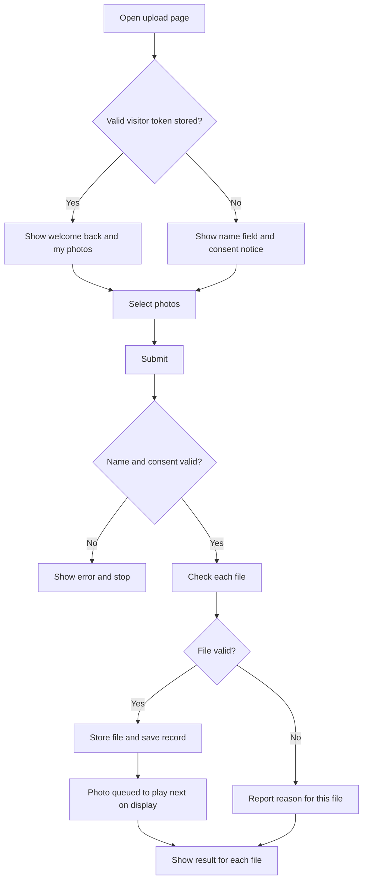

# PRD.md: Product Requirements Document

# Visitor Photo Slideshow (MomentVault: Your Digital Time Capsule)

| Item | Detail |
|---|---|
| Product | MomentVault, implementing Assignment 1: Visitor Photo Slideshow |
| Document version | 1.0 (draft for approval) |
| Date | 13 November 2026 |
| Based on | Original assignment and PROJECT_BRIEF.md v1.0 |
| Audience | The developer (implementation and demo), assessors (review), AI coding assistants (as a reference) |
| Build budget | About 20 focused hours over 5 days |

---

## How to Read This Document

**Source labels.** Every requirement says where it comes from.

| Label | Meaning |
|---|---|
| **A** | **Original assignment requirement.** Stated in the assignment text. |
| **D** | **Required design decision.** The assignment says the design must address this topic, but does not say how. The solution here is a choice that must be recorded in `ASSUMPTIONS.md`. |
| **R** | **Recommended enhancement.** Not in the assignment. Added because it protects visitors, improves quality or supports testing. It can be dropped without breaking the assignment. |

**Priority labels** (MoSCoW method).

| Priority | Meaning |
|---|---|
| **Must Have** | Needed for the assignment to be considered complete. The MVP fails without it. |
| **Should Have** | Strongly recommended. Build after all Must Have items if time allows. |
| **Could Have** | Nice to have. Build only after everything else is done and tested. |

---

# 1. Product Overview

## 1.1 Purpose

MomentVault lets visitors at a shared place (an event, office, lab or exhibition) contribute photos to a live slideshow on a TV or computer display. Visitors give their name and photos from their own device. The photos then play on the shared screen. A returning visitor's earlier photos play again.

## 1.2 Product Goals

| # | Goal | Source |
|---|---|---|
| G1 | A visitor can submit a name and photos and see them play on the display straight away | A |
| G2 | A returning visitor is recognised and their previous photos also play | A |
| G3 | Public display of photos of people is handled with clear consent | D |
| G4 | Uploads are validated, size-limited and safe when many people upload at once | D |
| G5 | Visitors keep control of their photos (withdraw consent, delete) | R |

## 1.3 System Components (conceptual)

| Component | Description |
|---|---|
| **Upload page** | A web page opened by a visitor on a phone or computer |
| **Display page** | A web page opened full screen on a TV or computer, with no login |
| **Backend service** | Receives uploads, validates and stores photos, identifies visitors and supplies the display with photos |
| **Database** | Stores visitors, consent records and photo information |
| **Photo storage** | A folder on the server that holds the image files |

The detailed architecture is defined later in `ARCHITECTURE.md`. This PRD defines *what* the product must do, not *how* it is built.

## 1.4 Document Conflicts and Provisional Decisions

Items found while preparing this PRD, as required by the engineering rules. Each needs your confirmation.

| # | Finding | How this PRD handles it |
|---|---|---|
| C1 | PROJECT_BRIEF.md ended with four open questions (slide duration, retention, deletion features, returning-visitor method). None has been answered yet. | The PRD uses the provisional defaults in Section 1.5 and the recommended approach from the brief. If any answer differs, update this PRD before coding. |
| C2 | The brief listed visitor self-deletion as a **[PROPOSED]** enhancement. This task asks for consent withdrawal and photo deletion to be specified. | Both are specified as **R (recommended)** and **Should Have**. They are not assignment requirements. They are strongly recommended because photos of people are displayed publicly. |
| C3 | The assignment says "photo plays in a slideshow for a specific duration" but does not say whether every photo loops forever or plays once. | Assumption AS-01 below. Must be recorded in `ASSUMPTIONS.md`. |
| C4 | The assignment does not say what the visitor name is used for beyond asking for it. | The name is used for the welcome message. Showing it on the display is only a Could Have, and if built the consent notice must say so. |

## 1.5 Configurable Parameters and Provisional Defaults

These values appear throughout the requirements. The developer must make them configurable in one place (for example, a settings file or environment variables), not scattered in the code. They are defaults, not secrets.

| ID | Parameter | Default | Source |
|---|---|---|---|
| P-01 | Slide duration (seconds each photo is shown) | 10 | D (assignment says "a specific duration") |
| P-02 | Maximum size of one photo file | 5 MB | D |
| P-03 | Maximum number of photos per submission | 5 | D |
| P-04 | Allowed image types | JPEG and PNG | D |
| P-05 | Maximum image size in pixels | 25 megapixels | D |
| P-06 | Visitor name length | 1 to 50 characters after trimming spaces | D |
| P-07 | Maximum active photos per visitor | 20 | R |
| P-08 | Maximum time for a new, deleted or withdrawn photo to be reflected on the display | 10 seconds | A/R |
| P-09 | Consent notice version | `v1` | D |

## 1.6 Assumptions (to record in ASSUMPTIONS.md)

| ID | Assumption | Reason |
|---|---|---|
| AS-01 | The display plays a continuous loop of all active photos from all visitors. | The assignment does not say what the display does when there is no new upload. A loop keeps the screen useful. |
| AS-02 | A new upload gets priority and plays next, followed by the visitor's previous photos, and then joins the normal loop. | Satisfies "as soon as an upload completes" and "also plays their previous photos". |
| AS-03 | A returning visitor is identified by a random token stored in the visitor's browser, never by name. | Names are not unique. This is the simplest reliable method without accounts. |
| AS-04 | A visitor who changes device or clears browser data is treated as new. | A direct consequence of AS-03. Documented as a known limitation. |
| AS-05 | The display page is public by design. Anyone who has its address can view it. | It must run on a TV with no login. |
| AS-06 | Photos are kept until the visitor deletes them or withdraws consent. There is no automatic expiry. | Simplest policy for an MVP. Documented in the consent notice. |
| AS-07 | There is no age verification. The consent notice states that the visitor must be an adult or have a guardian's permission. | Out of scope for an MVP. Documented as a limitation. |
| AS-08 | The app is used on a small scale (a single event or venue, tens of simultaneous visitors at most). | Matches the 20-hour, SQLite-based design. |

---

# 2. User Roles and Permissions

## 2.1 Roles

| Role | Description | Source |
|---|---|---|
| **New visitor** | A person whose browser holds no valid visitor token. | A |
| **Returning visitor** | A person whose browser holds a valid visitor token. | A |
| **Display screen** | The TV or computer that plays the slideshow. It is not a person and does not log in. | A |
| **Operator** | The person who runs the screen and may remove an inappropriate photo. | R (Could Have) |

## 2.2 Permissions Matrix

Legend: Yes = allowed, No = not allowed, Own = only for photos the visitor uploaded.

| Action | New visitor | Returning visitor | Display screen | Operator |
|---|---|---|---|---|
| Open the upload page | Yes | Yes | No | Yes |
| Read and accept the consent notice | Yes | Yes (reminder only) | No | No |
| Register by submitting name, consent and photos | Yes | Not needed | No | No |
| Upload photos | Yes | Yes | No | No |
| View their own photos | No | Own | No | No |
| Delete a photo | No | Own | No | Any (Could Have) |
| Withdraw consent | No | Yes | No | No |
| View the slideshow | Yes | Yes | Yes | Yes |
| View other visitors' private details | No | No | No | No |

**Rule.** No role can read another visitor's token. No role can change another visitor's name.

---

# 3. Functional Requirements

Each requirement has an ID, description, priority, source and testable acceptance criteria (AC). The AC use the form *Given (starting state), When (action), Then (expected result)*.

## 3.1 New Visitor Registration (FR-REG)

**FR-REG-01: Ask for name and photos.** *Must Have, Source A*
The upload page asks every visitor for their name and one or more photos. Both are required for a submission.
- **AC1.** Given the upload page is open, then a name field and a photo selector are visible.
- **AC2.** Given the name field is empty, when the visitor submits, then no upload starts and a message says the name is required.
- **AC3.** Given no photo is selected, when the visitor submits, then no upload starts and a message says a photo is required.

**FR-REG-02: Validate the name.** *Must Have, Source D*
The name is trimmed of leading and trailing spaces and must be 1 to 50 characters (P-06). Control characters are rejected. Characters such as `<`, `>` and `&` are accepted but are always shown as plain text and never interpreted as page markup.
- **AC1.** Given the name is 51 characters long, when submitted, then it is rejected with a message about the length limit.
- **AC2.** Given the name is `   Asha   `, when submitted, then it is stored as `Asha`.
- **AC3.** Given the name is ``, when it is shown anywhere in the app, then it appears as literal text and no script runs.

**FR-REG-03: Create a visitor on first valid submission.** *Must Have, Source A*
When a submission arrives with no valid visitor token, passes name and consent validation, the system creates a new visitor with a unique visitor ID and an unguessable visitor token, and returns the token to the browser. Registration does not depend on every photo being valid.
- **AC1.** Given a browser with no token, when a valid name, consent and photo are submitted, then exactly one new visitor exists and the browser stores a token.
- **AC2.** Given the same submission but every photo is invalid, then the visitor is still created and the response lists the file errors.
- **AC3.** Given the response is inspected, then the token is not part of any web address and is not shown on screen.

**FR-REG-04: Names are not unique.** *Must Have, Source D*
Two visitors may enter the same name. They remain separate visitors with separate photos.
- **AC1.** Given visitor A named "Sam" exists, when a different browser registers as "Sam", then two separate visitors exist.
- **AC2.** Given both "Sam" visitors have photos, then each sees only their own photos.

## 3.2 Returning Visitor Identification (FR-ID)

**FR-ID-01: Store a visitor token in the browser.** *Must Have, Source D*
After registration the browser stores the visitor token and sends it with later requests, so the visitor can be recognised without a login.
- **AC1.** Given a visitor has registered, when the browser is closed and reopened, then the token is still present.
- **AC2.** Given the token, when it is examined, then it is random and unguessable (at least 128 bits of randomness, for example a UUID4 or a value from Python's `secrets` module).

**FR-ID-02: Recognise a returning visitor.** *Must Have, Source A*
When the upload page loads and the browser holds a valid token, the system recognises the visitor, greets them by the name on record and does not ask for the name or consent again.
- **AC1.** Given a registered visitor reopens the upload page, then the page shows "Welcome back, <name>" and no name field.
- **AC2.** Given the visitor uploads a photo, then it is attached to the same visitor record and no new visitor is created.

**FR-ID-03: Reject an unknown or invalid token.** *Must Have, Source D*
If the token is missing, malformed or not found, the visitor is treated as new. The invalid token is discarded and no error page is shown.
- **AC1.** Given the stored token is edited to a random value, when the upload page loads, then the new-visitor form is shown.
- **AC2.** Given an invalid token is sent to an API route that needs one, then the response is a clear "not recognised" error and no data is changed.

**FR-ID-03a: Never identify by name alone.** *Must Have, Source D*
The visitor name must never be used to look up, merge or recognise a visitor.
- **AC1.** Given visitor "Priya" exists, when a different browser without a token submits the name "Priya", then a new visitor is created and none of the first visitor's photos are accessible.

**FR-ID-04: Switch visitor ("Not you?").** *Should Have, Source R*
A returning visitor can choose "Not you?" to clear the stored token on this browser and start as a new visitor. This is for shared devices. It does not delete anything from the server.
- **AC1.** Given a recognised visitor taps "Not you?", then the token is removed from the browser and the new-visitor form appears.
- **AC2.** Given the same visitor's photos are on the display, then they remain there.

**FR-ID-05: Protect the token.** *Must Have, Source D*
The token is not written to application logs, not placed in web addresses and not shown in error messages.
- **AC1.** Given an upload is made, then the server logs contain no token value.
- **AC2.** Given an error occurs, then the error message shown to the visitor contains no token value.

## 3.3 Public Display Consent (FR-CON)

**FR-CON-01: Show a consent notice before first upload.** *Must Have, Source D*
A new visitor sees a plain-language consent notice before they can submit. The notice must state at least that:
1. photos will be shown publicly on a screen,
2. the visitor confirms the photos are theirs or they have permission to share them, and anyone clearly visible has agreed,
3. photos stay until the visitor deletes them or withdraws consent (AS-06),
4. the visitor can delete photos or withdraw consent at any time,
5. the visitor is an adult or has a guardian's permission (AS-07),
6. if the display shows names (FR-DSP-07 built), names are shown too.

- **AC1.** Given a new visitor opens the upload page, then the notice is visible without extra clicks.
- **AC2.** Given the notice text, then it contains all the points that apply from items 1 to 6 above.

**FR-CON-02: Consent is explicit and required.** *Must Have, Source D*
Consent is given by ticking a checkbox that is **unticked by default**. A submission without consent is refused by the **server**, not only by the browser.
- **AC1.** Given the page loads, then the consent checkbox is unticked.
- **AC2.** Given the checkbox is unticked, when the visitor submits, then the upload does not start and a message asks them to agree.
- **AC3.** Given a request is sent directly to the server without consent, then the server rejects it and stores nothing.

**FR-CON-03: Record consent.** *Must Have, Source D*
When a visitor consents, the system records the visitor, the time and the notice version (P-09).
- **AC1.** Given a new visitor consents and registers, then the database holds a consent record with visitor ID, timestamp and notice version.

**FR-CON-04: Remind returning visitors.** *Should Have, Source R*
A returning visitor does not tick the box again. The page shows a short reminder that photos are displayed publicly and a link to withdraw consent.
- **AC1.** Given a returning visitor opens the page, then a reminder and a withdraw link are visible and no consent checkbox is required.

## 3.4 Photo Upload (FR-UPL)

**FR-UPL-01: Select multiple photos.** *Must Have, Source A*
The visitor can select up to P-03 photos in one submission.
- **AC1.** Given the visitor selects 5 valid photos, then all 5 are accepted for upload.
- **AC2.** Given the visitor selects 6 photos, then the page tells them the maximum before upload starts and the server also rejects the extra file(s).

**FR-UPL-02: Define when an upload is complete.** *Must Have, Source A*
An upload is complete for a photo only when the file has been fully received, validated, stored and its record saved. Only then is the photo eligible for the slideshow.
- **AC1.** Given an upload is interrupted halfway, then the photo is not eligible for the slideshow and no partial file remains stored.
- **AC2.** Given an upload completes successfully, then the visitor sees a success message for that photo.

**FR-UPL-03: Process files independently.** *Must Have, Source D*
Each photo in a submission is checked and stored independently. One invalid photo does not stop the valid ones.
- **AC1.** Given a submission of 2 valid photos and 1 text file renamed `.jpg`, then 2 are stored and the response shows an error for the third.

**FR-UPL-04: Per-photo feedback.** *Must Have, Source D*
After submission the visitor sees, for each photo, whether it was accepted or why it was rejected.
- **AC1.** Given a mixed submission, then each file name is listed with a success or a specific reason.

**FR-UPL-05: Upload progress.** *Should Have, Source R*
The page shows that an upload is in progress and disables repeat submission until it finishes.
- **AC1.** Given an upload is running, then a progress indicator is visible and the submit button is disabled.
- **AC2.** Given the visitor taps submit twice quickly, then the photos are stored only once.

## 3.5 File Validation and Upload Limits (FR-VAL)

All checks in this section are performed on the **server**. Browser checks are only a convenience (FR-VAL-07).

**FR-VAL-01: Allowed types only.** *Must Have, Source D*
Only JPEG and PNG (P-04) are accepted. The file extension and declared content type must both be consistent with an allowed type.
- **AC1.** Given a `.gif`, `.pdf`, `.exe` or `.svg` file, then it is rejected with a message about allowed types.
- **AC2.** Given a valid `.jpg` and a valid `.png`, then both are accepted.

**FR-VAL-02: Verify the real content.** *Must Have, Source D*
The server must open and verify the file content as an image (using Pillow). The real detected format must be JPEG or PNG, regardless of extension. Empty and corrupted files are rejected.
- **AC1.** Given a text file renamed `photo.jpg`, then it is rejected as "not a valid image".
- **AC2.** Given a 0-byte file, then it is rejected.
- **AC3.** Given a truncated or corrupted image, then it is rejected and nothing is stored.
- **AC4.** Given a PNG renamed `.jpg`, then the outcome follows the rule documented in `ASSUMPTIONS.md` (either rejected or accepted by its real format), and the test confirms that rule.

**FR-VAL-03: File size limit.** *Must Have, Source D*
Each photo may not exceed P-02. The server enforces this while receiving the data, so an oversized file cannot fill memory or disk.
- **AC1.** Given a file of exactly 5 MB, then it is accepted.
- **AC2.** Given a file slightly over 5 MB, then it is rejected with a "file too large" message that states the limit.
- **AC3.** Given a rejected oversized file, then no part of it remains in storage.

**FR-VAL-04: File count limit.** *Must Have, Source D*
No more than P-03 photos in one submission.
- **AC1.** Given 6 files in one request sent directly to the server, then the server rejects the excess or the whole request with a clear message, and never stores more than P-03.

**FR-VAL-05: Image dimension limit.** *Must Have, Source D*
Images larger than P-05 pixels are rejected before being fully decoded, to avoid crashes from "decompression bomb" files (small files that expand into huge images).
- **AC1.** Given an image over the pixel limit, then it is rejected with a message and the server stays responsive.

**FR-VAL-06: Per-visitor photo limit.** *Should Have, Source R*
A visitor may hold at most P-07 active photos.
- **AC1.** Given a visitor already has 20 active photos, when they upload another, then it is rejected with a message telling them to delete one first.

**FR-VAL-07: Early checks in the browser.** *Should Have, Source R*
The page checks type, size and count before upload and warns immediately. This never replaces the server checks.
- **AC1.** Given the visitor picks a 6 MB file, then a warning appears before any data is sent.

**FR-VAL-08: Basic rate limiting.** *Could Have, Source R*
The server limits how many submissions one client address can send per minute.
- **AC1.** Given a client exceeds the limit, then further requests receive a "too many requests, try again later" response.

## 3.6 Photo Storage (FR-STO)

**FR-STO-01: Safe storage names.** *Must Have, Source D*
Photos are stored in a dedicated server folder under server-generated unique names. The visitor's original file name is never used in a file path.
- **AC1.** Given a file named `../../etc/passwd.jpg` is uploaded, then it is either rejected or stored under a generated name inside the photo folder only.
- **AC2.** Given two files named `photo.jpg` are uploaded, then two distinct stored files exist.

**FR-STO-02: Store photo information.** *Must Have, Source A*
For each photo the database stores a unique photo ID, owning visitor ID, stored file name, upload time and status (active or removed).
- **AC1.** Given an accepted upload, then one database record exists linking the photo to the visitor.

**FR-STO-03: Strip hidden photo data and re-encode.** *Should Have, Source R*
The stored copy is re-saved with Pillow so that hidden metadata (such as GPS location and camera details, called EXIF data) is removed.
- **AC1.** Given a test photo containing GPS EXIF data, when it is stored and then inspected, then the stored file contains no GPS data.

**FR-STO-04: Store and record together.** *Must Have, Source D*
A photo is either fully stored (file and database record) or not at all. A failure partway leaves no orphan file and no record that points to a missing file.
- **AC1.** Given a failure is forced after the file is written but before the record is saved, then the file is removed.
- **AC2.** Given a failure is forced during the database write, then no record exists and no file remains.

**FR-STO-05: Serve photos safely.** *Must Have, Source D*
Photos are delivered to the browser only through the application using their photo ID, with the correct image content type. The photo folder is not browsable and nothing in it can be executed.
- **AC1.** Given the photo folder address is requested, then no file listing is returned.
- **AC2.** Given a removed photo's ID is requested, then a "not found" response is returned.

## 3.7 Slideshow Display (FR-DSP)

**FR-DSP-01: Separate display page.** *Must Have, Source A*
A dedicated display page, opened at its own address, shows the slideshow on a TV or computer. It needs no login and no interaction. It works full screen.
- **AC1.** Given the display address is opened on a second device, then the slideshow starts without any input.
- **AC2.** Given the page is shown full screen, then no menus, forms or controls cover the photo.

**FR-DSP-02: Show each photo for a set duration.** *Must Have, Source A*
Each photo is shown for P-01 seconds (default 10).
- **AC1.** Given the default settings, then each photo stays visible for 10 seconds (allowing a tolerance of 1 second).
- **AC2.** Given P-01 is changed to 5 in settings, then each photo stays for 5 seconds.

**FR-DSP-03: Show the whole photo.** *Must Have, Source D*
Photos are scaled to fit the screen without being cropped or stretched, in both portrait and landscape.
- **AC1.** Given a portrait and a landscape photo on a 16:9 screen, then each is fully visible with its correct proportions.

**FR-DSP-04: Continuous loop.** *Must Have, Source D (AS-01)*
After the last photo, the slideshow returns to the first and continues.
- **AC1.** Given 3 active photos, then the display cycles 1, 2, 3, 1, 2, 3 and so on.

**FR-DSP-05: Empty state.** *Must Have, Source D*
If there are no active photos, the display shows a friendly message inviting visitors to upload, instead of a blank or error screen.
- **AC1.** Given no active photos, then the message is shown. Given a first photo is then uploaded, then the message is replaced by the photo.

**FR-DSP-06: Skip photos that fail to load.** *Must Have, Source D*
If one photo cannot be loaded, the display skips it and continues.
- **AC1.** Given one photo file is missing from storage, then the display continues to the next photo within 2 seconds.

**FR-DSP-07: Show only active photos.** *Must Have, Source D*
Photos that were deleted or whose consent was withdrawn are never shown.
- **AC1.** Given a photo is removed, then it does not appear in subsequent playback.

**FR-DSP-08: Recover from connection problems.** *Should Have, Source R*
If the display cannot reach the server, it keeps playing the photos it already has, retries in the background and returns to normal on its own.
- **AC1.** Given the server is stopped for 30 seconds and restarted, then the display keeps playing throughout and shows new photos after restart without being refreshed by hand.

**FR-DSP-09: Transition effect.** *Could Have, Source R*
A simple fade between photos.
- **AC1.** Given a photo change, then the transition lasts no more than 1 second and does not delay the photo timing.

**FR-DSP-10: Name caption.** *Could Have, Source R*
The visitor's name is shown on the photo. If built, FR-CON-01 item 6 becomes mandatory.
- **AC1.** Given the caption is enabled, then the name is shown as plain text (see FR-REG-02) and the consent notice mentions it.

## 3.8 Automatic Slideshow Updates (FR-AUT)

**FR-AUT-01: Updates without refreshing.** *Must Have, Source A*
New photos appear on the display without anyone refreshing the page, within P-08 (10 seconds) of the upload completing.
- **AC1.** Given the display is running, when a photo upload completes, then the photo is in the display's playback within 10 seconds, with no manual refresh.

**FR-AUT-02: New photos play next.** *Must Have, Source A (AS-02)*
A newly uploaded photo plays next, after the photo currently on screen finishes, rather than waiting for the whole loop to finish.
- **AC1.** Given 50 photos in the loop and photo 10 on screen, when a new photo upload completes, then the new photo is the next one shown after photo 10.

**FR-AUT-03: Do not interrupt the current photo.** *Must Have, Source D*
An update never cuts short the photo currently on screen and never restarts the loop.
- **AC1.** Given a photo has been on screen for 4 seconds, when another visitor uploads, then the current photo still stays for its full 10 seconds.

**FR-AUT-04: Removal updates.** *Should Have, Source R*
A deleted or withdrawn photo disappears from playback within P-08 without a page refresh.
- **AC1.** Given a photo is deleted, then it is not shown again after at most 10 seconds plus the time left on its current showing.

## 3.9 Previous Photo Retrieval (FR-PRV)

**FR-PRV-01: Play a returning visitor's previous photos.** *Must Have, Source A*
When a returning visitor completes an upload, the slideshow also plays that visitor's earlier active photos.
- **AC1.** Given visitor V has 3 earlier photos and uploads 1 new photo, then the display plays the new photo and the 3 earlier photos.
- **AC2.** Given a brand-new visitor uploads, then only the new photo or photos are in the special sequence.

**FR-PRV-02: Playback order.** *Must Have, Source D (AS-02)*
The sequence is: the new photo or photos first, then the earlier photos starting with the most recent. The sequence then joins the normal loop.
- **AC1.** Given earlier photos P1 (oldest), P2, P3 (newest) and new photo N, then the order is N, P3, P2, P1.

**FR-PRV-03: No duplicates in a sequence.** *Must Have, Source D*
No photo appears twice in the same returning-visitor sequence.
- **AC1.** Given the sequence above, then each of N, P1, P2, P3 appears exactly once.

**FR-PRV-04: Only the right photos.** *Must Have, Source D*
Previous photos belong only to that visitor, and never include another visitor's photo or any deleted or withdrawn photo.
- **AC1.** Given two visitors both named "Sam", then each one's sequence contains only their own photos.
- **AC2.** Given a photo was deleted earlier, then it is not in the sequence.

**FR-PRV-05: "My photos" view.** *Should Have, Source R*
A recognised visitor can see thumbnails of their own active photos on the upload page. This is where deletion is done.
- **AC1.** Given a returning visitor with 3 photos, then 3 thumbnails are shown and no other visitor's photos appear.

## 3.10 Consent Withdrawal (FR-WDR)

Consent withdrawal is a **recommended enhancement (R)**. It supports the privacy design required by the assignment.

**FR-WDR-01: Withdraw consent at any time.** *Should Have, Source R*
A recognised visitor can withdraw consent from the upload page at any moment.
- **AC1.** Given a returning visitor, then a "Withdraw consent and remove all my photos" control is visible.

**FR-WDR-02: Confirm before withdrawing.** *Should Have, Source R*
The visitor must confirm the action, because it removes all their photos.
- **AC1.** Given the visitor selects withdraw, then a confirmation step explains what will happen. Cancelling changes nothing.

**FR-WDR-03: Effects of withdrawal.** *Should Have, Source R*
When confirmed: (a) all of the visitor's photos are removed from the display, (b) their stored files are deleted from the server, (c) the consent record is marked withdrawn with a timestamp, and (d) the visitor token is cleared from the browser.
- **AC1.** Given a visitor with 4 photos withdraws, then within 10 seconds none of their photos plays on the display.
- **AC2.** Given the same moment, then their 4 files no longer exist in storage.
- **AC3.** Given the database, then the consent record shows "withdrawn" with a time.
- **AC4.** Given another visitor's photos, then they are unaffected.

**FR-WDR-04: Uploading after withdrawal.** *Should Have, Source R*
After withdrawal, new uploads require fresh consent. The visitor is treated as new.
- **AC1.** Given a visitor has withdrawn, when they open the upload page, then the new-visitor form and consent notice are shown.
- **AC2.** Given an old token is sent after withdrawal, then it is treated as invalid (FR-ID-03).

## 3.11 Photo Deletion (FR-DEL)

Photo deletion is a **recommended enhancement (R)**.

**FR-DEL-01: Delete a single photo.** *Should Have, Source R*
A recognised visitor can delete any one of their own photos from "My photos".
- **AC1.** Given a visitor with 3 photos deletes one, then 2 remain in "My photos".

**FR-DEL-02: Only the owner can delete.** *Should Have, Source R*
A photo can be deleted only by a request carrying the token of the visitor who owns it.
- **AC1.** Given visitor B sends a delete request for visitor A's photo ID, then it is refused and the photo remains.
- **AC2.** Given a request with no token, then it is refused.

**FR-DEL-03: Full removal.** *Should Have, Source R*
Deleting removes the stored file and marks or removes the database record, and the photo leaves the display within P-08.
- **AC1.** Given a photo is deleted, then its file is gone from storage, and its ID returns "not found" (FR-STO-05).
- **AC2.** Given the display is running, then the photo stops appearing within 10 seconds plus its current showing.

**FR-DEL-04: Confirm before deleting.** *Should Have, Source R*
- **AC1.** Given the visitor selects delete, then they must confirm. Cancelling changes nothing.

**FR-DEL-05: Handle repeat deletion.** *Should Have, Source R*
- **AC1.** Given a photo is already deleted, when delete is requested again, then a friendly "already removed" message is returned and no error occurs.

## 3.12 Multiple Simultaneous Uploads (FR-CNC)

**FR-CNC-01: Independent concurrent uploads.** *Must Have, Source D*
Several visitors can upload at the same moment. Every valid photo is stored, and none is lost, duplicated or mixed up between visitors.
- **AC1.** Given 10 different visitors upload one valid photo each at the same time (automated test), then exactly 10 photo records and 10 files exist, each owned by the correct visitor.

**FR-CNC-02: No overwriting.** *Must Have, Source D*
- **AC1.** Given 10 simultaneous uploads all named `photo.jpg`, then 10 distinct stored files exist and none has been overwritten.

**FR-CNC-03: Database busy handling.** *Must Have, Source D*
If the database is briefly busy, the system waits and retries. If it still cannot complete, the visitor gets a friendly "please try again" message and no partial data remains.
- **AC1.** Given heavy simultaneous uploads, then no visitor sees a raw database error and no half-saved photo exists.

**FR-CNC-04: Display stays responsive.** *Must Have, Source D*
Uploads in progress do not freeze or interrupt the slideshow.
- **AC1.** Given 10 uploads are running, then the display keeps changing photos on time and its data requests still succeed.

**FR-CNC-05: Duplicate submission protection.** *Should Have, Source R*
Accidentally sending the same submission twice does not create duplicate photos (see FR-UPL-05 AC2).
- **AC1.** Given a double-tap on submit, then no duplicate photo record is created.

## 3.13 Operator Removal (FR-OPR)

An **optional recommended enhancement (R)**. Only attempt after everything else is done.

**FR-OPR-01: Operator removes any photo.** *Could Have, Source R*
An operator can remove any photo from the display, using a secret key.
- **AC1.** Given a valid operator key, when a photo is removed, then it leaves the display and storage as in FR-DEL-03.
- **AC2.** Given no key or a wrong key, then the request is refused.

**FR-OPR-02: Operator key is a secret.** *Could Have, Source R*
The key comes from an environment setting. `.env.example` holds only a placeholder, and the real key is never committed to Git.
- **AC1.** Given the repository, then a search finds no real operator key in any committed file.

---

# 4. Non-Functional Requirements

| ID | Category | Requirement | How to test | Priority |
|---|---|---|---|---|
| NFR-SEC-01 | Security | All uploads are treated as untrusted input and pass the checks in FR-VAL before storage. | Run the file-validation tests with the sample files in Appendix B. | Must |
| NFR-SEC-02 | Security | No secrets, keys or passwords are committed. `.env.example` has placeholder values only. | Search the repository and its Git history for secrets before submission. | Must |
| NFR-SEC-03 | Security | Visitor-supplied text (names) is always displayed as plain text. | Test with the script-tag name in FR-REG-02. | Must |
| NFR-SEC-04 | Security | Errors shown to visitors do not reveal file paths, tokens, stack traces or database details. | Force errors and read the messages. | Must |
| NFR-SEC-05 | Security | The server accepts cross-origin requests only from the configured frontend address. | Request from a different origin and confirm it is blocked. | Should |
| NFR-PRV-01 | Privacy | Hidden image data such as GPS location is not kept in stored photos. | See FR-STO-03. | Should |
| NFR-PRV-02 | Privacy | The app collects only name, photos and what is needed for consent records. No face analysis, tracking or advertising. | Review the data model. | Must |
| NFR-PRV-03 | Privacy | Deployed versions use HTTPS. | Check the deployed link, if any. | Should |
| NFR-PERF-01 | Performance | A 5 MB photo is validated and stored in 5 seconds or less on a normal development machine. | Time the upload test. | Should |
| NFR-PERF-02 | Performance | Non-upload requests respond in 1 second or less with up to 200 photos stored. | Time the list request. | Should |
| NFR-PERF-03 | Performance | The display starts showing the first photo in 3 seconds or less on a local network. | Time page load. | Should |
| NFR-REL-01 | Reliability | The system handles at least 10 simultaneous uploads without loss. | See FR-CNC-01. | Must |
| NFR-REL-02 | Reliability | A restart of the server does not lose saved photos or records. | Restart and check the data. | Must |
| NFR-USA-01 | Usability | Upload page works on a phone screen (width about 360 px) without sideways scrolling. | Test in browser phone mode. | Must |
| NFR-USA-02 | Usability | Display text and messages are readable from a distance on a TV. | Check at 1920 x 1080. | Should |
| NFR-USA-03 | Usability | All error messages are in plain language and say what to do next. | Review the messages in Section 11. | Must |
| NFR-COMP-01 | Compatibility | Upload page works on current Chrome, Edge, Firefox and Safari (including phone browsers). | Manual check. | Should |
| NFR-COMP-02 | Compatibility | Display page works on current Chrome or Edge at 1920 x 1080 (a TV browser if one is available). | Manual check. | Must |
| NFR-MNT-01 | Maintainability | Settings P-01 to P-09 are defined in one place, not repeated in code. | Change P-01 and observe FR-DSP-02. | Should |
| NFR-MNT-02 | Maintainability | Code follows consistent naming and is organised as the approved architecture says. | Review. | Must |
| NFR-TST-01 | Testability | Each Must Have requirement has at least one automated test, or a manual test with recorded results. | Check the test list against Section 10. | Must |
| NFR-DOC-01 | Documentation | README.md, ASSUMPTIONS.md, AI_LOG.md, ARCHITECTURE.md, tests and `.env.example` exist as the assignment requires. | Checklist at submission. | Must |
| NFR-DOC-02 | Process | Commit history shows regular, meaningful commits. | Review `git log`. | Must |

---

# 5. Detailed Feature Specifications

## 5.1 Upload Page

**Screen states**

| State | When | What the visitor sees |
|---|---|---|
| New visitor | No valid token | Name field, consent notice, consent checkbox, photo selector, submit button |
| Returning visitor | Valid token | "Welcome back, <name>", consent reminder with withdraw link, photo selector, submit button, "Not you?" link (Should), "My photos" (Should) |
| Uploading | Submit pressed | Progress indicator, disabled submit button |
| Result | Server responded | List of files with success or reason for each, and an option to upload more |
| Withdrawn | After withdrawal | Confirmation that photos were removed, then the new-visitor state |

**Fields**

| Field | Rules |
|---|---|
| Name | Required for new visitors. Trimmed. 1 to 50 characters. Shown as plain text. |
| Consent checkbox | Required for new visitors. Unticked by default. |
| Photos | 1 to 5 files. JPEG or PNG. Up to 5 MB each. |

**Behaviour notes**
- A returning visitor's name is the one on record. Changing the name is not required in the MVP.
- If the browser is not available to store the token (for example, strict privacy mode), the visitor still uploads but is treated as new each time. The page should warn once that returning-visitor features may not work.

## 5.2 Display Page

| Item | Specification |
|---|---|
| Address | A separate page, for example `/display` |
| Content | One photo at a time, centred, fully visible, on a plain dark background |
| Timing | P-01 seconds per photo |
| Order | The loop is in upload order, oldest first. Priority sequences (FR-AUT-02, FR-PRV-02) play first. |
| Empty state | Friendly message inviting visitors to upload |
| Updates | The page asks the server for changes regularly and updates by itself (FR-AUT-01) |
| Errors | Skips unloadable photos, keeps playing when the server is unreachable (FR-DSP-06, FR-DSP-08) |
| Controls | None for visitors. The page is not interactive. |

## 5.3 Photo Lifecycle

| Stage | Description |
|---|---|
| Received | File data arrives at the server. Not yet visible to anyone. |
| Validated | Passes type, size, content and pixel checks. |
| Stored | File saved under a generated name and record saved. Now **active**. |
| Playing | Eligible for the display (priority sequence first, then the loop). |
| Removed | Deleted by the visitor, withdrawn by consent withdrawal or removed by an operator. File deleted. Never shown again. |

A photo that fails at any stage before "Stored" never becomes active and leaves no file behind.

## 5.4 Returning-Visitor Sequence

When a returning visitor completes an upload, the display builds a priority sequence once:
1. the new photo or photos, in the order they completed,
2. the visitor's earlier active photos, most recent first.

After the priority sequence has played, those photos continue in the normal loop. If the same visitor uploads again while a sequence is playing, the new sequence is queued after the current one.

---

# 6. User Stories

| ID | Story | Linked requirements | Priority |
|---|---|---|---|
| US-01 | As a **new visitor**, I want to enter my name and upload photos, so that I can take part in the slideshow. | FR-REG-01, FR-REG-03, FR-UPL-01 | Must |
| US-02 | As a **visitor**, I want to see my photo appear on the screen soon after I upload it, so that I can enjoy seeing it shared. | FR-UPL-02, FR-AUT-01, FR-AUT-02 | Must |
| US-03 | As a **returning visitor**, I want to be recognised without typing my details again, so that I can upload quickly. | FR-ID-01, FR-ID-02 | Must |
| US-04 | As a **returning visitor**, I want my earlier photos to play again with my new photo, so that my past contributions are not lost. | FR-PRV-01, FR-PRV-02 | Must |
| US-05 | As a **visitor**, I want to be told clearly that my photos will be shown publicly and to agree first, so that I stay in control of my image. | FR-CON-01, FR-CON-02 | Must |
| US-06 | As a **visitor**, I want a clear message when a photo is rejected, so that I know how to fix it. | FR-UPL-04, FR-VAL-01 to FR-VAL-05 | Must |
| US-07 | As a **visitor**, I want my upload to work even when many people are uploading, so that I am not blocked at a busy event. | FR-CNC-01 to FR-CNC-03 | Must |
| US-08 | As a **person at the venue**, I want the slideshow to run on its own on the TV, so that nobody needs to operate it. | FR-DSP-01, FR-DSP-04, FR-AUT-01 | Must |
| US-09 | As a **visitor with the same name as someone else**, I want to see only my own photos, so that my photos are not mixed up with theirs. | FR-REG-04, FR-ID-03a, FR-PRV-04 | Must |
| US-10 | As a **visitor**, I want to delete one of my photos, so that I can remove one I regret sharing. | FR-DEL-01 to FR-DEL-05 | Should |
| US-11 | As a **visitor**, I want to withdraw my consent and have all my photos removed, so that I can stop being shown publicly at any time. | FR-WDR-01 to FR-WDR-04 | Should |
| US-12 | As a **visitor on a shared device**, I want to switch to a different visitor identity, so that I do not use someone else's account by accident. | FR-ID-04 | Should |
| US-13 | As a **visitor**, I want to see my own photos in one place, so that I know what I have shared. | FR-PRV-05 | Should |
| US-14 | As an **operator**, I want to remove an inappropriate photo quickly, so that the screen stays suitable for everyone. | FR-OPR-01 | Could |
| US-15 | As a **viewer**, I want smooth transitions and names on photos, so that the slideshow feels polished. | FR-DSP-09, FR-DSP-10 | Could |

---

# 7. Feature-Level Acceptance Criteria

A feature is **done** only when all its listed requirement criteria pass and the checks below are met. Use this as the sign-off checklist.

| Feature | Done when |
|---|---|
| **New visitor registration** | FR-REG-01 to FR-REG-04 pass. A first-time submission creates exactly one visitor and one consent record. |
| **Returning visitor identification** | FR-ID-01 to FR-ID-03a and FR-ID-05 pass. The browser keeps the visitor across restarts. Two different people with the same name stay separate. |
| **Public display consent** | FR-CON-01 to FR-CON-03 pass. Server refuses a no-consent request even when sent directly. |
| **Photo upload** | FR-UPL-01 to FR-UPL-04 pass. A mixed valid and invalid submission gives correct per-file results. |
| **File validation and limits** | FR-VAL-01 to FR-VAL-05 pass using every sample file in Appendix B. |
| **Photo storage** | FR-STO-01, FR-STO-02, FR-STO-04 and FR-STO-05 pass. No orphan files or records remain after forced failures. |
| **Slideshow display** | FR-DSP-01 to FR-DSP-07 pass on a second device or window. |
| **Automatic updates** | FR-AUT-01 to FR-AUT-03 pass. Timing is measured and recorded in the test results. |
| **Previous photo retrieval** | FR-PRV-01 to FR-PRV-04 pass. Order matches FR-PRV-02. |
| **Multiple simultaneous uploads** | FR-CNC-01 to FR-CNC-04 pass in an automated test with at least 10 parallel uploads. |
| **Consent withdrawal** *(Should)* | FR-WDR-01 to FR-WDR-04 pass. Files are confirmed gone from storage. |
| **Photo deletion** *(Should)* | FR-DEL-01 to FR-DEL-05 pass. A different visitor cannot delete the photo. |

**MVP release gate.** The MVP can be submitted when every Must Have requirement passes, all required documents exist and the demo can be run from the README instructions on a clean setup.

---

# 8. Business Rules

| ID | Rule |
|---|---|
| BR-01 | A visitor name is a label for display and greeting only. It is never used to identify, find or merge visitors. |
| BR-02 | A visitor is identified only by the unguessable visitor token held in their browser. |
| BR-03 | A visitor without a valid token is a new visitor, whatever name they type. |
| BR-04 | No photo may be accepted or stored without the visitor's recorded consent. |
| BR-05 | Consent is given once at registration and covers that visitor's later uploads until withdrawn. |
| BR-06 | Consent can be withdrawn at any time. Withdrawal removes all that visitor's photos and ends the visitor's identity. |
| BR-07 | Only the owner can delete a photo, except the operator if that feature exists. |
| BR-08 | Only JPEG and PNG photos up to the configured size, count and pixel limits are accepted. All limits are enforced by the server. |
| BR-09 | A photo is eligible for the slideshow only after upload is complete (received, validated, stored and recorded). |
| BR-10 | Removed photos are never shown again and their files are deleted. |
| BR-11 | A new photo plays next, followed by the owner's earlier photos (most recent first), then joins the loop. |
| BR-12 | One visitor's photos are never shown in another visitor's "previous photos" sequence. |
| BR-13 | Photos are kept until deleted or withdrawn. There is no automatic expiry in the MVP. |
| BR-14 | The consent notice text is versioned. The version accepted is stored with the consent record. |
| BR-15 | Secrets (such as an operator key) live in environment settings only and never in committed files. |

---

# 9. User Journeys and Workflows

## 9.1 Overall Upload Flow

## 9.2 Journey 1: New Visitor Shares Photos

1. The visitor opens the upload page and sees the new-visitor form.
2. They type their name.
3. They read the consent notice and tick the checkbox.
4. They select up to 5 photos and press submit.
5. The server checks name and consent, creates the visitor and returns a token. The browser stores it.
6. The server validates and stores each photo.
7. The visitor sees a success message for each accepted photo.
8. Within 10 seconds, the display plays the new photos next.

*Alternative paths:* missing name or consent (FR-REG-01, FR-CON-02), invalid file (Section 11).

## 9.3 Journey 2: Returning Visitor

1. The visitor opens the upload page on the same browser.
2. The page recognises the token and shows "Welcome back, <name>".
3. They select photos and press submit.
4. The server stores the new photos under the same visitor.
5. The display plays the new photos, then the visitor's earlier photos, then continues the loop.

*Alternative paths:* token lost, so the visitor is treated as new (AS-04). Shared device, so the visitor chooses "Not you?" (FR-ID-04).

## 9.4 Journey 3: Visitor Deletes One Photo (Should Have)

1. A recognised visitor opens "My photos".
2. They choose delete on a photo and confirm.
3. The server checks the token matches the photo's owner.
4. The photo file is deleted and the record is marked removed.
5. The display stops showing the photo within 10 seconds plus its current showing.

## 9.5 Journey 4: Visitor Withdraws Consent (Should Have)

1. A recognised visitor selects "Withdraw consent and remove all my photos".
2. They read the explanation and confirm.
3. The server removes all their photos, marks consent withdrawn and invalidates the token.
4. The browser clears its token.
5. The page shows a confirmation, then the new-visitor form.
6. The display stops showing every photo of that visitor.

## 9.6 Journey 5: Display Runs at the Venue

1. The operator opens the display address full screen on the TV.
2. If there are no photos, the invitation message is shown.
3. Photos play in a loop, each for the configured duration.
4. New uploads appear next without any action.
5. If the connection drops, the display keeps playing and reconnects by itself.

## 9.7 Journey 6: Busy Event

1. Ten visitors submit photos at the same time.
2. Each submission is handled independently (FR-CNC-01).
3. Every valid photo is stored under a unique name and owned by the right visitor.
4. The display keeps playing without freezing (FR-CNC-04) and adds each photo as it completes.

---

# 10. Feature Prioritization

## 10.1 Must Have (required for the MVP)

| Area | Requirement IDs |
|---|---|
| Registration | FR-REG-01, FR-REG-02, FR-REG-03, FR-REG-04 |
| Identification | FR-ID-01, FR-ID-02, FR-ID-03, FR-ID-03a, FR-ID-05 |
| Consent | FR-CON-01, FR-CON-02, FR-CON-03 |
| Upload | FR-UPL-01, FR-UPL-02, FR-UPL-03, FR-UPL-04 |
| Validation | FR-VAL-01, FR-VAL-02, FR-VAL-03, FR-VAL-04, FR-VAL-05 |
| Storage | FR-STO-01, FR-STO-02, FR-STO-04, FR-STO-05 |
| Display | FR-DSP-01 to FR-DSP-07 |
| Automatic updates | FR-AUT-01, FR-AUT-02, FR-AUT-03 |
| Previous photos | FR-PRV-01, FR-PRV-02, FR-PRV-03, FR-PRV-04 |
| Concurrency | FR-CNC-01, FR-CNC-02, FR-CNC-03, FR-CNC-04 |
| Non-functional | NFR-SEC-01 to NFR-SEC-04, NFR-PRV-02, NFR-REL-01, NFR-REL-02, NFR-USA-01, NFR-USA-03, NFR-COMP-02, NFR-MNT-02, NFR-TST-01, NFR-DOC-01, NFR-DOC-02 |

## 10.2 Should Have (recommended, build after all Must Have items)

| Area | Requirement IDs | Why it is recommended |
|---|---|---|
| Consent withdrawal | FR-WDR-01 to FR-WDR-04 | Photos of people are public, so visitors should be able to stop being shown. |
| Photo deletion | FR-DEL-01 to FR-DEL-05 | Gives visitors control and supports withdrawal. |
| Consent reminder | FR-CON-04 | Keeps returning visitors informed. |
| "Not you?" | FR-ID-04 | Prevents mix-ups on shared devices. |
| "My photos" | FR-PRV-05 | Needed for deletion. |
| Privacy of image data | FR-STO-03 | GPS data can reveal where a person lives. |
| Upload progress | FR-UPL-05, FR-CNC-05 | Avoids confusion and duplicate uploads. |
| Per-visitor limit | FR-VAL-06 | Stops one person filling the slideshow. |
| Early checks | FR-VAL-07 | Faster feedback. |
| Display recovery | FR-DSP-08 | Keeps the screen running unattended. |
| Removal updates | FR-AUT-04 | Makes deletion visible quickly. |
| Non-functional | NFR-SEC-05, NFR-PRV-01, NFR-PRV-03, NFR-PERF-01 to NFR-PERF-03, NFR-USA-02, NFR-COMP-01, NFR-MNT-01 | Quality and polish. |

**Suggested priority inside Should Have:** FR-DEL and FR-WDR first (they matter most for privacy), then FR-STO-03, FR-ID-04 and FR-PRV-05.

## 10.3 Could Have (only if time remains)

| Requirement IDs | Description |
|---|---|
| FR-DSP-09 | Fade transition |
| FR-DSP-10 | Name caption on display (requires the consent notice item 6) |
| FR-VAL-08 | Basic rate limiting |
| FR-OPR-01, FR-OPR-02 | Operator removal with secret key |

---

# 11. Error and Exception Scenarios

| ID | Scenario | Expected behaviour | Example visitor message |
|---|---|---|---|
| ERR-01 | Name empty or only spaces | Reject. Nothing stored. | "Please enter your name." |
| ERR-02 | Name longer than 50 characters | Reject. | "Names can be up to 50 characters." |
| ERR-03 | Consent not ticked | Reject at browser and server. | "Please agree to the display notice to continue." |
| ERR-04 | No photo selected | Reject. | "Please choose at least one photo." |
| ERR-05 | More than 5 photos | Reject extras before upload and at server. | "You can upload up to 5 photos at a time." |
| ERR-06 | File type not allowed (GIF, PDF, EXE, SVG) | Reject that file only. | "Only JPEG and PNG photos are allowed." |
| ERR-07 | File renamed but not a real image | Reject that file only. | "This file is not a valid photo." |
| ERR-08 | File too large | Reject that file. Remove any partial data. | "This photo is larger than 5 MB." |
| ERR-09 | Image dimensions too large | Reject that file. | "This photo is too large in pixels. Please resize it." |
| ERR-10 | Zero-byte or corrupted file | Reject that file. | "This file is empty or damaged." |
| ERR-11 | Visitor already has the maximum photos | Reject. | "You have reached your photo limit. Delete one to add more." |
| ERR-12 | Phone photo in an unsupported format (for example HEIC) | Reject with a helpful message. The recommended handling is documented in `ASSUMPTIONS.md`. | "This photo format is not supported. Please use JPEG or PNG." |
| ERR-13 | Upload interrupted (connection lost) | No partial file or record. Visitor can retry. | "Upload did not finish. Please try again." |
| ERR-14 | Server error while saving | No partial data. No technical details shown. | "Something went wrong. Please try again." |
| ERR-15 | Database busy | Wait and retry. If still failing, friendly message. | "The system is busy. Please try again in a moment." |
| ERR-16 | Invalid or unknown visitor token | Treat as a new visitor. | (New-visitor form shown) |
| ERR-17 | Delete request for someone else's photo | Refuse. Nothing changes. | "You can only delete your own photos." |
| ERR-18 | Delete request for a photo that is already gone | Friendly response. | "This photo has already been removed." |
| ERR-19 | Upload after withdrawal using an old token | Treat as a new visitor. | (New-visitor form shown) |
| ERR-20 | Too many requests (if rate limiting is built) | Reject temporarily. | "Too many uploads. Please wait a minute." |
| ERR-21 | Display cannot reach the server | Keep playing. Retry in the background. | (No message on the TV) |
| ERR-22 | One display photo file missing or unreadable | Skip it and continue. | (No message on the TV) |
| ERR-23 | Browser cannot store the token (private browsing) | Upload still works. The visitor is treated as new each visit. Warn once. | "Your browser is not saving your visit, so returning-visitor features may not work." |
| ERR-24 | Two tabs in the same new browser register at almost the same moment | May create two visitor records. **Known limitation**, accepted for the MVP and documented. | (None) |
| ERR-25 | Visitor uses a different device | Treated as new (AS-04). **Known limitation.** | (New-visitor form shown) |

---

# 12. Out-of-Scope Functionality

These items are **not** part of this product. They must not be built or promised.

| # | Out of scope | Reason |
|---|---|---|
| OOS-01 | Face recognition or any automatic identification of people | Not requested. Raises serious privacy concerns. |
| OOS-02 | Paid AI services or external AI APIs (for example, automatic content moderation) | Not requested. Adds cost and complexity. |
| OOS-03 | User accounts, passwords, email or phone verification | The assignment does not require them. |
| OOS-04 | Identifying visitors by name | Names are not unique (BR-01). |
| OOS-05 | Recognising the same visitor across different devices or after clearing browser data | Not possible with the chosen method. Documented limitation. |
| OOS-06 | Video, audio or animated image uploads | Photos only. |
| OOS-07 | Social features such as likes, comments, sharing or public profiles | Not requested. |
| OOS-08 | Administrator dashboards, analytics or reports | Not requested. |
| OOS-09 | Multiple events, multiple displays with different content, or multi-tenant support | Not requested. |
| OOS-10 | Native mobile or TV apps | The web pages are enough. |
| OOS-11 | Cloud storage services or content delivery networks | Not needed at this scale. |
| OOS-12 | Photo editing, filters or cropping | Not requested. |
| OOS-13 | Age verification | Handled only through the consent notice (AS-07). |
| OOS-14 | Automatic expiry or scheduled deletion of photos | Not in the MVP (AS-06). |
| OOS-15 | Legal compliance certification for any specific country's privacy law | The MVP shows good practice. It is not legal advice. |
| OOS-16 | Advanced slideshow features such as music, custom layouts or playlists | Not requested. |

---

# Appendix A: Traceability to the Original Assignment

| Assignment text | Requirement IDs |
|---|---|
| "Each visitor is asked for their name and photos" | FR-REG-01, FR-REG-02, FR-REG-03, FR-UPL-01 |
| "As soon as an upload completes, the photo plays in a slideshow" | FR-UPL-02, FR-AUT-01, FR-AUT-02, FR-AUT-03 |
| "…for a specific duration on a smart TV or computer display" | FR-DSP-01, FR-DSP-02, FR-DSP-03, FR-DSP-04 |
| "If the person is visiting again, the slideshow also plays their previous photos" | FR-ID-02, FR-PRV-01 to FR-PRV-04 |
| "Document every assumption in ASSUMPTIONS.md" | Section 1.6, NFR-DOC-01 |
| Design: "How a returning visitor is identified" | FR-ID-01 to FR-ID-05, BR-01 to BR-03 |
| Design: "Privacy and consent" | FR-CON-01 to FR-CON-04, FR-WDR (R), FR-DEL (R), FR-STO-03 (R), NFR-PRV |
| Design: "File validation, upload size limits" | FR-VAL-01 to FR-VAL-08 |
| Design: "What happens when several people upload at once" | FR-CNC-01 to FR-CNC-05 |
| Repository: README, ASSUMPTIONS, AI_LOG, ARCHITECTURE, tests, `.env.example`, commits | NFR-DOC-01, NFR-DOC-02, NFR-TST-01, NFR-SEC-02 |

---

# Appendix B: Suggested Test Files

Prepare these files once and reuse them in automated and manual tests.

| File | Used to test |
|---|---|
| `valid.jpg` (about 500 KB) | Normal success |
| `valid.png` (about 500 KB) | Normal success |
| `exactly_5mb.jpg` | Size limit boundary (accepted) |
| `over_5mb.jpg` | Size limit (rejected) |
| `fake_image.jpg` (a text file renamed) | Content verification |
| `empty.jpg` (0 bytes) | Empty file |
| `corrupt.jpg` (valid image cut short) | Corrupted file |
| `animation.gif` | Disallowed type |
| `document.pdf` | Disallowed type |
| `huge_pixels.png` (very large pixel size, small file) | Pixel limit |
| `gps_photo.jpg` (contains GPS data) | Metadata removal |
| `photo.jpg` used by 10 simulated visitors | Same-name files and concurrency |
| Name list including `Sam` twice and `` | Duplicate names and safe display |

---

# Appendix C: Concept Notes for the Developer

Short explanations of ideas you must be able to explain in the demo.

**Visitor token.**
*What:* A long random value, like a ticket number nobody can guess, stored in the visitor's browser.
*Why:* Names are not unique, so the system needs another way to recognise someone who comes back.
*How:* The server creates it at registration, the browser keeps it and sends it with later requests, and the server looks it up.
*Example:* Two people named Sam get two different tokens, so each sees only their own photos.
*Common mistakes:* Using the name as the identifier, putting the token in a web address, writing it to logs, using a guessable value such as 1, 2, 3.

**Server-side validation.**
*What:* Checking uploads on the server, not only in the browser.
*Why:* Anyone can bypass the browser and send requests directly, so browser checks can be skipped.
*How:* The server checks the size while receiving, then opens the file with Pillow to prove it is a real image.
*Example:* A text file renamed `photo.jpg` passes a name check but fails the Pillow check.
*Common mistakes:* Trusting the file extension or the declared content type, and using the visitor's file name in a path.

**Simultaneous uploads (concurrency).**
*What:* Several requests running at the same time.
*Why:* At an event many people upload together, and badly written code can overwrite files or corrupt data.
*How:* Each file gets a unique generated name, and each request uses its own database session.
*Example:* Ten files all called `photo.jpg` must become ten different stored files.
*Common mistakes:* Saving under the original name, sharing one database session between requests, and testing only one upload at a time.

**EXIF metadata.**
*What:* Hidden information inside photos such as camera, time and GPS location.
*Why:* Showing or storing a photo with GPS data can reveal where someone is or lives.
*How:* Re-saving the image with Pillow produces a new file without that data.
*Common mistakes:* Assuming that a photo only contains the picture.

**Automatic updates.**
*What:* The display learns about new photos without a manual refresh.
*Why:* The assignment says the photo plays as soon as the upload completes.
*How:* The display page asks the server for changes at regular short intervals. The method is decided in `ARCHITECTURE.md`.
*Common mistakes:* Restarting the slideshow on every update, which interrupts the current photo.

**Consent.**
*What:* The visitor's clear, informed agreement to have photos shown publicly.
*Why:* Photos of people are shown in public, so the visitor must understand and agree first.
*How:* An unticked checkbox plus a clear notice, with the agreement recorded and enforced on the server.
*Common mistakes:* A pre-ticked box, vague wording, and checking consent only in the browser.

---

# Document Control

| Version | Date | Change |
|---|---|---|
| 1.0 | 13 Nov 2026 | First draft, based on the assignment and PROJECT_BRIEF.md |

**Next steps:** (1) Confirm the provisional defaults in Section 1.5 and the assumptions in Section 1.6. (2) Record them in `ASSUMPTIONS.md`. (3) Use this PRD to write `ARCHITECTURE.md`, the data model and the API specification.
