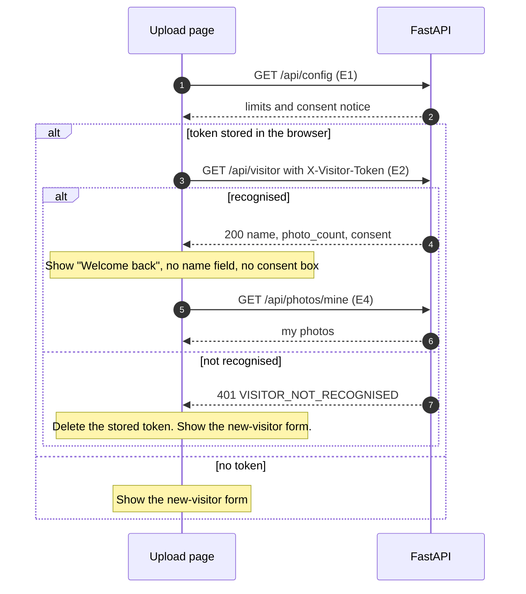
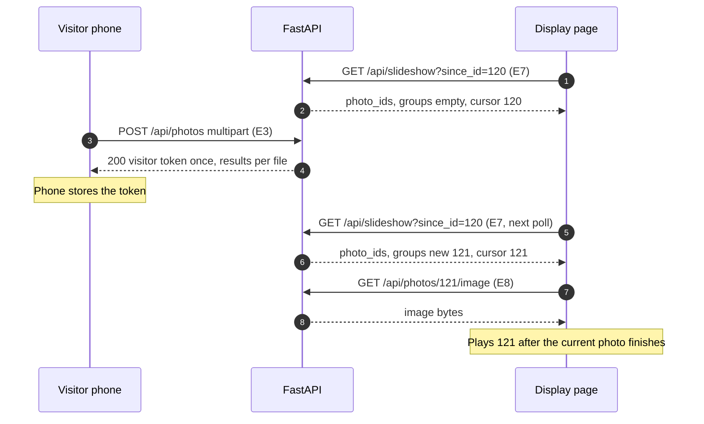

# API_SPECIFICATION.md

# Visitor Photo Slideshow (MomentVault): API Specification

| Item | Detail |
|---|---|
| Product | MomentVault, implementing Assignment 1: Visitor Photo Slideshow |
| Document version | 1.0 (draft for approval) |
| Date | 16 November 2026 |
| Based on | PRD.md, ASSUMPTIONS.md, ARCHITECTURE.md v1.1, DATABASE_DESIGN.md v1.0 |
| Backend | Python, FastAPI (not implemented yet) |
| Frontend | React (not implemented yet) |
| Status | **Proposed contract.** ARCHITECTURE.md Section 6.2 listed the endpoints as a *proposed contract to be confirmed*. This document is that confirmation step. It becomes binding when you approve it. |
| Not included | Source code. Examples are raw HTTP and JSON only. |

**Who this document is for.** Both the frontend developer and the backend developer. Every request and response is written out in full so that neither side has to guess a field name, a status code or an error. If something is not written here, it is not part of the contract (Section 12 lists the open items).

**How to read this document.**

- Labels show importance: **Must**, **Should** and **Could** follow the PRD priorities.
- **In plain words** paragraphs explain an idea simply.
- IDs such as `FR-UPL-03`, `ERR-08`, `A-06`, `AD-11` and `Q3` point to the PRD, ASSUMPTIONS.md, ARCHITECTURE.md and DATABASE_DESIGN.md.

**What was verified, and what was not.** The multipart behaviour in Section 5 (repeated `files` fields, and the "empty file input" case) was tested against Starlette 1.7.0, the library FastAPI is built on, using `python-multipart`. The three extra SQL statements in Section 10 were run on SQLite. **FastAPI itself was not installed in the sandbox**, so nothing here has been run through FastAPI. Section 12.3 lists what must be confirmed on the first coding day.

---

## Coverage of the Requested Items

| Requested | Where |
|---|---|
| The 13 items for every endpoint (name, method, path, purpose, auth, parameters, headers, request body, success JSON, error JSON, status codes, validation, database operations) | Each endpoint in Section 6 uses the **same 13-row layout**, numbered 1 to 13 |
| Visitor registration | E3 (registration and upload are one request, API-01) |
| Returning visitor identification | E2 |
| Current visitor retrieval | E2 (the same endpoint, API-02) |
| Photo upload | E3 |
| Photo listing | E4 (a visitor's own photos). The display's list is E7. |
| Slideshow retrieval | E7 (with E8 and E9 for the image files) |
| Photo deletion | E5 |
| Consent management | E1 (notice text and version), E3 (giving consent), E2 (consent status), E6 (withdrawing consent) |
| Basic admin operations | E10 (Could Have, optional) |
| multipart/form-data explained | Section 5 |
| Consistent JSON naming and response formats | Section 2 |
| Realistic example requests and responses | Section 6 and Section 7 |
| Avoiding unnecessary endpoints | Section 1.3 |

---

# 1. Overview

## 1.1 Endpoint Summary

Ten endpoints. Every path starts with `/api`.

| ID | Name | Method and path | Access | Priority | Used by |
|---|---|---|---|---|---|
| E1 | Get configuration | `GET /api/config` | Public | Must | Upload page, display |
| E2 | Get current visitor | `GET /api/visitor` | Visitor token | Must | Upload page |
| E3 | Register and upload photos | `POST /api/photos` | Token optional | Must | Upload page |
| E4 | List my photos | `GET /api/photos/mine` | Visitor token | Should | Upload page ("My photos") |
| E5 | Delete my photo | `DELETE /api/photos/{photo_id}` | Visitor token (owner) | Should | Upload page |
| E6 | Withdraw consent | `POST /api/visitor/withdraw` | Visitor token | Should | Upload page |
| E7 | Get slideshow feed | `GET /api/slideshow` | Public | Must | Display |
| E8 | Get display image | `GET /api/photos/{photo_id}/image` | Public | Must | Display, upload page |
| E9 | Get thumbnail | `GET /api/photos/{photo_id}/thumbnail` | Public | Should | Upload page |
| E10 | Operator removes a photo | `DELETE /api/operator/photos/{photo_id}` | Operator key | Could | Operator (optional) |

> **In plain words:** the phone page uses E1 to E6, the TV page uses E1, E7 and E8, and E9 gives small preview pictures for "My photos". E10 is only for a person running the screen, and only if time allows.

## 1.2 Why Each Endpoint Exists

| Endpoint | Without it |
|---|---|
| E1 | The frontend would copy the limits and the consent text, which then drift out of step with the server (NFR-MNT-01). |
| E2 | The upload page could not greet a returning visitor or know whether to show the name and consent form (FR-ID-02). |
| E3 | Nothing could be uploaded. It also creates the visitor and the consent record. |
| E4 | There would be no "My photos" list, so a visitor could not choose a photo to delete. |
| E5 | No photo deletion (FR-DEL). |
| E6 | No consent withdrawal (FR-WDR). |
| E7 | The display would not know which photos to play. |
| E8 | The display could not show a photo. |
| E9 | "My photos" would have to load the full-size images. |
| E10 | An unwanted photo could not be removed by the organiser (FR-OPR). |

## 1.3 Endpoints Deliberately **Not** Created

| Not created | Why |
|---|---|
| `POST /api/visitors` (separate registration) | Registration happens inside E3. One form is one request (A-06, API-01). A separate call would need a second round trip, and a visitor could be created with no photos for no reason. |
| `POST /api/consent` (give consent) | Consent is sent together with the first upload and recorded in the same step (FR-CON-03). Its text and version come from E1. |
| `GET /api/consent` (consent status) | Included in E2's response. |
| `GET /api/photos` (list every photo) | The display needs only ids, which E7 supplies. A public full list adds nothing. |
| `GET /api/photos/{id}` (photo details) | No screen needs details of a single photo. |
| `PATCH` or `PUT` endpoints | Photos are immutable. They can only be removed (ARCHITECTURE principle 5). Visitors cannot rename themselves (name is not edited in the MVP). |
| Login, logout, refresh-token endpoints | There are no accounts (OOS-01). |
| `GET /api/health` | Not required. Add only if a host needs one. |
| Admin list or dashboard endpoints | Out of scope (OOS). E10 is the single operator action. |
| Pagination or filtering | The data is small (at most a few hundred photos, and 20 per visitor). See API-11. |

---

# 2. Conventions

These rules apply to **every** endpoint. They are written once here and not repeated.

## 2.1 Basics

| Topic | Rule |
|---|---|
| Base path | Every URL starts with `/api`. |
| Same origin | In development the Vite server forwards `/api` to FastAPI. In demo and production FastAPI serves the built React files and `/api` from **one address** (ARCHITECTURE AD-16). **No CORS headers are needed**, and none are sent. |
| Protocol | HTTP. HTTPS is recommended for any public deployment (ARCHITECTURE L12). |
| Versioning | None in the MVP. All paths are unversioned. A future `/api/v2` is possible. |
| Request data | JSON for ordinary requests. **multipart/form-data** for E3 only (Section 5). |
| Response data | JSON, except E8 and E9, which return image bytes. |
| Character set | UTF-8. |
| Language | Messages are in English. |
| Trailing slashes | Not used. `/api/photos/mine` and `/api/photos/mine/` are not both promised to work. Always call the documented form. |

## 2.2 JSON Naming and Value Formats

| Topic | Rule | Example |
|---|---|---|
| Field names | `snake_case`, always | `photo_ids`, `max_file_bytes`, `created_at` |
| Ids | Whole numbers (JSON numbers, not strings) | `"id": 121` |
| Booleans | `true` or `false` | `"is_new": true` |
| Times | ISO 8601 in **UTC**, with milliseconds and a trailing `Z` | `"2026-11-16T05:12:33.481Z"` |
| Missing value | `null`, never an empty string and never an omitted field. A field documented in a response is **always present**. | `"token": null` |
| Lists | A list that has no items is `[]`, never `null` | `"groups": []` |
| Sizes | Always in **bytes** (integers) | `"max_file_bytes": 5242880` |
| Durations | Always in **seconds** (integers) | `"slide_seconds": 10` |
| Image links | **Relative** paths starting with `/api/` | `"/api/photos/121/image"` |
| Unknown fields in requests | Ignored by the server | |
| Extra fields in responses | The frontend must ignore fields it does not know, so the server may add fields later without breaking it. | |

> **Where the database format is different.** The database stores times as `YYYY-MM-DD HH:MM:SS.fff` text (DATABASE_DESIGN Section 11). The **API converts** to the ISO 8601 form above. The frontend never sees the database form.

## 2.3 Response Shape

| Kind | Shape |
|---|---|
| **Success** | The resource itself as a JSON object, **without an envelope**. There is no `{"data": ...}` wrapper and no `{"success": true}` flag. The HTTP status code says whether it worked. |
| **Error** | Always this shape (Section 4): `{"error": {"code": ..., "message": ..., "details": ..., "request_id": ...}}` |
| **No content** | Not used. Every success response has a JSON body, except E8 and E9 (image bytes). |

> **In plain words:** a status code in the 200s means "it worked, read the body". A status code of 400 or above means "it failed, read `error.code` to decide what to do and `error.message` to show the visitor".

## 2.4 Common Headers

**Request headers**

| Header | Used by | Meaning |
|---|---|---|
| `X-Visitor-Token` | E2, E3 (optional), E4, E5, E6 | The visitor's secret return token (Section 3.1) |
| `X-Operator-Key` | E10 | The operator's secret key (Section 3.2) |
| `Content-Type` | E3, E6 | `multipart/form-data; boundary=...` for E3. `application/json` for E6. The browser sets the E3 value itself. |
| `Accept` | All | `application/json` for JSON endpoints. Optional. |

**Response headers (every response)**

| Header | Meaning |
|---|---|
| `X-Request-ID` | A short identifier for this request, for example `req_9f3a1c27`. The same value appears in `error.request_id` for errors. A visitor can quote it so the developer can find the log line (ARCHITECTURE 12.6). |
| `X-Content-Type-Options: nosniff` | Stops the browser guessing a content type (ARCHITECTURE 13.2). |

## 2.5 Caching Rules

| Endpoint | `Cache-Control` | Why |
|---|---|---|
| E7 slideshow feed | `no-store` | Changes constantly. Must never be cached (ARCHITECTURE 6.5). |
| E1 config | `no-cache` | The browser may keep it but must ask again before reusing it. |
| E2, E3, E4, E5, E6, E10 | `no-store` | Personal or state-changing. |
| E8, E9 images | `public, max-age=31536000, immutable` | A stored photo never changes. Removed photos return 404. Caching also helps the display survive a short outage (A-27). |
| Error responses | `no-store` | |

## 2.6 Status Code Summary

Used across the API. Section 6 lists the exact codes for each endpoint.

| HTTP status | Meaning in this API |
|---|---|
| 200 OK | The request was processed. For E3 this includes submissions where some or all files were rejected. Read `results`. |
| 400 Bad Request | The request could not be read (broken multipart body, invalid JSON). |
| 401 Unauthorized | A token or key is missing, unknown or no longer valid. |
| 403 Forbidden | The visitor is recognised but may not do this (not their photo). |
| 404 Not Found | The photo does not exist or is removed, or the address is unknown. |
| 405 Method Not Allowed | Wrong method for the address. |
| 409 Conflict | The consent notice text changed since the page loaded. |
| 413 Content Too Large | The whole request exceeds the total limit. |
| 422 Unprocessable Content | The request was readable but a value is not acceptable (name, consent, file count, bad parameter). |
| 429 Too Many Requests | Rate limit exceeded. Only if rate limiting is built (Could Have). |
| 500 Internal Server Error | An unexpected failure. No technical details are shown. |
| 503 Service Unavailable | The database was busy and the wait ran out. Try again. |

> **Note.** FastAPI has its own default error shapes for 404, 405 and 422. The backend **must replace them** so that every error looks like Section 4 (API-14). Otherwise the frontend would face two different error shapes.

---

# 3. Authentication and Authorization

> **In plain words:** there are no accounts or passwords. A visitor proves who they are with a long random secret that their browser keeps. The server keeps only a scrambled copy (a hash) of it. The operator proves themselves with a secret key kept in the server's settings.

## 3.1 Visitor Token (E2 to E6)

| Item | Rule |
|---|---|
| Header | `X-Visitor-Token: <token>` (API-03) |
| Where it comes from | The server creates it **once**, when a new visitor registers (E3), and returns it in that response only. |
| What it looks like | An opaque string of URL-safe characters. The recommended form is 43 characters (from 32 random bytes, 256 bits). The minimum randomness is 128 bits (FR-ID-01). **The frontend must treat it as an opaque string** and never parse it. |
| Where the frontend keeps it | Browser local storage, wrapped so a storage failure does not stop the page (ARCHITECTURE AD-07, ERR-23). |
| Where the server keeps it | **Only the SHA-256 hash**, in `visitors.token_hash` (DATABASE_DESIGN Section 9.3). |
| Never | In a URL, query string, request body, error message or log (FR-ID-05). |
| How it is checked | The server hashes the received value and looks for an **active** visitor with that hash (Q1). |
| Maximum length accepted | 128 characters. A longer or malformed value is treated as "not recognised" without a database lookup. |
| After withdrawal | The hash is cleared, so the old token matches nothing (FR-WDR-04). |

**Two behaviours, depending on the endpoint:**

| Endpoint kind | Token missing, malformed or unknown | Response |
|---|---|---|
| **Token required** (E2, E4, E5, E6) | The request is refused and **nothing is changed** (FR-ID-03 AC2). | `401 VISITOR_NOT_RECOGNISED` |
| **Token optional** (E3) | The visitor is treated as **new** (FR-ID-03, ERR-16, ERR-19), so name and consent are required. | No error for the token itself |

**What the frontend does on `401 VISITOR_NOT_RECOGNISED`:** remove the stored token and show the new-visitor form. No error page and no error message (FR-ID-03).

## 3.2 Operator Key (E10, Could Have)

| Item | Rule |
|---|---|
| Header | `X-Operator-Key: <key>` |
| Source | An environment setting `OPERATOR_KEY`. The real key is never committed. `.env.example` holds a placeholder only (FR-OPR-02, BR-15). |
| Feature off | If `OPERATOR_KEY` is empty, **E10 does not exist**: it returns the ordinary `404 NOT_FOUND`, as if the address were unknown. |
| Comparison | A constant-time comparison, so response timing reveals nothing. |
| Wrong or missing key | `401 OPERATOR_KEY_INVALID`. Nothing changes (FR-OPR-01 AC2). |

## 3.3 Public Endpoints (E1, E7, E8, E9)

No credentials. They are public **by design** (A-28, ARCHITECTURE 13.3). A TV cannot log in, and the photos are shown publicly on the screen anyway. They never return a name, a token or a visitor identifier.

## 3.4 Who May Do What

| Action | Anyone | Recognised visitor | Owner of the photo | Operator |
|---|---|---|---|---|
| Read config, slideshow, images | Yes | Yes | Yes | Yes |
| Upload photos | New visitor (with name and consent) | Yes | Yes | n/a |
| Read own profile and photo list | No | Yes | Yes | n/a |
| Delete a photo | No | **Only own photos** | Yes | Any photo (E10) |
| Withdraw consent | No | Yes (own) | Yes | n/a |

---

# 4. Error Handling

## 4.1 Error Response Shape

Every error, from every endpoint, has this exact shape.

```json
{
  "error": {
    "code": "NAME_REQUIRED",
    "message": "Please enter your name.",
    "details": { "field": "name" },
    "request_id": "req_9f3a1c27"
  }
}
```

| Field | Type | Always present | Meaning |
|---|---|---|---|
| `error.code` | string | Yes | A **stable** machine-readable code in `UPPER_SNAKE_CASE`. The frontend uses this to decide **what to do**. Codes never change meaning. |
| `error.message` | string | Yes | A plain-language sentence safe to show to the visitor. The frontend uses this to decide **what to show**. It may be reworded without notice, so code must never test its text. |
| `error.details` | object or `null` | Yes | Extra structured information, for example which field or the limit. `null` when there is none. Keys are listed per error in Section 4.3. |
| `error.request_id` | string | Yes | Matches the `X-Request-ID` header. |

**Never in an error:** file paths, stack traces, SQL, tokens, hashes, other visitors' data (NFR-SEC-04, FR-ID-05).

## 4.2 Two Levels of Error

| Level | Where it appears | Examples |
|---|---|---|
| **Request-level** | The whole response is an error (HTTP 4xx or 5xx) with the shape above. Nothing was stored. | Name missing, too many files, unknown token |
| **File-level** | Inside a **successful** E3 response, in `results[n].error`. Same fields as a request-level error, **except there is no `request_id`** (the response header already carries it). See E3 for the exact shape. | One file is not an image |

> **In plain words:** if the visitor typed a bad name, nothing can proceed, so the *whole request* fails. If one of their five photos is bad, the other four still go through, so the request *succeeds* and the response says which photo failed and why (FR-UPL-03, FR-UPL-04).

## 4.3 Error Code Catalogue

**Request-level codes**

| Code | HTTP | Message shown to the visitor | `details` | PRD |
|---|---|---|---|---|
| `NAME_REQUIRED` | 422 | "Please enter your name." | `{"field":"name"}` | ERR-01 |
| `NAME_TOO_LONG` | 422 | "Names can be up to 50 characters." | `{"field":"name","max_length":50}` | ERR-02 |
| `NAME_INVALID` | 422 | "Please remove special control characters from your name." | `{"field":"name"}` | FR-REG-02 |
| `CONSENT_REQUIRED` | 422 | "Please agree to the display notice to continue." | `{"field":"consent"}` | ERR-03 |
| `CONSENT_NOTICE_CHANGED` | 409 | "The notice has been updated. Please read it again and agree to continue." | `{"current_version":"v2"}` | Small addition (Section 12.1) |
| `NO_FILES` | 422 | "Please choose at least one photo." | `{"field":"files"}` | ERR-04 |
| `TOO_MANY_FILES` | 422 | "You can upload up to 5 photos at a time." | `{"field":"files","max_files":5}` | ERR-05 |
| `REQUEST_TOO_LARGE` | 413 | "This upload is too large. Please send fewer or smaller photos." | `{"max_request_bytes":27262976}` | ERR-05, ERR-08 |
| `MALFORMED_REQUEST` | 400 | "The request could not be read. Please try again." | `null` | ERR-13 |
| `INVALID_PARAMETER` | 422 | "A value in the request is not valid." | `{"parameter":"since_id"}` | none |
| `CONFIRMATION_REQUIRED` | 422 | "Please confirm before removing all your photos." | `{"field":"confirm"}` | FR-WDR-02 |
| `VISITOR_NOT_RECOGNISED` | 401 | "We do not recognise this visit. Please start again." | `null` | ERR-16, ERR-19 |
| `NOT_PHOTO_OWNER` | 403 | "You can only delete your own photos." | `null` | ERR-17 |
| `PHOTO_NOT_FOUND` | 404 | "This photo could not be found." | `null` | FR-STO-05 |
| `NOT_FOUND` | 404 | "This address does not exist." | `null` | none |
| `METHOD_NOT_ALLOWED` | 405 | "This action is not allowed here." | `null` | none |
| `OPERATOR_KEY_INVALID` | 401 | "The operator key is missing or wrong." | `null` | FR-OPR-01 |
| `TOO_MANY_REQUESTS` | 429 | "Too many uploads. Please wait a minute." | `{"retry_after_seconds":60}` | ERR-20 |
| `SERVER_BUSY` | 503 | "The system is busy. Please try again in a moment." | `{"retry_after_seconds":2}` | ERR-15 |
| `INTERNAL_ERROR` | 500 | "Something went wrong. Please try again." | `null` | ERR-14 |

`429` and `503` responses also carry a `Retry-After` header (seconds).

**File-level codes** (only inside E3 `results`)

| Code | Message shown to the visitor | `details` | PRD |
|---|---|---|---|
| `FILE_TYPE_NOT_ALLOWED` | "Only JPEG and PNG photos are allowed." For a file whose name ends in `.heic` or `.heif`: "This photo format is not supported. Please use JPEG or PNG." | `{"allowed":["image/jpeg","image/png"]}` | ERR-06, ERR-12 |
| `FILE_NOT_AN_IMAGE` | "This file is not a valid photo." | `null` | ERR-07 |
| `FILE_TOO_LARGE` | "This photo is larger than 5 MB." | `{"max_file_bytes":5242880}` | ERR-08 |
| `IMAGE_TOO_LARGE_PIXELS` | "This photo is too large in pixels. Please resize it." | `{"max_megapixels":25}` | ERR-09 |
| `FILE_EMPTY_OR_CORRUPT` | "This file is empty or damaged." | `null` | ERR-10 |
| `PHOTO_LIMIT_REACHED` | "You have reached your photo limit. Delete one to add more." | `{"max_photos":20}` | ERR-11 |
| `SAVE_FAILED` | "Something went wrong. Please try again." | `null` | ERR-14 |

> **Messages and limits.** The numbers in messages (5 MB, 50, 5, 20) come from the server settings, so they change if the settings change. The frontend should show `message` as received and should never hard-code these numbers (NFR-MNT-01).

## 4.4 Frontend Behaviour per Error Code

| Code | What the frontend should do |
|---|---|
| `NAME_*`, `CONSENT_REQUIRED`, `NO_FILES`, `TOO_MANY_FILES` | Show `message` next to the named field. Nothing was stored, so the visitor can correct and resubmit. |
| `CONSENT_NOTICE_CHANGED` | Reload E1, show the new notice, clear the consent checkbox. |
| `REQUEST_TOO_LARGE`, `MALFORMED_REQUEST` | Show `message`. Offer to try again with fewer photos. |
| `VISITOR_NOT_RECOGNISED` | Remove the stored token. Show the new-visitor form. No message. |
| `NOT_PHOTO_OWNER` | Show `message`. Refresh "My photos". |
| `PHOTO_NOT_FOUND` (on delete) | Treat as already gone. Refresh "My photos". |
| `SERVER_BUSY`, `TOO_MANY_REQUESTS` | Show `message`. Wait `retry_after_seconds` before allowing a retry. |
| `INTERNAL_ERROR` | Show `message`. Allow a retry. |
| Network failure (no response at all) | Upload: "Upload did not finish. Please try again." (ERR-13). No automatic retry (A-27). The display keeps playing and retries at its next poll (ERR-21). |

---

# 5. Understanding multipart/form-data (for Photo Upload)

## 5.1 What It Is

> **In plain words:** an ordinary form or a JSON request can carry only text. A photo is *binary* data (raw bytes), not text. **multipart/form-data** is the standard way for a browser to send text fields **and** files in **one** request. The body is cut into **parts**, one per field or file, separated by a long random line called the **boundary**. Each part has a small header saying its field name and, for files, the file name and type.

## 5.2 Why Not JSON

| Option | Problem |
|---|---|
| Put the photo inside JSON as Base64 text | Makes the data about **33% bigger**, forces the server to hold the whole text in memory before decoding, and makes size limits harder to enforce. |
| Send each photo in its own request | Possible, but registration and consent would need to be separate, and per-photo results would be spread over several responses. |
| **multipart/form-data (chosen)** | Built into every browser, handled by FastAPI, and sends text and files together. One request means one registration and one set of per-file results (A-06). |

## 5.3 What a Request Looks Like

This is the **raw request** the browser sends. You will never write it by hand. The browser builds it from a form data object. It is shown so that both developers see the same structure.

```http
POST /api/photos HTTP/1.1
Host: 192.168.1.20:8000
Content-Type: multipart/form-data; boundary=----MomentVaultBoundary7MA4YWxk
Content-Length: 2481923

------MomentVaultBoundary7MA4YWxk
Content-Disposition: form-data; name="name"

Asha
------MomentVaultBoundary7MA4YWxk
Content-Disposition: form-data; name="consent"

true
------MomentVaultBoundary7MA4YWxk
Content-Disposition: form-data; name="notice_version"

v1
------MomentVaultBoundary7MA4YWxk
Content-Disposition: form-data; name="files"; filename="IMG_4021.jpg"
Content-Type: image/jpeg

<raw bytes of the first photo>
------MomentVaultBoundary7MA4YWxk
Content-Disposition: form-data; name="files"; filename="beach.png"
Content-Type: image/png

<raw bytes of the second photo>
------MomentVaultBoundary7MA4YWxk--
```

| Part of the request | Meaning |
|---|---|
| `Content-Type: multipart/form-data; boundary=...` | Tells the server this is multipart, and which line separates the parts. |
| `------MomentVaultBoundary7MA4YWxk` | The boundary line. It starts each part. |
| `Content-Disposition: form-data; name="name"` | A **text field** called `name`. Its value is on the line after the blank line. |
| `name="files"; filename="IMG_4021.jpg"` | A **file part**. `name` is the **field name**, and `filename` is the visitor's own file name. |
| Repeated `name="files"` | **Several files share the same field name.** This is how a list of files is sent. |
| Closing boundary ending in `--` | Marks the end of the body. |

## 5.4 The Fields of This API

| Field name | Kind | Required | Rule |
|---|---|---|---|
| `name` | text | New visitors: **yes**. Returning visitors: ignored. | 1 to 50 characters after trimming |
| `consent` | text | New visitors: **yes**. Returning visitors: ignored. | The exact text `true` |
| `notice_version` | text | New visitors: **yes**. Returning visitors: ignored. | Must equal the current version from E1 |
| `files` | file, repeated | **Yes** | 1 to 5 files |

**Field names are exact and case-sensitive.** A file sent under any other field name (for example `photos` or `file`) is **not** read, and the request fails with `NO_FILES`.

## 5.5 Rules Both Developers Must Follow

| # | Rule | Who | Why |
|---|---|---|---|
| 1 | **Do not set the `Content-Type` header by hand.** Let the browser set it. | Frontend | The browser adds the boundary value. A hand-written header has no boundary, so the server cannot split the parts. This is the most common multipart mistake. |
| 2 | Use the browser's form data object and append each file under the **same name** `files`. | Frontend | That is what produces the repeated field in 5.3. |
| 3 | Do not use the visitor's file name for anything except showing it back. | Backend | The name is untrusted. It may contain `../` or script text (FR-STO-01). The server stores files under random names. |
| 4 | The file name and `Content-Type` of each file part are **claims by the browser, not facts**. The server decides the real type by opening the image with Pillow. | Backend | FR-VAL-02. A text file renamed `.jpg` is rejected. |
| 5 | Order of fields does not matter, but the order of files does. Results come back **in the same order** as the files were sent. | Both | So the frontend can match results to what the visitor selected. |
| 6 | An **empty file picker** is sent by browsers as one `files` part with an **empty filename and zero bytes**. The server treats that as "no file" and returns `NO_FILES`. | Backend | Verified with Starlette 1.7.0: the part arrives as a file with filename `""` and size 0. |
| 7 | The frontend should check count, size and type **before** sending, for a friendly early message (FR-VAL-07). The server repeats every check. | Both | Browser checks are only a convenience. |
| 8 | The server reads the request body only up to the total limit (Section 8). Anything more is refused with `413`. | Backend | See Section 5.6. |
| 9 | Disable the submit button while the upload runs. | Frontend | Protects against double submission (FR-UPL-05, FR-CNC-05, API-13). |

## 5.6 How Size Limits Work with multipart

Verified in the library source: the framework **reads and stores the entire body** (file parts go to a temporary file) **before** the route function runs, and it has **no file size limit of its own** (ARCHITECTURE Section 7.6). So the limits are enforced in two places:

| Limit | Enforced where | Result |
|---|---|---|
| **Whole request** over `max_request_bytes` | A size guard in front of the route, counting bytes as they arrive and by the declared `Content-Length` | `413 REQUEST_TOO_LARGE`. Nothing stored. |
| **One file** over `max_file_bytes` | The route, per file | That file is rejected with `FILE_TOO_LARGE`. Other files continue. |
| **More files** than allowed | The route | `422 TOO_MANY_FILES`. Nothing stored. |

`max_request_bytes` is the maximum number of files times the maximum file size, plus 1 MB for the text fields and the multipart overhead. With the defaults that is `5 × 5,242,880 + 1,048,576 = 27,262,976` bytes. E1 reports it, so the frontend never calculates it.

---

# 6. Endpoint Specifications

Every endpoint uses the **same 13-row layout**:

1. Endpoint name, 2. HTTP method, 3. URL path, 4. Purpose, 5. Authentication and authorization, 6. Path and query parameters, 7. Request headers, 8. Request body, 9. Success response, 10. Error response, 11. HTTP status codes, 12. Validation rules, 13. Database operations.

Database operations refer to the queries in **DATABASE_DESIGN.md Section 13** (`Q1` to `Q14`). Three additional queries, `QA1` to `QA3`, are defined in Section 10 of this document.

---

## E1. Get Configuration

| # | Item | Specification |
|---|---|---|
| 1 | Name | Get configuration |
| 2 | Method | `GET` |
| 3 | Path | `/api/config` |
| 4 | Purpose | Gives the frontend every limit, duration and the **consent notice text and version**, so nothing is copied into the frontend (NFR-MNT-01, ARCHITECTURE AD-18). |
| 5 | Authentication | None. Public. |
| 6 | Parameters | None. |
| 7 | Request headers | None required. |
| 8 | Request body | None. |
| 9 | Success response | `200 OK`, below. |
| 10 | Error response | Standard shape (Section 4). Only `INTERNAL_ERROR` is realistic. |
| 11 | Status codes | 200, 500 |
| 12 | Validation rules | None. |
| 13 | Database operations | **None.** The values come from the server settings. |

**Success response fields**

| Field | Type | Meaning | Setting |
|---|---|---|---|
| `slide_seconds` | integer | How long each photo plays | P-01 |
| `poll_seconds` | integer | How often the display asks E7 | A-25 |
| `max_file_bytes` | integer | Largest single file | P-02 |
| `max_files_per_submission` | integer | Most files in one E3 request | P-03 |
| `max_request_bytes` | integer | Largest whole E3 request | derived (Section 5.6) |
| `max_photos_per_visitor` | integer | Most active photos one visitor may hold | P-07 |
| `max_megapixels` | integer | Largest image size | P-05 |
| `allowed_content_types` | list of strings | Accepted image types | P-04 |
| `allowed_extensions` | list of strings | Accepted file extensions, lower case, with the dot | P-04 |
| `name_min_length` | integer | Shortest name, after trimming | P-06 |
| `name_max_length` | integer | Longest name, after trimming | P-06 |
| `consent_notice.version` | string | Current notice version | P-09 |
| `consent_notice.title` | string | Heading of the notice | |
| `consent_notice.points` | list of strings | The notice, one sentence per item, in order. Rendered as plain text. | FR-CON-01 |
| `consent_notice.checkbox_label` | string | Text beside the consent checkbox | |

```json
{
  "slide_seconds": 10,
  "poll_seconds": 5,
  "max_file_bytes": 5242880,
  "max_files_per_submission": 5,
  "max_request_bytes": 27262976,
  "max_photos_per_visitor": 20,
  "max_megapixels": 25,
  "allowed_content_types": ["image/jpeg", "image/png"],
  "allowed_extensions": [".jpg", ".jpeg", ".png"],
  "name_min_length": 1,
  "name_max_length": 50,
  "consent_notice": {
    "version": "v1",
    "title": "Before you share your photos",
    "points": [
      "Your photos will be shown publicly on a screen at this venue.",
      "You confirm the photos are yours or you have permission to share them, and that anyone clearly visible has agreed.",
      "Your photos stay until you delete them or withdraw your consent.",
      "You can delete photos or withdraw your consent at any time on this page.",
      "You confirm that you are an adult, or that a parent or guardian has given permission."
    ],
    "checkbox_label": "I agree that my photos may be shown publicly on the display."
  }
}
```

**Example request**

```http
GET /api/config HTTP/1.1
Host: 192.168.1.20:8000
Accept: application/json
```

> **Note on the consent text.** The wording above is an **example**. The final text must contain every applicable point of PRD FR-CON-01 and is a content decision for you. If the optional display of names (FR-DSP-07) is built, a sixth point about names is added.

---

## E2. Get Current Visitor (Returning Visitor Identification)

| # | Item | Specification |
|---|---|---|
| 1 | Name | Get current visitor. This one endpoint covers both "returning visitor identification" and "current visitor retrieval" (API-02). |
| 2 | Method | `GET` |
| 3 | Path | `/api/visitor` |
| 4 | Purpose | Asks the server: "Do you recognise this token, and who is it?" The upload page calls it when it loads, **if** the browser holds a token. A `200` means "welcome back". A `401` means "treat as a new visitor" (FR-ID-02, FR-ID-03). It also returns the data needed for the greeting, the photo limit and the consent reminder (FR-CON-04). |
| 5 | Authentication | **Visitor token required.** |
| 6 | Parameters | None. |
| 7 | Request headers | `X-Visitor-Token` (required). |
| 8 | Request body | None. |
| 9 | Success response | `200 OK`, below. |
| 10 | Error response | Standard shape. |
| 11 | Status codes | 200, 401, 500, 503 |
| 12 | Validation rules | The token must be present, at most 128 characters, and match an `active` visitor. The name is **never** used to find a visitor (FR-ID-03a). |
| 13 | Database operations | `Q1` identify by token hash. `Q2` count active photos. Consent notice version and time: read from the open consent row of that visitor (one lookup by `visitor_id` where `withdrawn_at` is empty). |

**Success response fields**

| Field | Type | Meaning |
|---|---|---|
| `name` | string | The label on record. Always plain text. The frontend must render it as text, never as HTML (FR-REG-02 AC3). |
| `photo_count` | integer | Number of this visitor's **active** photos |
| `max_photos` | integer | The per-visitor limit (same as E1) |
| `consent.notice_version` | string | The notice version this visitor accepted |
| `consent.given_at` | string (time) | When they accepted |

The response deliberately contains **no internal id and no token**.

```http
GET /api/visitor HTTP/1.1
Host: 192.168.1.20:8000
Accept: application/json
X-Visitor-Token: kQ3v8mZr1x_T7yLw0pB2nC5dF9hJ4sGaE6uXoVtRiMc
```

```json
{
  "name": "Asha",
  "photo_count": 3,
  "max_photos": 20,
  "consent": {
    "notice_version": "v1",
    "given_at": "2026-11-16T05:12:33.481Z"
  }
}
```

**Error example (token unknown, edited or withdrawn): `401`**

```json
{
  "error": {
    "code": "VISITOR_NOT_RECOGNISED",
    "message": "We do not recognise this visit. Please start again.",
    "details": null,
    "request_id": "req_41be07d2"
  }
}
```

> **Why `401` and not `200` with a flag.** A missing or unknown token is "not authenticated", which is exactly what `401` means. It keeps the rule uniform: *every* token-required endpoint answers an unknown token the same way. The frontend turns this specific case into the normal new-visitor screen, not an error screen.

---

## E3. Register and Upload Photos

This single endpoint performs **visitor registration** (for a new visitor), **consent recording** and **photo upload**.

| # | Item | Specification |
|---|---|---|
| 1 | Name | Register and upload photos |
| 2 | Method | `POST` |
| 3 | Path | `/api/photos` |
| 4 | Purpose | Receives 1 to 5 photos. For a **new visitor** it first validates the name and consent, creates the visitor, stores the token hash and the consent record, and returns the token **once**. Then, for every visitor, it validates, cleans and stores each photo independently, and reports a result per file (FR-REG-03, FR-CON-03, FR-UPL-03, FR-UPL-04). |
| 5 | Authentication | **Token optional.** A valid token means a returning visitor. A missing, malformed or unknown token means a new visitor (FR-ID-03, ERR-16, ERR-19). |
| 6 | Parameters | None in the path or query. |
| 7 | Request headers | `Content-Type: multipart/form-data; boundary=...` (set by the browser). `X-Visitor-Token` (optional). `Content-Length` (set by the browser). |
| 8 | Request body | multipart/form-data with the fields in Section 5.4. |
| 9 | Success response | `200 OK`, below. |
| 10 | Error response | Standard shape for request-level errors. Per-file errors appear inside the success body. |
| 11 | Status codes | 200, 400, 409, 413, 422, 429 (optional), 500, 503 |
| 12 | Validation rules | Section "Validation order" below. |
| 13 | Database operations | See "Database operations" below. |

**Why the status is `200` and not `201`.** A submission can create a visitor, create photos, create nothing, or create some and reject others. One status that means "the request was processed, read `results`" is simpler for the frontend than choosing between 200, 201 and a partial-success code (API-05).

### Request fields

| Field | New visitor | Returning visitor | Rule |
|---|---|---|---|
| `name` | Required | Ignored (a name is never changed) | Trimmed. 1 to 50 characters. Control characters rejected. `<`, `>` and `&` allowed (FR-REG-02). |
| `consent` | Required | Ignored | Exactly the text `true`. Any other value, or a missing field, is "no consent". |
| `notice_version` | Required | Ignored | Must equal the current version from E1. |
| `files` | Required, 1 to 5 | Required, 1 to 5 | Repeated field. See per-file rules. |

### Validation order

The server checks in **this order** and stops at the first request-level failure. Nothing is stored if any step 1 to 6 fails.

| Step | Check | Failure |
|---|---|---|
| 1 | Total body size within `max_request_bytes` (counting received bytes, not only the declared length) | `413 REQUEST_TOO_LARGE` |
| 2 | Body can be parsed as multipart | `400 MALFORMED_REQUEST` |
| 3 | Decide new or returning from the token (never fails by itself) | none |
| 4 | **New visitors only:** `name` trimmed and checked: not empty, then not longer than 50, then no control characters | `422 NAME_REQUIRED`, `NAME_TOO_LONG`, `NAME_INVALID` |
| 5 | **New visitors only:** `consent` is `true`, then `notice_version` matches the current version | `422 CONSENT_REQUIRED`, then `409 CONSENT_NOTICE_CHANGED` |
| 6 | File count: none, or more than 5 | `422 NO_FILES`, `422 TOO_MANY_FILES` |
| 7 | **New visitors only:** create the visitor and consent record (one transaction, committed) | `503 SERVER_BUSY` or `500 INTERNAL_ERROR` (nothing created) |
| 8 | Each file, in the order sent, independently (below) | per-file error, request still `200` |

### Per-file validation order

| Step | Check | File-level code |
|---|---|---|
| a | The file is larger than `max_file_bytes` | `FILE_TOO_LARGE` |
| b | The file name extension and the declared content type are both allowed and consistent with JPEG or PNG | `FILE_TYPE_NOT_ALLOWED` (a `.heic` or `.heif` name gets the HEIC message) |
| c | The file has zero bytes | `FILE_EMPTY_OR_CORRUPT` |
| d | The content cannot be opened as an image | `FILE_NOT_AN_IMAGE` |
| e | The image opens, but its **real** detected format is not JPEG or PNG (for example a GIF named `.jpg`) | `FILE_TYPE_NOT_ALLOWED` |
| f | The image is damaged or truncated and cannot be fully read | `FILE_EMPTY_OR_CORRUPT` |
| g | The image size in pixels, read from the header **before** decoding, exceeds `max_megapixels` | `IMAGE_TOO_LARGE_PIXELS` |
| h | The visitor already holds the maximum active photos (counting photos accepted earlier in this same request) | `PHOTO_LIMIT_REACHED` |
| i | Saving the files or the record fails | `SAVE_FAILED` (nothing remains stored) |

A PNG sent with the name `.jpg` is **accepted** under its real format and stored with the matching extension (ASSUMPTIONS A-12, settles PRD FR-VAL-02 AC4).

### Success response fields

| Field | Type | Meaning |
|---|---|---|
| `visitor.name` | string | The visitor's name on record |
| `visitor.is_new` | boolean | `true` if this request created the visitor |
| `visitor.token` | string or `null` | The new secret token. **Present only when `is_new` is `true`**, and only in this response. `null` for a returning visitor. The frontend must store it immediately. |
| `visitor.photo_count` | integer | Active photos after this request |
| `visitor.max_photos` | integer | The per-visitor limit |
| `accepted_count` | integer | Files accepted |
| `rejected_count` | integer | Files rejected |
| `results` | list | One item per file sent, **in the order sent** |
| `results[].index` | integer | Position of the file in the request, starting at 0 |
| `results[].filename` | string | The visitor's file name, shortened to at most 100 characters. **For display only.** The frontend renders it as plain text. |
| `results[].status` | string | `accepted` or `rejected` |
| `results[].photo` | object or `null` | When accepted: `id`, `image_url`, `thumbnail_url`, `created_at`. Otherwise `null`. |
| `results[].error` | object or `null` | When rejected: `code`, `message`, `details`. Otherwise `null`. |

> **Registration with every file rejected.** If the visitor is new and every file is rejected, the visitor **is still created** and `visitor.token` **is still returned** (FR-REG-03 AC2, ARCHITECTURE step 4). The frontend must store the token, so the visitor's next attempt is recognised.

### Example 1: new visitor, two photos accepted and one rejected

```http
POST /api/photos HTTP/1.1
Host: 192.168.1.20:8000
Content-Type: multipart/form-data; boundary=----MomentVaultBoundary7MA4YWxk

(fields: name=Asha, consent=true, notice_version=v1,
 files=IMG_4021.jpg, files=beach.png, files=notes.jpg)
```

`notes.jpg` is a text file renamed to `.jpg`.

```json
{
  "visitor": {
    "name": "Asha",
    "is_new": true,
    "token": "kQ3v8mZr1x_T7yLw0pB2nC5dF9hJ4sGaE6uXoVtRiMc",
    "photo_count": 2,
    "max_photos": 20
  },
  "accepted_count": 2,
  "rejected_count": 1,
  "results": [
    {
      "index": 0,
      "filename": "IMG_4021.jpg",
      "status": "accepted",
      "photo": {
        "id": 121,
        "image_url": "/api/photos/121/image",
        "thumbnail_url": "/api/photos/121/thumbnail",
        "created_at": "2026-11-16T05:12:34.102Z"
      },
      "error": null
    },
    {
      "index": 1,
      "filename": "beach.png",
      "status": "accepted",
      "photo": {
        "id": 122,
        "image_url": "/api/photos/122/image",
        "thumbnail_url": "/api/photos/122/thumbnail",
        "created_at": "2026-11-16T05:12:34.598Z"
      },
      "error": null
    },
    {
      "index": 2,
      "filename": "notes.jpg",
      "status": "rejected",
      "photo": null,
      "error": {
        "code": "FILE_NOT_AN_IMAGE",
        "message": "This file is not a valid photo.",
        "details": null
      }
    }
  ]
}
```

### Example 2: returning visitor, one photo

```http
POST /api/photos HTTP/1.1
Host: 192.168.1.20:8000
Content-Type: multipart/form-data; boundary=----MomentVaultBoundary3Qp9ZfLm
X-Visitor-Token: kQ3v8mZr1x_T7yLw0pB2nC5dF9hJ4sGaE6uXoVtRiMc

(field: files=sunset.jpg)
```

```json
{
  "visitor": {
    "name": "Asha",
    "is_new": false,
    "token": null,
    "photo_count": 3,
    "max_photos": 20
  },
  "accepted_count": 1,
  "rejected_count": 0,
  "results": [
    {
      "index": 0,
      "filename": "sunset.jpg",
      "status": "accepted",
      "photo": {
        "id": 130,
        "image_url": "/api/photos/130/image",
        "thumbnail_url": "/api/photos/130/thumbnail",
        "created_at": "2026-11-16T06:40:10.337Z"
      },
      "error": null
    }
  ]
}
```

### Example 3: request-level error (consent not given), `422`

```json
{
  "error": {
    "code": "CONSENT_REQUIRED",
    "message": "Please agree to the display notice to continue.",
    "details": { "field": "consent" },
    "request_id": "req_c7d19a03"
  }
}
```

### Example 4: whole request too large, `413`

```json
{
  "error": {
    "code": "REQUEST_TOO_LARGE",
    "message": "This upload is too large. Please send fewer or smaller photos.",
    "details": { "max_request_bytes": 27262976 },
    "request_id": "req_2e8f6b55"
  }
}
```

### Error summary for E3

| Situation | Status | Code | Stored? |
|---|---|---|---|
| Body over the total limit | 413 | `REQUEST_TOO_LARGE` | Nothing |
| Body cannot be parsed | 400 | `MALFORMED_REQUEST` | Nothing |
| Name empty, too long or invalid (new visitor) | 422 | `NAME_REQUIRED`, `NAME_TOO_LONG`, `NAME_INVALID` | Nothing |
| Consent missing (new visitor) | 422 | `CONSENT_REQUIRED` | Nothing |
| Notice version out of date (new visitor) | 409 | `CONSENT_NOTICE_CHANGED` | Nothing |
| No files, or more than 5 | 422 | `NO_FILES`, `TOO_MANY_FILES` | Nothing |
| Rate limit (if built) | 429 | `TOO_MANY_REQUESTS` | Nothing |
| Database busy while creating the visitor | 503 | `SERVER_BUSY` | Nothing |
| Unexpected failure while creating the visitor | 500 | `INTERNAL_ERROR` | Nothing |
| Any problem with one file | **200** | a file-level code inside `results` | Only that file is skipped |
| Connection lost mid-upload | (none) | The server discards what arrived. The phone shows "Upload did not finish." | No partial file, no record (ERR-13) |

### Database operations for E3

| Step | Operation | Reference |
|---|---|---|
| Identify | Look up the token hash among active visitors | `Q1` |
| Register (new visitor only) | Insert the visitor and its consent record. **One transaction, committed** before any photo is processed, so the visitor exists even if every photo fails. If the commit fails nothing is created and no token is returned. | `Q7` |
| Limit check | Count the visitor's active photos | `Q2` |
| Each accepted photo | After its image and thumbnail files are written under random names, insert one `photos` row (`status = 'active'`, the shared `batch_id` of this request) and **commit that photo alone** (short write). The photo becomes eligible for the slideshow at that moment (BR-09, FR-UPL-02). | `Q8` |
| Failure after files were written | Delete the files just written. No row remains. | ARCHITECTURE 7.3, AD-14 |
| Visitor's new photo count | Count after the last insert | `Q2` |

All photos of one request share a single random `batch_id`, which is **internal** and never appears in any response.

---

## E4. List My Photos

| # | Item | Specification |
|---|---|---|
| 1 | Name | List my photos |
| 2 | Method | `GET` |
| 3 | Path | `/api/photos/mine` |
| 4 | Purpose | Returns the visitor's **own active** photos, newest first, for the "My photos" list from which a photo can be deleted (FR-DEL-01, FR-PRV-05). |
| 5 | Authentication | **Visitor token required.** |
| 6 | Parameters | None. |
| 7 | Request headers | `X-Visitor-Token` (required). |
| 8 | Request body | None. |
| 9 | Success response | `200 OK`, below. |
| 10 | Error response | Standard shape. |
| 11 | Status codes | 200, 401, 500, 503 |
| 12 | Validation rules | Token as in Section 3.1. Only the caller's own photos are ever returned. |
| 13 | Database operations | `Q1` identify. `Q8b` list the visitor's active photos. |

| Field | Type | Meaning |
|---|---|---|
| `photos` | list | Active photos, **newest first** |
| `photos[].id` | integer | Photo id. Used for E5. |
| `photos[].image_url` | string | Link to E8 |
| `photos[].thumbnail_url` | string | Link to E9 |
| `photos[].created_at` | string (time) | When it became visible |
| `count` | integer | Number of photos in the list |
| `max_photos` | integer | The per-visitor limit |

```http
GET /api/photos/mine HTTP/1.1
Host: 192.168.1.20:8000
Accept: application/json
X-Visitor-Token: kQ3v8mZr1x_T7yLw0pB2nC5dF9hJ4sGaE6uXoVtRiMc
```

```json
{
  "photos": [
    {
      "id": 130,
      "image_url": "/api/photos/130/image",
      "thumbnail_url": "/api/photos/130/thumbnail",
      "created_at": "2026-11-16T06:40:10.337Z"
    },
    {
      "id": 122,
      "image_url": "/api/photos/122/image",
      "thumbnail_url": "/api/photos/122/thumbnail",
      "created_at": "2026-11-16T05:12:34.598Z"
    },
    {
      "id": 121,
      "image_url": "/api/photos/121/image",
      "thumbnail_url": "/api/photos/121/thumbnail",
      "created_at": "2026-11-16T05:12:34.102Z"
    }
  ],
  "count": 3,
  "max_photos": 20
}
```

If the visitor has no active photos the response is `{"photos": [], "count": 0, "max_photos": 20}`, with status `200`.

> **Routing note for the backend.** `/api/photos/mine` is a fixed word and `/api/photos/{photo_id}` takes a number. They use different methods (`GET` versus `DELETE`), so they do not collide, but test both.

---

## E5. Delete My Photo

| # | Item | Specification |
|---|---|---|
| 1 | Name | Delete my photo |
| 2 | Method | `DELETE` |
| 3 | Path | `/api/photos/{photo_id}` |
| 4 | Purpose | Lets a visitor remove **one of their own** photos. The photo stops appearing on the display and its files are deleted (FR-DEL-01 to FR-DEL-05, BR-07, BR-10). The visitor confirms in the page first (FR-DEL-04). The server does not ask again. |
| 5 | Authentication | **Visitor token required.** Authorization: the photo must belong to the caller. |
| 6 | Path parameters | `photo_id`: integer, 1 or more. |
| 7 | Request headers | `X-Visitor-Token` (required). |
| 8 | Request body | None. |
| 9 | Success response | `200 OK`, below. |
| 10 | Error response | Standard shape. |
| 11 | Status codes | 200, 401, 403, 404, 422, 500, 503 |
| 12 | Validation rules | `photo_id` must be a whole number of 1 or more, otherwise `422 INVALID_PARAMETER`. Ownership is checked **on the server** every time (FR-DEL-02). |
| 13 | Database operations | `Q1` identify. `QA1` read the photo's owner and status. `Q10` mark it removed (ownership is repeated inside the statement). After the commit: delete the image and thumbnail files, using the names read from the row. |

**Decision table: what the server answers**

| The photo is... | Response |
|---|---|
| Active and **mine** | `200`, `already_removed: false`. The photo is hidden, then its files are deleted. |
| Already removed and **mine** | `200`, `already_removed: true` (FR-DEL-05, ERR-18). Not an error. |
| Active and **someone else's** | `403 NOT_PHOTO_OWNER`. Nothing changes (ERR-17). |
| Removed and someone else's | `404 PHOTO_NOT_FOUND` (reveals nothing about another visitor) |
| Does not exist | `404 PHOTO_NOT_FOUND` |
| No token or unknown token | `401 VISITOR_NOT_RECOGNISED` (FR-DEL-02 AC2) |

```http
DELETE /api/photos/122 HTTP/1.1
Host: 192.168.1.20:8000
Accept: application/json
X-Visitor-Token: kQ3v8mZr1x_T7yLw0pB2nC5dF9hJ4sGaE6uXoVtRiMc
```

```json
{
  "photo_id": 122,
  "status": "removed",
  "already_removed": false,
  "photo_count": 2
}
```

| Field | Type | Meaning |
|---|---|---|
| `photo_id` | integer | The id that was requested |
| `status` | string | Always `removed` on success |
| `already_removed` | boolean | `true` if it had already been removed |
| `photo_count` | integer | The visitor's active photos after this call |

**Error example: someone else's photo, `403`**

```json
{
  "error": {
    "code": "NOT_PHOTO_OWNER",
    "message": "You can only delete your own photos.",
    "details": null,
    "request_id": "req_8b2c40e1"
  }
}
```

**Timing.** The database change is committed first, so the photo leaves the next E7 answer immediately. The display notices at its next poll and stops showing it within P-08 (10 seconds), except that a photo already on screen finishes its current showing (FR-DEL-03 AC2). A leftover file after a failed file deletion is harmless and is logged for clean-up (ARCHITECTURE 9A).

---

## E6. Withdraw Consent

| # | Item | Specification |
|---|---|---|
| 1 | Name | Withdraw consent |
| 2 | Method | `POST` |
| 3 | Path | `/api/visitor/withdraw` |
| 4 | Purpose | Ends the visitor's consent. **All** of their photos are removed from the display and their files deleted. Their name and token hash are erased. The consent record is kept, without personal data, with the withdrawal time (FR-WDR-01 to FR-WDR-04, BR-06). |
| 5 | Authentication | **Visitor token required.** |
| 6 | Parameters | None. |
| 7 | Request headers | `X-Visitor-Token` (required). `Content-Type: application/json`. |
| 8 | Request body | JSON, below. |
| 9 | Success response | `200 OK`, below. |
| 10 | Error response | Standard shape. |
| 11 | Status codes | 200, 400, 401, 422, 500, 503 |
| 12 | Validation rules | The body must be valid JSON with `confirm` equal to the boolean `true` (API-06). Anything else is `422 CONFIRMATION_REQUIRED`. |
| 13 | Database operations | `Q1` identify. Then **one transaction** `Q9`: mark all active photos removed, close the open consent, set the visitor `withdrawn` with `name` and `token_hash` cleared. After the commit: `Q11` read the files to delete, then delete them. |

**Request body**

| Field | Type | Required | Rule |
|---|---|---|---|
| `confirm` | boolean | Yes | Must be `true` |

```http
POST /api/visitor/withdraw HTTP/1.1
Host: 192.168.1.20:8000
Content-Type: application/json
Accept: application/json
X-Visitor-Token: kQ3v8mZr1x_T7yLw0pB2nC5dF9hJ4sGaE6uXoVtRiMc

{ "confirm": true }
```

**Success response**

| Field | Type | Meaning |
|---|---|---|
| `withdrawn` | boolean | Always `true` on success |
| `photos_removed` | integer | How many active photos were removed |
| `withdrawn_at` | string (time) | When consent was withdrawn |

```json
{
  "withdrawn": true,
  "photos_removed": 4,
  "withdrawn_at": "2026-11-16T07:05:41.912Z"
}
```

**What the frontend must do after a `200`:** remove the stored token and show the new-visitor form (FR-WDR-03 d). The old token now matches nothing.

**Error example: confirmation missing, `422`**

```json
{
  "error": {
    "code": "CONFIRMATION_REQUIRED",
    "message": "Please confirm before removing all your photos.",
    "details": { "field": "confirm" },
    "request_id": "req_a53d7f90"
  }
}
```

**Repeat calls.** A second call with the same token returns `401 VISITOR_NOT_RECOGNISED`, because the token no longer matches anything. That is correct and harmless. The frontend treats it as "already done".

**Consent management in one place**

| Need | How |
|---|---|
| Show the notice and its version | E1 (`consent_notice`) |
| Give consent | E3 fields `consent` and `notice_version` (new visitor only) |
| See what a visitor accepted | E2 (`consent.notice_version`, `consent.given_at`) |
| Withdraw consent | E6 |
| Give consent again after withdrawing | Treated as a **new visitor**: submit E3 with name and consent (FR-WDR-04) |

---

## E7. Get Slideshow Feed

| # | Item | Specification |
|---|---|---|
| 1 | Name | Get slideshow feed |
| 2 | Method | `GET` |
| 3 | Path | `/api/slideshow` |
| 4 | Purpose | The display page calls this every `poll_seconds`. It returns every photo that may play, and tells the display which photos to play **next** after any new upload (FR-AUT-01, FR-AUT-02, FR-PRV-01 to FR-PRV-03, BR-11). |
| 5 | Authentication | None. Public (Section 3.3). |
| 6 | Query parameters | `since_id` (optional). See below. |
| 7 | Request headers | None required. |
| 8 | Request body | None. |
| 9 | Success response | `200 OK`, below. |
| 10 | Error response | Standard shape. |
| 11 | Status codes | 200, 422, 500, 503 |
| 12 | Validation rules | `since_id`, if present, must be a whole number of 0 or more. Otherwise `422 INVALID_PARAMETER`. |
| 13 | Database operations | `Q3` all eligible photos. `Q6` the cursor. When `since_id` is given: `Q5` new photos since the cursor, and `Q4` the owner's previous photos. |

> **In plain words:** the display keeps a number, the **cursor**: the highest photo number it has already been told about. It sends that back as `since_id`. The server remembers **nothing** about any display (ARCHITECTURE principle 4). It answers from the database each time.

**Query parameter**

| Parameter | Type | Required | Meaning |
|---|---|---|---|
| `since_id` | integer, 0 or more | No | The `cursor` value from the previous answer. **Leave it out on the first request.** |

**Success response fields**

| Field | Type | Meaning |
|---|---|---|
| `photo_ids` | list of integers | **Every active photo**, oldest first. This is the display's **main loop**. A number that disappears from this list means "stop showing it" (removed, deleted or withdrawn). |
| `groups` | list | "Play next" groups for uploads **after** the cursor, oldest upload first. Empty on the first request and when nothing is new. |
| `groups[].new` | list of integers | The new photos of one upload, in upload order. |
| `groups[].previous` | list of integers | The same visitor's **earlier** active photos, most recent first. Empty when not applicable (see rules). |
| `cursor` | integer | The highest photo number ever assigned. **The display must always store this value and send it as `since_id` next time.** `0` if no photo has ever existed. |

**Example 1: first request (display just started)**

```http
GET /api/slideshow HTTP/1.1
Host: 192.168.1.20:8000
Accept: application/json
```

```json
{
  "photo_ids": [64, 87, 91, 103, 120],
  "groups": [],
  "cursor": 120
}
```

**Example 2: five seconds later, after Asha uploaded photos 121 and 122**

```http
GET /api/slideshow?since_id=120 HTTP/1.1
Host: 192.168.1.20:8000
Accept: application/json
```

```json
{
  "photo_ids": [64, 87, 91, 103, 120, 121, 122],
  "groups": [
    {
      "new": [121, 122],
      "previous": [87, 64]
    }
  ],
  "cursor": 122
}
```

**Example 3: nothing new**

```json
{
  "photo_ids": [64, 87, 91, 103, 120, 121, 122],
  "groups": [],
  "cursor": 122
}
```

### How the server builds `groups` (so both sides agree)

| # | Rule |
|---|---|
| 1 | **First request** (no `since_id`): `groups` is `[]`. A display that starts or reloads simply begins its loop and does not replay history. |
| 2 | Find active photos with an id **above** `since_id` (`Q5`). |
| 3 | Put them into groups by upload (by the internal `batch_id`), **oldest upload first**. Each `new` list is in upload order. |
| 4 | If **no** photo of that upload has an id at or below `since_id` (the display has never seen this upload), fill `previous` with the **same visitor's other active photos from earlier uploads**, most recent first (`Q4`, A-22, BR-11). |
| 5 | If the display **already** saw part of that upload (the photos arrived across two polls), list **only the new photos** and leave `previous` empty, so earlier photos are not replayed twice. |
| 6 | A visitor's photos never appear in another visitor's `previous` (BR-12). |
| 7 | If `since_id` is **greater than** the current highest photo number (for example after a demo reset), the server answers as for a first request: `groups` is `[]` and `cursor` is the real current value. |
| 8 | A photo removed before the display fetches it never appears in `groups` or `photo_ids`. |
| 9 | The response contains **no names, tokens or visitor identifiers** (ARCHITECTURE 8.2). `batch_id` is never sent. |

### What the display does with the answer (the contract with the frontend)

| Item in the response | Display action |
|---|---|
| A number in `photo_ids` the display does not know | Append it to the end of the **main loop**. |
| A known number missing from `photo_ids` | Remove it from the loop and from the waiting line. If it is on screen now it finishes its current showing. |
| Each group | Append `new`, then `previous`, to the **end of the waiting line** (first in, first out), skipping any photo already waiting or on screen (A-21, A-23). |
| `cursor` | Store it. Send it as `since_id` on the next request. |
| The request fails | Keep playing what is already loaded and try again at the next poll (FR-DSP-08, A-27). Show nothing on the TV (ERR-21). |

Image addresses are **not** in the response because they follow one fixed pattern: `/api/photos/{id}/image`.

**Error example: bad parameter, `422`**

```json
{
  "error": {
    "code": "INVALID_PARAMETER",
    "message": "A value in the request is not valid.",
    "details": { "parameter": "since_id" },
    "request_id": "req_6d90c2ab"
  }
}
```

**Timing, from upload to screen.** The photo is in this feed as soon as its database row is committed. The display sees it at its next poll (up to `poll_seconds`) and plays it after the current photo finishes (up to `slide_seconds`). PRD FR-AUT-01's "within 10 seconds" is therefore read as "enters the display's waiting line", not "is on screen" (ARCHITECTURE 8.3 and its consistency finding 1 in Section 18.1).

---

## E8. Get Display Image

| # | Item | Specification |
|---|---|---|
| 1 | Name | Get display image |
| 2 | Method | `GET` |
| 3 | Path | `/api/photos/{photo_id}/image` |
| 4 | Purpose | Returns the display-size image file of an **active** photo (FR-DSP, FR-STO-05). |
| 5 | Authentication | None. Public (Section 3.3). |
| 6 | Path parameters | `photo_id`: integer, 1 or more. |
| 7 | Request headers | None required. |
| 8 | Request body | None. |
| 9 | Success response | `200 OK`. The body is the **image bytes**, not JSON. Headers: `Content-Type: image/jpeg` or `image/png` (from the stored content type), `Cache-Control: public, max-age=31536000, immutable`, `X-Content-Type-Options: nosniff`. |
| 10 | Error response | Standard JSON shape (the error body **is** JSON even though success is an image). |
| 11 | Status codes | 200, 404, 422, 500 |
| 12 | Validation rules | `photo_id` is a whole number of 1 or more, else `422 INVALID_PARAMETER`. The photo must exist and be `active` and its owner `active`. Removed, withdrawn or unknown photos return `404 PHOTO_NOT_FOUND`. The file name is read **from the database, never from the request**, so request text can never choose a file path (FR-STO-05). |
| 13 | Database operations | `QA2` read the stored file name and content type of an active photo. Then read that file from the photos folder. If the row is active but the file is missing or unreadable: `404 PHOTO_NOT_FOUND`, and the problem is logged (ERR-22). |

```http
GET /api/photos/121/image HTTP/1.1
Host: 192.168.1.20:8000
Accept: image/*
```

```http
HTTP/1.1 200 OK
Content-Type: image/jpeg
Content-Length: 412873
Cache-Control: public, max-age=31536000, immutable
X-Content-Type-Options: nosniff
X-Request-ID: req_3f61d8a0

<raw bytes of the image>
```

**Error example: photo removed or unknown, `404`**

```json
{
  "error": {
    "code": "PHOTO_NOT_FOUND",
    "message": "This photo could not be found.",
    "details": null,
    "request_id": "req_0b77e3c4"
  }
}
```

**Display behaviour on failure:** skip a photo that does not load within about 2 seconds and continue with the next (FR-DSP-06, ERR-22).

---

## E9. Get Thumbnail

| # | Item | Specification |
|---|---|---|
| 1 | Name | Get thumbnail |
| 2 | Method | `GET` |
| 3 | Path | `/api/photos/{photo_id}/thumbnail` |
| 4 | Purpose | Returns a small preview of an **active** photo for "My photos". Depends on assumption A-15 being approved. |
| 5 | Authentication | None. Public. |
| 6 | Path parameters | `photo_id`: integer, 1 or more. |
| 7 | Request headers | None required. |
| 8 | Request body | None. |
| 9 | Success response | Same as E8 but the body is the thumbnail. |
| 10 | Error response | Same as E8. |
| 11 | Status codes | 200, 404, 422, 500 |
| 12 | Validation rules | Same as E8. |
| 13 | Database operations | `QA2`, reading the thumbnail name instead of the image name. |

If A-15 is **not** approved, E9 and the `thumbnail_url` fields are dropped, and "My photos" uses E8 (DATABASE_DESIGN Section 16.1).

---

## E10. Operator Removes a Photo (Could Have, optional)

> **Build only after everything else is done** (FR-OPR, PRD Section 10.3). If it is not built, remove E10 from the contract.

| # | Item | Specification |
|---|---|---|
| 1 | Name | Operator removes a photo |
| 2 | Method | `DELETE` |
| 3 | Path | `/api/operator/photos/{photo_id}` |
| 4 | Purpose | Lets the person running the screen remove **any** photo, for example an unsuitable one (FR-OPR-01). The effects are the same as E5. |
| 5 | Authentication | **Operator key required** (Section 3.2). If `OPERATOR_KEY` is empty the endpoint answers `404 NOT_FOUND`. |
| 6 | Path parameters | `photo_id`: integer, 1 or more. |
| 7 | Request headers | `X-Operator-Key` (required). |
| 8 | Request body | None. |
| 9 | Success response | `200 OK`, below. |
| 10 | Error response | Standard shape. |
| 11 | Status codes | 200, 401, 404, 422, 500, 503 |
| 12 | Validation rules | Key compared in constant time. `photo_id` a whole number of 1 or more. No ownership check, because the operator may remove any photo. |
| 13 | Database operations | `QA1` read the photo. If active: `QA3` mark it removed (like `Q10` but without the owner condition). After the commit: delete the files. The visitor and their other photos are **not** affected. |

| Photo is... | Response |
|---|---|
| Active | `200`, `already_removed: false` |
| Already removed | `200`, `already_removed: true` |
| Does not exist | `404 PHOTO_NOT_FOUND` |
| Key missing or wrong | `401 OPERATOR_KEY_INVALID` |

```http
DELETE /api/operator/photos/87 HTTP/1.1
Host: 192.168.1.20:8000
Accept: application/json
X-Operator-Key: <the key from the server settings>
```

```json
{
  "photo_id": 87,
  "status": "removed",
  "already_removed": false
}
```

The key shown as a placeholder above must **never** be written in a document, test or commit. Use the real value only through the environment.

---

# 7. How the Endpoints Work Together

## 7.1 Upload Page, Opening



## 7.2 Photo Upload to the TV



## 7.3 Display Loop

| Step | Call | Rhythm |
|---|---|---|
| Start | `GET /api/config` (E1), then `GET /api/slideshow` (E7) with no `since_id` | Once |
| Keep updated | `GET /api/slideshow?since_id=<cursor>` (E7) | Every `poll_seconds` |
| Show a photo | `GET /api/photos/{id}/image` (E8) | The next photo is preloaded while the current one plays |
| The two timers | The slide timer (`slide_seconds`) and the poll timer (`poll_seconds`) are **independent** | |

---

# 8. Limits and Settings Reference

All values are configurable on the server and reported by E1 (PRD Section 1.5). The frontend must read them from E1.

| Setting | Default | E1 field | PRD |
|---|---|---|---|
| Slide duration | 10 s | `slide_seconds` | P-01 |
| Display poll interval | 5 s | `poll_seconds` | A-25 |
| Maximum file size | 5 MB = 5,242,880 bytes | `max_file_bytes` | P-02 |
| Maximum files per request | 5 | `max_files_per_submission` | P-03 |
| Maximum request size | 27,262,976 bytes | `max_request_bytes` | derived |
| Allowed types | JPEG, PNG | `allowed_content_types`, `allowed_extensions` | P-04 |
| Maximum image size | 25 megapixels | `max_megapixels` | P-05 |
| Name length | 1 to 50 | `name_min_length`, `name_max_length` | P-06 |
| Maximum active photos per visitor | 20 | `max_photos_per_visitor` | P-07 |
| Consent notice version | `v1` | `consent_notice.version` | P-09 |

---

# 9. Requirement Traceability

| PRD area | Endpoint |
|---|---|
| FR-REG (registration) | E3 |
| FR-ID (identification) | E2, E3, Section 3.1 |
| FR-CON (consent) | E1, E3, E2, E6 |
| FR-UPL, FR-VAL (upload, validation) | E3, Section 5 |
| FR-STO (storage) | E3, E8, E9 |
| FR-DSP, FR-AUT, FR-PRV (slideshow) | E7, E8 |
| FR-WDR (withdrawal) | E6 |
| FR-DEL (deletion) | E4, E5 |
| FR-CNC (concurrency) | E3 (per-photo short commits) |
| FR-OPR (operator) | E10 |

| Error scenario | Where |
|---|---|
| ERR-01 to ERR-05 | E3 request-level codes |
| ERR-06 to ERR-12 | E3 file-level codes |
| ERR-13 | Network failure, Section 4.4 |
| ERR-14, ERR-15 | `INTERNAL_ERROR`, `SERVER_BUSY`, `SAVE_FAILED` |
| ERR-16, ERR-19 | `VISITOR_NOT_RECOGNISED`, E3 treats as new |
| ERR-17, ERR-18 | E5 |
| ERR-20 | `TOO_MANY_REQUESTS` (optional) |
| ERR-21, ERR-22 | E7, E8 display behaviour |
| ERR-23 to ERR-25 | Frontend and known limitations |

---

# 10. Additional Database Queries Used by the API

DATABASE_DESIGN.md Section 13 defines `Q1` to `Q14`. These three small queries were needed by the API and are **proposed additions** to that list. They were run on the DATABASE_DESIGN schema.

**QA1. Read a photo and its owner (for delete and operator removal)**

```sql
SELECT id, visitor_id, status, stored_name, thumb_name
FROM photos
WHERE id = :photo_id;
```

**QA2. Read the file of an active photo (for E8 and E9)**

```sql
SELECT p.stored_name, p.thumb_name, p.content_type
FROM photos AS p
JOIN visitors AS v ON v.id = p.visitor_id
WHERE p.id = :photo_id
  AND p.status = 'active'
  AND v.status = 'active';
```

**QA3. Operator removal (no owner condition)**

```sql
UPDATE photos
SET status = 'removed',
    removed_at = strftime('%Y-%m-%d %H:%M:%f', 'now')
WHERE id = :photo_id
  AND status = 'active';
```

---

# 11. Suggested Contract Tests

Both sides can write these from this document alone. Use FastAPI's test client with a temporary database and photo folder.

| # | Test | Expected |
|---|---|---|
| 1 | `GET /api/config` | 200, every field in E1 present with the right type |
| 2 | `GET /api/visitor` with no token | 401 `VISITOR_NOT_RECOGNISED`, standard error shape |
| 3 | E3 new visitor, valid name, consent, one JPEG | 200, `is_new` true, a token present, one `accepted` result |
| 4 | Then `GET /api/visitor` with that token | 200, correct name and `photo_count` 1 |
| 5 | E3 again, same token | 200, `is_new` false, `token` null, no new visitor created |
| 6 | E3 with no consent | 422 `CONSENT_REQUIRED`, nothing stored |
| 7 | E3 with a 51-character name | 422 `NAME_TOO_LONG` |
| 8 | E3 with name `   Asha   ` | Stored as `Asha` |
| 9 | E3 with a name `<script>alert(1)</script>` | Accepted. Returned unchanged as text. |
| 10 | E3 with 6 files | 422 `TOO_MANY_FILES`, nothing stored |
| 11 | E3 with no files, and with an empty file picker | 422 `NO_FILES` |
| 12 | E3 with 2 valid files and one text file named `.jpg` | 200, 2 accepted, 1 `FILE_NOT_AN_IMAGE`, results in order |
| 13 | E3 with a file of exactly 5,242,880 bytes, then one byte more | First accepted, second `FILE_TOO_LARGE` |
| 14 | E3 with a body over `max_request_bytes` | 413 `REQUEST_TOO_LARGE` |
| 15 | E3 with a GIF, a `.heic` name and a PNG named `.jpg` | `FILE_TYPE_NOT_ALLOWED` (HEIC message for the second), and the PNG accepted |
| 16 | E3 for a visitor already holding 20 photos | `PHOTO_LIMIT_REACHED` per file |
| 17 | Two visitors named "Sam" | Two separate visitors, each sees only their own photos in E4 |
| 18 | E4 | Newest first, only own photos |
| 19 | E5 own photo, then again | 200 `already_removed` false, then 200 true |
| 20 | E5 another visitor's active photo | 403 `NOT_PHOTO_OWNER`, photo remains |
| 21 | E5 with no token | 401 |
| 22 | E7 first request | `groups` empty, `cursor` equals the highest id |
| 23 | E7 after a returning visitor uploads | One group, `new` in upload order, `previous` most recent first, only that visitor's photos |
| 24 | E7 when a batch arrives over two polls | Second group has `previous` empty |
| 25 | E7 after a deletion | The id is missing from `photo_ids` |
| 26 | E7 with `since_id=abc`, and with `since_id` above the cursor | 422 `INVALID_PARAMETER`, and a first-request-style answer |
| 27 | E8 for an active, removed and unknown photo | 200 image, 404, 404, with the correct `Content-Type` |
| 28 | E6 without `confirm`, then with it | 422 `CONFIRMATION_REQUIRED`, then 200 |
| 29 | After E6: the old token on E2, E3 | E2 returns 401, E3 treats the caller as new and requires consent |
| 30 | After E6: photos in E7 and files on disk | Gone from `photo_ids`. Files deleted. Other visitors untouched. |
| 31 | Unknown address and wrong method | `NOT_FOUND` and `METHOD_NOT_ALLOWED`, in the standard shape (not FastAPI's default) |
| 32 | Any error | Body has no token, path or stack trace. `X-Request-ID` matches `request_id`. |
| 33 | 10 simultaneous E3 calls with different new visitors | 10 visitors, 10 photos, 10 distinct files, no `SERVER_BUSY` visible as a raw error (FR-CNC-01) |
| 34 | E10 with no key, wrong key, correct key, and with `OPERATOR_KEY` empty | 401, 401, 200, 404 |

---

# 12. Decisions, Conflicts and Open Items

## 12.1 API Decisions

| ID | Decision | Reason | Alternative rejected |
|---|---|---|---|
| API-01 | No separate registration endpoint. Registration is part of E3. | A-06, one form is one request | `POST /api/visitors` then upload |
| API-02 | One endpoint (E2) for identification and current visitor | They are the same question, so a second endpoint would be a duplicate | Two endpoints |
| API-03 | Visitor token in the header `X-Visitor-Token` | ARCHITECTURE left the name to this document. Simple to build and test. | A cookie (ARCHITECTURE 9.3a) |
| API-04 | Success is the bare resource. Errors use `{"error": {...}}` with a stable `code`. | One simple rule: status code says success or failure | An envelope on every response |
| API-05 | E3 returns `200` with per-file results, never `201` or `207` | One outcome shape for mixed results | 201 or 207 |
| API-06 | E6 requires `{"confirm": true}` | Withdrawal is destructive and cannot be undone. This protects against an accidental or stray call. **A small addition not in the PRD.** | No body |
| API-07 | Slideshow groups are objects with `new` and `previous` lists | ARCHITECTURE 8.2 named `groups` but not their shape | Flat list of ids |
| API-08 | A per-file code `SAVE_FAILED` was added | ARCHITECTURE 7.3 says a failed save is "reported as failed" but listed no code | Reuse `INTERNAL_ERROR` (a whole-request code) |
| API-09 | "5 MB" means 5 × 1024 × 1024 = 5,242,880 bytes | The PRD does not define the megabyte. **Please confirm.** | 5,000,000 bytes |
| API-10 | Ids are integers. No random public ids. | ARCHITECTURE L8 accepts guessable photo numbers | Random public ids (DATABASE_DESIGN F-5) |
| API-11 | No pagination | Small data volumes | Paged lists |
| API-12 | No CORS, no health endpoint | Same-origin by design | Cross-origin set-up |
| API-13 | Double-submit protection is **client-side** (disable the button). There is no server idempotency key in the MVP. | FR-UPL-05 AC2 and FR-CNC-05 are met when the button is disabled. A server key adds a header and a table. | `Idempotency-Key` header |
| API-14 | The backend replaces FastAPI's default 404, 405 and validation errors | Two error shapes would force the frontend to handle both | Default FastAPI errors |
| API-15 | `since_id` above the real cursor behaves like a first request | Stops a display silently missing uploads after a database reset | Error response |

## 12.2 Findings Against Approved Documents

Nothing in the other documents was changed.

| # | Finding | Proposed handling |
|---|---|---|
| 1 | **ARCHITECTURE 6.1** said the token header name is "fixed in the API spec". | Resolved: `X-Visitor-Token` (API-03). |
| 2 | **ARCHITECTURE 6.2** left the `groups` shape open. | Defined in E7 (API-07). |
| 3 | **ARCHITECTURE 6.2** lists `GET /api/photos/mine` and `GET /api/photos/{id}/image` as separate paths, and this contract keeps them. | Consistent. |
| 4 | **PRD FR-ID-03** says "no error page is shown" for an invalid token, while E2 returns `401`. | Not a conflict. The `401` is for the frontend, which shows the normal new-visitor screen (Section 4.4). |
| 5 | **PRD FR-VAL-03** says limits are enforced "while receiving". | Met by the size guard (Section 5.6). The route alone could not do it. |
| 6 | **PRD FR-VAL-04** allows either "reject the excess or the whole request". | This contract rejects the **whole request** with `TOO_MANY_FILES`. It is simpler, and nothing is stored. |
| 7 | **ARCHITECTURE 12.4** has `CONSENT_NOTICE_CHANGED`, which is **not in the PRD**. | Kept as in ARCHITECTURE finding 8. Please confirm. |
| 8 | **API-06** (confirm field) and **API-08** (`SAVE_FAILED`) are small additions. | Please confirm or remove. |
| 9 | **PRD P-02** "5 MB" is not defined in bytes. | API-09. |
| 10 | **ASSUMPTIONS A-15** (thumbnails) is "ASSUMED + CONFIRM". | E9 and `thumbnail_url` depend on it. |
| 11 | **ARCHITECTURE 9.3** says the token has "at least 128 bits". | This document recommends 256 bits (43 characters). Both satisfy FR-ID-01. |
| 12 | **DATABASE_DESIGN** has no queries for QA1 to QA3. | Added in Section 10 as proposed additions. |

## 12.3 To Confirm on the First Coding Day

| # | Check | Why |
|---|---|---|
| AV-1 | Install the pinned FastAPI and confirm a list of files bound to the field name `files` receives a repeated field. | Verified in Starlette only |
| AV-2 | Confirm how FastAPI binds the empty-file-input case (empty filename, zero bytes) and that the route can detect it. | Section 5.5 rule 6 |
| AV-3 | Confirm how to limit the number of files and fields the multipart parser accepts, and that the size guard stops an oversized or length-less body before it is stored. | ARCHITECTURE S1 |
| AV-4 | Replace FastAPI's default error handlers and confirm every error matches Section 4.1, including parse errors. | API-14 |
| AV-5 | Confirm responses carry `X-Request-ID` and the `Cache-Control` values in Section 2.5. | |
| AV-6 | Confirm that a photo row committed per file appears in E7 immediately and that ids never go backwards. | Cursor safety (DATABASE_DESIGN Section 4.3) |
| AV-7 | Check the contract tests in Section 11 against the real routes, and keep the document and the code in step. | |

## 12.4 Open Items Carried Forward

| ID | Question | Effect on this document |
|---|---|---|
| A-11 | Real retention period | None on the API. A purge job would be background work, not an endpoint. |
| A-15 | Thumbnails approved? | Keeps or drops E9 and `thumbnail_url` |
| A-20 | Meaning of "specific duration" | Changes only the `slide_seconds` default |
| A-26, A-30 | Demo screen and deployment | No effect on the contract |
| FR-DSP-07 | Show names on the display (Could Have) | If built, the feed would need a deliberate, privacy-reviewed way to expose names. **Not part of this contract.** |

---

# Glossary

| Term | Meaning |
|---|---|
| **Endpoint** | One address plus one method that the frontend can call, for example `GET /api/config`. |
| **Request, response** | What the frontend sends, and what the server answers. |
| **Header** | A named line of extra information sent with a request or response. |
| **Query parameter** | A value added to the address after a question mark, such as `?since_id=120`. |
| **Path parameter** | A value that is part of the address, such as the `121` in `/api/photos/121/image`. |
| **JSON** | A text format for structured data, used for almost all responses. |
| **multipart/form-data** | A way to send text fields and files together in one request (Section 5). |
| **Token** | A long random secret that proves who a visitor is, without a login. |
| **Hash** | A one-way scramble of a value. The server stores the hash of the token, not the token. |
| **Cursor** | The highest photo number the display has already been told about. |
| **Idempotent** | Doing it twice has the same effect as doing it once. |
| **Status code** | The three-digit number that tells whether a request worked, such as 200 or 404. |

---

# Document Control

| Version | Date | Change |
|---|---|---|
| 1.0 | 16 Nov 2026 | Initial draft. Multipart behaviour checked on Starlette 1.7.0. Not yet run through FastAPI. |

**Approvals needed before coding:** (1) the token header name `X-Visitor-Token` (API-03), (2) the small additions API-06 and API-08 and the `CONSENT_NOTICE_CHANGED` code, (3) the definition of 5 MB (API-09), (4) the thumbnail decision (A-15), (5) whether to build the optional operator endpoint E10.
