# ARCHITECTURE.md

# Visitor Photo Slideshow (MomentVault): Architecture

| Item | Detail |
|---|---|
| Product | MomentVault, implementing Assignment 1: Visitor Photo Slideshow |
| Document version | 1.1 (draft for approval) |
| Date | 15 November 2026 |
| Revision note | v1.1 adds checked facts about FastAPI/Starlette upload handling and Pillow limits (Section 7.6), an image-processing gate (AD-23), and an exact pixel-limit rule (AD-24). Nothing else in v1.0 was changed. |
| Based on | Original assignment, PROJECT_BRIEF.md, PRD.md, ASSUMPTIONS.md, TECH_STACK.md |
| Scope | Architecture for the **initial local MVP**: React frontend, FastAPI backend, SQLite database, SQLAlchemy ORM, filesystem photo storage |
| Not included | Source code, and the final API specification (Section 6.2 is a *proposed contract* to be confirmed) |

**How to read this document.** Short paragraphs marked **In plain words** explain an idea in simple language. IDs such as `FR-DSP-02`, `A-21` and `ERR-08` point to requirements in PRD.md and assumptions in ASSUMPTIONS.md. Diagrams use Mermaid, which GitHub shows as pictures.

---

## Coverage of the Requested Topics

| # | Requested topic | Where |
|---|---|---|
| 1 | Architecture overview | Section 1 |
| 2 | High-level system architecture | Section 2 |
| 3 | System context diagram (Mermaid) | Section 3 |
| 4 | Component and container diagrams (Mermaid) | Section 4 |
| 5 | Frontend-to-backend communication flow | Section 6 |
| 6 | Photo upload data flow | Section 7 |
| 7 | Slideshow retrieval and refresh flow | Section 8 |
| 8 | Returning visitor identification flow | Section 9 |
| 9 | Database and image storage responsibilities | Section 10 |
| 10 | Component responsibilities | Section 11 |
| 11 | Error-handling strategy | Section 12 |
| 12 | Security boundaries | Section 13 |
| 13 | Deployment architecture | Section 14 |
| 14 | Architectural limitations | Section 15 |
| 15 | Future scalability improvements | Section 16 |
| - | Pattern evaluation (layered, MVC, service/repository) | **Section 5** |
| - | End-to-end request flow, visitor upload to TV | **Section 8.3** |
| - | Architecture decision log | Section 17 |
| - | Consistency check against approved documents | Section 18 |

---

# 1. Architecture Overview

## 1.1 The Architecture in One Paragraph

MomentVault is a **web application with two parts that talk over HTTP**. A **React** program runs in the browser and shows two pages: an upload page for visitors' phones and a display page for the TV. A **FastAPI** program runs on one computer, receives uploads, checks them, stores them and answers questions such as "which photos should play?". Information about visitors, consent and photos is kept in a **SQLite** file through **SQLAlchemy**. The photo files themselves are kept in a **folder on the same computer**. The backend is organised in **simple layers** (routes, services, repositories, models), and the frontend is organised in **components**.

> **In plain words:** the phone sends a photo to the server. The server checks it, saves it and writes a note in its database. The TV keeps asking the server "anything new?" and shows what it finds.

## 1.2 What Drives the Design

| Driver | What it means here | Source |
|---|---|---|
| **Simple and explainable** | A beginner must explain every part in a live demo. | Assignment F-10, project rules |
| **Safe under simultaneous uploads** | No lost, overwritten or half-saved photos when about 10 people upload at once. | PRD FR-CNC, A-19 |
| **Privacy and consent first** | Nothing is stored without consent, and visitors can remove their photos. | PRD FR-CON, FR-WDR, FR-DEL |
| **Easy to test** | Each part can be tested alone with a temporary database and folder. | PRD NFR-TST-01 |
| **Replaceable parts** | Storage and database can change later without rewriting everything. | TECH_STACK Part 8 |
| **Small scale** | A single event or venue, not a big crowd. | A-08 |

## 1.3 Architectural Principles

1. **Keep it as simple as the PRD allows.** One backend process, one database file, one photo folder.
2. **Separate responsibilities.** Each layer has one job and may only call the layer below it.
3. **Never trust the browser.** Every rule is enforced on the server (FR-VAL, FR-CON-02).
4. **Keep the server stateless.** The server remembers nothing about displays between requests. Everything it needs is in the database and the photo folder, so a restart loses nothing.
5. **Photos are immutable.** A stored photo never changes. It can only be removed. This makes caching safe.
6. **Make failure harmless.** A failed upload leaves no half-saved file or record (FR-STO-04).
7. **Isolate what may change.** File storage and image processing sit behind small modules, so they can be replaced.
8. **Do not add technology that is not needed** (TECH_STACK Part 7).

## 1.4 Architectural Style Summary

| Area | Choice | Why |
|---|---|---|
| Overall | Client-server web application. Single-page frontend, JSON API. | Matches the selected stack. |
| Backend | **Layered architecture** inside one deployable program (a "modular monolith") | Simple and testable. |
| Frontend | **Component-based architecture** with hooks | The natural way to build React. |
| Data | Relational database plus a folder of files | Small and understandable. |
| Communication | HTTP with JSON, and multipart forms for uploads | Standard and easy to debug. |
| Live updates | **Polling** (the display asks every few seconds) | Simplest method (A-25). |
| MVC | **Not used as a structure** (see Section 5.2) | It does not fit a JSON API plus React. |

---

# 2. High-Level System Architecture

## 2.1 The Big Picture

There are three kinds of things running:

| Part | What it is | Where it runs |
|---|---|---|
| **Browsers** | The upload page on visitors' phones, and the display page on the TV or a computer | On those devices |
| **Application server** | One Uvicorn process running the FastAPI application. It also serves the built React files. | One computer |
| **Data folder** | The SQLite file and the photo files | The same computer's disk |

There are **no external services**: no cloud storage, no third-party login, no paid APIs (PRD OOS-02, OOS-11).

## 2.2 How Addresses Are Divided

| Address starts with | Handled by | Notes |
|---|---|---|
| `/api/...` | FastAPI routes | All data and photo requests |
| `/` | Built React files | The upload page |
| `/display` | Built React files | The display page. The server returns the same entry file for `/` and `/display` only. Other unknown addresses return "not found". |

During development, the Vite server serves the pages and **forwards `/api` requests** to FastAPI (a "proxy"), so the browser still sees one address.

## 2.3 Proposed Repository Structure

This is a directory layout only. Names follow one convention: `snake_case` for Python files, `PascalCase` for React components, `camelCase` for JavaScript helpers.

```text
momentvault/
  README.md  ASSUMPTIONS.md  ARCHITECTURE.md  AI_LOG.md  PRD.md
  PROJECT_BRIEF.md  TECH_STACK.md  .env.example  .gitignore
  backend/
    requirements.txt
    app/
      main                   application start-up and wiring
      api/                   ROUTES: one file per area
        visitor_routes  photo_routes  slideshow_routes  config_routes
      schemas/               SCHEMAS: request and response shapes
      models/                MODELS: database tables (SQLAlchemy)
      services/              SERVICES: business rules
        visitor_service  consent_service  photo_service
        slideshow_service  image_service
      repositories/          REPOSITORIES: database queries
        visitor_repository  consent_repository  photo_repository
      storage/               photo_storage: saves, reads and deletes files
      core/                  settings, security helpers, error types,
                             shared dependencies, request size guard
      db/                    engine, session and start-up set-up
    tests/                   mirrors the layers above
  frontend/
    package.json
    src/
      App                    picks the page from the address
      pages/                 UploadPage  DisplayPage
      components/            small reusable pieces
      hooks/                 useVisitor  useConfig  useUpload  useSlideshow
      api/                   apiClient (the only place that calls fetch)
      lib/                   tokenStorage  slideshowQueue (plain logic)
      styles/                plain CSS
  data/                      NOT in Git
    momentvault.db           SQLite file
    photos/                  display-size images
    thumbs/                  small thumbnails
```

## 2.4 Requirement-to-Component Map

| PRD area | Main components |
|---|---|
| Registration (FR-REG) | `photo_routes` (combined endpoint), `visitor_service`, `visitor_repository`, schemas |
| Returning identification (FR-ID) | token helpers in `core`, `visitor_service`, current-visitor dependency, `tokenStorage`, `useVisitor` |
| Consent (FR-CON) | `consent_service`, `config_routes`, `ConsentNotice` component |
| Upload and validation (FR-UPL, FR-VAL) | request size guard, `photo_service`, `image_service` |
| Storage (FR-STO) | `photo_storage`, `photo_repository`, models |
| Slideshow display (FR-DSP) | `DisplayPage`, `useSlideshow`, `slideshowQueue` |
| Automatic updates (FR-AUT) | polling in `useSlideshow`, `slideshow_service` |
| Previous photos (FR-PRV) | `slideshow_service`, `photo_repository` |
| Withdrawal and deletion (FR-WDR, FR-DEL) | `visitor_service`, `photo_service`, `photo_storage` |
| Simultaneous uploads (FR-CNC) | session per request, per-photo short commits, SQLite WAL, unique file names |
| Operator removal (FR-OPR, Could Have) | operator-key dependency, `photo_service` |

---

# 3. System Context Diagram

The context diagram shows MomentVault as one box and the people who use it. Nothing outside the box (no third-party service) is involved.

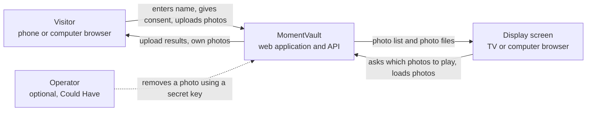

| Actor | Role | PRD role |
|---|---|---|
| Visitor | Uploads photos. May be new or returning. May delete or withdraw. | New visitor, Returning visitor |
| Display screen | Shows the slideshow. Not a person, and it never logs in. | Display screen |
| Operator | Removes an unwanted photo. Only if the optional feature is built. | Operator (Could Have) |

---

# 4. Container and Component Diagrams

## 4.1 Container Diagram

A "container" here is something that runs: a browser page, a server process, or a data store.

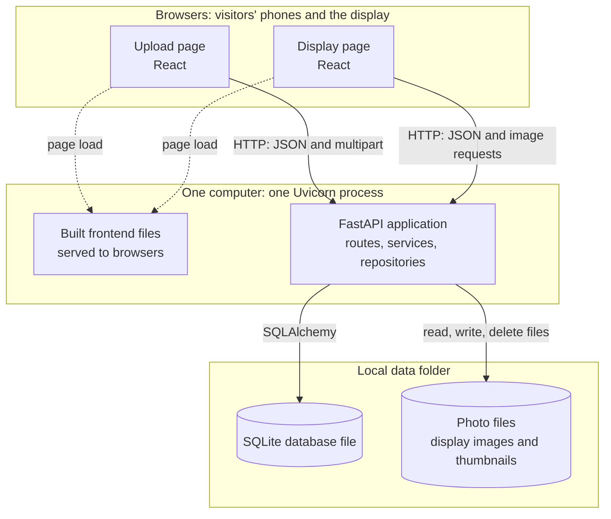

## 4.2 Backend Component Diagram

Arrows show "calls". Calls only go **downwards**.

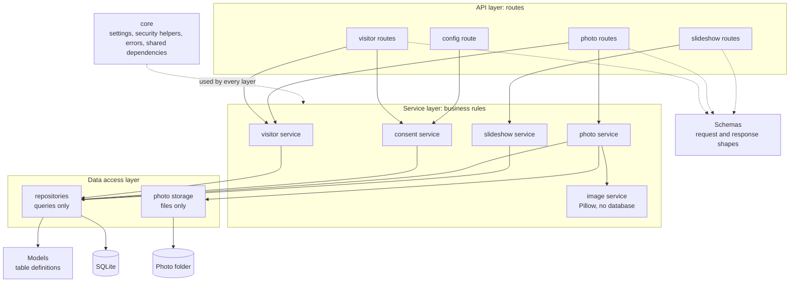

## 4.3 React Component Tree

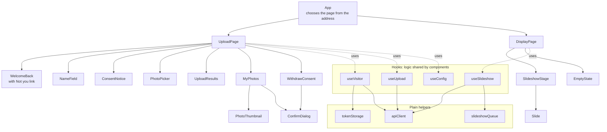

---

# 5. Architectural Patterns: Honest Evaluation

This section evaluates three well-known patterns and says plainly where each fits and where it does not.

## 5.1 Layered Architecture: **Recommended**

**What it means.** The program is split into horizontal layers. Each layer has one job. A layer may call the layer below it, never the one above.

**Why it is needed.** Without layers, one function ends up reading the web request, checking rules, running database queries and saving files. That is hard to test and hard to explain.

**How it works here.**

| Layer | Job | Example in this project |
|---|---|---|
| **API (routes)** | Receive the web request, check its shape, call a service, return the response | The photo upload route |
| **Schemas** | Describe the shape of requests and responses | "A name is text of 1 to 50 characters" |
| **Services** | Hold the business rules and coordinate work | "No photo is stored without consent" |
| **Repositories** | Run database queries, nothing else | "Find the active photos of visitor 7" |
| **Models** | Define the database tables | Visitor, Consent, Photo |
| **Storage and image modules** | Work with files and image content | Save a file, check a picture |

**The one rule.** Dependencies point **down**: routes call services, services call repositories, storage and the image module. A repository never calls a service. A service never knows about web requests.

**Practical example.** Deleting a photo: the route reads the photo number and the visitor token, the service checks ownership and orders the changes, the repository marks the photo removed, and the storage module deletes the file.

**Common mistakes.**
- Writing database queries inside route functions.
- Putting business rules in routes ("fat routes") or in the frontend only.
- A repository that commits changes on its own, so the service loses control of the transaction.
- A service that raises web errors (HTTP codes). Services raise their own error types, and the web layer translates them.

## 5.2 MVC: **Not used as a structure**

**What MVC means.** *Model-View-Controller* splits an app into the data (Model), the screen (View) and the part that handles input (Controller). It was designed for applications where the server builds the screens, such as server-rendered pages.

**Why it does not fit directly.**

| MVC part | In a server-rendered app | In this project |
|---|---|---|
| Model | Data and rules | SQLAlchemy models hold the data, but rules sit in services |
| View | HTML pages built by the server | **There is no server-side view.** FastAPI returns JSON. The screens are built by React, a separate program in the browser. |
| Controller | Handles requests, chooses a view | A route function, but it returns data, not a view |

React is not MVC either. It is **component-based**: the screen is built from small components that redraw when their state changes. Forcing MVC would mean creating empty `controllers/` and `views/` folders in the backend that do nothing real, which would confuse the explanation without helping the code.

**Honest verdict.** MVC is a **useful vocabulary**, not a folder structure here. If asked in a viva, "Is this MVC?", a good answer is: *"The backend is layered and the frontend is component-based. There are MVC-like roles (the route acts like a controller, the model holds data, React is the view), but it is not an MVC structure because the server returns JSON and does not render screens."*

## 5.3 Service and Repository Pattern: **Service layer yes, repository kept thin**

**What it means.**
- A **service** holds one area of business rules (for example, "photo service").
- A **repository** gathers all database queries for one table in one place.

**Why a service layer is worth it.** Many rules here are not about the database or the web: consent must exist, limits apply, withdrawal removes everything, previous photos follow new ones. Those rules need a home that can be tested without a web server.

**Why the repository needs care.** In larger systems, a repository is an *interface* that hides the database so it can be swapped. SQLAlchemy already offers much of that (its session tracks changes and groups them into transactions). A full interface-and-implementation setup would add files and concepts without benefit at this size.

**Decision: thin repository modules.** Repositories are plain groups of query functions, one module per table. They keep queries out of services, make services easier to test, and make a later database change easier. They do **not** use abstract base classes, generic repositories or interfaces.

| Option | Verdict |
|---|---|
| No repositories (queries inside services) | Acceptable for tiny apps, but services get cluttered and queries repeat. |
| **Thin repository modules** | **Chosen.** Small cost, clear separation. |
| Full abstract repository pattern | Rejected. Over-engineering for an MVP. |

**Review trigger.** If the repository files feel like pointless pass-through code after Day 2, merge them into the services. This is allowed and does not break any approved decision.

**Common mistakes.** Putting business rules in repositories. Letting repositories commit. Returning half-loaded objects that break after the session closes.

**Transaction rule.** The **service** decides when to commit. Repositories only read and add.

## 5.4 How These Ideas Relate to FastAPI

| Idea | In FastAPI |
|---|---|
| Routes | Functions grouped in routers, one router per area |
| Schemas | Pydantic models for request and response shapes |
| Connecting layers | **Dependency injection**: a route declares what it needs (a database session, settings, the current visitor), and FastAPI supplies it per request |
| Cross-cutting checks | **Middleware**, for example the request size guard (Section 13) |
| Error translation | Exception handlers that turn service errors into a standard JSON error (Section 12) |

> **In plain words:** dependency injection means a route does not build its own database session. It says "I need a session" and FastAPI hands one over. This is how each request gets its own session (needed for safe concurrency) and how tests can swap in a temporary database.

## 5.5 How These Ideas Relate to React

React has its own layering, and it mirrors the backend:

| Backend layer | Frontend equivalent | Job |
|---|---|---|
| Routes | **Pages** (`UploadPage`, `DisplayPage`) | Own a whole screen and connect its parts |
| Schemas | Shapes of data used by components | Agreed field names |
| Services | **Hooks** (`useUpload`, `useSlideshow`) and plain logic (`slideshowQueue`) | Behaviour and rules for the screen |
| Repositories | **`apiClient`** | The only code that talks to the backend |
| Models | Component state | Data currently on screen |
| Templates | **Components** | Draw pieces of the screen from data they receive |

**Component-based architecture rules for this project**

| Rule | Reason |
|---|---|
| A component draws things and reacts to clicks. It does not call `fetch` directly. | Keeps components simple and testable. |
| Components get data through **props** (inputs) and keep their own small **state** (memory). | The basic React idea. |
| **Hooks** hold logic that changes over time (polling, timers, uploading). | Keeps timers out of drawing code, which is where beginners meet bugs. |
| The slideshow ordering rules live in one **plain function module** (`slideshowQueue`) with no React inside. | Easy to test by hand and to explain. |
| No Redux, no routing library, no UI kit. | Not needed (TECH_STACK Part 7). |
| State is kept at the lowest level that needs it. | Avoids tangled data flow. |

> **In plain words:** a *component* is a reusable piece of screen, like a button or a photo card. *State* is what a component remembers. A *hook* is a way to share behaviour between components, such as "keep asking the server for updates".

## 5.6 Pattern Decision Summary

| Pattern | Decision | Reason |
|---|---|---|
| Layered architecture (backend) | **Adopt** | Simple, testable, matches FastAPI |
| MVC | **Do not adopt as a structure** | No server-side views |
| Service layer | **Adopt** | Business rules need a testable home |
| Repository | **Adopt thin modules only** | Separates queries without ceremony |
| Component-based architecture (frontend) | **Adopt** | The natural React model |
| Dependency injection | **Adopt through FastAPI's built-in mechanism** | Per-request sessions, easy test swaps |
| Domain model separate from ORM models | **Do not adopt** | One set of models is enough |

---

# 6. Frontend-to-Backend Communication Flow

## 6.1 Conventions

| Topic | Rule |
|---|---|
| Base path | Every API address starts with `/api`. |
| Data format | JSON for normal requests and responses. **Multipart form data** for the upload. |
| Visitor identity | The browser sends the **visitor token** in a custom request header. The header name is fixed in the API spec. The token is never in a web address, the page body or logs (FR-ID-05). |
| Who calls | Only `apiClient` calls the server. It adds the token header, reads errors and returns data. |
| Errors | Always a standard error shape with a **machine code** and a **plain message** (Section 12). |
| Time | All times are stored and sent in UTC (A-31). |
| Same origin | In normal use the browser sees one address (production, or the Vite proxy in development), so cross-origin settings are not needed. |
| Limits and settings | The frontend **asks the server** for limits, slide duration and the consent text instead of copying them (NFR-MNT-01). |

## 6.2 Proposed API Contract (to be confirmed in the API specification)

| Method and path | Who may call | Purpose | Main PRD links |
|---|---|---|---|
| `GET /api/config` | Anyone | Limits, allowed types, slide duration, poll interval, consent notice text and version | FR-CON-01, NFR-MNT-01 |
| `GET /api/visitor` | Token | Who am I? Returns name and photo count. Returns "not recognised" if the token is missing or invalid. | FR-ID-02, FR-ID-03 |
| `POST /api/photos` | Anyone (token optional) | Register if new, then upload up to the maximum number of photos. Returns a result per photo. Returns the token **once**, when a new visitor is created. | FR-REG, FR-CON-02, FR-UPL, FR-VAL |
| `GET /api/photos/mine` | Token | List my active photos (thumbnails) | FR-PRV-05 |
| `DELETE /api/photos/{id}` | Token (owner) | Delete one of my photos | FR-DEL |
| `POST /api/visitor/withdraw` | Token | Withdraw consent and remove everything | FR-WDR |
| `GET /api/slideshow` | Anyone | Display feed: active photo list and "play next" groups. Takes an optional `since_id`. | FR-AUT, FR-PRV |
| `GET /api/photos/{id}/image` | Anyone | The display-size image of an active photo | FR-DSP, FR-STO-05 |
| `GET /api/photos/{id}/thumbnail` | Anyone | The thumbnail of an active photo | FR-PRV-05 |
| `DELETE /api/operator/photos/{id}` | Operator key | Remove any photo (Could Have) | FR-OPR |

**Notes**
- Registration and upload share **one endpoint** (A-06): one form, one request.
- The upload request carries: name, consent flag, the consent **notice version**, and the files.
- Removed photos return "not found" from the image and thumbnail routes (FR-STO-05).
- `GET /api/photos/mine` and the thumbnail route support the Should Have "My photos". If assumption A-15 (thumbnails) is not approved, thumbnails are dropped.

## 6.3 Access Levels

| Level | Meaning | Examples |
|---|---|---|
| **Public** | No identification needed. Public by design (A-28). | `config`, `slideshow`, `image`, `thumbnail` |
| **Visitor token** | The server looks up the visitor from the token. | `visitor`, `photos/mine`, `delete`, `withdraw` |
| **Token optional** | A new visitor has none. A returning one sends it. | `POST /api/photos` |
| **Operator key** | A secret from environment settings. Could Have. | `operator` routes |

## 6.4 How Requests Reach the Right Place

| Situation | Path of a request |
|---|---|
| **Development** | Browser to the Vite server. Pages come from Vite. Requests starting with `/api` are forwarded to FastAPI. |
| **Demo and production (chosen)** | Browser to FastAPI. FastAPI serves the built pages and handles `/api`. One address for everything (TECH_STACK Option A). |

## 6.5 Caching

Stored photos never change, so the image and thumbnail routes can tell browsers to **keep a copy**. This reduces repeated downloads, and lets a display that loses its connection keep showing photos it already loaded (A-27). The slideshow feed, however, must **never be cached**, because it changes constantly.

---

# 7. Photo Upload Data Flow

## 7.1 What Happens, Step by Step

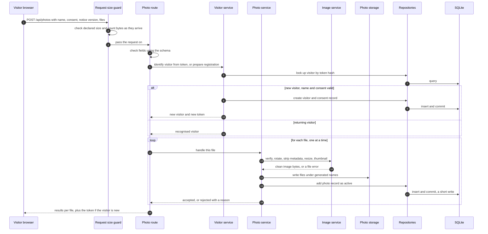

## 7.2 Step Table

| # | Step | Who | Rule |
|---|---|---|---|
| 1 | Size guard | Request size guard | Rejects a request whose **declared** size exceeds the total limit. Also counts the **real** bytes arriving and stops if the limit is passed, because the declared size can be missing or false (FR-VAL-03). |
| 2 | Field checks | Route and schema | Name is 1 to 50 characters. Consent flag present. Notice version matches the current one. File count is 1 to the maximum (FR-REG-02, FR-CON-02, FR-VAL-04). |
| 3 | Identify visitor | Visitor service | Token present and valid means returning. No token and valid name and consent means register (BR-03, FR-REG-03). A bad token is treated as new (FR-ID-03). |
| 4 | Register | Visitor service | Creates the visitor, stores only a **hash** of the token, creates the consent record, then **commits** so the visitor exists even if every photo fails (A-06). |
| 5 | Per-file checks | Photo service, image service | Extension and declared type, then real content (opened with Pillow), then pixel limit, then per-visitor photo limit (FR-VAL-01, 02, 05, 06). |
| 6 | Clean the image | Image service | Applies the photo's rotation, removes hidden data such as GPS, scales so the longest side is at most 1920 pixels, and makes a thumbnail (A-15). |
| 7 | Write files | Photo storage | Writes to temporary names, then moves into place under random generated names. The visitor's file name is **never** used (FR-STO-01). |
| 8 | Record the photo | Photo service, repository | One **short** database write adds the photo as `active`, then commits. The photo is now visible to the display. |
| 9 | Respond | Route | One result per file, in order. Rejected files say why. The token is included only when a visitor was just created. |

## 7.3 What Goes Wrong, and What Happens

| Failure | Result | Requirement |
|---|---|---|
| Invalid file among valid ones | That file is rejected. The others continue. | FR-UPL-03 |
| Request over the total limit | Whole request rejected with a clear message. Nothing stored. | ERR-05, ERR-08 |
| Failure while writing files | Any partial files are removed. No record is added. | FR-STO-04 |
| Failure while saving the record | The files just written are removed. The photo is reported as failed. | FR-STO-04 |
| Database busy | The system waits briefly, retries, then returns "try again". Nothing half-saved remains. | FR-CNC-03, ERR-15 |
| Connection lost mid-upload | The server discards what arrived. The phone shows "upload did not finish". | FR-UPL-02, ERR-13 |

## 7.4 Why Each Photo Is Saved Separately

Each accepted photo gets **its own short database write**, instead of saving all photos of a request together.

| Reason | Explanation |
|---|---|
| Meets "as soon as an upload completes" | A photo becomes visible as soon as **it** is ready, not after the slowest photo in the batch. |
| Keeps locks short | SQLite allows one writer at a time. Short writes mean other uploads rarely wait. |
| Matches independent handling | One failure does not undo the others (FR-UPL-03). |

Each submission receives a random **batch identifier**, stored on every photo from that request. It lets the slideshow treat one visit's photos together (Section 8).

## 7.5 Ten Simultaneous Uploads

| Concern | How the design handles it |
|---|---|
| Same file name | Stored names are random, so nothing is overwritten (FR-CNC-02). |
| Shared state | Each request has **its own database session**. Nothing is shared. |
| Database lock | Image work happens **before** and outside the database write. The write itself is short and waits briefly if another write is in progress (TECH_STACK Part 5.1). |
| Slideshow disruption | Display reads are not blocked by uploads in SQLite's WAL mode (FR-CNC-04). |
| CPU load | Image processing uses the processor. Under heavy load uploads become **slower**, not wrong. The 10-upload test records the time. |
| Memory load | A decoded 25-megapixel image needs roughly 75 to 100 MB of memory (estimate, to be measured). Ten of them at once could exhaust a small computer, so image work passes through a **gate** that allows only a few at a time (Section 7.6, AD-23). |

## 7.6 Checked Facts About the Frameworks (Verified 15 November 2026)

These were checked by reading the installed library code and running small tests in the build sandbox. They replace assumptions that v1.0 left for a Day 1 spike. Re-check them on the real versions pinned in `requirements.txt`.

| # | Fact | Evidence | Design consequence |
|---|---|---|---|
| V1 | Starlette's multipart parser reads the **whole request body** and stores each file in a temporary file (kept in memory up to 1 MB, then on disk) **before** the route function runs. | Source of `starlette/formparsers.py`: file parts go into `SpooledTemporaryFile(max_size=1 MB)`, and `parse()` finishes before returning. | A per-file size check inside the route runs **too late** to stop a large body arriving. The request size guard (AD-19) must count bytes **before** parsing. |
| V2 | The only built-in limits are `max_files` (default 1000), `max_fields` (default 1000) and a **1 MB limit for non-file parts**. There is **no limit on file size**. | Same source. | The guard must enforce the total byte limit. The route must also reject more than 5 files (FR-VAL-04). A browser can still send 1000 tiny files, so the guard should also cap the declared count where the framework version allows it. **Check at build** how to pass `max_files` in the pinned FastAPI version. |
| V3 | Uvicorn has no option to cap request body size. | Uvicorn options checked when TECH_STACK was written. | Same as V1: the cap is our own code. |
| V4 | Pillow's default decompression-bomb limit is **89,478,485 pixels** (about 89.5 MP), far above the PRD's 25 MP (P-05). | `Image.MAX_IMAGE_PIXELS` in Pillow 12.3.0. | Pillow's default alone does **not** enforce P-05. See AD-24. |
| V5 | `Image.open()` reads only the header, so the width and height are known **before** the pixels are decoded. | Test: after `open()`, the pixel data was not loaded yet, yet `size` was available. | The 25 MP check can run cheaply **before** the expensive decode. |

> **In plain words:** the framework accepts the whole upload first and only then lets our code look at it. So the "too big" test has to stand at the door, not inside the room.

---

# 8. Slideshow Retrieval and Refresh Flow

## 8.1 The Design in Plain Words

> **In plain words:** the display page asks the server every few seconds, "which photos exist, and has anyone new uploaded?" It keeps two lists in its own memory: a **waiting line** for photos that should play next, and a **main loop** of all photos. When the waiting line has something, that plays next. Otherwise the loop continues.

The server **remembers nothing about any display** (principle 4). Instead, every answer is built fresh from the database, using a **cursor**: the highest photo number the display has already seen.

## 8.2 What the Feed Contains

`GET /api/slideshow` returns:

| Field | Meaning |
|---|---|
| `photo_ids` | Every **active** photo number, oldest first. This is the main loop. It also reveals removals: a number missing from the list means "stop showing it". |
| `groups` | "Play next" groups for uploads **after** the display's cursor (see below). Empty on the first request. |
| `cursor` | The highest photo number ever assigned. The display sends it back as `since_id` next time. |

**First request (no cursor).** The server returns the loop and the current cursor, and **no groups**. A display that starts or reloads therefore does not replay history. It simply starts its loop.

**How the server builds `groups`** (stateless rule, using only the database and the cursor):

1. Find active photos with a number higher than the cursor.
2. Put them into groups by **batch** (one upload request), oldest batch first.
3. Each group lists the **new** photos in upload order.
4. If the display has **never seen** this batch (no photo of the batch is at or below the cursor), also list the **previous** photos: the same visitor's other active photos from earlier batches, **most recent first** (A-22, FR-PRV-02).
5. If the display has already seen part of the batch (the photos arrived over two polls), list **only the new photos** and no previous ones. This avoids replaying the earlier photos twice.

The feed contains **no names, tokens or visitor identifiers**. A visitor's identity is used only inside the server to find earlier photos.

## 8.3 End-to-End Request Flow: From Visitor to TV

This is the complete journey of one photo.

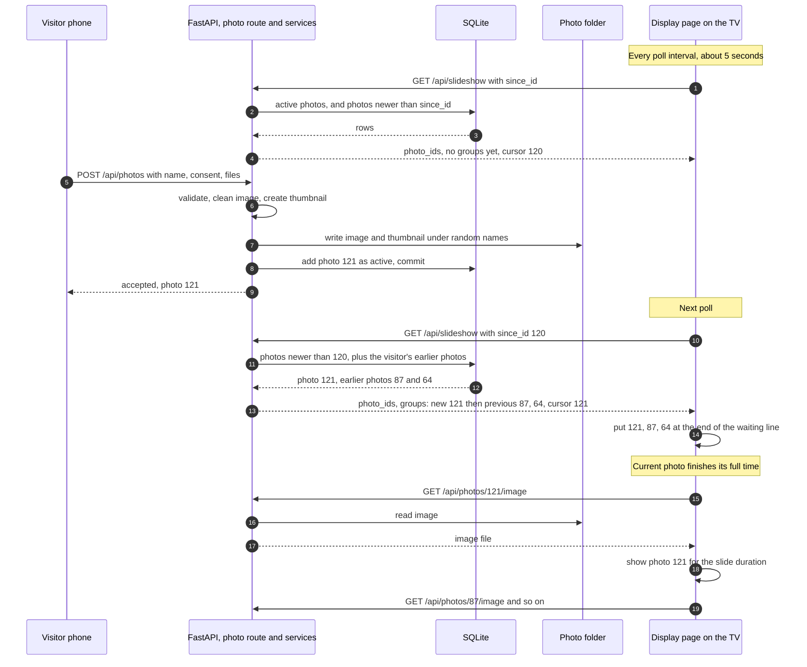

### Time from upload to screen

| Step | Time (estimate, to be measured) |
|---|---|
| Upload transfer | Depends on the phone's network and photo size |
| Server processing of this photo | Target 5 seconds or less for a 5 MB photo (NFR-PERF-01) |
| Wait for the display's next poll | Up to the poll interval (5 seconds, A-25) |
| Wait for the current photo to finish | Up to the slide duration (10 seconds, P-01), because the current photo is **never interrupted** (FR-AUT-03) |
| Download the image | Usually under a second on a local network (the display also **preloads** the next photo) |

**Important reading of the requirement.** PRD FR-AUT-01 says a new photo appears "within 10 seconds". With the slide duration at 10 seconds and the no-interrupt rule, the photo is **in the display's waiting line** within about the poll interval after saving, but it appears **on screen** only after the current photo ends. The worst case is roughly processing time plus 5 plus 10 seconds. This is not a conflict, but the PRD should say clearly that "10 seconds" means *enters the waiting line* (see Section 18, item 1).

## 8.4 How the Display Chooses the Next Photo

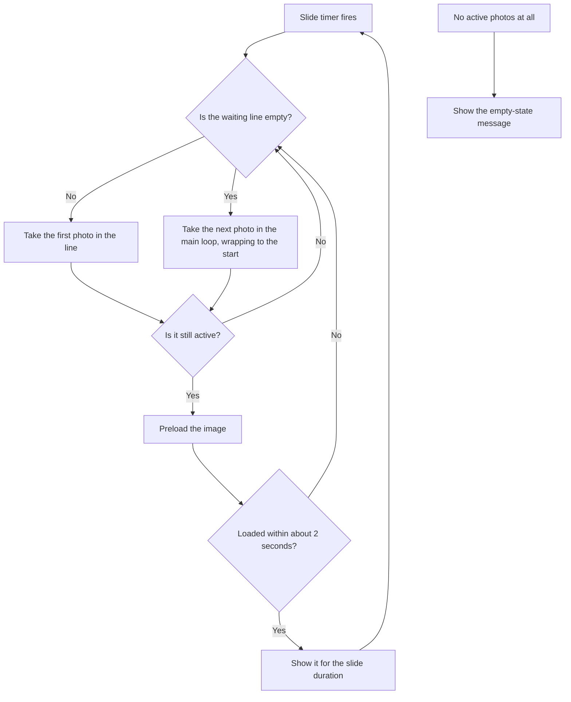

## 8.5 What Happens at Each Poll

| Event in the feed | Display action |
|---|---|
| A number in `photo_ids` the display does not know | Append to the end of the main loop |
| A known number missing from `photo_ids` | Remove from the loop and the waiting line. If it is on screen now, it finishes its time. |
| A group | Append its new photos, then its previous photos, to the **end** of the waiting line, skipping any already waiting or on screen (A-23) |
| `cursor` | Remember it for the next request |
| The request fails | Keep playing what is already loaded and try again at the next poll (FR-DSP-08, A-27) |

## 8.6 Display State Held in the Browser

| Item | Lives in | Lost on reload? |
|---|---|---|
| Main loop and position | Display page memory | Yes. The loop restarts. |
| Waiting line | Display page memory | **Yes.** Accepted limitation (A-21). |
| Cursor | Display page memory | Yes. The first request after a reload returns no groups. |
| Loaded images | Browser cache | May survive, which helps short outages |

---

# 9. Returning Visitor Identification Flow

## 9.1 Overview

> **In plain words:** the first time someone uploads, the server hands their browser a long random "ticket". The browser keeps it. Next time, the browser shows the ticket and the server says "welcome back". The name is **only a label**. It is never used to find anyone (BR-01, A-01).

## 9.2 Flow

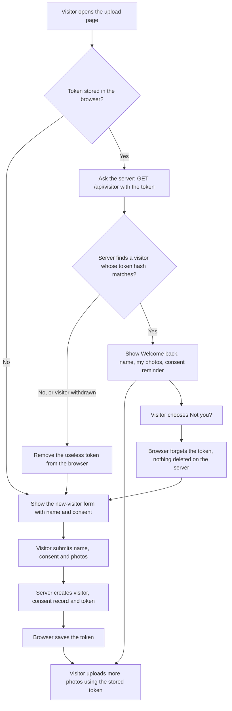

## 9.3 Token Life Cycle

| Stage | What happens |
|---|---|
| **Create** | When a new visitor registers, the server generates a random value of at least 128 bits using Python's secure random source (FR-ID-01). |
| **Return once** | The raw token is sent back to the browser in the response of the registration request, once only. |
| **Store in the server** | Only a **hash** (a one-way scramble) is saved. Because the token is long and random, a fast standard hash is enough. This is different from passwords, which are short and guessable and need slow hashes. |
| **Store in the browser** | In the browser's local storage, wrapped so a failure does not stop the page (ERR-23). |
| **Use** | The browser sends it in a request header. The server hashes it and looks the visitor up by the hash. |
| **Protect** | Never in a web address, page text, error message or log (FR-ID-05). |
| **End** | Withdrawal clears the stored hash and the browser token (FR-WDR-03). "Not you?" forgets only the browser copy (FR-ID-04). |

## 9.3a Decision: Browser Storage and Header, Not a Cookie

ASSUMPTIONS A-01 left the choice between a cookie and browser storage to this document.

| | **Local storage and request header (chosen)** | Secure cookie |
|---|---|---|
| Easy to explain and test | Yes. Tests simply set a header. | Needs cookie handling in tests |
| Protection from malicious scripts | Weaker. A script on the page could read it. | Stronger, if the cookie is hidden from scripts |
| Cross-site request tricks | Not exposed, because the browser does not add the header automatically | Needs extra protection |
| Works over plain HTTP on a local network | Yes | Partly. The `Secure` setting needs HTTPS. |
| Clearing it ("Not you?") | The page does it | Needs a server call |

**Why chosen:** simplicity and explainability for a local MVP. **Mitigation for the weaker script protection:** React draws visitor-supplied text as plain text, the app never inserts raw HTML, and a content security policy header is recommended (Section 13). **Revisit** if the app is deployed publicly over HTTPS (Section 16).

## 9.4 Edge Cases

| Situation | Behaviour | Reference |
|---|---|---|
| Different browser, device or private window | Treated as a new visitor. Earlier photos stay on the display but cannot be managed. | A-03, ERR-25 |
| Token edited or random | Not found, so treated as new. The bad token is removed. | FR-ID-03, ERR-16 |
| Token after withdrawal | Not found, so treated as new. | FR-WDR-04, ERR-19 |
| Browser cannot store the token | Upload still works. The visitor looks new every time. The page warns once. | ERR-23 |
| Two tabs register at the same instant | May create two visitor records. Known limitation. | ERR-24 |
| Same name, different people | Two separate visitors. Names are never compared. | FR-REG-04, FR-ID-03a |

---

# 9A. Deletion and Withdrawal Flows

These are Should Have features, shown here so the architecture supports them.

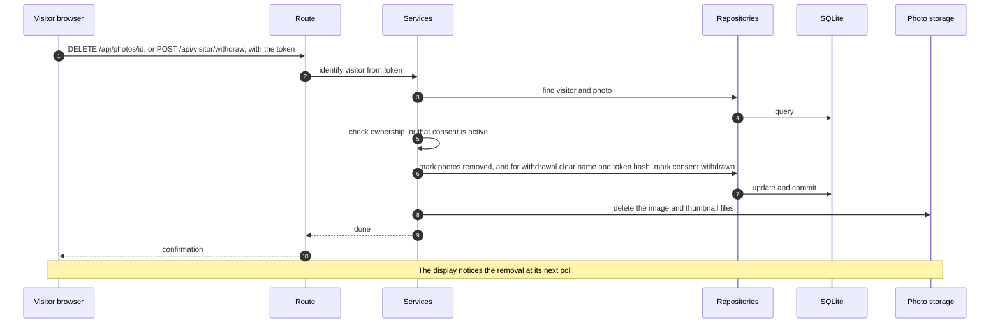

**Order matters.** The database is changed and committed **first**, then the files are deleted. If file deletion fails, the photo is already invisible (it is no longer in the feed) and only a leftover file remains, which is logged for clean-up. The opposite order could leave an "active" photo pointing to a missing file.

---

# 10. Database and Image Storage Responsibilities

## 10.1 Who Owns What

| Store | Owns | Does not own |
|---|---|---|
| **SQLite database** | Visitors, consent records, photo records (owner, file names, time, status), the order of photos | The image files themselves |
| **Photo folder** | Display images and thumbnails | Any information about owners, status or consent |

> **In plain words:** the database is the **filing cabinet index**: it says who owns which photo and whether it may be shown. The folder holds the **actual pictures**. A photo is only shown if the index says it is active **and** the picture file exists.

## 10.2 Data Model

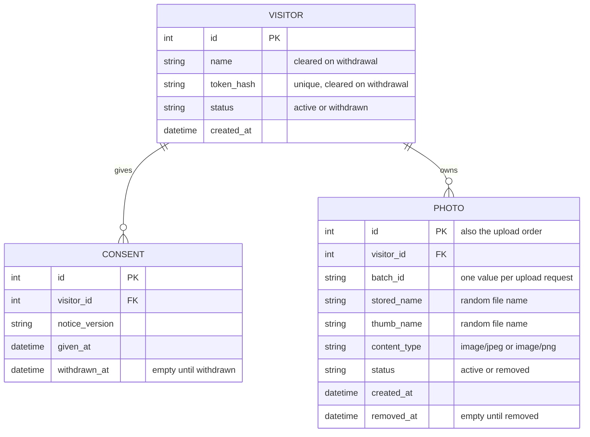

### Tables

| Table | Purpose | Notes |
|---|---|---|
| **visitor** | One row per registered visitor | The **name is not unique** (FR-REG-04). Only the **token hash** is stored, never the token. After withdrawal, the name and hash are cleared and status becomes `withdrawn`. |
| **consent** | Who consented, when, to which notice version | Kept after withdrawal with **no personal data**: visitor id, times and version only (A-09, FR-CON-03). |
| **photo** | One row per accepted photo | `id` increases with each new photo, so it doubles as the **upload order** and the slideshow **cursor**. A removed photo keeps its row with status `removed` and no personal data. |

### Indexes (speed-ups for the common questions)

| Index | Used for |
|---|---|
| visitor: token hash (unique) | "Who owns this token?" on every identified request |
| photo: status and id | The slideshow feed (all active photos in order) |
| photo: visitor and status and id | A visitor's own and previous photos |
| photo: batch | Grouping one request's photos |

> **In plain words:** an index is like the index in a book. Without it the database reads every row to answer a question.

### Rules

| Rule | Reason |
|---|---|
| Foreign keys are **switched on** for every SQLite connection and tested | SQLite does not enforce them by default (TECH_STACK 4.4). |
| Status values are limited to the ones above | Prevents invalid states. |
| Times are UTC | A-31. |
| No raw SQL assembled from user input | SQLAlchemy builds safe queries. |
| Tables are created at start-up. No migration tool in the MVP. | TECH_STACK Part 7. |

**Why `photo.id` can be the cursor.** SQLite allows only one write at a time. A photo row is added only when the photo is **fully ready**, inside one short write. So photos become visible in the same order as their numbers, and "everything with a number above the cursor" never skips a photo. **This depends on SQLite's single writer.** A different database would need a different cursor method (Section 16, M-1).

## 10.3 Photo Storage

| Topic | Design |
|---|---|
| Location | `data/photos/` for display images, `data/thumbs/` for thumbnails, beside `data/momentvault.db` (one folder, one place to keep safe, TECH_STACK 5.2) |
| Names | Random, generated by the server. The original file name is never used in a path (FR-STO-01). |
| Content | The **cleaned copy** only (rotated, metadata removed, scaled to at most 1920 pixels). The original upload is not kept (A-15). |
| Format | JPEG stays JPEG and PNG stays PNG. The stored content type is recorded. |
| Delivery | Only through the image route, by photo number. The server reads the file name from the database, **never from the request**, so request text cannot choose a path (FR-STO-05). |
| Listing | The folder is never browsable. |
| Executables | Files are never executed. Only image bytes are served, with a fixed image content type and a "do not guess the type" header. |

## 10.4 Order of Operations (Consistency Rules)

| Operation | Order | If it fails halfway |
|---|---|---|
| **Add photo** | 1. Clean image in memory. 2. Write files (temporary names, then rename). 3. Add and commit the row. | Before step 3: delete the files. Nothing visible. |
| **Delete photo** | 1. Mark removed and commit. 2. Delete files. | Row removed but a file remains: harmless, logged for clean-up. |
| **Withdraw** | 1. In one transaction: mark photos removed, clear name and token hash, mark consent withdrawn. 2. Delete files. | Same as delete. |
| **Server crash during an upload** | Possible orphan files with no row. | Harmless. An optional start-up sweep that removes files without rows is recommended (Should Have). |

## 10.5 Photo Life Cycle

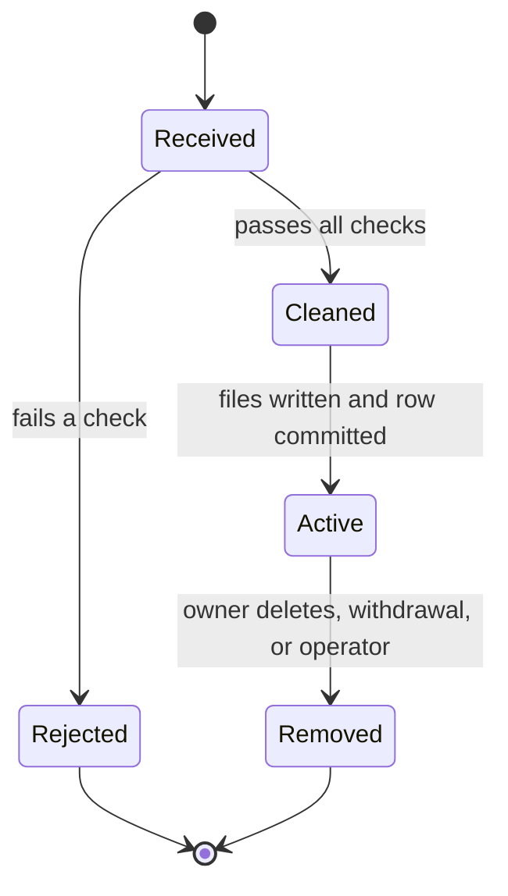

A photo is **visible to the display only in the `Active` state** (BR-09, BR-10).

## 10.6 Retention

There is **no automatic expiry**. Photos stay until deleted or consent is withdrawn (BR-13). The real-world retention period is **OPEN** (A-11) and does not block the MVP.

---

# 11. Component Responsibilities

## 11.1 Backend

| Component | Responsible for | Calls | Must **not** |
|---|---|---|---|
| **Routes** (`api`) | Reading the request, calling one service, shaping the response, choosing the status code | Services, schemas | Contain business rules or database queries |
| **Schemas** | Defining request and response shapes, and field checks such as name length | Nothing | Touch the database or files |
| **Models** | Table definitions and relationships | Nothing | Contain business rules |
| **Visitor service** | Registering, identifying by token hash, "Not you" support data, withdrawal rules | Repositories, security helpers | Know about HTTP |
| **Consent service** | Consent required, notice version check, recording consent | Repositories | Know about HTTP |
| **Photo service** | The upload sequence, limits per visitor, ownership checks, deletion, operator removal | Image service, storage, repositories | Know about HTTP, or open files for reading itself |
| **Slideshow service** | Building the feed: active list, groups, cursor | Repositories | Remember anything between requests |
| **Image service** | Verify, rotate, strip metadata, scale, thumbnails, pixel limit (read from the image header **before** decoding, AD-24), and the **processing gate** that allows only a few images to be decoded at once (AD-23) | Pillow only | Touch the database or the disk |
| **Repositories** | Queries and adding or updating rows | Models, the session | **Commit**, or contain business rules |
| **Photo storage** | Saving, reading and deleting files, generated names, temporary-then-rename writes | The file system | Know about visitors, consent or the database |
| **Core: settings** | Reading configuration (limits, paths, keys) once | Environment | Hard-code secrets |
| **Core: security helpers** | Token generation, hashing, operator-key comparison | Secure random and hash libraries | Log tokens |
| **Core: errors** | The service error types and the standard error shape | Nothing | Contain web-specific code beyond translation |
| **Core: dependencies** | Per-request database session, current visitor, operator check | Repositories via services | Hold global state |
| **Request size guard** | Rejecting over-large requests early | Settings | Parse form fields |
| **DB set-up** | Engine, WAL mode, busy wait, foreign keys, table creation at start | SQLAlchemy | Contain queries |

## 11.2 Frontend

| Component or module | Responsible for | Must **not** |
|---|---|---|
| **App** | Choosing the page by address | Contain page logic |
| **UploadPage** | Arranging upload screen parts, connecting hooks | Call `fetch` directly |
| **DisplayPage** | Arranging the stage and the empty state | Contain queue rules |
| **Small components** (`NameField`, `ConsentNotice`, `PhotoPicker`, `UploadResults`, `MyPhotos`, `PhotoThumbnail`, `WithdrawConsent`, `ConfirmDialog`, `WelcomeBack`, `SlideshowStage`, `Slide`, `EmptyState`) | Drawing and reacting to clicks | Hold server logic |
| **useConfig** | Loading limits, durations and the consent text once | Duplicate the limits |
| **useVisitor** | Reading the stored token, asking the server who it is, "Not you", withdrawal | Store the token anywhere except `tokenStorage` |
| **useUpload** | Early checks, sending, progress, per-file results, preventing double submit | Decide business rules that the server also enforces |
| **useSlideshow** | Polling, the slide timer, preloading, keeping the waiting line and loop | Contain ordering rules (calls `slideshowQueue`) |
| **slideshowQueue** | The pure ordering logic: add groups, dedupe, remove, choose next | Use React or the network |
| **apiClient** | The only caller of the server: adds the token header, converts errors | Keep UI state |
| **tokenStorage** | Reading, writing and clearing the token, tolerating failure | Log the token |

## 11.3 How Each Part Is Tested

| Part | How |
|---|---|
| Image service | Unit tests with the sample files in PRD Appendix B. No database needed. |
| Services | Tests with a temporary database and a temporary photo folder. |
| Routes | FastAPI's test client, including multi-file uploads and the 10-simultaneous-upload test. |
| Photo storage | Tests with a temporary folder, including forced failures. |
| `slideshowQueue` | Manual checks with fixed data, or a small test file if time allows (TECH_STACK 4.16). |
| Pages and display behaviour | Manual test plan with recorded results, on a phone, a computer and the TV. |

---

# 12. Error-Handling Strategy

## 12.1 Principles

1. **Fail safe.** A failure must never leave half-saved data (FR-STO-04).
2. **Say what to do.** Messages are plain and actionable (NFR-USA-03).
3. **Say nothing technical.** No file paths, tokens, stack traces or database details reach visitors (NFR-SEC-04).
4. **One shape everywhere.** Every error from the API looks the same.
5. **Services speak in their own errors.** Only the web layer chooses status codes.
6. **Log for developers, message for visitors.** Different content for different readers.

## 12.2 Where Each Kind of Error Is Handled

| Layer | Handles |
|---|---|
| Request size guard | Request over the limit |
| Schemas | Missing or badly shaped fields (name length, consent flag) |
| Services | Rule violations: no consent, limit reached, not the owner, not recognised |
| Image service | Invalid, corrupt or oversized images |
| Photo storage | File write and delete failures (cleans up, then reports) |
| Repositories and DB set-up | Database busy and other database errors (translated into a "busy" error) |
| Exception handlers (web layer) | Turn service errors into the standard error response. Catch anything unexpected and return a generic message. |
| Frontend `apiClient` | Turns responses and network failures into messages |

## 12.3 Standard Error Shape

Every error response contains: a stable **`code`** (for the frontend), a human **`message`**, and optional **`details`** (for example which file). Per-file problems are **not** request errors. They appear inside the upload response, one result per file.

## 12.4 Error Codes and Status Mapping

| Code | HTTP status | Level | PRD error |
|---|---|---|---|
| `NAME_REQUIRED`, `NAME_TOO_LONG`, `NAME_INVALID` | 422 | Request | ERR-01, ERR-02 |
| `CONSENT_REQUIRED` | 422 | Request | ERR-03 |
| `CONSENT_NOTICE_CHANGED` (stale notice version) | 409 | Request | Small addition, see Section 18 |
| `NO_FILES` | 422 | Request | ERR-04 |
| `TOO_MANY_FILES` | 422 | Request | ERR-05 |
| `REQUEST_TOO_LARGE` | 413 | Request | ERR-05, ERR-08 |
| `FILE_TYPE_NOT_ALLOWED` (includes unsupported phone formats) | none, per-file result | File | ERR-06, ERR-12 |
| `FILE_NOT_AN_IMAGE` | none, per-file result | File | ERR-07 |
| `FILE_TOO_LARGE` | none, per-file result | File | ERR-08 |
| `IMAGE_TOO_LARGE_PIXELS` | none, per-file result | File | ERR-09 |
| `FILE_EMPTY_OR_CORRUPT` | none, per-file result | File | ERR-10 |
| `PHOTO_LIMIT_REACHED` | none, per-file result | File | ERR-11 |
| `VISITOR_NOT_RECOGNISED` | 401 | Request | ERR-16, ERR-19 |
| `NOT_PHOTO_OWNER` | 403 | Request | ERR-17 |
| `PHOTO_NOT_FOUND` | 404 | Request | FR-STO-05 |
| Delete of an already removed photo | 200 with an "already removed" note | Request | ERR-18 |
| `SERVER_BUSY` (with a "try again after" hint) | 503 | Request | ERR-15 |
| `TOO_MANY_REQUESTS` (if rate limiting is built) | 429 | Request | ERR-20 |
| `INTERNAL_ERROR` | 500 | Request | ERR-14 |

Handled **outside** the API: upload interrupted (ERR-13, detected by the phone), display cannot reach the server or a photo will not load (ERR-21, ERR-22, handled by the display), browser cannot store the token (ERR-23), two-tab registration (ERR-24) and different device (ERR-25), which are known limitations.

**Upload response rule.** If the name, consent and request shape are fine, the response is **successful** and lists a result per file, even when some or all files are rejected. Request-level problems use the error statuses above.

## 12.5 Transactions and Clean-Up

| Rule | Reason |
|---|---|
| Services decide when to commit. Repositories never do. | Keeps each unit of work whole. |
| A failed step **rolls back** its database changes. | No half-saved records. |
| A failed step **deletes** files it already wrote. | No orphans from known failures. |
| Delete: database first, files second. | The display never shows a photo that is pending removal (Section 10.4). |

## 12.6 Logging

| Include | Never include |
|---|---|
| Event type, status code, error code, photo number, duration | Tokens or token hashes, file contents, names of visitors, request bodies |
| A short **request id** to match a visitor's complaint to a log line | Operator keys |

Unexpected errors log full detail on the server and return only the generic message to the visitor.

## 12.7 Frontend Handling and Degraded Modes

| Situation | Behaviour |
|---|---|
| Upload page loses the network | Message "upload did not finish, please try again". No automatic retry or queue (A-27). |
| Server returns `SERVER_BUSY` | "The system is busy. Please try again in a moment." |
| Display loses the server | Keeps playing loaded photos, retries at each poll, shows no error text on the TV (A-27, FR-DSP-08). |
| Display page loaded while the server is down | Shows a simple "Reconnecting" message. |
| A photo will not load on the display | Skip it within about 2 seconds (FR-DSP-06). |
| Config cannot be loaded on the upload page | The form is disabled and a retry message is shown, because limits and consent text are unknown. |

---

# 13. Security Boundaries

## 13.1 Trust Zones

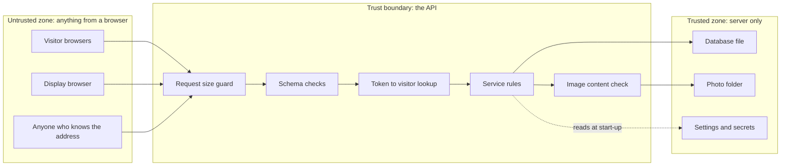

> **In plain words:** everything coming from a browser is treated as possibly hostile. Only the server's own code, after passing every check, may touch the database and the photo folder.

## 13.2 Controls at the Boundary

| Threat | Control | Where |
|---|---|---|
| Oversized or endless uploads | Declared and real byte counting, total request limit, per-file limit, file count limit, pixel limit | Size guard, services, image service (FR-VAL) |
| Fake images (a text file renamed) | Content verified by opening with Pillow, not by name or declared type | Image service (FR-VAL-02) |
| Hidden scripts in images | Only JPEG and PNG, re-encoded to a clean copy, served with a fixed image type and a "do not guess the type" header | Image service, image route |
| Path tricks in file names | Visitor file names never used in paths. Stored names are random. File name read from the database, never from the request. | Photo storage, image route (FR-STO-01, FR-STO-05) |
| Script injection through names | Names are always drawn as plain text and never inserted as raw HTML (NFR-SEC-03) | React components |
| SQL injection | Queries built by SQLAlchemy with bound values | Repositories |
| Token guessing | At least 128 bits of randomness | Security helpers (FR-ID-01) |
| Token leaks from the database | Only a hash is stored | Visitor service |
| Token leaks through logs and errors | Never logged, never in addresses or messages | Logging rules, error handlers (FR-ID-05) |
| Acting on someone else's photos | Ownership check on every delete | Photo service (FR-DEL-02) |
| Uploading without consent | Server-side check, not only in the browser | Consent service (FR-CON-02) |
| Stale consent text | Notice version must match the current one | Consent service |
| Abuse of operator functions | Secret key from environment settings, compared safely | Operator dependency (FR-OPR, Could Have) |
| Directory listing of photos | No static folder is exposed | Image route design |
| Leaked secrets | `.env` and the data folder excluded from Git. Only placeholders in `.env.example` (NFR-SEC-02). | Repository rules |
| Cross-origin misuse | Not needed in single-address use. If enabled, restricted to the configured address only (NFR-SEC-05). | Core settings |
| Information leaks in errors | Generic messages to visitors, detail only in server logs | Exception handlers |
| Excessive spam | Per-visitor photo limit now. Rate limiting is a Could Have (FR-VAL-08). | Photo service |

**Recommended response headers (Should Have):** a content security policy limiting scripts to the app's own address, a "do not guess content types" header, and no caching on the slideshow feed.

## 13.3 What Is Public by Design

| Public | Why |
|---|---|
| The upload page and display page | Visitors need no login, and a TV cannot log in (A-28). |
| The slideshow feed and active photo files | The display must read them, and the photos are shown publicly anyway. Photo numbers are guessable counters, so anyone could fetch all **active** photos. This gives no more than watching the screen. Removed photos return "not found". |
| The configuration | It holds only limits and the consent text. |

**Never exposed publicly:** visitor names (unless the optional caption is built), tokens and hashes, visitor identifiers, consent records, file paths.

## 13.4 What This Architecture Does **Not** Protect Against

| Limit | Note |
|---|---|
| Someone sharing or screenshotting what is shown | Cannot be prevented. The consent notice says so (A-08). |
| Inappropriate uploads | No automatic moderation. Removal depends on the owner or the optional operator feature (A-29). |
| A determined flood from one address | Only basic limits exist. Rate limiting is future work. |
| Anyone using the same browser profile | They act as that visitor (A-01). |
| Plain HTTP on a local network | Traffic can be read on that network. Acceptable for a demo, not for public use (Section 14). |
| Confirming who is in a photo | Consent is self-declared (A-07). |

---

# 14. Deployment Architecture

## 14.1 Modes

| Mode | Purpose | Status |
|---|---|---|
| **Development** | Day-to-day coding | Used |
| **Local network demo** | Marking, live demo and testing with real phones | **Selected for the MVP** (A-30 provisional default) |
| **Single-host deployment** | Optional public link | Optional, only on a host with persistent storage and after a restart test (TECH_STACK 5.3) |

## 14.2 Development Mode

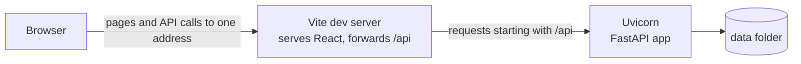

## 14.3 Local Network Demo (Selected)

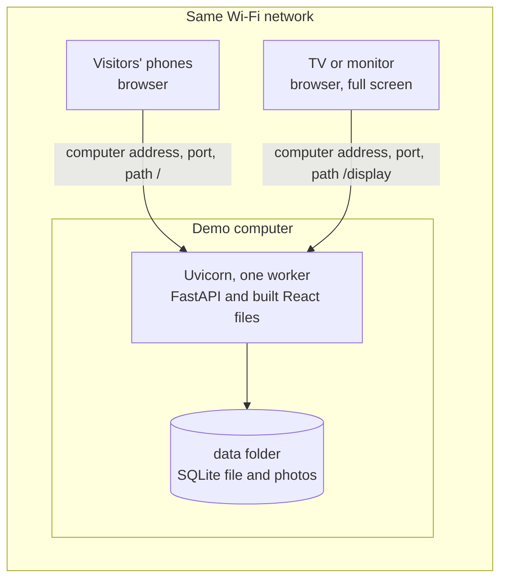

## 14.4 Process Model

| Item | Choice | Reason |
|---|---|---|
| Server processes | **One** Uvicorn process with one worker | SQLite's single writer, and the app keeps no shared state between workers (TECH_STACK 5.1) |
| Request handling | Ordinary functions run in a pool of worker threads | Pillow and SQLAlchemy block while working, and the pool keeps the server responsive |
| Database connections | One session per request | Safe concurrency (A-19) |
| Static files | Served by the same process | One address, no cross-origin set-up (TECH_STACK 5.4) |

## 14.5 Configuration

All settings come from **environment variables** or a `.env` file that is **not** in Git. `.env.example` holds placeholder values only.

| Setting | Default | Notes |
|---|---|---|
| Data folder location | `data/` | Holds the database and photo folders |
| Slide duration | 10 seconds | P-01 |
| Poll interval | 5 seconds | A-25 |
| Maximum file size | 5 MB | P-02 |
| Maximum photos per request | 5 | P-03 |
| Allowed image types | JPEG and PNG | P-04 |
| Maximum image size in pixels | 25 megapixels | P-05. Enforced by our own check, not by Pillow's default (AD-24). |
| Maximum images processed at once | 4 | Proposed. Memory protection (AD-23). Tune after measuring. |
| Name length | 1 to 50 | P-06 |
| Maximum active photos per visitor | 20 | P-07 |
| Consent notice version and text | `v1` | P-09 |
| Maximum earlier photos replayed | all, up to the visitor limit | Proposed P-10 (A-23) |
| Database busy wait | A few seconds | Part 5.1 of TECH_STACK |
| Allowed origins | none | Only if cross-origin use is ever enabled |
| Operator key | empty, so the feature is off | Could Have. **Placeholder only** in `.env.example`. |

## 14.6 Start-Up Sequence

1. Read settings. Stop with a clear message if something required is missing.
2. Create the data folders if they do not exist.
3. Open the database, switch on WAL mode, the busy wait and foreign keys, and create missing tables.
4. (Should Have) Remove photo files that have no database row.
5. Register the API routes and the error handlers.
6. If the built frontend exists, serve it for `/` and `/display`.

## 14.7 Network Checklist for the Demo

| Check | Why |
|---|---|
| Phones and the computer are on the **same network** | Phones cannot use "localhost" (A-30) |
| The server listens on the **network**, not only on the computer itself | Otherwise phones cannot connect |
| The computer's firewall allows the chosen port | Common cause of "cannot connect" |
| The display is opened in **full screen** by one manual step, and sleep is off | Browsers do not allow automatic full screen (A-26) |
| Rehearse with **real phones** and the **real TV** | Not assumed to work (A-12, A-26) |
| HTTPS is **not available** on the local network | The app uses no feature that needs it, to be confirmed in testing on real phones |

## 14.8 Data Safety

| Topic | Design |
|---|---|
| Backup | A manual copy of the whole `data/` folder with the app **stopped**. In WAL mode the database has extra files, and a copy taken while running may miss recent changes. |
| Reset between demos | Stop the app and clear the `data/` folder. A scripted reset is a future item (E-05). |
| Hosts that erase files | Never use one for real data (TECH_STACK 5.3). Run a restart test before trusting any host. |

---

# 15. Architectural Limitations

| # | Limitation | Effect | Mitigation or note |
|---|---|---|---|
| L1 | **One server process and one SQLite writer** | Fine for a small event. Heavy simultaneous uploads become slower. | Short writes, WAL mode, the 10-upload test (A-19). Migrate if outgrown (M-1). |
| L2 | **Photos on one computer's disk** | No backup. Lost with the disk. Cannot run several servers. | Manual backup. Object storage later (M-2). |
| L3 | **Polling delay** | New photos enter the waiting line up to about 5 seconds late, and appear after the current slide. | Documented (Section 8.3). A shorter interval or push updates later (M-3). |
| L4 | **The waiting line lives in the display's memory** | A reload restarts the loop and loses the line. | Accepted (A-21). A server-held playlist later (E-12). |
| L5 | **Large waiting lines** | A busy event could delay "play next". | Duplicate suppression now. The cap setting P-10 can be tightened (A-23). |
| L6 | **Visitor identity is tied to one browser** | A new device means a new visitor. Lost tokens orphan photos. | A-03, A-04. Recovery code later (E-01). |
| L7 | **No moderation or admin tools** | Unwanted photos stay until removed. | Optional operator removal (A-29). |
| L8 | **Public, guessable photo numbers** | All active photos can be fetched by anyone who knows the address. | Same exposure as the public screen. Removed photos are not served. |
| L9 | **The cursor method depends on SQLite's single writer** | A different database needs a different method. | Recorded in M-1. |
| L10 | **Request size limits need a custom guard** | Verified: the framework stores the whole body before the route runs and has no file size limit (Section 7.6, V1 to V3). | The size guard (Section 7.2). A short Day 1 test confirms it on the pinned versions (S1). |
| L11 | **Processing uses the CPU** | Many large simultaneous uploads slow everything. | Per-file limits, pixel limit, measured in the concurrency test. |
| L12 | **Plain HTTP on a local network** | Not suitable for public exposure. | HTTPS for any public deployment. |
| L13 | **No automatic expiry or backups** | Data stays indefinitely. | A-11 is OPEN. |
| L14 | **Display depends on a current browser** | Old TV browsers may fail. | Test early. Laptop by HDMI as fallback (A-26). |
| L15 | **No offline mode** | A reloaded display with no server shows only "Reconnecting". | A-27. Offline cache later (E-07). |

---

# 16. Future Scalability Improvements

These are **not** part of the MVP. The table shows what each would change, and, because of the layering, what would **stay the same**.

| ID | Improvement | Trigger | Layers affected | What stays the same |
|---|---|---|---|---|
| M-1 | SQLite to PostgreSQL | Many simultaneous writers, or several server instances | Database set-up, repositories (query details), and the **cursor method** (photo numbers may not become visible in order, so use a commit time with an overlap window) | Routes, schemas, services, frontend |
| M-2 | Local disk to object storage | Several instances, or a host without persistent disks | **Photo storage module only**, plus how images are served | Everything else |
| M-3 | Polling to Server-Sent Events or WebSockets | Instant updates, many displays | Slideshow route and the `useSlideshow` hook | Services, database, other pages |
| M-4 | Migration tool (Alembic) | The first release that changes tables | DB set-up | Application code |
| M-5 | Docker | Repeatable deployment | Packaging only | Application code |
| M-6 | Continuous integration | Frequent changes | Repository tooling | Application code |
| M-11 | Separate frontend hosting | Growth | Hosting and cross-origin settings | Application code |
| E-01 | Recovery code for new devices | Cross-device recognition needed | Visitor service, upload page | Display, storage |
| E-02 / E-03 | Moderation queue, operator dashboard with login | Public events | New photo status ("pending"), new routes, authentication. The display already shows only `active` photos, so it is unchanged. | Display, storage |
| E-04 | Rate limiting | Public deployment | Middleware | Services |
| E-05 | Scheduled expiry, reset command | A retention policy (A-11) | A scheduled task in the service layer | Routes, display |
| E-12 | Server-held playlist | Reloads must not lose the waiting line, or screens must stay in sync | Slideshow service and display hook | Database model largely |
| New | Background workers for image processing | Slow uploads under load | Photo service (hands work to a queue) | Routes, storage |
| New | Several server instances | Large scale | Needs M-1 and M-2 first. The server is already stateless, which helps. | Services, frontend |
| New | Cookie-based token and HTTPS | Public deployment | Security helpers, `apiClient`, `tokenStorage` | Services, database |

**Why the layering helps:** replacing the database touches repositories. Replacing file storage touches one module. Changing the update method touches one route and one hook. That is the benefit of the boundaries in Section 5.

---

# 17. Architecture Decision Log

| ID | Decision | Reason | Alternatives rejected |
|---|---|---|---|
| AD-01 | Backend uses a **simple layered architecture** | Testable, explainable | MVC (no fit), hexagonal or clean architecture (too much ceremony) |
| AD-02 | **MVC is not used** as a structure | No server-side views | Forcing empty folders |
| AD-03 | **Thin repository modules**, with a review trigger | Keeps queries out of services without interfaces | Full repository pattern, no repositories |
| AD-04 | **Services decide commits** | Keeps each unit of work whole | Repositories that commit |
| AD-05 | Ordinary (non-async) endpoints with sync SQLAlchemy | Pillow and SQLAlchemy block, and it is simpler | Async everywhere |
| AD-06 | **One combined endpoint** for registration and upload | One form, one request (A-06) | Two-step flow |
| AD-07 | Token in **local storage**, sent in a **header**, only a **hash** stored on the server | Simple to build, test and explain | Cookie (see 9.3a) |
| AD-08 | **Per-photo short commits** with a batch identifier | A photo shows as soon as it is ready. Short locks. | One commit per request |
| AD-09 | **Stateless slideshow feed** using a cursor and active list | Server restarts lose nothing | Server-held playlist per display |
| AD-10 | Waiting line and loop **in the display's memory** | Matches A-21. No server state. | Server playlist |
| AD-11 | Photo `id` as the cursor, relying on SQLite's single writer | Simplest correct method for SQLite | Timestamps, event table |
| AD-12 | Photos **immutable and cacheable**, slideshow feed **not cached** | Safe caching, fresh updates | Caching everything |
| AD-13 | Database changed **before** files on delete | The display never shows a pending-removal photo | Files first |
| AD-14 | Files written **before** the row on upload, cleaned up on failure | No row points to a missing file | Row first |
| AD-15 | **One data folder** for database and photos | One place to keep and back up | Separate locations |
| AD-16 | **One origin** in demo and production (FastAPI serves the built frontend), Vite proxy in development | No cross-origin set-up, one address for phones | Two hosts |
| AD-17 | A **tiny page switch** in `App`, no routing library. The server returns the entry file for `/` and `/display` only. | One fewer dependency | React Router, two entry pages |
| AD-18 | The frontend **fetches limits and the consent text** from the server | One source of truth (NFR-MNT-01) | Copying values into the frontend |
| AD-19 | A **request size guard** in front of the routes | FastAPI does not cap uploads on its own | Relying on the framework |
| AD-20 | Standard error shape with **stable codes** | The frontend can decide messages and behaviour | Free-text errors |
| AD-21 | One Uvicorn worker | Matches SQLite's single writer | Several workers |
| AD-22 | Removed photos **keep a row without personal data** | Audit and clean-up retries | Hard delete of rows |
| AD-23 | An **image-processing gate** limits how many images are decoded at once (default 4) | A decoded 25 MP image can use about 75 to 100 MB. Ten at once could run a small computer out of memory (Section 7.5). | No limit, or one at a time (too slow) |
| AD-24 | The 25 MP limit is checked by **our code from the image header before decoding**, and Pillow's own limit is kept as a second safety net | Pillow's default is about 89.5 MP, so it does not enforce P-05 (Section 7.6, V4 and V5) | Relying on Pillow's default |

---

# 18. Consistency Check and Open Items

## 18.1 Findings Against Approved Documents

Nothing below has been changed in the other documents. Each item needs your approval.

| # | Finding | Proposed handling |
|---|---|---|
| 1 | **PRD FR-AUT-01** says a new photo appears "within 10 seconds". With the no-interrupt rule (FR-AUT-03) and a 10-second slide, the photo is **queued** within about the poll interval but is **on screen** only after the current slide, so up to about 15 seconds or more in the worst case. | Clarify FR-AUT-01 and P-08: "enters the display's waiting line within 10 seconds". |
| 2 | **PRD FR-UPL-02 and FR-AUT-01** talk about "as soon as an upload completes". The design commits each photo separately, so this holds per photo. | Consistent. Keep. |
| 3 | **A-01** left the token storage choice to this document. | Resolved here: local storage plus header (AD-07). Please confirm. |
| 4 | **A-21** says the waiting line is first in, first out. | Consistent. Rule in 8.2 and 8.5. |
| 5 | **A-22, A-23** (new then previous, no duplicates). | Implemented by the group rule in 8.2 and the display's duplicate suppression. |
| 6 | **A-15** adds thumbnails and scaling beyond PRD FR-STO-03. | Architecture assumes A-15 is approved. If not, drop thumbnails and the thumbnail route. |
| 7 | **FR-UPL-03** (independent files) with **FR-STO-04** (store and record together) | Consistent: one photo is stored and recorded together, and photos are independent of each other. |
| 8 | **Consent notice version check** (`CONSENT_NOTICE_CHANGED`) is not in the PRD. | Small safeguard so the stored version is truthful. Add to the PRD, or remove it. |
| 9 | **Batch identifier** on photos is not in the PRD. | Internal design detail that supports FR-PRV. No PRD change needed. |
| 10 | **TECH_STACK 4.2** says size limits need custom code. | Confirmed by L10. This document specifies a request size guard. |
| 11 | **TECH_STACK 5.4** left "page switching" to this document. | Resolved by AD-17. |
| 12 | **A-26** (display needs one manual full-screen step) vs PRD FR-DSP-01 ("no interaction"). | Already flagged in ASSUMPTIONS Part 6.2. |
| 13 | Interfaces here are a **proposed contract**. There is no approved API specification yet. | Section 6.2 should be turned into the API specification and approved before coding. |
| 14 | **PRD P-05** (25 MP) differs from Pillow's default limit (about 89.5 MP), and **FR-VAL-03** ("enforce while receiving") cannot be met inside the route because the framework reads the whole body first. | Resolved by AD-24 and AD-19. No PRD change needed. Wording of FR-VAL-03 can stay. |

## 18.2 Items to Verify Early (Day 1 Spikes)

These are design assumptions that should be checked quickly before building on them. They are not verified in this document.

| # | Check | Why |
|---|---|---|
| S1 | Send a very large file, and a request with no declared size, to a test route. Confirm the size guard stops both **before** the body is stored. Also confirm how to cap the file count. | L10, V1, V2. Protects against filling the disk (FR-VAL-03). |
| S2 | Run 10 simultaneous uploads against SQLite in WAL mode. Record the time and any "busy" errors. | A-19, FR-CNC-01 |
| S3 | Upload sample phone photos (including a sideways one and one with GPS data). Confirm rotation and metadata removal. | A-15, R5 |
| S4 | Open the display page on the real TV or fallback screen. | A-26 |
| S5 | Open the upload page on a real iPhone and an Android phone. Check which file types arrive. | A-12 |

## 18.3 Open Items Carried Forward

| ID | Question | Status |
|---|---|---|
| A-11 | Retention period for a real deployment | OPEN |
| A-20 | Meaning of "specific duration" | OPEN (default 10 seconds per photo) |
| A-26 | The demo screen and its browser | OPEN |
| A-30 | Whether to deploy, and where | OPEN (default local demo) |

---

# Glossary

| Term | Meaning |
|---|---|
| **Layer** | A group of code with one job. It may call the layer below it. |
| **Route** | The function that handles one web address. |
| **Schema** | A description of what a request or response must look like. |
| **Model** | A Python class that describes a database table. |
| **Service** | Code that holds the business rules. |
| **Repository** | A group of database queries for one table. |
| **Dependency injection** | The framework hands a route what it needs (such as a database session), so the route does not build it itself. |
| **Middleware** | Code that checks every request before it reaches a route. |
| **Transaction** | A group of database changes that succeed or fail together. |
| **Session (database)** | A short-lived conversation with the database for one request. |
| **WAL mode** | A SQLite setting that lets reading continue while a write is in progress. |
| **Cursor (here)** | The highest photo number the display has already seen. |
| **Polling** | Asking the server "anything new?" at regular intervals. |
| **Hash** | A one-way scramble of a value. |
| **Proxy (Vite)** | The development server passes `/api` requests on to the backend. |
| **Component** | A reusable piece of screen. |
| **State** | What a component remembers. |
| **Hook** | A way to share behaviour and state between components. |
| **Batch** | The photos from one upload request. |

---

# Document Control

| Version | Date | Change |
|---|---|---|
| 1.0 | 14 Nov 2026 | First draft, based on the assignment, PROJECT_BRIEF.md, PRD.md, ASSUMPTIONS.md and TECH_STACK.md |

**Next steps:** (1) Approve the decisions in Section 17 and the findings in Section 18. (2) Turn Section 6.2 into the API specification. (3) Run the Day 1 spikes in Section 18.2. (4) Start the backend with the models, the image service and the upload flow.
