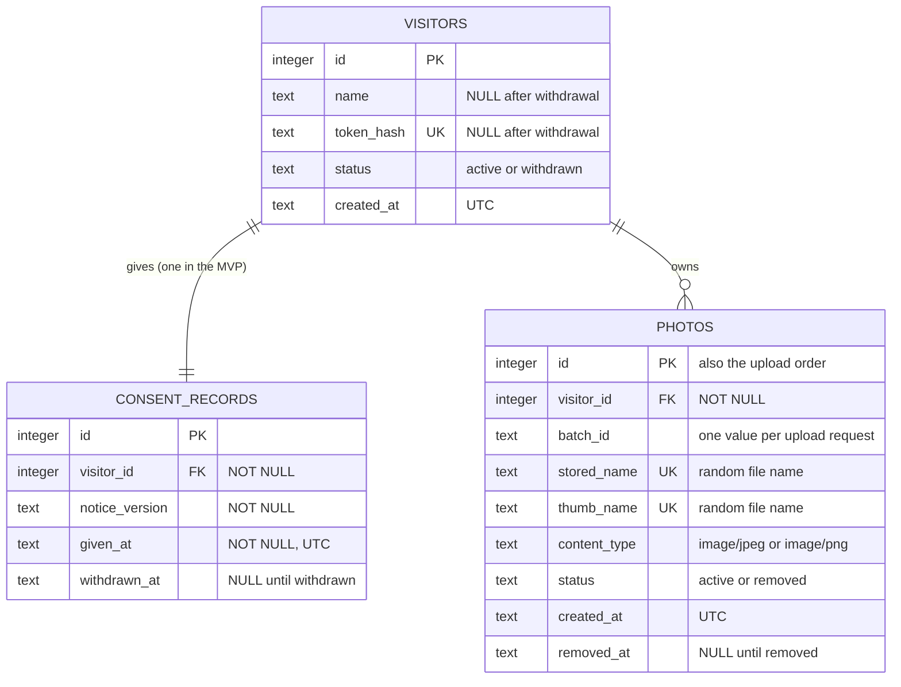

# DATABASE_DESIGN.md

# Visitor Photo Slideshow (MomentVault): Database Design

| Item | Detail |
|---|---|
| Product | MomentVault, implementing Assignment 1: Visitor Photo Slideshow |
| Document version | 1.0 (draft for approval) |
| Date | 15 November 2026 |
| Based on | Original assignment, PROJECT_BRIEF.md, PRD.md, ASSUMPTIONS.md, TECH_STACK.md, ARCHITECTURE.md v1.1 |
| Technology | SQLite 3 with SQLAlchemy ORM. Image files live on disk, never in the database. |
| Not included | Application source code. The SQL below is *design material* to explain the schema. SQLAlchemy models are described in words and tables (Section 14). |

**How to read this document.** Every part of the design is labelled:

- **PROPOSED (MVP)** is part of the schema to build now.
- **FUTURE** is a possible later enhancement. It is not part of the MVP schema.

IDs such as `BR-06`, `FR-WDR-03`, `A-09` and `AD-11` point to the PRD, ASSUMPTIONS.md and ARCHITECTURE.md. Short paragraphs marked **In plain words** explain an idea simply.

**What was verified, and what was not.** The CREATE TABLE statements and the SELECT, UPDATE and integrity examples in this document were run against a real SQLite engine (version 3.53.1) with foreign keys switched on. Every "blocked" and "allowed" claim in Section 9 was observed, not assumed. The query plans in Section 10 were read with `EXPLAIN QUERY PLAN`. **SQLAlchemy was not installed in the sandbox**, so the model mapping in Section 14 comes from documentation knowledge and has **not** been run. It must be confirmed on the first day of coding (Section 15.6).

---

## Coverage of the Requested Topics

| # | Requested topic | Where |
|---|---|---|
| 1 | Database overview | Section 1 |
| 2 | Entity Relationship Diagram (Mermaid) | Section 3 |
| 3 | Table definitions | Section 4 |
| 4 | Column names and data types | Section 4 (each table) and Section 5 |
| 5 | Primary keys | Section 4 and 6.1 |
| 6 | Foreign keys | Section 6.2 |
| 7 | Relationships and cardinality | Section 3.2 and Section 6 |
| 8 | Unique constraints | Section 7 |
| 9 | NOT NULL constraints | Section 8 |
| 10 | Indexing recommendations | Section 10 |
| 11 | Timestamps | Section 11 |
| 12 | Data deletion and retention strategy | Section 12 |
| 13 | SQL query examples | Section 13 |
| 14 | SQLAlchemy model mapping explanation | Section 14 |
| 15 | Initialization and migration considerations | Section 15 |
| - | Entity evaluation (Visitors, Photos, Consent records) | Section 2 |
| - | The seven design goals, one by one | Section 9 |
| - | Proposed design versus future enhancements | Section 16 |
| - | Conflicts and open items | Section 17 |

---

# 1. Database Overview

## 1.1 In One Paragraph

The database is a **single SQLite file** with **three tables**: `visitors` (who uploaded), `consent_records` (what they agreed to and when), and `photos` (one row per photo, holding **information about** the photo and the **file names** that point to the picture on disk). The pictures themselves are never stored in the database (TECH_STACK, ARCHITECTURE Section 10).

> **In plain words:** think of a filing cabinet index. The database is the index cards. Each card says who owns a photo, when it arrived, whether it may be shown and what the picture file is called. The pictures sit in a separate folder.

## 1.2 What the Database Must Do

| Need | Source | How the design meets it |
|---|---|---|
| Many photos per visitor | PRD FR-REG, FR-PRV | One visitor row, many photo rows (Section 6) |
| Two people can share a name | PRD FR-REG-04, BR-01 | `name` is **not** unique. Identity is the token (Section 9.2) |
| Secure return identification | PRD FR-ID, BR-02 | Only a **hash** of a random token is stored, and it is unique (Section 9.3) |
| Consent recorded and withdrawable | PRD FR-CON, FR-WDR, BR-04 to BR-06, BR-14 | A separate consent table with the notice version and times (Section 9.4) |
| Photos shown only when allowed | PRD BR-09, BR-10 | A `status` column and the rule "only `active` photos play" (Section 9.5) |
| Fast "which photos play?" query | PRD FR-AUT, FR-DSP | Two indexes and one simple query (Sections 10 and 13) |
| No photo without an owner | PRD FR-STO-04 | Foreign key plus NOT NULL plus switched-on enforcement (Section 9.7) |
| Safe with several uploads at once | PRD FR-CNC | SQLite WAL mode, short writes, no shared state (Section 15) |

## 1.3 Design Principles

1. **Minimal but logically correct.** Three tables. No table exists without a requirement that needs it.
2. **Let the database refuse bad data.** Rules that must *never* be broken (an orphan photo, a duplicate token) are enforced by the database itself, not only by Python code.
3. **Hide first, erase second.** Photos are marked `removed` first, and their files are deleted second (ARCHITECTURE AD-13). Rows are kept, but without personal data.
4. **Store references, not files.** The database holds short file **names**, never image bytes and never absolute paths.
5. **Beginner-explainable.** Every column and constraint must be justifiable in one sentence in a live demo.

---

# 2. Entity Evaluation

Three entities were evaluated, as requested. For each: what it is, why it exists, and whether it earns its own table.

## 2.1 Visitors: **Earns a table**

| Question | Answer |
|---|---|
| What is it? | A person (or more exactly, a *browser*) that uploaded photos. |
| Why a table? | Photos need an owner. Identification needs a stored token hash. Withdrawal needs somewhere to record that the visitor is gone. |
| What identifies a visitor? | The **token**, never the name (BR-01, BR-02). So the row stores a **hash of the token**. |
| Is the name unique? | **No.** Two people may both be "Asha" (FR-REG-04). |
| After withdrawal? | The row **stays**, with `status = 'withdrawn'`, and the name and token hash are **cleared** (BR-06, FR-WDR-03). |

## 2.2 Photos: **Earns a table**

| Question | Answer |
|---|---|
| What is it? | One accepted photo. |
| Why a table? | It is the thing the slideshow plays. It has its own lifecycle (active, then removed). |
| What does it store? | The owner, a **batch identifier** (photos from one upload request), two **random file names** (display image and thumbnail), the content type, status and times. **No image bytes.** |
| Why keep the row after removal? | The row has no personal data once removed. Keeping it makes `id` a safe, never-reused counter, which the slideshow cursor depends on (ARCHITECTURE AD-11), and lets a failed file deletion be retried. |

## 2.3 Consent records: **Earns a table (narrowly)**

This was the closest decision, so the alternatives are shown.

| Option | Verdict |
|---|---|
| **A. Separate `consent_records` table (chosen)** | Consent is a *fact with its own history*: which notice version, when given, when withdrawn (BR-14, FR-CON-03). It must **survive withdrawal without personal data**, while the visitor's name and token hash are erased. A separate table keeps that proof cleanly apart from the personal data. It also allows a future second consent (new notice version) without changing `visitors`. |
| B. Columns on `visitors` (`consent_version`, `consent_given_at`, `consent_withdrawn_at`) | Smaller, and truly sufficient for the MVP. Rejected because it mixes the personal row (which is cleared on withdrawal) with the proof (which is kept), and it cannot hold more than one consent. |
| C. Store consent on every photo | Rejected. Duplicates the same fact many times and gets out of step. |

> **Honest note:** in the MVP there is exactly **one** consent record per visitor (BR-05: consent is given once at registration). Option B would also work. Option A is chosen because it matches ARCHITECTURE v1.1 (Section 10.2) and because the retention and withdrawal rules read more clearly this way. If time is short, B is an acceptable simplification, and it would need an ARCHITECTURE update.

## 2.4 Entities Deliberately **Not** Created

| Not created | Why |
|---|---|
| `batches` or `uploads` table | A `batch_id` column on `photos` is enough to group one request's photos. A table would add a join for no benefit. |
| `photo_files` table (one row per file variant) | Two fixed variants (display image, thumbnail) fit as two columns. |
| `settings` table | Settings come from environment variables (ARCHITECTURE Section 14.5). |
| `admin` or `operator` table | The operator is a secret key in settings, not a database user (A-29). |
| `slideshow` or `display` table | The server remembers nothing about displays (ARCHITECTURE principle 4). |
| `images` table holding bytes | Out of the question: binary data stays out of SQLite (Section 12.5). |
| `audit_log` | Not required. See FUTURE items. |

---

# 3. Entity Relationship Diagram

## 3.1 Diagram (PROPOSED, MVP)



## 3.2 Relationships and Cardinality in Words

| Relationship | Cardinality | Why it exists |
|---|---|---|
| **Visitor to Photos** | One visitor has **zero or many** photos. Each photo belongs to **exactly one** visitor. | Photos need an owner so that the owner can delete them, so that "previous photos" can find them (FR-PRV), and so that withdrawal can remove them all (BR-06). |
| **Visitor to Consent records** | One visitor has **at least one** consent record (exactly one in the MVP). Each consent record belongs to **exactly one** visitor. | BR-04: no photo is accepted without recorded consent. The record is created **in the same transaction** as the visitor, so a visitor never exists without consent. |
| **Photos to Consent records** | **No direct link.** | Consent belongs to the *visitor*, not to each photo (BR-05). Linking them would repeat the same fact on every photo. The rule "this photo may play" is answered by the owner's status. |

> **Drawing note.** The diagram shows the Visitor-to-Consent line as "exactly one" because that is the MVP behaviour. The *database* actually allows several consent rows per visitor, with at most **one open** (not withdrawn) at a time (Section 7). That leaves room for a future re-consent without a schema change.

---

# 4. Table Definitions

All SQL below is **example design SQL**. The application will create the tables through SQLAlchemy (Section 14), which should produce an equivalent structure. Table names are **plural** (`visitors`, `consent_records`, `photos`). See Section 17, item 1, about ARCHITECTURE using singular names.

## 4.1 `visitors` (PROPOSED, MVP)

**Purpose.** One row per registered visitor.

| Column | Type | Null? | Meaning |
|---|---|---|---|
| `id` | INTEGER | NOT NULL | Primary key. Internal number, never shown to users. |
| `name` | TEXT | **NULL allowed** | The label typed by the visitor. **Not unique.** NULL only after withdrawal. |
| `token_hash` | TEXT | **NULL allowed** | One-way hash of the secret return token. **Unique.** NULL only after withdrawal. |
| `status` | TEXT | NOT NULL | `active` or `withdrawn`. |
| `created_at` | TEXT (UTC time) | NOT NULL | When the visitor first registered. |

```sql
CREATE TABLE visitors (
    id          INTEGER PRIMARY KEY AUTOINCREMENT,
    name        TEXT,
    token_hash  TEXT UNIQUE,
    status      TEXT    NOT NULL DEFAULT 'active',
    created_at  TEXT    NOT NULL DEFAULT (strftime('%Y-%m-%d %H:%M:%f', 'now')),
    CONSTRAINT ck_visitors_status CHECK (status IN ('active', 'withdrawn')),
    CONSTRAINT ck_visitors_state CHECK (
        (status = 'active'     AND name IS NOT NULL AND length(name) > 0 AND token_hash IS NOT NULL)
     OR (status = 'withdrawn'  AND name IS NULL     AND token_hash IS NULL)
    )
);
```

**Why `name` and `token_hash` may be NULL.** Withdrawal must erase the name and the token hash (FR-WDR-03) but keep the row so that photos and consent records still point at something. The `ck_visitors_state` rule makes this *safe*: an `active` visitor **must** have both, and a `withdrawn` visitor **must** have neither. No half states exist.

**Why the name has no maximum length here.** The maximum (50 characters) is a configurable parameter (P-06). The server enforces it. Hard-coding 50 into the database would mean a table rebuild whenever the parameter changes. The database only guarantees "not empty".

## 4.2 `consent_records` (PROPOSED, MVP)

**Purpose.** Proof that a visitor agreed to a particular version of the consent notice, and when they withdrew.

| Column | Type | Null? | Meaning |
|---|---|---|---|
| `id` | INTEGER | NOT NULL | Primary key. |
| `visitor_id` | INTEGER | NOT NULL | Foreign key to `visitors.id`. |
| `notice_version` | TEXT | NOT NULL | Version of the consent text accepted, for example `v1` (BR-14). |
| `given_at` | TEXT (UTC time) | NOT NULL | When consent was given. |
| `withdrawn_at` | TEXT (UTC time) | **NULL allowed** | Empty until consent is withdrawn. |

```sql
CREATE TABLE consent_records (
    id             INTEGER PRIMARY KEY AUTOINCREMENT,
    visitor_id     INTEGER NOT NULL REFERENCES visitors (id) ON DELETE RESTRICT,
    notice_version TEXT    NOT NULL,
    given_at       TEXT    NOT NULL DEFAULT (strftime('%Y-%m-%d %H:%M:%f', 'now')),
    withdrawn_at   TEXT,
    CONSTRAINT ck_consent_times CHECK (withdrawn_at IS NULL OR withdrawn_at >= given_at)
);

-- At most ONE open (not withdrawn) consent per visitor:
CREATE UNIQUE INDEX uq_consent_one_open_per_visitor
    ON consent_records (visitor_id) WHERE withdrawn_at IS NULL;
```

**What is kept after withdrawal.** The visitor id, the notice version and the two times. **No name, no token, no photo reference.** That is why the record can be retained without personal data (A-09, FR-CON-03).

## 4.3 `photos` (PROPOSED, MVP)

**Purpose.** One row per accepted photo, holding metadata and file names.

| Column | Type | Null? | Meaning |
|---|---|---|---|
| `id` | INTEGER | NOT NULL | Primary key. Also the **upload order** and the slideshow **cursor** (ARCHITECTURE AD-11). |
| `visitor_id` | INTEGER | NOT NULL | Foreign key to `visitors.id`. The owner. |
| `batch_id` | TEXT | NOT NULL | Random value shared by all photos of **one upload request**. Used to group "this visit's photos". |
| `stored_name` | TEXT | NOT NULL | Random **file name** of the display-size image inside `data/photos/`. Unique. |
| `thumb_name` | TEXT | NOT NULL | Random **file name** of the thumbnail inside `data/thumbs/`. Unique. |
| `content_type` | TEXT | NOT NULL | `image/jpeg` or `image/png`, as detected by the server (not as claimed by the browser). |
| `status` | TEXT | NOT NULL | `active` (may play) or `removed` (never plays). |
| `created_at` | TEXT (UTC time) | NOT NULL | When the photo became visible. |
| `removed_at` | TEXT (UTC time) | **NULL allowed** | Empty while active. Set when removed. |

```sql
CREATE TABLE photos (
    id           INTEGER PRIMARY KEY AUTOINCREMENT,
    visitor_id   INTEGER NOT NULL REFERENCES visitors (id) ON DELETE RESTRICT,
    batch_id     TEXT    NOT NULL,
    stored_name  TEXT    NOT NULL UNIQUE,
    thumb_name   TEXT    NOT NULL UNIQUE,
    content_type TEXT    NOT NULL,
    status       TEXT    NOT NULL DEFAULT 'active',
    created_at   TEXT    NOT NULL DEFAULT (strftime('%Y-%m-%d %H:%M:%f', 'now')),
    removed_at   TEXT,
    CONSTRAINT ck_photos_status CHECK (status IN ('active', 'removed')),
    CONSTRAINT ck_photos_removed CHECK (
        (status = 'active'  AND removed_at IS NULL)
     OR (status = 'removed' AND removed_at IS NOT NULL)
    )
);

CREATE INDEX ix_photos_status_id         ON photos (status, id);
CREATE INDEX ix_photos_visitor_status_id ON photos (visitor_id, status, id);
CREATE INDEX ix_photos_batch             ON photos (batch_id);
```

**Why file *names*, not paths.** The folder location (`data/photos/`) comes from one setting. Storing only the random name means moving the data folder, or later switching to object storage, changes **one setting**, not every row (ARCHITECTURE M-2). A stored absolute path would also leak server layout if it ever appeared in a log or error.

**Why `content_type` has no CHECK.** The value is produced by the server's own image check, not typed by a visitor. Keeping the database list open means adding a format later needs no table rebuild. The server enforces JPEG and PNG (P-04).

**Why `AUTOINCREMENT` on `id`.** Plain SQLite may reuse the number of a deleted *last* row. `AUTOINCREMENT` guarantees a number is **never reused**. The slideshow cursor ("everything with an id above the last one I saw") depends on that. The small extra cost is acceptable at this size.

## 4.4 The Three Tables Together (creation order)

Create `visitors` first, then `consent_records` and `photos` (both point at `visitors`). SQLAlchemy works this order out automatically.

---

# 5. Column Names and Data Types

## 5.1 Naming Conventions

| Rule | Example |
|---|---|
| Tables: plural, `snake_case` | `consent_records` |
| Columns: singular, `snake_case` | `token_hash` |
| Foreign key: `<table in singular>_id` | `visitor_id` |
| Times: end in `_at` | `created_at`, `removed_at` |
| Constraint names are written out | `ck_photos_status`, so error messages are readable |

## 5.2 How SQLite Types Work (Beginner Note)

> **In plain words:** SQLite is relaxed about types. A column's declared type is a *hint* ("type affinity"), not a strict rule. SQLite has only a few real storage kinds: whole numbers, decimals, text and raw bytes. This is why the design adds `CHECK` rules for the values that matter, because SQLite will not stop `'banana'` going into a status column on its own.

| Concept | Declared type | Why |
|---|---|---|
| Internal ids | `INTEGER PRIMARY KEY` | The fastest key in SQLite. It is an alias for the hidden row number. |
| Names, hashes, file names, versions, batch ids | `TEXT` | SQLite does not enforce a length for `VARCHAR(50)`, so `TEXT` is honest. Lengths are enforced by the server. |
| Statuses | `TEXT` plus `CHECK (... IN (...))` | Simple, readable in a database viewer, and the database refuses unknown values. An "enum" type does not exist in SQLite. |
| Times | `TEXT` in UTC | See Section 11. |
| Image bytes | **not stored** | Out of scope by design (Section 12.5). |

## 5.3 Token Storage Format

`token_hash` stores a **hexadecimal string** of the SHA-256 hash of the token (64 characters), as chosen in ARCHITECTURE Section 9.3. The raw token is **never** stored. Reasons are in Section 9.3.

---

# 6. Keys and Relationships

## 6.1 Primary Keys

| Table | Primary key | Kind | Why this choice |
|---|---|---|---|
| `visitors` | `id` | Integer, auto-numbered | Simple and fast. Never shown to users, and the token is the public secret. |
| `consent_records` | `id` | Integer, auto-numbered | Same. |
| `photos` | `id` | Integer, auto-numbered, **never reused** | Also the upload order and the slideshow cursor. |

**Why not use the name or token as the key.** Names are not unique. Tokens are cleared on withdrawal. A key must never change or disappear.

**Photo numbers in addresses.** Photo `id` appears in image addresses (`/api/photos/121/image`). This means photo numbers are guessable counters. That is an accepted, documented trade-off (ARCHITECTURE L8, Section 13.3): the photos are public on the screen anyway, and removed photos return "not found". **FUTURE:** a random public id column if this ever matters.

## 6.2 Foreign Keys

| From | To | On delete | Why |
|---|---|---|---|
| `photos.visitor_id` | `visitors.id` | **RESTRICT** | A visitor row that still has photos cannot be deleted. Prevents orphan photos. |
| `consent_records.visitor_id` | `visitors.id` | **RESTRICT** | Consent proof must not vanish silently. |

**Why RESTRICT and not CASCADE.** `CASCADE` would silently delete every photo row if a visitor row were ever deleted by mistake, and the **files would stay behind on disk** because the database cannot delete files. `RESTRICT` makes such a mistake **fail loudly**. In this design visitor rows are **never deleted** anyway (Section 12), so RESTRICT is a safety net.

> **Critical setting.** SQLite does **not enforce foreign keys unless switched on for every connection** (`PRAGMA foreign_keys = ON`). Without it all of the protection above is silently absent. The application must switch it on in its connection set-up, and a test must prove it (Section 15.4). This was confirmed during verification: with the setting on, an orphan insert is rejected.

## 6.3 Why Each Relationship Exists: Summary

| Relationship | If it did not exist |
|---|---|
| Photo to Visitor | Nobody could delete or withdraw their photos, and "previous photos" could not be found. |
| Consent to Visitor | Consent proof could not be tied to the person who gave it. |
| (No Photo to Consent link) | Not needed. Consent is per visitor. Adding it would repeat data. |

---

# 7. Unique Constraints

| Table | Unique on | Why | If violated |
|---|---|---|---|
| `visitors` | `token_hash` | Two visitors must never share a token. This is the identity lookup (BR-02). NULLs are allowed multiple times (withdrawn visitors), because SQLite treats each NULL as different. | Registration retries with a new token (probability negligible with a 128-bit or larger random token). |
| `visitors` | **Not** on `name` | Names are labels and may repeat (FR-REG-04, BR-01). | Not applicable. This is the point. |
| `consent_records` | `visitor_id` **where `withdrawn_at` is empty** (a *partial* unique index) | At most one *open* consent per visitor. History of withdrawn ones may repeat. | The second open consent is refused. |
| `photos` | `stored_name` | Two photos must never point to the same file, or deleting one would break the other (FR-CNC-02). | Insert refused. |
| `photos` | `thumb_name` | Same, for thumbnails. | Insert refused. |

> **In plain words:** a *unique constraint* is a promise that no two rows share the same value. A *partial* unique index applies the promise only to some rows, here only to consents that are still open.

---

# 8. NOT NULL Constraints

| Table | NOT NULL columns | Reason |
|---|---|---|
| `visitors` | `id`, `status`, `created_at` | Always meaningful. |
| `visitors` | `name`, `token_hash` are nullable **by design**, but `ck_visitors_state` forces them to be present when `status = 'active'` | Withdrawal clears them. |
| `consent_records` | `id`, `visitor_id`, `notice_version`, `given_at` | Consent with no owner, version or time is meaningless (BR-14). |
| `consent_records` | `withdrawn_at` is nullable | Empty means "not withdrawn". |
| `photos` | `id`, **`visitor_id`**, `batch_id`, `stored_name`, `thumb_name`, `content_type`, `status`, `created_at` | `visitor_id NOT NULL` is the key anti-orphan rule: a photo can never exist without an owner. |
| `photos` | `removed_at` is nullable | Empty means "not removed". `ck_photos_removed` ties it to `status`. |

> **A trap found while testing.** In SQL a `CHECK` rule that evaluates to *unknown* (NULL) **passes**. A first draft of the visitor rule wrote only `length(name) > 0`, and the engine happily accepted an active visitor with a NULL name, because `length(NULL) > 0` is unknown, not false. The final rule adds an explicit `name IS NOT NULL`. This is a good example of why constraints are *tested*, not assumed.

---

# 9. Meeting the Seven Design Goals

## 9.1 Multiple Photos per Visitor

One row in `visitors`, many rows in `photos` pointing at it through `visitor_id`. The per-visitor limit (20 active photos, P-07) is a **business rule enforced by the service**, not by the schema, because it is a configurable number. The count query is in Section 13.

The `batch_id` groups photos uploaded together. Different visits have different batch ids, which lets the slideshow tell "this visit's new photos" from "the visitor's earlier photos" (A-22).

## 9.2 Duplicate Visitor Names

Nothing is unique on `name`. Two visitors called "Asha" get two rows with different ids and different token hashes. The name is used only for greeting and an optional caption (BR-01). Verified: two rows with the same name were accepted.

## 9.3 Secure Return-Token Identification

| Aspect | Design |
|---|---|
| What the browser holds | A long random **token** (at least 128 bits, FR-ID-01). |
| What the database holds | Only a **SHA-256 hash** of the token in `visitors.token_hash`. |
| Why a hash | If the database file leaks, the stored values cannot be used as tokens. A leaked hash is not a key. |
| Why SHA-256 and not a slow password hash | The token is long and random, so it cannot be guessed or looked up in a dictionary. A fast hash is correct here. Slow hashes (bcrypt and similar) are for short, human-chosen passwords. |
| How a visitor is recognised | The server hashes the token sent by the browser and looks for a matching `token_hash` on an `active` visitor (Query Q1). |
| Why the column is indexed | The `UNIQUE` constraint creates an index automatically, so this lookup on every identified request is fast. Verified with `EXPLAIN QUERY PLAN`: it uses that index. |
| Wrong or edited token | No match, so the visitor is treated as new (FR-ID-03). |
| After withdrawal | The hash is set to NULL, so the old token matches nothing. |

## 9.4 Consent Withdrawal

Withdrawal happens in **one transaction** (all or nothing). Query Q9 shows it:

1. Mark all the visitor's active photos `removed` and set `removed_at`.
2. Set `consent_records.withdrawn_at` on the open consent.
3. Set the visitor's `status = 'withdrawn'` and clear `name` and `token_hash`.

Only **after the commit** does the application delete the image files (Section 12.3). The rules make the result consistent: the `ck_visitors_state` rule *requires* the name and hash to be cleared together with the status change, so withdrawal cannot half-happen.

What remains: the visitor row (id, status, created time), the consent record (version and times), and the removed photo rows (names of files that no longer exist). **None of these contains personal data** (A-09).

## 9.5 Photo "Approval" and Deletion

**Important finding.** The approved documents contain **no approval step**. BR-09 says a photo becomes eligible *"only after upload is complete (received, validated, stored and recorded)"*, and moderation is explicitly excluded (OOS-02 excludes automatic content moderation, and the operator removal is only a Could Have). So in the MVP:

> **"Approved" means "the upload completed and the photo passed validation".** That is the moment the row is inserted with `status = 'active'`.

| Stage | Database state |
|---|---|
| Upload fails any check | **No row at all.** Nothing to clean up in the database. |
| Upload passes every check, files written, row committed | `status = 'active'`. Eligible for the slideshow. |
| Owner deletes, visitor withdraws, or operator removes | `status = 'removed'`, `removed_at` set. Never eligible again (BR-10). |

There is deliberately **no** `pending`, `approved` or `rejected` status in the MVP, because nothing in the requirements creates those states. **FUTURE (Section 16):** a `pending` status for a moderation queue. It is a small change: one more allowed status value, and the slideshow query already selects only `active`, so the display needs no change.

**Deletion is a status change, not a row delete** (hide first, erase second). The database change is committed first. Then the files are deleted. If file deletion fails, the photo is already invisible and only a leftover file remains.

## 9.6 Retrieving Eligible Photos for the Slideshow

A photo is eligible when:

1. Its `status` is `active`, **and**
2. (belt and braces) its owner's `status` is `active`.

Rule 2 is redundant in a correct system, because withdrawal marks all the visitor's photos `removed` in the same transaction. It is kept in the main query as a **defensive check** at almost no cost (a primary key lookup), so that a bug elsewhere can never display a withdrawn visitor's photo. The queries are in Section 13 (Q3 to Q6). The main index serves it (Section 10).

## 9.7 Avoiding Orphaned Photo Records

An *orphan* is a record that points to something that no longer exists. There are three kinds, and the database can prevent only some of them.

| Orphan | Prevented by | Prevented by the database? |
|---|---|---|
| **Photo row with no visitor** | `visitor_id NOT NULL` + foreign key + `RESTRICT` + visitor rows never deleted + `PRAGMA foreign_keys = ON` | **Yes.** Verified: inserting a photo for a visitor that does not exist is refused, and deleting a visitor that still has photos is refused. |
| **Consent row with no visitor** | Same | **Yes.** |
| **Photo row whose file is missing** | Order of operations: files are written **first**, the row is committed **last**; if the commit fails, the files are deleted (ARCHITECTURE AD-14). | **No.** The database cannot see the disk. This is a rule of the **application**. |
| **File with no photo row** (after a crash) | A start-up sweep lists the file names in the database and removes unknown files (Query Q12). | **No.** Application job. |
| **Visitor with no photos** | Allowed by design: a visitor may register while all files are rejected (A-06). Not harmful. | Not an error. Q13 lists them for information. |

> **In plain words:** the database guarantees that every *index card* points to a real *person*. It cannot guarantee that every card points to a real *picture file*. Only careful ordering of the steps, plus a clean-up check, can do that.

---

# 10. Indexing Recommendations

> **In plain words:** an index is like the index at the back of a book. Without it, SQLite reads every row to answer a question. With it, SQLite jumps to the answer. Indexes cost a little disk space and a little time on every write, so only useful ones are created.

## 10.1 Proposed Indexes (MVP)

| Index | Columns | Created by | Used by | Verified plan |
|---|---|---|---|---|
| Token lookup | `visitors.token_hash` | The `UNIQUE` constraint, automatically | Q1: identify a visitor on every request | Uses the automatic unique index |
| `ix_photos_status_id` | `photos (status, id)` | Explicit | Q3 slideshow list, Q5 new since the cursor | Search by `status` and `id`; covering for the list (no table read needed) |
| `ix_photos_visitor_status_id` | `photos (visitor_id, status, id)` | Explicit | Q2 count, Q4 previous photos, Q8 own photos | Search by `visitor_id` and `status`; covering |
| `ix_photos_batch` | `photos (batch_id)` | Explicit | Grouping one request's photos (slideshow feed) | Direct search |
| One open consent | partial unique index on `consent_records (visitor_id) WHERE withdrawn_at IS NULL` | Explicit | Enforcing the rule, and Q9 finding the open consent | Direct search |
| File names | `UNIQUE` on `stored_name`, `thumb_name` | Automatic | Enforcing uniqueness | n/a |

**No separate index on `photos.visitor_id`.** The composite index `ix_photos_visitor_status_id` starts with `visitor_id`, so it already serves any query by owner. A second one would only slow writes. SQLite does **not** create an index for a foreign key automatically, so this index doubles as the foreign key's index.

**Column order matters.** In `(status, id)` the **equality** column comes first and the **range or order** column second. That lets `WHERE status = 'active' AND id > ? ORDER BY id` be answered from the index alone.

## 10.2 Indexes Deliberately Not Created

| Not created | Why |
|---|---|
| Index on `visitors.name` | Never searched. Names are not identifiers. |
| Index on `created_at` | No query filters by time in the MVP. `id` already gives upload order. |
| Index on `consent_records.visitor_id` alone | The partial unique index covers the open-consent lookup. Looking up *all* consents of a visitor is rare. |
| Full-text index | No text search requirement. |

## 10.3 A Possible Refinement (optional)

If the display list ever becomes large, a **partial index** (`CREATE INDEX ... ON photos (id) WHERE status = 'active'`) would be smaller, because removed rows are excluded. At the expected size (hundreds of photos) it is **not needed** and is not recommended for the MVP.

## 10.3a Honest Scale Note

At event scale (tens to a few thousand rows) every query is instant even without indexes. The indexes are included because they are cheap, because they document *how* the data is used, and because they keep the cost stable if the event is larger than expected. Do not spend time tuning beyond this.

---

# 11. Timestamps

## 11.1 Rules

| Rule | Design |
|---|---|
| Time zone | **UTC everywhere** in storage (A-31). Conversion to local time happens only when displaying. |
| Storage form | Text in `YYYY-MM-DD HH:MM:SS.fff` format. Text in this format **sorts correctly** as time, and is readable in any database viewer. |
| Who sets them | The **application** sets times in Python using UTC, so tests can control them. The `DEFAULT` in the SQL is a backup. Both produce the same format. |
| Never changed | `created_at` and `given_at` never change after insert. |
| "Empty means not yet" | `removed_at` and `withdrawn_at` are NULL until the event happens. |

## 11.2 Which Timestamps Exist, and Why

| Column | Table | Purpose |
|---|---|---|
| `created_at` | `visitors` | When the visitor first registered. Useful for demonstrating and debugging. |
| `given_at` | `consent_records` | **When consent was given.** Required evidence (FR-CON-03). |
| `withdrawn_at` | `consent_records` | **When consent was withdrawn.** Required evidence (FR-WDR). This is the single source of truth for the withdrawal time. |
| `created_at` | `photos` | When the photo became visible. |
| `removed_at` | `photos` | When the photo was hidden. Needed for the file clean-up retry and for the demo. |

**Not included:** `updated_at` columns. Nothing in the requirements needs "last changed" times, and rows change only through the defined status changes. **No `withdrawn_at` on `visitors`**, because it would duplicate `consent_records.withdrawn_at`. Two copies of one fact eventually disagree.

## 11.3 Why Not Use a Real Date Type

SQLite has no true date type. It offers text, number or Julian day storage. Text in a fixed UTC format is the clearest and the most portable to PostgreSQL later (ARCHITECTURE M-1). SQLAlchemy's `DateTime` type maps to this text form automatically. **Not verified here** (Section 15.6): check that values written by the application and values written by the SQL `DEFAULT` are read back identically.

---

# 12. Data Deletion and Retention Strategy

## 12.1 The Strategy in One Line

> **Hide first, erase second. Keep rows, remove personal data, delete files.**

## 12.2 What Happens to Each Kind of Data

| Event | Rows | Files | Personal data |
|---|---|---|---|
| **Owner deletes one photo** (FR-DEL) | `photos.status = 'removed'`, `removed_at` set. Row kept. | Image and thumbnail deleted **after** the database commit. | None was in the photo row. |
| **Visitor withdraws consent** (FR-WDR) | All their photos set to `removed`. Consent `withdrawn_at` set. Visitor `status = 'withdrawn'`. | All their files deleted after the commit. | `name` and `token_hash` set to NULL. |
| **Operator removes a photo** (FR-OPR, Could Have) | Same as owner deletion. | Same. | None. |
| **Upload fails a check** | No row created. | Any partial files deleted. | None stored. |
| **"Not you?" on the upload page** (FR-ID-04) | **No change in the database.** Only the browser forgets its token. | None. | None. |

## 12.3 Order of Operations

| Operation | Order | If it fails halfway |
|---|---|---|
| Delete or withdraw | 1. Commit the database change. 2. Delete files. | Photo is already invisible. A leftover file remains, is logged and swept later. |
| Add photo | 1. Write files. 2. Commit the row. | If the commit fails the files are deleted. Nothing is visible. |

The opposite order for deletion (files first) could leave an `active` row pointing at a missing file, which the display would try to show.

## 12.4 Why Soft Delete for Photos, and Why No Hard Delete of Rows

| Question | Answer |
|---|---|
| Is this "keeping data after a deletion request"? | **No personal data is kept.** A removed photo row holds only random file names, a batch id, a content type and times. The *image* is gone. The *name* is gone. Nothing identifies a person. Visitor rows are kept for the same reason, with name and token cleared. |
| Why not delete the rows? | (1) The photo `id` is the slideshow cursor and must never be reused or skipped (`AUTOINCREMENT` helps, and kept rows make it obvious). (2) The row records which files still need deleting if the file step failed. (3) Foreign keys stay simple: no cascade is ever needed. |
| Is a stricter erase possible? | Yes. See FUTURE below. |

## 12.5 No Image Data in the Database

| Item | Where it lives |
|---|---|
| Display-size image | `data/photos/<stored_name>` |
| Thumbnail | `data/thumbs/<thumb_name>` |
| Image bytes in SQLite | **Never** |

**Why.** Large binary data makes the database file big and slow to copy, makes WAL files grow, locks the database during large writes, and cannot be served as efficiently as a plain file. The database stores the **name**. The server builds the real path from the configured folder plus the name, **never from request text** (ARCHITECTURE Section 10.3).

## 12.6 Retention

| Topic | MVP rule |
|---|---|
| Automatic expiry | **None.** Photos stay until deleted or withdrawn (BR-13). |
| Real-deployment retention period | **OPEN** (A-11). Does not block the MVP. |
| Consent records | Kept after withdrawal, without personal data. |
| Backups | A manual copy of the whole `data/` folder with the app stopped (ARCHITECTURE 14.8). Backups contain whatever the database held at that time, so a *withdrawn* visitor's data may still exist in an **older backup**. State this honestly in the privacy notes. |

## 12.7 FUTURE Deletion and Retention Enhancements

| ID | Enhancement | Trigger |
|---|---|---|
| D-1 | **Purge job:** hard-delete `removed` photo rows and withdrawn visitor rows older than N days, once their files are confirmed gone. Rows are purged in the order photos, then consents, then visitors, to respect the foreign keys. | A stricter privacy policy, or a very long-running installation |
| D-2 | **Scheduled expiry** (photos older than N days become `removed`) | A retention period decided under A-11 |
| D-3 | **A reset command** that empties all tables and folders between demos | Repeated demos (ARCHITECTURE E-05) |
| D-4 | Secure overwrite of deleted files | Unlikely. Needs a security requirement. |

---

# 13. SQL Query Examples

All queries use **parameters** shown as `:name`. In the real application SQLAlchemy builds them with **bound values**. User text is never joined into SQL text, which prevents SQL injection (ARCHITECTURE Section 13.2). All were run against sample data.

## Q1. Identify a returning visitor by token

```sql
SELECT id, name
FROM visitors
WHERE token_hash = :token_hash
  AND status = 'active';
```

*Plain words:* the server hashes the token it received and looks for an active visitor with that hash. No row means "treat as a new visitor". Uses the unique index.

## Q2. Count a visitor's active photos (for the 20-photo limit)

```sql
SELECT COUNT(*)
FROM photos
WHERE visitor_id = :visitor_id
  AND status = 'active';
```

*Plain words:* the service compares this number with the limit **before** accepting more files.

## Q3. All eligible photos for the slideshow loop

```sql
SELECT p.id
FROM photos AS p
JOIN visitors AS v ON v.id = p.visitor_id
WHERE p.status = 'active'
  AND v.status = 'active'
ORDER BY p.id;
```

*Plain words:* "give me every photo that may be shown, oldest first". The `JOIN` is the defensive owner check from Section 9.6. A photo number missing from this list means "stop showing it".

## Q4. A visitor's previous photos, most recent first (excluding the new batch)

```sql
SELECT id
FROM photos
WHERE visitor_id = :visitor_id
  AND status = 'active'
  AND batch_id <> :new_batch_id
ORDER BY id DESC;
```

*Plain words:* after a returning visitor uploads, their **older** photos follow the new ones, newest of the old first (A-22, BR-11). Only this visitor's photos, never anyone else's (BR-12).

## Q5. New photos since the display's cursor, grouped by upload

```sql
SELECT id, batch_id, visitor_id
FROM photos
WHERE status = 'active'
  AND id > :cursor
ORDER BY batch_id, id;
```

*Plain words:* the display remembers the highest photo number it has seen (the *cursor*). The server returns everything newer. The service then groups the rows by `batch_id` and attaches the previous photos (Q4). The server never stores anything per display.

## Q6. The current cursor value

```sql
SELECT COALESCE(MAX(seq), 0)
FROM sqlite_sequence
WHERE name = 'photos';
```

*Plain words:* the highest photo number **ever assigned**, even if that photo was removed. This is a SQLite-specific table that exists because of `AUTOINCREMENT`. A simpler alternative is `SELECT COALESCE(MAX(id), 0) FROM photos`, which works because removed rows are never deleted. Either is acceptable. **Choose one at build time.** `MAX(id)` is more portable (M-1).

## Q7. Register a new visitor, with consent (one transaction)

```sql
-- 1. create the visitor
INSERT INTO visitors (name, token_hash)
VALUES (:name, :token_hash);

-- 2. record consent for that visitor (id from step 1)
INSERT INTO consent_records (visitor_id, notice_version)
VALUES (:new_visitor_id, :notice_version);
```

*Plain words:* both inserts are committed **together** (a transaction). If either fails, neither is saved, so a visitor never exists without consent (BR-04). The default for `status` is `active`, and the default times are filled in.

## Q8. Add an accepted photo

```sql
INSERT INTO photos (visitor_id, batch_id, stored_name, thumb_name, content_type)
VALUES (:visitor_id, :batch_id, :stored_name, :thumb_name, :content_type);
```

*Plain words:* run only **after** the image files are safely written. This is the moment the photo becomes eligible. Commit **per photo** (ARCHITECTURE AD-08).

## Q8b. List a visitor's own photos (for "My photos")

```sql
SELECT id, thumb_name
FROM photos
WHERE visitor_id = :visitor_id
  AND status = 'active'
ORDER BY id DESC;
```

## Q9. Withdraw consent (one transaction)

```sql
-- 1. hide every photo of this visitor
UPDATE photos
SET status = 'removed',
    removed_at = strftime('%Y-%m-%d %H:%M:%f', 'now')
WHERE visitor_id = :visitor_id
  AND status = 'active';

-- 2. close the open consent
UPDATE consent_records
SET withdrawn_at = strftime('%Y-%m-%d %H:%M:%f', 'now')
WHERE visitor_id = :visitor_id
  AND withdrawn_at IS NULL;

-- 3. end the visitor's identity and erase personal data
UPDATE visitors
SET status = 'withdrawn',
    name = NULL,
    token_hash = NULL
WHERE id = :visitor_id;
```

*Plain words:* all three happen together or not at all. After the commit, the application reads Q11 and deletes the files. Verified: after this, the visitor's photos are absent from Q3, and their old token matches nothing in Q1.

## Q10. Delete one photo (owner)

```sql
UPDATE photos
SET status = 'removed',
    removed_at = strftime('%Y-%m-%d %H:%M:%f', 'now')
WHERE id = :photo_id
  AND visitor_id = :visitor_id   -- ownership check inside the statement
  AND status = 'active';
```

*Plain words:* if the photo is not theirs or is already removed, **no row changes**, and the service reports "not found" or "already removed" (ERR-17, ERR-18). Putting the owner in the `WHERE` makes it impossible to remove someone else's photo even by mistake.

## Q11. Files that must be deleted (clean-up after Q9 or Q10)

```sql
SELECT id, stored_name, thumb_name
FROM photos
WHERE status = 'removed';
```

*Plain words:* the application deletes these files, ignoring any already gone. Because rows are kept, this query can be run again after a crash to retry. An optional refinement tracks "files already deleted" (FUTURE D-1).

## Q12. Start-up sweep: file names the database knows (compare with the folder)

```sql
SELECT stored_name, thumb_name
FROM photos
WHERE status = 'active';
```

*Plain words:* the application lists the files in `data/photos/` and `data/thumbs/`. Any file **not** in this result belongs to no active photo and can be removed. This clears orphan files after a crash (Should Have). Never delete a file that is not in a **fresh** result, and never run this while an upload is in progress.

## Q13. Integrity checks (for tests and the demo)

```sql
-- Any foreign key violations? (expected: no rows)
PRAGMA foreign_key_check;

-- Withdrawn visitors that still own active photos? (expected: no rows)
SELECT p.id
FROM photos AS p
JOIN visitors AS v ON v.id = p.visitor_id
WHERE v.status = 'withdrawn'
  AND p.status = 'active';

-- Visitors with no photos (information only, allowed by design)
SELECT v.id
FROM visitors AS v
LEFT JOIN photos AS p ON p.visitor_id = v.id
WHERE p.id IS NULL;
```

## Q14. Reading and checking settings

```sql
PRAGMA foreign_keys;      -- must return 1 on every application connection
PRAGMA journal_mode;      -- should return wal
```

---

# 14. SQLAlchemy Model Mapping Explanation

> **Status: not run.** SQLAlchemy was not available in the build sandbox, so this section is a design explanation and **has not been executed**. Verify on Day 1 (Section 15.6). It contains no source code, in line with the project rule for this document.

## 14.1 The Idea in Plain Words

> **In plain words:** *ORM* means "object-relational mapper". You describe each table once as a **Python class**. Each **column** becomes an attribute, and each **row** becomes an object. SQLAlchemy writes the SQL for you and turns query results back into objects. The three classes are called **models**.

## 14.2 Mapping Table

| Database | SQLAlchemy model | Notes |
|---|---|---|
| Table `visitors` | Model `Visitor` | One object per visitor row |
| Table `consent_records` | Model `ConsentRecord` | |
| Table `photos` | Model `Photo` | |
| `INTEGER PRIMARY KEY AUTOINCREMENT` | An integer primary key column, with the SQLite auto-increment table option switched on | Plain primary key columns give SQLite's default rowid behaviour. The auto-increment option must be requested explicitly for the never-reuse guarantee. **Confirm the option name on the pinned version.** |
| `TEXT` | A string column | No length given, because SQLite ignores it |
| Status columns | A string column plus a **check constraint** | Python-side validation (schemas) is added on top |
| `*_at` times | A date-time column | Application sets UTC. See Section 11.3. |
| `UNIQUE` | A unique flag on the column | |
| Partial unique index | An index with a SQLite "where" condition | Documented as SQLite-specific. Confirm the option on the pinned version. |
| Composite indexes | Index objects listed with the model | |
| `REFERENCES visitors (id) ON DELETE RESTRICT` | A foreign key column | `visitor_id` points at `visitors.id` |
| Constraint names | Explicit names on every constraint | Keeps database error messages readable |

## 14.3 Relationships (Python Side)

| Relationship | Meaning for the code |
|---|---|
| `Visitor.photos` | The list of photos that belong to a visitor. Paired with `Photo.visitor`. |
| `Visitor.consent_records` | The list of consent records. Paired with `ConsentRecord.visitor`. |

**Important distinction.** A *relationship* in SQLAlchemy is a **convenience for Python code**. The *foreign key* is the **real database rule**. Without the foreign key column, the relationship would not protect anything.

**Cascade settings.** The Python-side relationship must **not** be configured to delete photos when a visitor is deleted. Visitor rows are never deleted (Section 12), and the database uses RESTRICT. A "delete cascade" on the Python side would contradict this design.

## 14.4 Where the Models Sit in the Architecture

| Layer | Role |
|---|---|
| **Models** | Describe the three tables. Contain **no business rules** (ARCHITECTURE 11.1). |
| **Repositories** | Run queries such as Q1 to Q13 through the session. **Never commit** (AD-04). |
| **Services** | Decide *when* to commit and *which* status changes belong together, for example the three steps of Q9. |
| **Schemas** (Pydantic) | Describe request and response shapes. Separate from the models. |

**Models are not sent to the browser.** A model contains `token_hash` and internal ids. Responses use schemas that expose only what is needed. This is how the "never expose tokens or names in the slideshow feed" rule is kept (ARCHITECTURE Section 8.2).

## 14.5 Session Habits That Matter for SQLite

| Habit | Why |
|---|---|
| One session per request | No shared state between simultaneous uploads (A-19, FR-CNC) |
| Close the session when the request ends | Releases the connection and any lock |
| Keep write transactions **short** | SQLite allows one writer at a time. Image processing happens **before** the write begins (ARCHITECTURE 7.5). |
| Read after commit carefully | Objects can expire after a commit and reload on next access. Return plain data from services, not live model objects, after the session closes. |

---

# 15. Database Initialization and Migration Considerations

## 15.1 Where the Database Lives

`data/momentvault.db`, inside the git-ignored `data/` folder, next to `photos/` and `thumbs/` (ARCHITECTURE AD-15). SQLite also creates `-wal` and `-shm` helper files beside it in WAL mode. They are part of the database and must travel with it.

## 15.2 Start-Up Initialization (PROPOSED)

| Step | Action |
|---|---|
| 1 | Create the `data/` folders if missing. |
| 2 | Open the engine. On **every new connection** run the settings in 15.3. |
| 3 | Create any missing tables from the models (the "create all" step). It is safe to run repeatedly: it **creates only what is missing and never alters existing tables**. |
| 4 | (Should Have) Sweep orphan files (Q12). |

## 15.3 Required Connection Settings

| Setting | Value | Why |
|---|---|---|
| `foreign_keys` | ON, **per connection** | SQLite ignores foreign keys otherwise (Section 6.2) |
| `journal_mode` | WAL | Readers (the display) are not blocked while a write happens (FR-CNC-04). The mode persists in the file, but setting it at start-up is harmless. |
| `busy_timeout` | A few seconds | A second writer **waits** instead of failing immediately (FR-CNC-03) |
| Thread sharing | The SQLite connection must be usable by the worker threads the framework runs endpoints in | **Confirm the exact setting on the pinned SQLAlchemy version** (TECH_STACK flagged this) |

> **Common mistake.** Setting `foreign_keys = ON` once, in one place, and assuming it stays. The setting belongs to the **connection**, and the connection pool opens new ones. It must be applied in a hook that runs for **each** new connection, and a test must prove it works.

## 15.4 Tests the Database Needs (Suggested)

| Test | Proves |
|---|---|
| Insert a photo with a non-existent `visitor_id` is refused | Foreign keys are on (orphan prevention) |
| Delete a visitor that has photos is refused | RESTRICT works |
| Two visitors with the same name are both saved | Names are not unique |
| Two visitors with the same token hash: the second is refused | Token uniqueness |
| A second open consent for one visitor is refused | Partial unique index |
| Status values other than the allowed ones are refused | CHECK constraints |
| An `active` visitor with a NULL name is refused | The NULL-passing CHECK trap is closed |
| Q3 never returns a removed photo or a withdrawn visitor's photo | Eligibility |
| After Q9, the old token matches nothing and the photos vanish from Q3 | Withdrawal |
| 10 simultaneous uploads create 10 photo rows, no duplicates, no "database is locked" | FR-CNC (ties to ARCHITECTURE S2) |
| A new photo number is greater than every earlier one, even after removal | Cursor safety |

All of these use a **temporary database** created fresh for each test run, never the real file.

## 15.5 Migration Considerations

**What a migration is.** A *migration* is a recorded, repeatable change to the database structure, such as adding a column, applied to databases that already contain data.

| Question | Answer |
|---|---|
| Is a migration tool needed in the MVP? | **No** (TECH_STACK Part 7, ARCHITECTURE M-4). The database starts empty, and the schema is created at first start. Changing the schema during development means **deleting the database file and recreating it**, which is acceptable because no real data exists. |
| What does the "create all" step not do? | It **never changes an existing table**. If a column is added to a model later, an old database file will **not** get it, and queries will fail with "no such column". |
| When must migrations be added? | The first time a **database with data worth keeping** must change shape, for example a deployed event that is running. That is the trigger for Alembic (ARCHITECTURE M-4). |
| Cheap preparation now | Record a schema version in the database. SQLite provides a built-in version number (`PRAGMA user_version`) that is currently 0 on a new file. The proposal is to set it to **1** at creation and check it at start-up, so a future version can say "this database is too old" instead of failing in a confusing way. |
| SQLite limits | SQLite can add a column easily, but it **cannot alter or drop most constraints in place**. Changing a CHECK (for example adding the `pending` status) means creating a new table, copying rows, and renaming it. Alembic has a "batch" mode for exactly this. This is one reason the CHECK lists are kept short. |
| Moving to PostgreSQL later | See ARCHITECTURE M-1. The design is portable, with these differences to handle: the cursor method (Section 16, F-6), time columns become real timestamp types, and the `AUTOINCREMENT` and partial-index syntax changes. |

## 15.6 Items to Verify on Day 1 of Coding

| # | Check | Why |
|---|---|---|
| DV-1 | Install the pinned SQLAlchemy. Confirm the auto-increment table option name and the partial-index option name for SQLite. | Section 14 could not be run here. |
| DV-2 | Create the tables from the models and **compare** the resulting `CREATE TABLE` text with Section 4 (the engine can print it). | Models and this document must agree. |
| DV-3 | Prove `foreign_keys = ON` on **every** connection, including those opened by worker threads. | The whole anti-orphan design depends on it. |
| DV-4 | Write one time with the application and one with the SQL `DEFAULT`. Read both back through SQLAlchemy. | Section 11.3 |
| DV-5 | Run Section 15.4 tests on a temporary database. | Section 9 claims. |

---

# 16. Proposed Design versus Future Enhancements

## 16.1 PROPOSED (MVP) Schema: Complete List

| Item | Status |
|---|---|
| Tables `visitors`, `consent_records`, `photos` | **PROPOSED (MVP)** |
| Photo statuses `active`, `removed` | **PROPOSED (MVP)** |
| Visitor statuses `active`, `withdrawn` | **PROPOSED (MVP)** |
| Token hash, unique | **PROPOSED (MVP)** |
| `batch_id` on photos | **PROPOSED (MVP)** (internal design detail, no PRD change needed) |
| Thumbnails (`thumb_name`) | **PROPOSED (MVP)**, depends on assumption A-15 being approved. If A-15 is rejected, drop the column. |
| Indexes in Section 10.1 | **PROPOSED (MVP)** |
| Created-at-start tables, no migration tool | **PROPOSED (MVP)** |

## 16.2 FUTURE Enhancements (not part of the MVP)

| ID | Enhancement | What changes in the database | Triggers |
|---|---|---|---|
| F-1 | **Moderation queue** (photo approval) | Add status `pending` (and optionally `rejected`). The slideshow query already selects only `active`, so it needs no change. | Public events (ARCHITECTURE E-02) |
| F-2 | **Operator accounts and login** | A new `operators` table, authentication | Operator dashboard (E-03) |
| F-3 | **Photo captions with the visitor name** | No schema change. The name is already stored. The slideshow feed would have to expose it, which is a privacy decision. | Optional PRD feature |
| F-4 | **Recovery code for new devices** | A new table or column holding a second hash | Cross-device recognition (E-01) |
| F-5 | **Random public photo id** | A new unique `public_id` column on `photos`, used instead of the counter in addresses | If guessable photo numbers become a concern |
| F-6 | **PostgreSQL migration** | The cursor must not rely on id order alone (concurrent writers can commit out of order). Use a commit time with an overlap window or an event table. | Many writers, several servers (M-1) |
| F-7 | **Audit log** | A new append-only table of events (uploaded, removed, withdrawn) | Accountability requirements |
| F-8 | **Photo dimensions and file size** | Columns `width`, `height`, `size_bytes` | Layout or statistics needs |
| F-9 | **Multiple events or venues** | An `events` table and an `event_id` on every other table | Multi-event support (out of scope, OOS) |
| F-10 | **Duplicate image detection** | A `content_hash` column with an index (A-17) | If duplicate suppression is required |
| F-11 | **Photo content in object storage** | `stored_name` becomes an object key. No other schema change, which is the benefit of storing names only. | M-2 |
| F-12 | Purge job and expiry | See Section 12.7 | Retention policy (A-11) |
| F-13 | **Alembic migrations** | Adds a migration history table | First database worth preserving (M-4) |

---

# 17. Conflicts, Findings and Open Items

Nothing here has been changed in the other documents. Each item needs your decision.

## 17.1 Findings Against Approved Documents

| # | Finding | Proposed handling |
|---|---|---|
| 1 | **Table names.** ARCHITECTURE v1.1 Section 10.2 names the tables `visitor`, `consent` and `photo` (singular). This document uses `visitors`, `consent_records`, `photos`, as the request asked for "Visitors", "Photos" and "Consent records". | Cosmetic. Update ARCHITECTURE Section 10.2 to the plural names when approved. |
| 2 | **Photo "approval".** The request mentions approval, but the PRD has no approval step (BR-09 says eligible after upload completes. Moderation is out of scope or a Could Have). | Interpreted as "upload complete, status `active`". A `pending` state is a FUTURE item (F-1). **Please confirm.** |
| 3 | **Name length.** PRD P-06 makes the limit (50) configurable. | Not hard-coded in the database (Section 4.1). The server enforces it. |
| 4 | **Content type list.** P-04 allows JPEG and PNG. | The database stores the detected type without a CHECK. The server enforces the list. |
| 5 | **Consent per visitor, one record in the MVP.** BR-05 says consent is given once. | The schema allows more than one (for a future re-consent), with at most one open. This is a deliberate small allowance, not a PRD change. |
| 6 | **ARCHITECTURE Section 10.2 already includes** `batch_id`, `thumb_name`, `content_type` and `removed_at` on photos, and `withdrawn_at` on consent. | Consistent. This design adds the **check constraints**, the **partial unique index**, the **never-reuse id** and the **delete rules** on top. No column was removed or renamed. |
| 7 | **ASSUMPTIONS A-15** (thumbnails and scaling) is "ASSUMED + CONFIRM". | `thumb_name` depends on it. See Section 16.1. |
| 8 | **Withdrawn data in old backups.** Backups may hold data that was later withdrawn. | Stated in Section 12.6. Mention in the README privacy notes. |

## 17.2 Open Items Carried Forward

| ID | Question | Effect on this document |
|---|---|---|
| A-11 | Real retention period | Decides whether purge or expiry (F-12) is needed. MVP: none. |
| A-15 | Are thumbnails approved? | Keeps or drops `thumb_name` |
| A-17 | Is duplicate-image detection wanted? | MVP: no. Would add `content_hash` (F-10). |
| A-26, A-30 | Demo screen, deployment | No effect on the schema |

## 17.3 Verification Status

| Item | Status |
|---|---|
| CREATE TABLE statements (Section 4) | **Run** on SQLite 3.53.1 and accepted |
| Orphan photo, orphan consent, duplicate token, second open consent, bad status, empty or NULL name for an active visitor, removed photo with no time, deleting a visitor that owns photos | **Run**, all correctly refused |
| Duplicate visitor names | **Run**, accepted as designed |
| Every SQL block in this document (Q1 to Q14), extracted from the file and executed | **Run** on sample data. Results matched expectations: for example Q10 changed 0 rows for the wrong owner, 1 row for the owner and 0 rows when repeated, and the integrity checks in Q13 returned no rows. |
| Index use | **Read with `EXPLAIN QUERY PLAN`**: the token lookup, the slideshow list, the owner's list, the new-since-cursor query, the batch lookup and the open-consent lookup each use the intended index |
| Withdrawal result | **Run**: after Q9 the withdrawn visitor's photos were absent from Q3 and the old token matched nothing |
| SQLAlchemy mapping (Section 14) | **Not run.** The package was not installed in the sandbox. Verify on Day 1 (DV-1 to DV-5). |
| Concurrency (10 simultaneous uploads) | **Not run.** Needs the application. Test listed in Section 15.4 |
| Behaviour on a different SQLite version | Not tested. The deployment machine's version should be at least that needed for partial indexes (supported for many years). **Check on the demo machine.** |

---

# Glossary

| Term | Meaning |
|---|---|
| **Table, row, column** | A table is a grid of data. A row is one record. A column is one field. |
| **Primary key (PK)** | The column that uniquely identifies each row. |
| **Foreign key (FK)** | A column that holds another table's primary key, linking the two. |
| **Cardinality** | How many rows on one side relate to how many on the other (one-to-many, and so on). |
| **Constraint** | A rule the database enforces: NOT NULL, UNIQUE, CHECK, foreign key. |
| **Orphan** | A record pointing to something that no longer exists. |
| **Index** | A lookup structure that makes a query faster, like a book's index. |
| **Partial index** | An index that covers only the rows matching a condition. |
| **Transaction** | A group of changes that all succeed or all fail. |
| **Soft delete** | Marking a row removed instead of erasing it. |
| **Hash** | A one-way scramble of a value. The original cannot be recovered from it. |
| **Migration** | A recorded change to the structure of an existing database. |
| **WAL mode** | A SQLite setting that lets reading continue while a write is happening. |
| **ORM** | Object-relational mapper. Lets code treat table rows as objects. |
| **Cursor (slideshow)** | The highest photo number a display has already seen. |

---

# Document Control

| Version | Date | Change |
|---|---|---|
| 1.0 | 15 Nov 2026 | Initial draft. Schema verified in SQLite. SQLAlchemy mapping not yet run. |

**Approvals needed before coding:** (1) the interpretation of "approval" (17.1 item 2), (2) plural table names (item 1), (3) thumbnails (A-15), (4) the open retention question (A-11).
