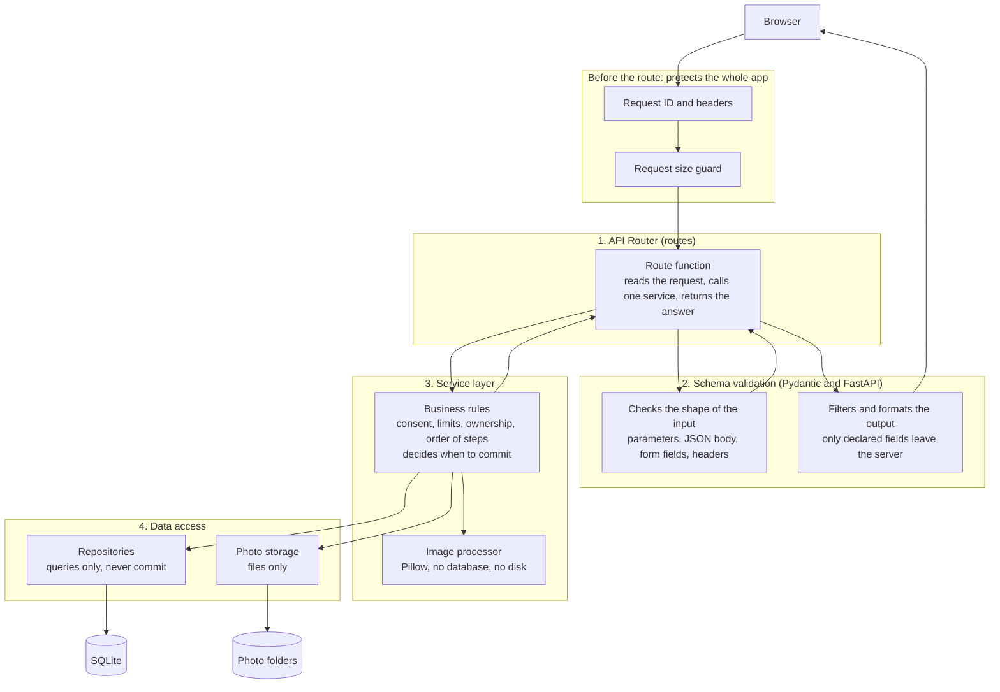
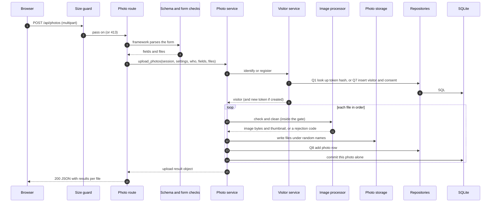
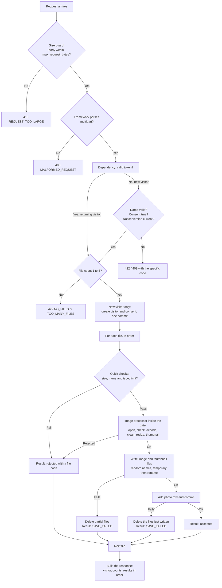

# BACKEND_DESIGN.md

# Visitor Photo Slideshow (MomentVault): Backend Design

| Item | Detail |
|---|---|
| Product | MomentVault, implementing Assignment 1: Visitor Photo Slideshow |
| Document version | 1.0 (draft for approval) |
| Date | 16 November 2026 |
| Based on | PRD.md, ASSUMPTIONS.md, TECH_STACK.md, ARCHITECTURE.md v1.1, DATABASE_DESIGN.md v1.0, API_SPECIFICATION.md v1.0 |
| Technology | Python, FastAPI, SQLAlchemy, SQLite, Pydantic, Pillow, Pytest (plus Uvicorn, python-multipart and httpx, as approved in TECH_STACK) |
| Not included | Implementation source code. Tables, names, diagrams and plain-language steps only. |

**How to read this document.** Short paragraphs marked **In plain words** explain an idea simply. IDs such as `FR-UPL-03`, `A-21`, `AD-05`, `E3`, `Q8` and `API-06` point to the PRD, ASSUMPTIONS.md, ARCHITECTURE.md, API_SPECIFICATION.md and DATABASE_DESIGN.md.

**What was verified, and what was not.** The sandbox has Pillow 12.3.0, Pydantic 2.13.5, Starlette 1.7.0, python-multipart, Uvicorn and Pytest. **FastAPI, SQLAlchemy and httpx are not installed, and there is no network to install them.** So:

- **Verified by running small experiments:** the Pillow image-checking steps (Section 15), the Pydantic time formatting (Section 10.5), the multipart parsing (earlier, API spec), the way to create oversized test images cheaply (Section 22.4), and the atomic file rename (Section 17).
- **Not verified (written from documentation knowledge):** every statement about FastAPI features and SQLAlchemy 2.0 APIs. Each is listed in Section 24.3 as a Day 1 check. Treat the structure as sound and the exact feature names as "confirm on the pinned version".

---

## Coverage of the Requested Topics

| # | Requested topic | Where |
|---|---|---|
| 1 | Backend responsibilities | Section 1 |
| 2 | Backend folder structure | Section 5 |
| 3 | Application entry point | Section 6 |
| 4 | Router organisation | Section 7 |
| 5 | Database connection and session management | Section 8 |
| 6 | SQLAlchemy model responsibilities | Section 9 |
| 7 | Pydantic schema responsibilities | Section 10 |
| 8 | Service-layer responsibilities | Section 11 |
| 9 | Repository and database access approach | Section 12 |
| 10 | Dependency injection approach | Section 13 |
| 11 | File upload processing workflow | Section 14 |
| 12 | Image validation workflow | Section 15 |
| 13 | Unique filename generation | Section 16 |
| 14 | Secure file storage | Section 17 |
| 15 | Exception handling | Section 18 |
| 16 | Logging | Section 19 |
| 17 | Environment configuration | Section 20 |
| 18 | API response conventions | Section 21 |
| 19 | Testing approach | Section 22 |
| - | How the layers communicate (Router, Schema validation, Service, Repository, Response) | **Section 3** |
| - | Beginner comparison: route, controller, service, model, schema, repository, ORM, dependency | **Section 4** |
| - | Time fit, build order | Section 23 |
| - | Decisions, findings, items to verify | Section 24 |

---

# 1. Backend Responsibilities

## 1.1 In One Paragraph

The backend is **one FastAPI program** that does everything the browser cannot be trusted to do. It receives uploads, checks them, cleans the images, stores the files under safe random names, records everything in SQLite, recognises returning visitors by their secret token, and tells the TV page which photos to play. It also serves the built React pages, so the whole application lives at one address.

> **In plain words:** the React pages are the shop window. The backend is the staff room behind it: it checks every delivery, files it, and answers questions. It never believes anything a browser says without checking.

## 1.2 What the Backend Does

| Responsibility | Requirement | API |
|---|---|---|
| Publish limits and the consent notice | NFR-MNT-01, FR-CON-01 | E1 |
| Recognise a returning visitor from the token | FR-ID | E2 |
| Register a new visitor and record consent | FR-REG, FR-CON | E3 |
| Receive, validate, clean and store photos | FR-UPL, FR-VAL, FR-STO | E3 |
| List a visitor's own photos | FR-DEL-01 | E4 |
| Delete a photo, withdraw consent | FR-DEL, FR-WDR | E5, E6 |
| Build the slideshow feed (loop and "play next") | FR-AUT, FR-PRV | E7 |
| Serve photo and thumbnail files | FR-STO-05 | E8, E9 |
| Operator removal (optional) | FR-OPR | E10 |
| Serve the built React pages for `/` and `/display` | AD-16 | none |
| Stay correct under simultaneous uploads | FR-CNC | all |
| Never leak tokens, names, paths or technical details | NFR-SEC, FR-ID-05 | all |

## 1.3 What the Backend Does **Not** Do

| Not the backend's job | Where it lives |
|---|---|
| Drawing screens, the slideshow timer, the waiting-line ordering | React frontend (ARCHITECTURE 5.5) |
| Remembering anything about a display between requests | Nowhere. The server is **stateless** about displays (ARCHITECTURE principle 4). |
| Accounts, passwords, sessions | Out of scope (OOS-01) |
| Content moderation by AI, face recognition | Out of scope (OOS-02) |
| Background jobs, queues, schedulers | Not needed in the MVP |

---

# 2. Design Principles and What Is Deliberately Not Built

## 2.1 Principles

| # | Principle | Consequence |
|---|---|---|
| 1 | **Simple first.** Every file and class must be explainable in one sentence in a live demo. | Few files. No clever patterns. |
| 2 | **One job per layer, dependencies point down.** | Section 3 |
| 3 | **Ordinary functions, not clever classes.** Classes only where something must *hold state* (the database engine, the photo folder, the image gate). | Services and repositories are **modules of functions** |
| 4 | **The database refuses bad data too.** | Python checks and database constraints agree (DATABASE_DESIGN Section 9) |
| 5 | **Services decide commits.** Repositories never commit (ARCHITECTURE AD-04). | Section 11.3 |
| 6 | **Ordinary (non-async) endpoints with synchronous SQLAlchemy** (AD-05) | Pillow and SQLAlchemy block, so FastAPI runs the endpoints in worker threads. Simpler than async, and fast enough here. |
| 7 | **Every limit comes from settings** (NFR-MNT-01) | Section 20 |

## 2.2 Things Deliberately **Not** Built

Each of these is common in larger projects. Each would cost hours and add nothing visible to the assignment.

| Not built | Why not |
|---|---|
| Abstract base classes, interfaces, generic "BaseRepository" | SQLAlchemy already hides the database. A thin function per query is enough (ARCHITECTURE 5.3). |
| Service **classes**, a dependency-injection container | Functions with explicit parameters are easier to read and to test. |
| A separate "domain model" mapped to and from the database models | One set of models is enough (ARCHITECTURE 5.6). |
| A hand-written mapper layer from models to response shapes | Services return Pydantic objects directly (Section 10.4). |
| Async SQLAlchemy, async file I/O | Adds concepts, solves no problem at this scale. |
| Background workers (Celery and similar) | Processing a photo takes about a second. Visitors may wait for it. |
| Alembic migrations | Tables are created at start-up (DATABASE_DESIGN 15.5). |
| Unit-of-work classes, event buses, caching layers | No requirement needs them. |
| Authentication libraries | One hashed token and one environment key. |
| Rate limiting | Could Have (FR-VAL-08). Only if time remains. |

---

# 3. How the Layers Communicate

## 3.1 The Chain You Asked About

**API Router, then Schema Validation, then Service, then Database/Repository, then Response.**



The numbers match the layers in the request. The arrows into and out of the schema box show that validation happens **twice**: on the way in (is the request well formed?) and on the way out (is the answer exactly what the contract says?).

## 3.2 What Each Layer Does, and Does Not Do

| Layer | Does | Must **not** |
|---|---|---|
| **Edge** (request id, size guard) | Gives every request an id. Refuses an over-large body before it is stored. | Read form fields or know any business rule |
| **1. Router (routes)** | Declares the address, method and status code. Receives the validated input. Calls **one** service function. Returns what the service gives back. | Contain business rules, queries, file handling or image code ("fat routes") |
| **2. Schemas** | Describe the shape of inputs and outputs. Reject malformed input. Filter and format output. | Touch the database, files or the network |
| **3. Services** | Hold every **rule**: consent required, limits, ownership, the order of steps. Decide when to commit. Raise domain errors with a code. | Know HTTP (status codes, headers, requests), or write SQL |
| **3b. Image processor** | Verify, rotate, strip metadata, resize, make thumbnails. Control how many images are decoded at once. | Touch the database or the disk |
| **4. Repositories** | Run queries and add or change rows. Return rows or plain values. | Commit, apply business rules, or raise HTTP errors |
| **4b. Photo storage** | Write, read and delete files safely under generated names. | Know about visitors, consent or the database |
| **Models** | Describe the tables. | Hold business rules |

## 3.3 Who May Call Whom

A layer may call **only** the layers listed. Anything else is a design error.

| From (caller) | May call | May **not** call |
|---|---|---|
| Routes | Services, schemas, dependencies | Repositories, storage, Pillow directly |
| Services | Repositories, photo storage, image processor, other services (see below), core helpers | Routes, anything from FastAPI (requests, responses) |
| Repositories | Models, the database session | Services, storage |
| Photo storage | The file system, settings | Database, services |
| Image processor | Pillow | Database, disk, services |

**Service-to-service rule:** `photo_service` may call `visitor_service` (to register a new visitor during an upload). `visitor_service` may call `consent_service`. **Never the reverse**, which prevents circular imports.

## 3.4 One Request, Layer by Layer: Slideshow Feed (E7)

A simple case first.

| Step | Layer | What happens |
|---|---|---|
| 1 | Edge | Request id attached. Body size irrelevant (no body). |
| 2 | Router | The slideshow route receives the request and its `since_id`. |
| 3 | Schema validation | FastAPI checks `since_id` is a whole number 0 or more. If not, an error is raised, and the error handler returns `422 INVALID_PARAMETER`. |
| 4 | Router | Calls the slideshow service with the database session and `since_id`. |
| 5 | Service | Asks the photo repository for the active photo ids (`Q3`) and the cursor (`Q6`). If `since_id` is present, also for new photos (`Q5`) and previous photos (`Q4`), and builds the groups by the rules in API_SPECIFICATION E7. |
| 6 | Repository | Runs the SQL through the session and returns rows. |
| 7 | Service | Returns the feed object (a Pydantic schema object). |
| 8 | Router | Returns it. |
| 9 | Schema validation (output) | The response schema keeps only `photo_ids`, `groups` and `cursor`. No other field can leak. |
| 10 | Edge | Response header `X-Request-ID` added. The route sets `Cache-Control: no-store`. |

## 3.5 One Request, Layer by Layer: Photo Upload (E3)

The longest case. The detailed steps are in Section 14. The layer view:



## 3.6 Data Passed Between Layers

| Between | What is passed | In what form |
|---|---|---|
| Browser to route | Request | HTTP, JSON or multipart |
| Route to service | Plain Python values plus the **session**, **settings** and **identity** | Ordinary arguments (never the raw request object) |
| Service to repository | The session plus simple values | Ordinary arguments |
| Repository to service | Rows (model objects) or plain values (numbers, lists of ids) | Used **inside the service only**. They are never passed up to the route. |
| Service to route | A Pydantic response object, or a raised domain error | Section 10.4, Section 18 |
| Route to browser | JSON (validated and formatted by the response schema) | HTTP |

> **Why model objects stay inside services.** A model object is "live": it belongs to a database session. After the request ends and the session closes, touching it can fail. Services convert what they need into Pydantic objects **before** returning.

---

# 4. Beginner Guide: Eight Words That Are Easy to Confuse

> **Restaurant picture.** The **route** is the waiter at the door who takes your order and brings the food. The **service** is the head chef who decides how the order is made. The **repository** is the person who fetches ingredients from the storeroom. The **model** describes how things are labelled on the shelves. The **schema** is the order form and the plate standard. The **ORM** is the label-reading robot that turns shelf labels into ingredients. A **dependency** is something the waiter asks the manager to supply ("I need a clean table").

| Term | What it is | Plain meaning | In this project | Common mistake |
|---|---|---|---|---|
| **Route** | A function that handles one address and method | "When someone asks for `POST /api/photos`, run this" | Files in `api/`, for example `photo_routes` | Putting business rules or SQL inside it |
| **Controller** | In MVC, the part that receives input and chooses what happens | The same *role* as a route | **There is no separate controller layer.** A FastAPI route plays that role. MVC is not used as a structure (ARCHITECTURE 5.2). | Creating an empty `controllers/` folder |
| **Service** | A group of functions holding the **business rules** | "What must be true, and in what order?" | Files in `services/`, for example `photo_service` | Knowing about HTTP, or writing SQL |
| **Model** | A Python class describing a **database table** | "A Photo has an id, an owner, a status..." | Files in `models/`: `Visitor`, `ConsentRecord`, `Photo` | Putting rules in it, or sending it to the browser |
| **Schema** | A Pydantic class describing the **shape of data** going in or out of the API | "A response has `photo_ids`, `groups`, `cursor`" | Files in `schemas/` | Confusing it with a model. A schema is about the **API**, a model is about the **database**. |
| **Repository** | A group of functions that run **database queries** for one table | "Get me the active photos of visitor 7" | Files in `repositories/` | Committing, or hiding business rules inside it |
| **ORM** | Object-Relational Mapper. A library that lets you work with Python objects instead of writing SQL text | "A row is an object. A table is a class." | **SQLAlchemy** | Believing the ORM is a layer you write. It is a library you use. |
| **Dependency** | Something a function *needs*, which the framework supplies | "I need a database session." FastAPI hands one over for each request. | A database session, the settings, the current visitor, the photo storage | Creating those things yourself inside the route |

## 4.1 Model versus Schema (the most common confusion)

| | Model | Schema |
|---|---|---|
| Describes | A database table | An API request or response |
| Library | SQLAlchemy | Pydantic |
| Contains `token_hash`? | Yes (the column exists) | **Never** (it must not appear in any response) |
| Example | `Photo` with `stored_name`, `status`, `visitor_id` | `PhotoSummary` with `id`, `image_url`, `thumbnail_url`, `created_at` |
| Changes when | The table changes | The API contract changes |

> **In plain words:** the model is how the data is **stored**. The schema is how the data is **shown to the outside world**. They are deliberately different, so a stored secret can never leak by accident.

## 4.2 Where the Words Appear in One Sentence

"A **route** receives the request, FastAPI checks it against a **schema**, the route hands plain values to a **service**, the service asks a **repository** for rows (which the **ORM** builds from **models**), and everything the route needs comes in as **dependencies**."

---

# 5. Backend Folder Structure

This refines the layout in ARCHITECTURE 2.3. File names are `snake_case`. `__init__.py` files are omitted from the listing but are needed in each folder.

```text
momentvault/
  .env.example                     placeholders only
  .gitignore                       data/, .env, venv, caches
  data/                            NOT in Git (created at start-up)
    momentvault.db                 SQLite (plus -wal and -shm files)
    photos/                        display-size images
    thumbs/                        thumbnails
  backend/
    requirements.txt               pinned versions
    pytest.ini                     test settings
    app/
      main.py                      creates the app, wires everything (Section 6)
      api/                         1. ROUTES
        config_routes.py           E1
        visitor_routes.py          E2, E6
        photo_routes.py            E3, E4, E5, E8, E9
        slideshow_routes.py        E7
        operator_routes.py         E10 (optional)
      schemas/                     2. SCHEMAS
        common.py                  time format, error shape
        config.py                  E1 response
        visitor.py                 E2, E6
        photo.py                   E3, E4, E5 responses
        slideshow.py               E7 response
      models/                      MODELS
        base.py                    the shared base for all models
        visitor.py                 Visitor
        consent_record.py          ConsentRecord
        photo.py                   Photo
      services/                    3. SERVICES
        visitor_service.py         identify, register, profile, withdraw
        consent_service.py         consent rules and records
        photo_service.py           upload, list, delete, serve, operator remove
        slideshow_service.py       the feed
        image_processor.py         Pillow work and the processing gate
      repositories/                4. DATA ACCESS
        visitor_repository.py
        consent_repository.py
        photo_repository.py
      storage/
        photo_storage.py           safe file writing, reading, deleting
      db/
        database.py                engine, session factory, connection settings
        init_db.py                 create tables, schema version
      core/
        settings.py                configuration (Section 20)
        consent_notice.py          the notice text and its version (Section 20.4)
        security.py                token creation, hashing, key comparison
        errors.py                  domain error type and the error catalogue
        error_handlers.py          turns errors into the standard JSON
        dependencies.py            shared dependencies (Section 13)
        middleware.py              request id, request size guard
        logging_config.py          log set-up
    tests/                         mirrors the layers (Section 22)
      conftest.py
      helpers/                     builders for test images and requests
      test_image_processor.py
      test_photo_storage.py
      test_security.py
      test_repositories.py
      test_visitor_service.py
      test_photo_service.py
      test_slideshow_service.py
      test_api_config_visitor.py
      test_api_upload.py
      test_api_slideshow_images.py
      test_api_delete_withdraw.py
      test_errors_and_headers.py
      test_concurrency.py
  frontend/                        React (separate document)
```

## 5.1 File Count and Why It Is Not Larger

About 30 source files. Each exists because a layer boundary needs it:

| Folder | Files | Why this many |
|---|---|---|
| `api/` | 5 (4 if E10 is skipped) | One per area of the API, as in ARCHITECTURE 2.3 |
| `schemas/` | 5 | One per area, plus shared pieces |
| `models/` | 4 | One per table plus the base |
| `services/` | 5 | One per area of rules, plus the image processor |
| `repositories/` | 3 | One per table |
| `core/`, `db/`, `storage/` | 10 | Each has a single distinct job |

**Allowed shortcuts (review point after Day 2, same rule as ARCHITECTURE 5.3).** If a file is only a few lines, merge it into its neighbour. The two likeliest: fold `consent_service` into `visitor_service`, and fold `consent_repository` into `visitor_repository`. Neither breaks any approved decision.

## 5.2 Naming Conventions

| Thing | Convention | Example |
|---|---|---|
| Files, folders, functions, variables | `snake_case` | `photo_service`, `count_active_photos` |
| Classes (models, schemas, errors) | `PascalCase` | `Photo`, `SlideshowFeed`, `DomainError` |
| Constants | `UPPER_SNAKE_CASE` | `ALLOWED_FORMATS` |
| Routes | Named after the action | `upload_photos`, `delete_photo` |
| Repository functions | Start with a verb that says what the query does | `get_by_token_hash`, `list_active_ids`, `count_active_for_visitor`, `add`, `mark_removed` |
| Service functions | Start with the use case | `register_visitor`, `withdraw_consent` |
| Tests | `test_<behaviour>` | `test_rejects_text_file_renamed_jpg` |

---

# 6. Application Entry Point

## 6.1 Job of `main`

One file creates the application and connects every piece. It contains **no business logic**.

> **In plain words:** `main` is the switchboard. It plugs the routers, the error handlers and the middleware into the FastAPI application and prepares the database and the photo folders before the first request.

## 6.2 Application Factory

The application is created by a **small function** that takes the settings as input (the "application factory" idea), and a module-level application object is made from it for Uvicorn to run.

| Why a factory | Reason |
|---|---|
| Tests can build an app with **temporary** settings (temporary data folder, small limits) | Every test gets a clean database and folder (NFR-TST-01) |
| No work happens when the file is merely imported | Avoids surprising side effects |

## 6.3 Start-Up Sequence

This extends ARCHITECTURE 14.6. It runs once, in FastAPI's **lifespan** hook (the supported place for start-up and shut-down work).

| Step | Action | If it fails |
|---|---|---|
| 1 | Read and validate the settings (Section 20) | Stop with a clear message naming the bad setting |
| 2 | Configure logging | n/a |
| 3 | Create `data/`, `data/photos/` and `data/thumbs/` if missing. Resolve their absolute paths. | Stop with a clear message |
| 4 | Create the database engine and the per-connection settings (Section 8) | Stop |
| 5 | Create missing tables. Set the schema version to 1 on a new database (DATABASE_DESIGN 15.5). | Stop |
| 6 | Verify that foreign keys are really on (a one-off check) | Stop. The anti-orphan design depends on it. |
| 7 | Create the photo storage object and the image processor (with its gate) and keep them in the application's shared state | Stop |
| 8 | (Should Have) Remove files that have no database row, and stale temporary files | Log and continue |
| 9 | Log "started" with the settings summary (never secrets) | n/a |

**At shut-down:** dispose of the database engine so the SQLite files close cleanly.

## 6.4 Wiring Order

| Order | What `main` registers |
|---|---|
| 1 | The request-id middleware (outermost, so even the size guard's errors get an id) |
| 2 | The request size guard |
| 3 | The exception handlers (Section 18) |
| 4 | The routers, each under `/api` (Section 7) |
| 5 | The built frontend: the entry page for `/` and `/display` **only**, plus the folder of built assets. Any other unknown address returns the standard `404 NOT_FOUND` (ARCHITECTURE 2.2). API routes are registered **first** so they are never shadowed. |

## 6.5 How the App Is Run

| Mode | How |
|---|---|
| Development | Uvicorn with auto-reload, on the backend port. Vite serves the frontend and forwards `/api`. |
| Demo | Uvicorn, **one worker**, listening on all network addresses so phones can connect. **No auto-reload.** (ARCHITECTURE 14.4, 14.7) |
| Tests | No server. The tests drive the app in-process (Section 22). |

**One worker only.** The image gate, SQLite's single writer and the in-process state all assume one process (AD-21).

## 6.6 Automatic API Documentation

FastAPI publishes interactive documentation pages from the routes and schemas. They are **useful for the demo** and for the developer, and are left **on** for a local demo. They show the contract, not any data. Switch them off for any public deployment (decision for later).

---

# 7. Router Organisation

## 7.1 One Router per Area of the API

| Router file | Endpoints | Prefix | Notes |
|---|---|---|---|
| `config_routes` | E1 `GET /api/config` | `/api` | No service, no database. Builds the answer from settings and the consent notice. |
| `visitor_routes` | E2 `GET /api/visitor`, E6 `POST /api/visitor/withdraw` | `/api/visitor` | Token required |
| `photo_routes` | E3 `POST /api/photos`, E4 `GET /api/photos/mine`, E5 `DELETE /api/photos/{photo_id}`, E8 `GET /api/photos/{photo_id}/image`, E9 `GET /api/photos/{photo_id}/thumbnail` | `/api/photos` | The largest router |
| `slideshow_routes` | E7 `GET /api/slideshow` | `/api/slideshow` | Public |
| `operator_routes` | E10 `DELETE /api/operator/photos/{photo_id}` | `/api/operator` | Only registered when an operator key is configured. Otherwise the address returns `NOT_FOUND`. |

## 7.2 What a Route Function Contains

A route function is **short**. It does exactly this, in this order:

1. Declares its address, method, success status and response schema.
2. Declares what it needs as parameters (path and query values, form fields, files, and dependencies such as the session, the settings and the current visitor).
3. Calls **one** service function, passing plain values.
4. Sets any response header that depends on the route (for example `Cache-Control`).
5. Returns the service's result.

A route function must be explainable as "read, call, return". If a route has an `if` about a business rule, that rule belongs in a service.

## 7.3 Route Rules

| Rule | Reason |
|---|---|
| **Ordinary `def` functions, not `async def`** | Pillow, SQLAlchemy and file writing block. FastAPI runs ordinary functions in a worker-thread pool, so one slow upload does not freeze the others or the display (AD-05, FR-CNC-04). |
| Each route names its **response schema** | The schema filters the output (Section 10) and produces the interactive documentation. |
| Each route states its **success status code** | E1 to E10 all return 200 (API-05) |
| No route calls a repository, the storage or Pillow | Section 3.3 |
| `/api/photos/mine` and `/api/photos/{photo_id}` differ by method and are both tested | API_SPECIFICATION E4 routing note |

## 7.4 Endpoint to Code Map

| Endpoint | Route | Service function (in words) | Main repository work |
|---|---|---|---|
| E1 | `config_routes` | none | none |
| E2 | `visitor_routes` | visitor profile | `Q1` (via the dependency), `Q2`, open consent lookup |
| E3 | `photo_routes` | upload photos (uses identify, register) | `Q1`, `Q7`, `Q2`, `Q8` |
| E4 | `photo_routes` | list my photos | `Q8b` |
| E5 | `photo_routes` | delete own photo | `QA1`, `Q10` |
| E6 | `visitor_routes` | withdraw consent | `Q9`, `Q11` |
| E7 | `slideshow_routes` | build feed | `Q3`, `Q6`, `Q5`, `Q4` |
| E8, E9 | `photo_routes` | get photo file | `QA2` |
| E10 | `operator_routes` | operator remove photo | `QA1`, `QA3`, `Q11`-style file read |

---

# 8. Database Connection and Session Management

> **In plain words:** the **engine** is the one long-lived connection setup to the SQLite file. A **session** is a short conversation with the database for **one request**. Each request gets its own session and closes it at the end. No session is ever shared.

## 8.1 The Pieces

| Piece | What it is | Lifetime | Where |
|---|---|---|---|
| **Engine** | Knows where the database file is and how to open connections | Whole application run | Created at start-up in `db/database` |
| **Connection settings hook** | A small piece of code that runs for **every new connection** the engine opens | Per connection | `db/database` |
| **Session factory** | Makes sessions | Whole application run | `db/database` |
| **Session** | One unit of conversation with the database | **One request** | Supplied by a dependency |

## 8.2 Required Settings on Every Connection

These come from DATABASE_DESIGN 15.3 and TECH_STACK Part 5.

| Setting | Value | Why |
|---|---|---|
| Foreign keys | **ON** | SQLite ignores them otherwise. The anti-orphan design depends on it. |
| Journal mode | WAL | Readers (the display) are not blocked while a write happens (FR-CNC-04) |
| Busy timeout | `DB_BUSY_TIMEOUT_MS` (default 5000) | A second writer **waits** instead of failing at once (FR-CNC-03) |
| Thread sharing | Allow a connection to be used by a different thread than the one that created it | FastAPI runs ordinary endpoints in a thread pool. **Confirm the exact SQLAlchemy and sqlite3 setting at build (BV-3).** |

> **Common mistake:** setting foreign keys on once and assuming it stays. The setting belongs to the **connection**, and the engine opens new connections over time. That is why it is placed in a hook that runs for each one, and why start-up checks it (Section 6.3 step 6) and a test proves it (Section 22).

## 8.3 Session Lifecycle (One Request)

| Step | What happens |
|---|---|
| 1 | The request reaches a route that needs the database. FastAPI calls the **session dependency**. |
| 2 | The dependency opens a session from the factory. |
| 3 | The route runs. The session is passed down to the service and on to repositories. |
| 4 | The **service** commits when its unit of work succeeds. |
| 5 | If any exception escapes, the dependency **rolls back** whatever was not committed. |
| 6 | The dependency **always closes** the session, even after an error, which releases the connection and any lock. |

## 8.4 Transaction Rules

| Rule | Detail |
|---|---|
| **Services commit. Repositories never commit.** | ARCHITECTURE AD-04. A repository may "flush" (send pending SQL so a new id is known) but never commit. |
| **Short write transactions** | SQLite allows one writer at a time. Never keep a write transaction open during image processing or file writing. The processing happens first, and the write follows quickly (ARCHITECTURE 7.5). |
| **One unit of work, one commit** | See the table below. |
| **Session per request** | Never keep a session in a global or share it between threads. |
| **Do not use model objects after the session closes** | Services return plain Pydantic objects (Section 3.6). The session is also set so that committed objects are **not automatically expired**, so reading a value right after a commit does not trigger a hidden query. **Confirm the option name at build (BV-2).** |

**Units of work (what is committed together)**

| Use case | Transaction | Commit count |
|---|---|---|
| Register a new visitor | Insert visitor and insert consent record (`Q7`) | **1** (before any photo is processed, API E3) |
| Accept one photo | Insert photo row (`Q8`) | **1 per photo** (ARCHITECTURE AD-08) |
| Delete one photo | Mark photo removed (`Q10`) | 1, then delete files |
| Withdraw consent | Mark photos removed, close consent, clear visitor (`Q9`) | **1** (all three or none), then delete files |
| Operator removal | Mark photo removed (`QA3`) | 1, then delete files |
| Read endpoints | none | 0 |

## 8.5 Database Busy Handling

| Situation | Behaviour |
|---|---|
| A write waits, then succeeds within the busy timeout | Invisible to the visitor |
| The wait runs out ("database is locked") | The error handler translates it to `503 SERVER_BUSY` with a `Retry-After` hint, or, inside E3, a per-file `SAVE_FAILED` if some photos were already saved. No half-saved data remains (FR-CNC-03, ERR-15). |
| Any other database error | Logged in full. The visitor sees `500 INTERNAL_ERROR` only. |

---

# 9. SQLAlchemy Model Responsibilities

## 9.1 The Job of a Model

A model **describes one table** and nothing else. The three models mirror DATABASE_DESIGN Section 4 exactly.

| Model | Table | Responsibility |
|---|---|---|
| `Visitor` | `visitors` | Columns, the unique token hash, the status rule. Knows its `photos` and `consent_records` (convenience links). |
| `ConsentRecord` | `consent_records` | Columns, the foreign key to the visitor, the "one open consent per visitor" partial unique index |
| `Photo` | `photos` | Columns, the foreign key to the visitor, the two unique file names, the status rule, the three indexes |

## 9.2 Model Rules

| Rule | Detail |
|---|---|
| **Mirror DATABASE_DESIGN** | The same tables, columns, constraints (including **named** check constraints), indexes and the never-reused photo id. A Day 1 task compares the generated table text with DATABASE_DESIGN Section 4 (DV-2). |
| **No business rules** | A model has no "can this photo be shown?" method. Rules live in services. |
| **Python-side relationships are convenience only** | The foreign key is the real rule. **No delete-cascade** is configured on the Python side, which would contradict RESTRICT (DATABASE_DESIGN 14.3). |
| **Times** | The application sets UTC times in Python, so tests control them. The database default is only a backup (DATABASE_DESIGN 11.1). |
| **Status values** | Written as named constants in one place, not as scattered strings. The same constants are used by repositories and services. |
| **Never sent to the browser** | Models contain `token_hash` and internal ids. Only schemas leave the server (Section 4.1). |

## 9.3 The ORM Approach

SQLAlchemy 2.0 style: models declared with typed columns, queries written with the `select` expression style and run through the session. **This avoids raw SQL strings in application code and builds queries with bound values**, which prevents SQL injection (ARCHITECTURE 13.2). The SQL in DATABASE_DESIGN Section 13 is the *meaning* of each query. The repository writes the same query in the ORM style. **SQLAlchemy 2.0 was not available in the sandbox. Confirm the option names on the pinned version (BV-1, BV-2).**

---

# 10. Pydantic Schema Responsibilities

## 10.1 The Job of a Schema

A schema describes the **shape of data that crosses the API boundary**. Pydantic checks it automatically.

| Direction | What the schema does |
|---|---|
| **Input** | Describes and checks JSON bodies, path values and query values. It rejects what does not fit. |
| **Output** | Describes the exact fields of every response. FastAPI **keeps only those fields** and formats them. Anything extra on the object (for example `token_hash`) is dropped. |

> **Verified:** a response schema built from an object that also carries a `token_hash` attribute outputs only its declared fields (test run with Pydantic 2.13.5).

## 10.2 Schema Inventory

Names are proposals. Fields are fixed by API_SPECIFICATION.

| Schema | Used by | Direction | Fields (summary) |
|---|---|---|---|
| `PublicConfig` (with a nested consent notice) | E1 | Output | All limits, durations, allowed types, notice version, title, points, checkbox label |
| `VisitorProfile` (with consent info) | E2 | Output | `name`, `photo_count`, `max_photos`, `consent.notice_version`, `consent.given_at` |
| `WithdrawRequest` | E6 | **Input** | `confirm` (boolean) |
| `WithdrawResult` | E6 | Output | `withdrawn`, `photos_removed`, `withdrawn_at` |
| `PhotoSummary` | E3, E4 | Output | `id`, `image_url`, `thumbnail_url`, `created_at` |
| `UploadResponse` (with visitor and per-file results) | E3 | Output | `visitor`, `accepted_count`, `rejected_count`, `results` |
| `FileResultError` | E3 | Output | `code`, `message`, `details` |
| `MyPhotos` | E4 | Output | `photos`, `count`, `max_photos` |
| `DeleteResult` | E5, E10 | Output | `photo_id`, `status`, `already_removed`, `photo_count` (E10 omits `photo_count`) |
| `SlideshowFeed` (with groups) | E7 | Output | `photo_ids`, `groups[].new`, `groups[].previous`, `cursor` |
| `ErrorResponse` | all errors | Output | `error.code`, `message`, `details`, `request_id` |

## 10.3 What Is **Not** a Pydantic Input Schema

The E3 upload is **multipart form data**, not JSON. Its fields (`name`, `consent`, `notice_version`, `files`) are declared on the route as form fields and files, not as a Pydantic body. Two consequences:

| Point | Decision |
|---|---|
| **The form fields are declared as optional** at the FastAPI level | If FastAPI checked "required" itself, a missing name would produce FastAPI's own error text. The contract needs **our** codes (`NAME_REQUIRED`, `CONSENT_REQUIRED`...) and needs to **skip** the checks for returning visitors. So the service validates them. |
| Name trimming, length and control-character rules are **service rules** | They apply only to new visitors and use settings. |

## 10.4 Services Return Schema Objects

**Decision (BD-02).** A service returns the Pydantic response object directly (for example a `SlideshowFeed`), and the route returns it unchanged. There is **no separate mapper** and no second set of "result" classes.

| Benefit | Cost |
|---|---|
| Fewer classes and files. A beginner follows one object from service to response. | Services import schema classes. This is acceptable: Pydantic is a plain data library, and a schema contains no HTTP code. A service still knows **nothing about requests, responses or status codes**. |

If this ever hurts, the alternative is plain dataclasses in the services. It is not needed now.

## 10.5 Conventions Built Into the Schemas

| Convention | How it is met |
|---|---|
| `snake_case` field names | Python names already match |
| Times as `2026-11-16T05:12:33.481Z` | One shared time type in `schemas/common` formats every time as UTC with milliseconds and a trailing `Z`. A naive time from SQLite is treated as UTC. **Verified:** with Pydantic 2.13.5 a naive time `2026-11-16 05:12:33.481000` is written as `2026-11-16T05:12:33.481Z`. |
| Every documented field always present, `null` when empty | Fields are declared without "omit when empty" behaviour |
| Empty lists as `[]` | Lists default to empty, never `None` |
| Image links as relative paths | Built by one helper function using the fixed patterns `/api/photos/{id}/image` and `/api/photos/{id}/thumbnail`, so the pattern lives in one place |

---

# 11. Service-Layer Responsibilities

## 11.1 The Job of the Service Layer

Services hold **every business rule** and decide **the order of steps and the commit**. They are plain **modules of functions**. Each function takes everything it needs as **explicit parameters** (session, settings, storage, the visitor), so there is no hidden state and tests can call them directly.

## 11.2 Service Inventory

| Service | Responsibilities | Main functions (in words) | Calls |
|---|---|---|---|
| **visitor_service** | Identify a visitor from a raw token. Register a new visitor (validate name, create token, store the hash, create consent). Build the visitor profile (E2). Withdraw consent (E6). | identify visitor, register visitor, get profile, withdraw consent | repositories, security helpers, consent_service, photo storage (to delete files after withdrawal) |
| **consent_service** | The consent rule: consent must be exactly `true`, and the notice version must be current. Create the consent record. Close it on withdrawal. | check consent, add consent record, close consent | consent repository, the consent notice |
| **photo_service** | The upload workflow (E3). List my photos (E4). Delete a photo (E5). Operator removal (E10). Find the file for an image request (E8, E9). | upload photos, list my photos, delete own photo, operator remove photo, get photo file | visitor_service, image processor, photo storage, photo repository |
| **slideshow_service** | Build the feed (E7): loop, groups, cursor. | build feed | photo repository |
| **image_processor** | The image validation and cleaning workflow (Section 15). The processing gate. **Pure**: no database, no disk. | check and clean an image | Pillow |

## 11.3 Rules Each Service Must Follow

| Rule | Reason |
|---|---|
| **Never import anything from FastAPI** | Keeps services testable without a web server and independent of HTTP |
| **Raise domain errors, not HTTP errors** | A service says *what* went wrong (`NAME_TOO_LONG`). The error handler decides the status code (Section 18). |
| **Commit explicitly, and only at the units of work in Section 8.4** | One place to look for transaction behaviour |
| **Files and database in the safe order** | Add: files first, row last, delete files if the row fails. Remove: row first, files second (ARCHITECTURE AD-13, AD-14) |
| **Return Pydantic objects, never live model objects** | Section 3.6 |
| **Never log tokens, hashes, names or file contents** | FR-ID-05 |
| **Check ownership in the service, not in the route or the browser** | FR-DEL-02 |
| **Keep functions short and named after use cases** | A beginner can explain each one |

## 11.4 Business Rules and Where They Live

| Rule | PRD | Service |
|---|---|---|
| Name is trimmed, 1 to 50 characters, no control characters | FR-REG-02 | visitor_service |
| Name is never used to find a visitor | FR-ID-03a, BR-01 | visitor_service (identification uses only the token hash) |
| Consent is required for a new visitor and the notice version must match | FR-CON-02, BR-04, BR-14 | consent_service |
| A token that is unknown, malformed or withdrawn means "new visitor" on upload and `401` elsewhere | FR-ID-03 | visitor_service, dependencies |
| Maximum 5 files per request | FR-VAL-04 | photo_service |
| Maximum 20 active photos per visitor | FR-VAL-06 | photo_service |
| File type, content, size, pixel checks | FR-VAL-01, 02, 03, 05 | photo_service (size and name), image_processor (content) |
| Only the owner may delete | FR-DEL-02 | photo_service |
| Repeat deletion is not an error | FR-DEL-05 | photo_service |
| Withdrawal removes all photos and ends the identity | FR-WDR-03 | visitor_service |
| A photo is eligible only when active and its owner is active | BR-09, BR-10 | photo repository queries, slideshow_service |
| A new upload plays first, then the owner's earlier photos, most recent first | BR-11, A-21, A-22 | slideshow_service |
| One visitor's photos never appear in another's "previous" | BR-12 | slideshow_service, photo repository |

---

# 12. Repository and Database Access Approach

## 12.1 Decision: Thin Repository Modules

ARCHITECTURE AD-03 approved **thin repository modules**. This section says exactly what that means.

| Aspect | Decision |
|---|---|
| Form | A module of **plain functions**, one module per table. No classes, no base class, no interface. |
| First parameter | Always the **session** |
| Returns | Model objects, lists of ids, counts or simple values. Used inside services only. |
| Commits | **Never.** A function may flush so that a new id is available. |
| Business rules | **None** |
| Queries | Written in the SQLAlchemy `select` style, with bound values. **No SQL assembled from request text.** |
| Naming | A verb that describes the query (Section 5.2) |
| Review trigger | If after Day 2 the repositories feel like pointless pass-through code, merge them into services (AD-03). Allowed and does not break any approved decision. |

## 12.2 Repository Inventory

Each function maps to a query in DATABASE_DESIGN Section 13 or API_SPECIFICATION Section 10.

| Repository | Function (in words) | Query |
|---|---|---|
| visitor_repository | Find an active visitor by token hash | `Q1` |
| | Add a visitor | `Q7` (first half) |
| | Mark a visitor withdrawn and clear name and token hash | `Q9` step 3 |
| consent_repository | Add a consent record | `Q7` (second half) |
| | Find the open consent of a visitor | open-consent lookup |
| | Close the open consent | `Q9` step 2 |
| photo_repository | Count a visitor's active photos | `Q2` |
| | List all eligible photo ids | `Q3` |
| | List a visitor's previous photos, newest first, excluding a batch | `Q4` |
| | List new active photos above a cursor, with their batch and owner | `Q5` |
| | Read the highest photo number ever assigned (the cursor) | `Q6` |
| | Add a photo | `Q8` |
| | List a visitor's own active photos | `Q8b` |
| | Read a photo and its owner | `QA1` |
| | Read the file names of an active photo | `QA2` |
| | Mark one photo removed | `Q10` (owner) and `QA3` (operator) |
| | Mark all of a visitor's photos removed | `Q9` step 1 |
| | List the file names of removed photos, and of active photos | `Q11`, `Q12` |

## 12.3 Using the ORM Without Over-Using It

| Guideline | Reason |
|---|---|
| Simple reads and writes through model objects | The ORM is good at this |
| Bulk status changes (withdrawal) as **one update statement**, not a loop over objects | Faster, and one statement keeps the transaction short |
| Never load a list of whole photo rows just to read ids | The slideshow needs only ids. Ask for ids only. |
| Avoid "lazy loading" through the Python relationships inside loops | Hidden extra queries are a classic ORM trap. Use explicit repository functions. |
| Do not call raw SQL strings | Everything the project needs is expressible with `select` and `update` |

---

# 13. Dependency Injection Approach

> **In plain words:** a **dependency** is something a function needs but should not build itself. In FastAPI a route lists what it needs as parameters marked as dependencies, and FastAPI builds each one for **this request** and passes it in. This keeps the session per request, and lets tests **swap in** a temporary database or small limits.

## 13.1 Decision (BD-03)

Use **FastAPI's built-in dependency system only**. No container, no third-party injection library, no service classes. Services receive their needs as ordinary function arguments.

## 13.2 Dependency Inventory

| Dependency | Supplies | Created | Used by |
|---|---|---|---|
| **settings** | The validated settings object (read once and cached) | Once per application | Almost every route |
| **db session** | A new session, closed after the request | Per request | Every route that touches the database |
| **photo storage** | The storage object created at start-up | Once per application | Upload, delete, withdraw, image routes |
| **image processor** | The processor (settings plus the gate) created at start-up | Once per application | Upload route |
| **optional visitor** | The visitor if the `X-Visitor-Token` header is valid, otherwise "none". **Never raises.** | Per request | E3 |
| **required visitor** | The visitor, or raises `VISITOR_NOT_RECOGNISED` | Per request | E2, E4, E5, E6 |
| **operator check** | Passes if the `X-Operator-Key` header matches (constant-time). Otherwise raises `OPERATOR_KEY_INVALID`. | Per request | E10 |

## 13.3 What the Visitor Dependencies Do

| Step | Detail |
|---|---|
| 1 | Read the `X-Visitor-Token` header. FastAPI maps the Python parameter name to that header automatically (BV-4). |
| 2 | If it is missing or longer than 128 characters, the result is "no visitor" without a database lookup. |
| 3 | Otherwise hash the value (SHA-256) and call `visitor_service` to look up an **active** visitor by that hash (`Q1`). |
| 4 | **Optional** version returns the visitor or "none". **Required** version returns the visitor or raises the domain error. |
| 5 | The token and its hash are **never logged**. |

The visitor object returned is a **small plain object** (the internal id, name and status), not a live model.

## 13.4 How Dependencies Are Swapped in Tests

| Test need | Method |
|---|---|
| Temporary data folder and database, small limits | Build the application with a settings object that points at a temporary folder (factory, Section 6.2) |
| Force a failure (for example a storage write error) | Replace the storage dependency with a test version |
| Fixed time or token | Pass a fake into the function under test (services take explicit parameters) |

FastAPI also allows replacing any dependency for a test (a built-in "override" feature). **Confirm at build (BV-5).**

---

# 14. File Upload Processing Workflow (E3)

This is the **backend recipe** for `POST /api/photos`. It follows API_SPECIFICATION E3 "Validation order" exactly, and ARCHITECTURE Section 7.

## 14.1 The Whole Workflow



## 14.2 Step by Step

| # | Step | Layer | Detail |
|---|---|---|---|
| 1 | Size guard | Middleware | Counts bytes as they arrive and checks the declared length. Over `max_request_bytes` (default 27,262,976) gives `413`. Applies to `POST /api/photos` with that limit and to other bodies with a small limit (Section 18.6). |
| 2 | Parse | FastAPI and Starlette | **Verified (ARCHITECTURE 7.6):** the framework reads the **whole** body and stores each file in a temporary file (in memory up to 1 MB, then on disk) before the route runs. So step 1 is the only real protection against a huge body. |
| 3 | Identify | Dependency | The optional-visitor dependency (Section 13.3). Never fails. |
| 4 | Validate registration data | visitor_service, consent_service | **New visitors only:** name (trim, not empty, then length, then control characters), then consent is `true`, then the notice version is current. Returning visitors skip this. Nothing is stored if it fails. |
| 5 | Check the file count | photo_service | 0 files, or an **empty file picker** (one part with empty name and 0 bytes, verified in API spec 5.5), gives `NO_FILES`. More than 5 gives `TOO_MANY_FILES`. The whole request is rejected and nothing is stored. |
| 6 | Register | visitor_service | **New visitors only:** generate the token, hash it, insert the visitor and the consent record, and **commit once** (`Q7`). On failure nothing is created and no token is returned. |
| 7 | Prepare | photo_service | Count the visitor's active photos once (`Q2`). Create one random `batch_id` shared by all photos of this request. |
| 8 | **Per file, in order** | photo_service | Steps 9 to 15. A problem with one file never stops the others (FR-UPL-03). |
| 9 | Quick checks | photo_service | The file's size from the framework: 0 bytes gives `FILE_EMPTY_OR_CORRUPT`. Over `max_file_bytes` gives `FILE_TOO_LARGE` **without reading it**. Extension and declared type must be allowed, otherwise `FILE_TYPE_NOT_ALLOWED` (the HEIC message for `.heic` or `.heif`). The per-visitor limit gives `PHOTO_LIMIT_REACHED`. |
| 10 | Process | image_processor | The workflow in Section 15, inside the processing gate. Returns the cleaned image and thumbnail bytes, or a rejection code. |
| 11 | Generate names | photo_storage | Two random names (Section 16). |
| 12 | Write files | photo_storage | Temporary name, then rename (Section 17). On failure delete anything partial, result `SAVE_FAILED`. |
| 13 | Record | photo repository, then photo_service | Add the photo row with `status = active` (`Q8`) and **commit this photo alone**. This is the moment the photo becomes eligible for the slideshow (BR-09, FR-UPL-02). |
| 14 | Compensate | photo_service | If the commit fails, delete the files from step 12 and report `SAVE_FAILED`. No row remains. |
| 15 | Record the result | photo_service | One result per file, in the order sent: accepted (with the photo summary) or rejected (with the code and message). |
| 16 | Respond | photo_service, route | After the last file, count the visitor's active photos again. Build the upload response: the visitor (with the token only when new), accepted and rejected counts, and the results. Status `200`. |

## 14.3 Why Each Photo Is Committed Separately

Already decided (ARCHITECTURE 7.4, AD-08): a photo becomes visible **as soon as it is ready** (FR-AUT-01), write locks stay short so other uploads do not wait, and one failure does not undo the others.

## 14.4 What the Visitor Never Sees

The visitor's own file name is **never** used in a path. It is returned only in the result list (shortened to 100 characters, as text) so the page can show "IMG_4021.jpg: accepted" (FR-UPL-04).

## 14.5 Interrupted Uploads

If the connection drops mid-upload, the framework stops reading and the route never runs, so **no file and no row are created** (FR-UPL-02 AC1, ERR-13). Temporary files made by the framework are removed by the framework. The phone shows "Upload did not finish."

## 14.6 Concurrency Notes (FR-CNC)

| Concern | How it is handled |
|---|---|
| Two uploads with the same file name | Stored names are random. Nothing can be overwritten (FR-CNC-02). |
| Shared state | Each request has its own session. The only shared objects (storage, image processor, settings) hold **no per-request data**. |
| Database lock | Image work and file writing happen **before** the short write. Waits are bounded by the busy timeout. |
| Memory | The processing gate limits simultaneous image decoding (Section 15.4). |
| Display not frozen | Readers are not blocked in WAL mode, and endpoints run in worker threads (FR-CNC-04). |
| Double click on submit | The frontend disables the button (API-13). The backend does not de-duplicate in the MVP. |

---

# 15. Image Validation Workflow

> **In plain words:** the file name and the declared type are only *claims* by the browser. The backend opens the file with Pillow and trusts only what Pillow finds inside. Then it makes a **clean copy** of the picture, and only the clean copy is stored. The original upload is thrown away.

## 15.1 The Image Processor in One Line

One function takes the uploaded file and the settings and returns **either** a clean image plus a thumbnail **or** a rejection with one of the file-level codes. It uses only Pillow and memory. It touches neither the database nor the disk.

## 15.2 Workflow

| # | Step | Failure gives | Notes |
|---|---|---|---|
| 1 | Wait for a free slot in the **gate** (Section 15.4) | (waits) | Held until step 12 finishes |
| 2 | **Open** the file with Pillow | `FILE_NOT_AN_IMAGE` if Pillow cannot identify it | Opening reads only the header. **Verified:** a text file gives "cannot identify image file". |
| 3 | **Check the real format** | `FILE_TYPE_NOT_ALLOWED` | Pillow's detected format must be JPEG or PNG. **Verified:** GIF content is detected as GIF even if named `.jpg`. A PNG named `.jpg` is **accepted** under its real format (ASSUMPTIONS A-12). |
| 4 | **Check the pixel count from the header, before decoding** | `IMAGE_TOO_LARGE_PIXELS` | Width times height above `max_megapixels` times one million. **Verified:** after opening, the size is known but the pixels are not decoded, so this check is cheap. A 6000 by 5000 image is 30 million pixels and is only 37 KB as a PNG, so a tiny file can still be a decompression bomb (FR-VAL-05). |
| 5 | Catch Pillow's own bomb error | `IMAGE_TOO_LARGE_PIXELS` | Pillow's default limit is about 89.5 million pixels. At **twice** the limit it raises an error while opening, **verified** with a lowered limit. The project's 25 MP check in step 4 comes first, so this is only a second safety net. |
| 6 | **Fully decode** the image | `FILE_EMPTY_OR_CORRUPT` | **Verified:** a truncated JPEG opens normally (the header is fine) but fails with a read error when fully decoded. So full decoding is **required** to detect damage (FR-VAL-02 AC3). Pillow's "load truncated images" option must stay **off**. |
| 7 | **Apply the rotation** the photo carries | | Phones store sideways pictures with a rotation tag. **Verified:** applying it turned 4000 by 3000 into 3000 by 4000. |
| 8 | **Normalise the colour mode** | | JPEG output must be a normal colour or grey picture. **Verified:** a CMYK JPEG stays CMYK when re-saved, which many browsers show wrongly, so non-grey, non-RGB modes are converted to RGB before saving a JPEG. PNG keeps its mode (RGBA, palette, grey). |
| 9 | **Shrink** so the longest side is at most `MAX_IMAGE_SIDE_PX` (default 1920) | | Never enlarges. **Verified:** a 3000 by 4000 picture became 1440 by 1920. |
| 10 | **Re-encode** the picture as a **new** file in the **same format** | | JPEG stays JPEG, PNG stays PNG (A-15). **The metadata is not copied:** **verified** that after re-saving, the picture had **zero** EXIF entries, so location (GPS), camera and time information is gone (privacy, A-15). |
| 11 | **Make the thumbnail** from the same picture, longest side `THUMBNAIL_SIDE_PX` (default 320), re-encoded the same way | | |
| 12 | Return the two byte strings, the content type and the file extension (`.jpg` or `.png`) | | The extension comes from the **detected format**, never the visitor's name. Release the gate slot. |

Any unexpected Pillow error in steps 2 to 11 is treated as the nearest rejection code (usually `FILE_EMPTY_OR_CORRUPT`) and logged, never shown in detail.

## 15.3 Why Not Pillow's `verify()`

Pillow offers a quick `verify()` check. It is **not used**, for two verified reasons: it does not decode the pixel data (so it would miss some damage that a full decode finds), and an image object **cannot be used again after `verify()`**, which would force opening the file twice. A single open plus a full decode (step 6) is simpler and stronger.

## 15.4 The Processing Gate (AD-23)

| Item | Decision |
|---|---|
| What | A counter (a bounded semaphore) allowing at most `MAX_CONCURRENT_IMAGE_JOBS` (default 4) images to be decoded and processed at the same moment, across **all** requests |
| Why | A decoded 25 MP image can need roughly **75 to 100 MB** of memory (an estimate). Ten simultaneous uploads could need 1 GB. The gate trades a little waiting for a safe ceiling (ARCHITECTURE 7.5). |
| Where | Inside the image processor object created at start-up |
| Waiting | A request that finds no free slot **waits**. There is no timeout in the MVP. Uploads become slower under load, not wrong (ARCHITECTURE L11). |
| Released | Always, even if an error occurs |
| Tune | Measure during the 10-upload test. Lower it on a small computer. |

## 15.5 Order of the Quick Checks versus the Processor

Cheap checks run **before** the gate and before any decoding: size (from the framework), name and declared type, and the per-visitor limit. The expensive Pillow work comes last. This is the order in API_SPECIFICATION "Per-file validation order". Where the two documents order a rejection differently, the **observable result** (which code the visitor sees for a given file) is the same for each realistic file.

## 15.6 What Is Stored

Only the **clean copies**. The original upload is never kept (A-15). The stored picture has no metadata, a sensible size, a known format and a server-chosen name.

---

# 16. Unique Filename Generation

## 16.1 Rules

| Rule | Detail |
|---|---|
| **Random, not derived** | A name is a random 32-character hexadecimal string produced by the standard library's random UUID function, followed by an extension. The visitor's name, the time, the visitor id and the photo id are **not** used. |
| **Extension from the real format** | `.jpg` for JPEG, `.png` for PNG, taken from what Pillow detected, not from the upload |
| **Two names per photo** | One for the display image (in `photos/`) and one for the thumbnail (in `thumbs/`). Different random values, so neither reveals the other. |
| **Fixed shape** | Exactly `32 lowercase hex characters` + `.jpg` or `.png`. Example: `ee9476c9c98c4f5488c334244892dfaf.jpg` (a real output of the generator, **verified**). |
| **Unguessable** | About 122 random bits. Nobody can guess another photo's file name, although photo numbers in addresses are guessable by design (ARCHITECTURE L8). |

## 16.2 Collisions

| Protection | Detail |
|---|---|
| Probability | Negligible with 122 random bits |
| File system | A file is created in **exclusive mode**, which **fails if the name already exists**, so an existing file can never be overwritten (FR-CNC-02). On the rare failure a new name is generated. |
| Database | `UNIQUE` on `stored_name` and `thumb_name` (DATABASE_DESIGN Section 7) is the last line of defence |

## 16.3 Names Are Validated Before Use

Any name that reaches a file operation must match the fixed shape (regular expression of 32 lowercase hex characters, a dot, `jpg` or `png`). A name that does not is refused with an internal error, even though names come from the database (Section 17).

## 16.4 Other Random Values

| Value | Source | Form |
|---|---|---|
| Visitor token | The standard library's secure random source, 32 bytes | 43 URL-safe characters (**verified length**). At least 128 bits is required (FR-ID-01). 256 bits is used. |
| Batch id | A random UUID, per request | 32 hex characters |
| Request id | A short random value | `req_` plus 8 hex characters |

Ordinary (non-secure) random functions are **never** used for tokens.

---

# 17. Secure File Storage

## 17.1 Layout

All files live inside the data folder **outside the source code folder and outside the frontend build**:

| Folder | Contents |
|---|---|
| `data/photos/` | Display-size images |
| `data/thumbs/` | Thumbnails |

These folders are **never** exposed as static file folders. Nothing can list or fetch them directly. Photos reach a browser **only** through E8 and E9.

## 17.2 The Photo Storage Object

A small object created at start-up holds the two **absolute** folder paths. It is the **only** code that touches photo files.

| Operation (in words) | Behaviour |
|---|---|
| Save an image | Writes the bytes to a **temporary** name in the same folder, then **renames** it into place. **Verified:** the rename replaces atomically on the same file system. A reader or a crash can therefore never see a half-written photo. |
| Read the path of a photo | Builds the path from the folder plus a **validated** name, then checks the result is still inside the folder |
| Delete | Removes the file. A file that is already gone is **not** an error (idempotent). Other failures are logged and reported, never raised to the visitor. |
| Clean up | Removes temporary files and files without a database row (start-up sweep, Should Have, Q12) |

## 17.3 Security Rules

| Threat | Control |
|---|---|
| Path tricks in the visitor's file name (`../../x.jpg`) | The visitor's name is **never** used in a path (FR-STO-01) |
| Path tricks through the address | The file name is read **from the database**, never from the request. The address contains only a number. |
| A bad name in the database | The name must match the fixed shape (Section 16.3), and the resolved path must be inside the data folder. Two checks, so one mistake is not enough. |
| Disguised files | Only a re-encoded JPEG or PNG made by Pillow is ever written. Nothing the visitor sent is stored as it arrived. |
| Executing an upload | Files are never run or interpreted. Responses use a fixed `Content-Type` from the database and `X-Content-Type-Options: nosniff` (ARCHITECTURE 13.2). |
| Directory listing | No static mount exists for the photo folders |
| Reading removed photos | E8 and E9 look the photo up first (`QA2`: active photo, active owner). Removed, withdrawn or unknown photos return `404`. |
| Filling the disk | The size guard, per-file limit, pixel limit, per-visitor limit and the clean-up after failures (ARCHITECTURE 13.2) |
| Secrets in the repository | `data/` and `.env` are in `.gitignore` (NFR-SEC-02) |

## 17.4 Serving a Photo (E8, E9)

| Step | Detail |
|---|---|
| 1 | The service runs `QA2` for the photo id. No row gives `404 PHOTO_NOT_FOUND`. |
| 2 | The storage object builds the path from the validated name |
| 3 | If the file is missing or unreadable, `404 PHOTO_NOT_FOUND` is returned and the problem is **logged** (ERR-22) |
| 4 | The route returns the file with the stored content type, `Cache-Control: public, max-age=31536000, immutable`, and `nosniff` (API spec E8) |

## 17.5 Deleting Files

| Case | Behaviour |
|---|---|
| Delete, withdrawal, operator removal | The database change is **committed first**, then files are deleted (AD-13). If a file cannot be deleted the photo is already invisible. The file name stays in a `removed` row, so `Q11` can retry it later. |
| Failed upload | Files already written for that photo are deleted immediately (AD-14) |

## 17.6 Backups and Persistence

No automatic backup. A manual copy of the whole `data/` folder with the app **stopped** (ARCHITECTURE 14.8). Files and database must be copied together, or rows and files will not match.

---

# 18. Exception Handling

> **In plain words:** when something goes wrong deep in the code, the code *raises an exception*, which travels upward until something catches it. In this backend the catching is done **in one place**, which turns every failure into the same JSON error shape.

## 18.1 The Domain Error

There is **one** application error type, carrying:

| Part | Meaning |
|---|---|
| `code` | A stable code from the API_SPECIFICATION catalogue, for example `NAME_TOO_LONG` |
| `details` | Optional facts, for example the limit |
| (message) | **Not** set by the raiser. Looked up from the catalogue by code. |

Services and the image processor raise it. **They never choose HTTP status codes.** Per-file rejections use the same error type, but the photo service catches them and records them in the result list instead of failing the request.

## 18.2 The Error Catalogue

One table in `core/errors` maps every code to its **HTTP status** and its **visitor message**. It is the single place that holds the contents of API_SPECIFICATION Section 4.3. Messages that contain limits (5 MB, 50, 5, 20) are built from the settings.

| Benefit | Detail |
|---|---|
| One place to change a message | No messages scattered through services |
| No drift from the contract | Tests check that every code in the API document exists in the catalogue |
| Services stay free of HTTP | They name a code. The handler finds the status. |

## 18.3 The Handlers

All registered once in `main`. Each produces the standard error body of API_SPECIFICATION 4.1, including `request_id`.

| What was raised | Handler result |
|---|---|
| The domain error | Status and message from the catalogue |
| FastAPI's request validation error (bad path or query value, unreadable JSON) | `INVALID_PARAMETER` (422), or `MALFORMED_REQUEST` (400) for an unreadable body. For E6, a missing or false `confirm` is mapped to `CONFIRMATION_REQUIRED`. **FastAPI's own error text is never sent.** |
| The framework's "not found" and "method not allowed" | `NOT_FOUND` (404) and `METHOD_NOT_ALLOWED` (405) |
| The framework's multipart parse failure (status 400) | `MALFORMED_REQUEST` |
| A database "locked" or "busy" error | `SERVER_BUSY` (503) with `Retry-After`. Logged as a warning. |
| Any other database error | `INTERNAL_ERROR` (500). Full detail logged. |
| **Anything else, unexpected** | `INTERNAL_ERROR` (500). Full detail and stack trace **logged**, generic message to the visitor (NFR-SEC-04). |

## 18.4 Where Each Kind of Failure Is Handled

| Failure | Raised in | Turned into JSON by |
|---|---|---|
| Body too large | Size guard (it answers directly in the standard shape, because the route is never reached) | The guard itself |
| Missing or bad token on a token-required route | Visitor dependency | Domain-error handler |
| Bad name, consent, count | Services | Domain-error handler |
| One bad file | Image processor or photo service | Not an error response. Becomes a result entry in a `200`. |
| Storage write failure | Photo storage | Photo service catches it: result entry `SAVE_FAILED` |
| Database busy | SQLAlchemy | Database-error handler, or caught in the photo service (per-file `SAVE_FAILED`) |
| Bug | Anywhere | Catch-all handler |

## 18.5 Rules

| Rule | Reason |
|---|---|
| Never put a token, a hash, a path or a stack trace in a response | FR-ID-05, NFR-SEC-04 |
| Roll back the session on any escaping exception | Section 8.3 |
| Clean up files **before** re-raising, never after | No orphan files (FR-STO-04) |
| Do not catch an exception only to hide it | Log it, or let it travel up |
| Do not use exceptions for normal outcomes such as "already removed" | That is a normal `200` (FR-DEL-05) |

## 18.6 Size Guard Detail

| Aspect | Decision |
|---|---|
| Kind | A small middleware written at the lowest (ASGI) level, because it must see the body **as it arrives** |
| Limit for `POST /api/photos` | `max_request_bytes` |
| Limit for other requests | A small fixed limit (for example 64 KB). Only E6 sends a body, and it is tiny. |
| Declared length too large | Refuse at once, before reading |
| No declared length (chunked) or a false one | Count the bytes received. Stop reading as soon as the limit is passed and answer `413`. |
| After refusing | Nothing is stored. The framework never parses the body. |
| Order | Runs **inside** the request-id middleware, so the `413` still carries an id |

**Verified fact driving this (Section 14.2 step 2):** without this guard the framework would read the entire body first. **Confirm on the pinned versions that the guard stops a very large body and a length-less body before they are stored (BV-6, ARCHITECTURE S1).**

---

# 19. Logging

## 19.1 Approach

Python's built-in `logging` module, writing **one line per event to standard output**. No logging library, no log files managed by the app (the host or the terminal captures output). Uvicorn's own access log stays on and shows address, method, path and status, **without** headers, so the token never appears in it.

## 19.2 Format

Every line carries: time (UTC), level, the **request id** (when inside a request), a short event name, and a few `key=value` facts. Example, as plain text: `2026-11-16T05:12:34Z INFO req_9f3a1c27 photo_accepted photo_id=121 ms=830`.

The request id comes from the request-id middleware and is attached to every log line through a context-aware logging filter. The same id is in the response header and the `error.request_id` field, so a visitor's complaint maps to log lines (ARCHITECTURE 12.6).

## 19.3 What to Log

| Level | Event | Facts |
|---|---|---|
| INFO | Application started, settings summary (no secrets), schema version | Limits, data folder |
| INFO | Visitor registered | Internal visitor id |
| INFO | Photo accepted | Photo id, processing time in milliseconds, size in bytes |
| INFO | Photo or visitor removed (delete, withdrawal, operator) | Photo id or counts |
| INFO | Upload summary | Number accepted, number rejected |
| WARNING | File rejected | The error **code** only (for example `FILE_NOT_AN_IMAGE`), the size, never the file name or content |
| WARNING | Database busy, request refused with `SERVER_BUSY` | Wait time |
| WARNING | A file could not be deleted (leftover file) | The stored name (a random value, not personal) |
| WARNING | Wrong operator key | Count only |
| ERROR | Unexpected exception | Full detail and stack trace, request id |
| DEBUG | Detailed step timing, gate waits | Off by default |

## 19.4 What Never to Log

| Never | Why |
|---|---|
| Visitor tokens or token hashes | FR-ID-05 |
| The operator key | BR-15 |
| Visitor names | Personal data. Withdrawal must really erase them. |
| Original file names | Visitor-supplied and possibly personal |
| File contents or request bodies | Privacy and size |
| Full file system paths of the data folder in visitor-facing places | Information leak |

Logging calls pass values as `key=value` pairs built by the code, never by dumping a whole request or object.

## 19.5 Other Details

| Topic | Decision |
|---|---|
| Level | `LOG_LEVEL` setting (default INFO) |
| Pillow and other libraries | Set to WARNING so they do not flood the output |
| Log reading in the demo | The terminal running Uvicorn is the log |
| Test logs | Tests check that errors contain no token, using the captured log output (Section 22) |

---

# 20. Environment Configuration

## 20.1 Approach

All settings are read **once at start-up** from environment variables, optionally filled from a `.env` file that is **not** in Git. `.env.example` lists every setting with **placeholder** values only (NFR-SEC-02, BR-15).

**Decision (BD-04): use `pydantic-settings`**, the optional package from TECH_STACK. It reads and **validates** settings into one typed object, and stops start-up with a clear message if a value is wrong (for example a negative limit). The alternative, reading environment variables by hand, would need hand-written validation. **This adds one small dependency and needs your approval.**

The settings object is **immutable**, created once, and handed out through the settings dependency. Tests create their own with a temporary data folder.

## 20.2 Settings Reference

Names are proposals (ARCHITECTURE 14.5, extended). All have safe defaults except the operator key, which defaults to **off**.

| Setting | Default | Meaning | PRD |
|---|---|---|---|
| `DATA_DIR` | `./data` | Folder for the database and photos | A-18 |
| `SLIDE_SECONDS` | 10 | Seconds per photo (reported by E1) | P-01 |
| `POLL_SECONDS` | 5 | Display poll interval (reported by E1) | A-25 |
| `MAX_FILE_MB` | 5 | Largest file, in MiB (5 MiB = 5,242,880 bytes, API-09) | P-02 |
| `MAX_FILES_PER_SUBMISSION` | 5 | Files per request | P-03 |
| `MAX_MEGAPIXELS` | 25 | Largest image size | P-05 |
| `NAME_MAX_LENGTH` | 50 | Longest name (the minimum, 1, is fixed) | P-06 |
| `MAX_PHOTOS_PER_VISITOR` | 20 | Active photos per visitor | P-07 |
| `REPLAY_PREVIOUS_MAX` | 20 | Most earlier photos listed in `previous` | A-23 |
| `MAX_IMAGE_SIDE_PX` | 1920 | Longest side after resizing | A-15 |
| `THUMBNAIL_SIDE_PX` | 320 | Longest side of a thumbnail | A-15 |
| `MAX_CONCURRENT_IMAGE_JOBS` | 4 | The processing gate (AD-23) | none |
| `DB_BUSY_TIMEOUT_MS` | 5000 | How long a write waits for the database | FR-CNC-03 |
| `FRONTEND_DIST_DIR` | `../frontend/dist` | The built React files | AD-16 |
| `LOG_LEVEL` | `INFO` | Logging level | none |
| `OPERATOR_KEY` | empty (feature off) | **Secret.** Enables E10. Placeholder only in `.env.example`. | FR-OPR-02 |

**Derived values (calculated, not set):** the file size in bytes, and `max_request_bytes` = files per request times file size, plus 1 MiB for the text fields and multipart overhead (27,262,976 with the defaults, API spec 5.6).

## 20.3 Validation at Start-Up

| Check | Failure |
|---|---|
| Every number is a positive whole number (the operator key aside) | Refuse to start, naming the setting |
| `MAX_FILES_PER_SUBMISSION` is at most `MAX_PHOTOS_PER_VISITOR` | Refuse to start |
| `DATA_DIR` can be created and written to | Refuse to start |
| `FRONTEND_DIST_DIR` missing | **Warn only**, because the API works without the frontend (development) |
| Foreign keys really on | Refuse to start (Section 6.3) |

## 20.4 The Consent Notice (Decision BD-05)

ARCHITECTURE 14.5 lists "consent notice version and text `v1`" among the settings. This design keeps the **text and its version together in one definition in code** (`core/consent_notice`), not split between a setting and a file.

| Reason | Detail |
|---|---|
| They must change together | A new version with old text, or old version with new text, would make stored consent records **untrue** (BR-14) |
| Not a secret, rarely changed | Does not belong in the environment |

Changing the notice means editing that one definition and bumping its version. E1 and the consent rule both read it. **This differs slightly from ARCHITECTURE 14.5 and needs your confirmation.**

## 20.5 Secrets

| Rule | Detail |
|---|---|
| The only secret is `OPERATOR_KEY` | Visitor tokens are runtime values, not settings |
| Never in Git | `.env` is ignored. `.env.example` has a placeholder |
| Never logged or returned | Settings logging prints a fixed summary of **non-secret** fields only |
| Compared safely | Constant-time comparison (Section 13.2) |

---

# 21. API Response Conventions

These implement API_SPECIFICATION Section 2 and Section 4.

| Convention | How the backend delivers it |
|---|---|
| Success is the bare object, with no wrapper | Routes return the schema object. FastAPI serialises it. |
| Errors are `{"error": {code, message, details, request_id}}` | The handlers (Section 18.3), built from the catalogue |
| `snake_case` names, ids as numbers, `null` for empty, `[]` for empty lists | Schema design (Section 10.5) |
| Times as ISO 8601 UTC with milliseconds and `Z` | The shared time type (**verified**) |
| Sizes in bytes, durations in seconds | Settings converted once |
| Image links are relative paths | One helper builds them |
| Status `200` for every success, including a mixed upload | Routes declare it explicitly (API-05) |
| Only declared fields are returned | Each route names its response schema |
| `X-Request-ID` and `X-Content-Type-Options: nosniff` on every response | Request-id middleware |
| `Cache-Control` per endpoint | E7, E2 to E6, E10, errors: `no-store`. E1: `no-cache`. E8 and E9: `public, max-age=31536000, immutable`. Set by each route, and by the handlers for errors. |
| `Retry-After` on 429 and 503 | The handlers |
| Image responses are the file with the stored type | Photo route returns a file response |
| No CORS headers | Same origin (API spec 2.1) |
| Unknown address or wrong method use the standard error shape | Handlers replace FastAPI's defaults (API-14) |

**Contract rule:** if the code and API_SPECIFICATION disagree, **the API specification wins** and the code is fixed, unless the specification is formally amended. A contract test suite (Section 22.5) enforces this.

---

# 22. Testing Approach

## 22.1 Strategy

**Pytest** drives every automated test. The tests mirror the layers, so a failure points at the layer that broke. Most of the value comes from three groups: the **image processor** (pure, fast, rich in edge cases), the **upload workflow** (the heart of the assignment), and the **contract tests** from API_SPECIFICATION Section 11.

| Layer | How it is tested | Needs |
|---|---|---|
| `security` helpers | Direct function tests | Nothing |
| `image_processor` | Direct tests with images built in memory | Pillow only |
| `photo_storage` | Direct tests with a temporary folder, including forced failures | Pytest temporary folder |
| Repositories | Tests against a **temporary SQLite file** | Temporary database |
| Services | Direct calls with a temporary database and storage, no web server | Same |
| Routes and the whole API | **FastAPI's test client**, in-process | httpx (installed as approved) |
| Concurrency | The 10-simultaneous-upload test | Threads, temporary database |
| Display, phones, real TV | Manual test plan with recorded results (TECH_STACK T-08) | People and devices |

## 22.2 Test Environment Rules

| Rule | Reason |
|---|---|
| Every test uses a **fresh temporary data folder and database file** | No test depends on another (NFR-TST-01) |
| Use a database **file**, not an in-memory database | In-memory SQLite is per-connection, which breaks sessions and threads, and WAL does not apply to it |
| The application is built with the **factory** and test settings (small limits where useful) | Section 6.2 |
| Tests never touch the real `data/` folder | Safety |
| No network access | Tests are self-contained |
| Test images are **generated in code**, never committed | Section 22.4 |

## 22.3 Shared Test Fixtures (in `conftest`)

| Fixture | Provides |
|---|---|
| Settings | Test settings pointing at a temporary folder |
| Application and client | The built app and its test client |
| Session | A session on the temporary database |
| Storage and image processor | Real objects on the temporary folder |
| "Registered visitor" | A visitor created through the real service, with their raw token, for tests that need an identity |
| Image builders | Functions that produce the test files below |

## 22.4 Generating Test Files in Code

PRD Appendix B lists the suggested sample files. They are **produced by small builder functions**, so the repository stays small and the cases are readable.

| Test file | How to make it | Verified |
|---|---|---|
| Valid JPEG and PNG | Pillow creates and saves a small picture | Yes |
| JPEG with a **sideways rotation tag** and **location (GPS) data** | Pillow saves with EXIF data | Rotation tag verified. GPS tag handling to be checked on first use. |
| Text file renamed `.jpg` | Plain bytes | Yes (cannot identify) |
| Empty file | Zero bytes | n/a |
| **Truncated JPEG** | Cut a valid JPEG in half | **Yes:** opens, then fails on full decode |
| GIF named `.jpg`, GIF named `.gif` | Pillow saves a GIF | **Yes:** detected as GIF |
| PNG named `.jpg` | A PNG with the wrong extension | Yes |
| **Over the pixel limit** | A solid-colour image of 30 megapixels saved as PNG | **Yes: only 37 KB**, so no large file is needed |
| **Exactly 5 MiB** | A valid JPEG **padded with zero bytes** at the end until it is 5,242,880 bytes, which decoders ignore | **Yes:** the padded file still opens and decodes |
| **One byte over** | The same file plus one more byte | Same method |
| CMYK JPEG | Pillow saves a CMYK image as JPEG | **Yes** |
| 10 different valid images | Builder called ten times | n/a |

> **Why this matters:** none of the nasty cases needs a large or dangerous file in the repository.

## 22.5 What Is Tested

**Image processor (the richest group)**

| Test | Expected |
|---|---|
| Valid JPEG and valid PNG | Clean image and thumbnail returned, same format |
| Text file renamed `.jpg` | `FILE_NOT_AN_IMAGE` |
| Truncated JPEG | `FILE_EMPTY_OR_CORRUPT` |
| GIF content | `FILE_TYPE_NOT_ALLOWED` |
| PNG content with a `.jpg` name | Accepted as PNG |
| 30 MP image | `IMAGE_TOO_LARGE_PIXELS`, and it is **not** fully decoded |
| Sideways JPEG | Output is upright |
| JPEG with GPS and camera data | Output has **no** metadata |
| CMYK JPEG | Output is RGB |
| Very large picture | Longest side at most 1920. Thumbnail at most 320. |
| Small picture | Not enlarged |
| Gate | With the gate set to 1, two simultaneous calls run one after the other, and the slot is released after an error |

**Other units**

| Group | Tests |
|---|---|
| Security | Token is 43 characters and different each time. Hash is stable. The raw token is never the hash. Constant-time comparison accepts only the right key. |
| Storage | Saved name matches the fixed shape. A path-trick name is refused. A failed write leaves no file. A temporary file is not left behind. Deleting a missing file is not an error. |
| Repositories | The database tests from DATABASE_DESIGN 15.4 (orphan refused, duplicate token refused, second open consent refused, bad status refused, active visitor with no name refused, new photo number always greater) |
| Services | Registration creates visitor and consent together. Failure creates neither. Withdrawal changes all three tables together. Ownership check. Repeat deletion. Feed rules (first request, new group, previous photos, batch across two polls, removal) |

**API contract tests.** Every one of the **34 tests** in API_SPECIFICATION Section 11 is implemented, using the test client. Some additional checks:

| Check | Expected |
|---|---|
| Every error has the standard shape and a matching `X-Request-ID` | Yes |
| No response or captured log line contains a token, a hash, a file path or a stack trace | Yes |
| Every code in the API document exists in the error catalogue | Yes |
| Unknown address and wrong method use the standard shape | Yes |
| Response bodies contain only the documented fields | Yes |
| Foreign keys are on for **every** connection, including connections used by worker threads | Yes (the key anti-orphan test) |

**Concurrency test (FR-CNC-01 to FR-CNC-04)**

| Test | Expected |
|---|---|
| Ten different new visitors upload one valid photo each at the same moment, all using the file name `photo.jpg` | Exactly 10 visitors, 10 photo rows, 10 distinct files. Each photo owned by the right visitor. No raw database error. |
| Meanwhile the slideshow feed is requested repeatedly | Every request succeeds |
| Record the total time and any busy responses | Reported in the test plan (ARCHITECTURE S2) |

Run the concurrency test with several threads, each with its own client, on a temporary database file. **If the test client does not give genuine parallelism, run the real server in a background thread and use HTTP requests (BV-7).**

## 22.6 Coverage Aim

| Area | Aim |
|---|---|
| Image processor, storage, security | Every branch |
| Upload workflow and services | Every rule in Section 11.4 has at least one test |
| API | Every endpoint, every status code in API_SPECIFICATION |
| Overall percentage | **Not a goal.** The goal is that every PRD "Must Have" acceptance criterion has a test or a recorded manual check. |

## 22.7 Test Order of Work

Write the tests **with** each piece, not at the end: image processor tests first (they are quick and catch the hardest bugs), then storage, repositories, services, then the API tests as each route is built, and the concurrency test last. This matches the build order in Section 23.

## 22.8 Manual Checks (Not Automated)

Real phones and the real TV or fallback screen (ARCHITECTURE S4, S5, A-12, A-26), the demo rehearsal, and the privacy and consent wording. Results are recorded in the manual test plan.

---

# 23. Time Fit and Build Order

## 23.1 Realism Check

TECH_STACK Part 6.1 budgets about **7.5 hours** for the backend (6 hours core plus 1.5 hours listing, serving and display updates) and **2.5 hours** for tests and the manual plan, within a **20-hour** total. These hours are **estimates**, not measurements. This design fits them because it uses ordinary functions, three tables, no migrations, no async, no background jobs, and generates test data in code.

## 23.2 Build Order (Must Have first)

| # | Work | Estimate (hours) | Result you can demonstrate |
|---|---|---|---|
| 1 | Project skeleton: environment, requirements, settings, logging, start-up, empty app, one test | 1.0 | App starts, `GET /api/config` works |
| 2 | Models, database set-up, repositories, database tests | 1.0 | Tables created, constraints proven |
| 3 | **Image processor and its tests** | 1.25 | Every image case behaves as Section 15 says |
| 4 | Photo storage and its tests | 0.5 | Safe save, read, delete |
| 5 | Security helpers, visitor and consent services, the identification dependencies, E2 | 0.75 | Registration logic, "welcome back" |
| 6 | **Upload workflow and E3**, per-file results | 1.25 | Photos upload end to end |
| 7 | Slideshow feed (E7), image serving (E8) | 1.0 | A photo appears on the display |
| 8 | Error handlers, request id, size guard | 0.75 | Standard errors, `413` |
| | **Subtotal, Must Have backend** | **7.5** | |
| 9 | Contract tests and the concurrency test | about 2.0 (within the 2.5-hour test budget) | 10 uploads at once proven |

## 23.3 Should Have (only after all of the above)

In the order TECH_STACK Part 6.1 recommends:

| Order | Item | Estimate (hours) |
|---|---|---|
| 1 | Photo deletion (E5) and "my photos" (E4) | 0.75 |
| 2 | Consent withdrawal (E6) | 0.75 |
| 3 | Thumbnails and metadata removal are **already in the processor** (Section 15), so mainly E9 | 0.25 |
| 4 | Start-up orphan-file sweep | 0.25 |
| 5 | Operator removal (E10, Could Have) | 0.5 |

**Rule:** do not start any Should Have item until the Must Have backend (steps 1 to 8) works and its tests (step 9) pass. Re-plan after Day 1 using your real speed (TECH_STACK).

## 23.4 Ways to Save Time If Behind

| Saving | Effect |
|---|---|
| Merge `consent_service` into `visitor_service` | Two fewer files |
| Merge repositories into services | Fewer files (AD-03 review trigger) |
| Drop thumbnails (A-15) | Removes E9 and `thumb_name` |
| Skip E10 | Removes a router |
| Skip the start-up sweep | Leftover files remain after a crash |

---

# 24. Decisions, Findings and Items to Verify

## 24.1 Backend Decisions

| ID | Decision | Reason | Alternative rejected |
|---|---|---|---|
| BD-01 | Services, repositories and routes are **modules of plain functions**. Classes only for the photo storage, the image processor and the settings. | Simple, explainable, easy to test | Service classes, DI container |
| BD-02 | Services return Pydantic response objects directly | Fewer classes, no mapper | Dataclasses plus a mapper |
| BD-03 | FastAPI's own dependency system only | Enough for per-request session, visitor and settings | Third-party injection |
| BD-04 | Use `pydantic-settings` for configuration | Typed, validated, small | Hand-written environment reading |
| BD-05 | Consent notice text and version live together in one code definition | They must change together (BR-14) | Version as a setting |
| BD-06 | Application factory with a module-level app | Tests get temporary settings | A single global app |
| BD-07 | Upload form fields are optional at the FastAPI level and validated by services | Our error codes and the returning-visitor exception | FastAPI "required" fields |
| BD-08 | Pillow `verify()` is not used. One open plus a full decode. | Verified weaker and awkward (Section 15.3) | `verify()` then reopen |
| BD-09 | Size and quick checks run before the gate. Pillow work runs inside it. | Memory safety without wasting slots | Gate around everything |
| BD-10 | A separate small limit for non-upload request bodies | Cheap protection | No limit |
| BD-11 | One start-up check that foreign keys are really on | The anti-orphan design depends on it | Trusting the hook |

## 24.2 Findings Against Approved Documents

Nothing in the other documents was changed.

| # | Finding | Proposed handling |
|---|---|---|
| 1 | **ARCHITECTURE 14.5** lists the consent notice **version** as a setting. BD-05 moves it into one code definition with the text. | Please confirm. Otherwise the version becomes a setting and a test must check it matches the text. |
| 2 | **TECH_STACK** lists `pydantic-settings` as **optional**. BD-04 adopts it. | Needs approval (one more package). |
| 3 | **ARCHITECTURE** names a "request size guard" in `core`. This design places it in `core/middleware` with the request id, and gives it a second, smaller limit for other bodies. | Consistent in intent. Minor detail. |
| 4 | **ARCHITECTURE 11.1** says services do not know HTTP. BD-02 lets services import Pydantic schema classes. | Pydantic is a data library, not HTTP. Consistent in spirit. Flagged so it is a conscious choice. |
| 5 | **API_SPECIFICATION** per-file order puts the per-visitor limit after the pixel check. This design runs it earlier as a cheap check. | Observable results are the same for realistic files (Section 15.5). If the strict order matters for a test, reorder. |
| 6 | **ARCHITECTURE 5.3** allowed merging repositories and `consent_service`. | Kept as designed, with the merge options listed in Section 23.4. |
| 7 | **TECH_STACK Part 6.1** budgets 7.5 hours for the backend. | This design is sized to it (Section 23). The Should Have items add roughly 2.5 hours. |
| 8 | **API_SPECIFICATION API-13**: no server-side duplicate-submit protection. | Unchanged. Noted in Section 14.6. |

## 24.3 Items to Verify on Day 1 (Not Verified Here)

FastAPI, SQLAlchemy and httpx were not installed in the sandbox, so these are **not** checked.

| # | Check | Why |
|---|---|---|
| BV-1 | Install the pinned SQLAlchemy 2.x. Confirm the typed-model style, the `select` and `update` style, the auto-increment table option and the partial-index option. | Sections 9 and 12 |
| BV-2 | Confirm the session option that keeps objects from expiring after a commit. | Section 8.4 |
| BV-3 | Confirm the SQLite thread-sharing setting works with FastAPI's worker threads, and that connections created by the pool all get the foreign-key, WAL and busy-timeout settings. | Section 8.2 (TECH_STACK flagged this) |
| BV-4 | Confirm a header parameter maps to `X-Visitor-Token`. | Section 13.3 |
| BV-5 | Confirm dependency overrides work for the session, settings and storage in tests. | Section 13.4 |
| BV-6 | Confirm the size guard stops a very large and a length-less body before they are stored, and find how to cap the number of files and fields the parser accepts. | Section 18.6 (ARCHITECTURE S1) |
| BV-7 | Confirm the test client gives genuine concurrency for the 10-upload test. | Section 22.5 |
| BV-8 | Confirm the lifespan hook, FastAPI's handling of optional form fields with a list of files, and the handlers that replace the default 404, 405 and validation errors. | Sections 6, 10.3, 18.3 |
| BV-9 | Confirm Pillow's bomb error and warning at the exact limit using the project's own limit, and that GPS tags are dropped on a real phone photo. | Section 15 |
| BV-10 | Confirm a file response can carry the required `Cache-Control` and `nosniff` headers. | Section 17.4 |

## 24.4 Open Items Carried Forward

| ID | Question | Effect on the backend |
|---|---|---|
| A-11 | Real retention period | None in the MVP. A purge job would be future work (DATABASE_DESIGN F-12). |
| A-15 | Thumbnails approved? | Keeps or drops E9, the thumbnail step and `thumb_name` |
| A-26, A-30 | Demo screen, deployment | No effect on the backend design |
| API-06, API-08, API-09 | Small API additions and the megabyte definition | Already built into this design. Change only if you reject them. |

---

# Glossary

| Term | Meaning |
|---|---|
| **Layer** | A group of code with one job that may call only the layers below it |
| **Route** | A function that handles one address and method |
| **Schema** | A Pydantic description of API input or output |
| **Model** | A SQLAlchemy class describing a table |
| **Service** | Functions holding the business rules |
| **Repository** | Functions that run database queries |
| **ORM** | A library that maps tables to classes (SQLAlchemy) |
| **Dependency** | Something a function needs that the framework supplies per request |
| **Session** | A short conversation with the database for one request |
| **Transaction** | Changes that all succeed or all fail |
| **Middleware** | Code that handles every request before it reaches a route |
| **Lifespan** | FastAPI's place for start-up and shut-down work |
| **Gate (semaphore)** | A counter that lets only a fixed number of tasks run at once |
| **Atomic rename** | Replacing a file in one step so nobody sees a half-written file |
| **Decompression bomb** | A small file that expands into a huge image and exhausts memory |
| **EXIF** | Hidden data in a photo (rotation, camera, location) |
| **Request id** | A short code that ties a response, an error and the log lines together |

---

# Document Control

| Version | Date | Change |
|---|---|---|
| 1.0 | 16 Nov 2026 | Initial draft. Pillow, Pydantic and file-handling behaviour verified by experiment. FastAPI and SQLAlchemy behaviour not yet run. |

**Approvals needed before coding:** (1) `pydantic-settings` (BD-04), (2) the consent notice kept in one definition (BD-05), (3) services returning schema objects (BD-02), (4) the optional merges in Section 23.4 if time is short, (5) the thumbnail decision (A-15).
