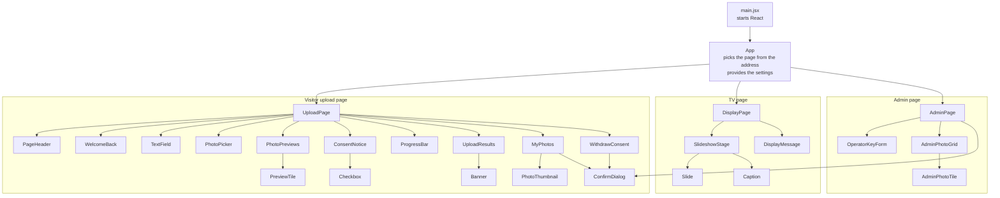
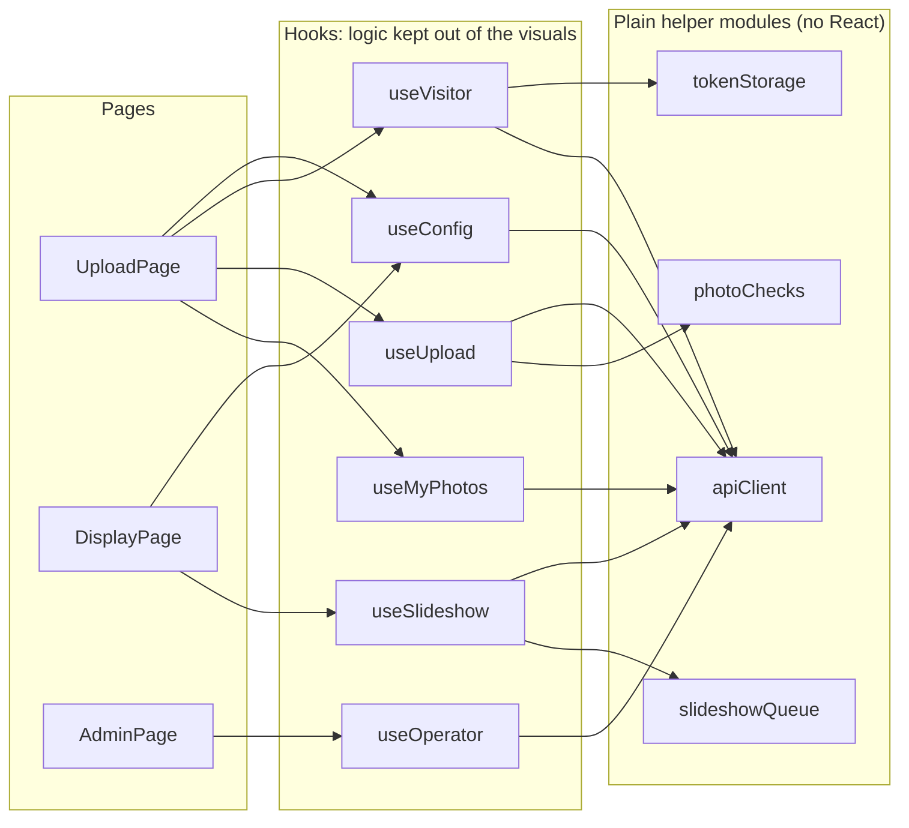
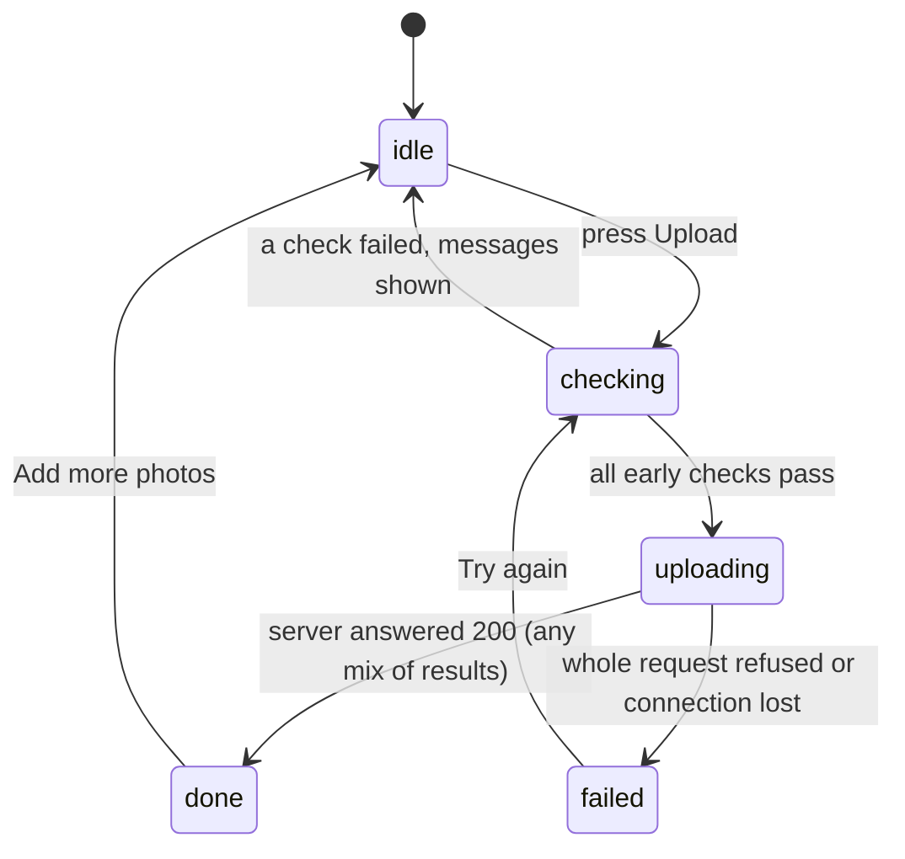

# FRONTEND_DESIGN.md

# Visitor Photo Slideshow (MomentVault): Frontend and Design System

| Item | Detail |
|---|---|
| Product | MomentVault, implementing Assignment 1: Visitor Photo Slideshow |
| Document version | 1.0 (draft for approval) |
| Date | 16 November 2026 |
| Based on | PRD.md, ASSUMPTIONS.md, TECH_STACK.md, ARCHITECTURE.md v1.1, API_SPECIFICATION.md v1.0 (DATABASE_DESIGN.md and BACKEND_DESIGN.md for the server side) |
| Technology | React, JavaScript, Vite, plain CSS. **No Tailwind, Bootstrap or component library.** |
| Not included | React source code. Tables, wireframes, diagrams and plain-language specifications only. |

**How to read this document.** Short paragraphs marked **In plain words** explain an idea simply. IDs such as `FR-DSP-03`, `A-21`, `E7`, `API-06` and `BD-02` point to the PRD, ASSUMPTIONS.md, API_SPECIFICATION.md and BACKEND_DESIGN.md. Labels mean: **Must / Should / Could** (PRD priority), **CONTRACT** (supported by the approved API) and **FUTURE** (needs a change to an approved document first).

**What was verified, and what was not.**

- **Verified by calculation:** every colour pair in Section 2.1 was run through the WCAG contrast formula. The results are printed in the tables.
- **Not verified:** nothing in this document was rendered in a browser, because no React, Vite or browser testing was done in the sandbox. Layout measurements, the TV font sizes and the behaviour of the HTML `dialog` element, the fullscreen feature and CSS properties are **design intentions** and must be checked on real devices (Section 18).

---

## Read This First: Four Findings That Change What Can Be Built

| # | Finding | What this document does |
|---|---|---|
| 1 | **The "Basic Admin Interface" is larger than the approved API supports.** The API has exactly **one** operator action: remove a photo (E10, **Could Have**). There is no endpoint that lists visitors, and the slideshow feed (E7) contains **no names** by design. The PRD also puts "advanced admin dashboards" out of scope. | Section 7 designs the admin page **in two parts**: **v1 (CONTRACT)** manages photos using E7, E9 and E10 only. **v2 (FUTURE)** designs the visitor listing and extra actions you asked for, clearly marked as needing new endpoints and a privacy review. Nothing in v2 is assumed to exist. |
| 2 | **The visitor's name cannot be shown on the TV with the approved API.** E7 returns only photo numbers. The PRD calls the name caption **FR-DSP-10 (Could Have)** and says that if it is built, consent notice item 6 becomes mandatory. | Section 6.7 defines exactly **where** the name goes, but marks it **FUTURE and off by default**. |
| 3 | **The operator key cannot be checked when it is typed.** There is no "check key" endpoint, and E10 only removes a photo. | The admin page accepts the key and discovers a wrong key on the **first removal** (a `401`). Section 7.9 explains the behaviour. |
| 4 | **A third page address, `/admin`, is needed.** ARCHITECTURE AD-14 and BACKEND_DESIGN 6.4 serve the entry page only for `/` and `/display`. | One small amendment: also serve it for `/admin`. Listed in Section 19. |

A smaller correction: PRD FR-CON-01 item 6, and therefore API_SPECIFICATION Section 12.4, refer to the name caption as **FR-DSP-07**. The caption is **FR-DSP-10** (FR-DSP-07 is "show only active photos"). This document uses FR-DSP-10.

---

## Coverage of the Request

| Requested | Where |
|---|---|
| Design direction | Section 1 |
| Design system: colours, typography, fonts, spacing, radius, shadows, buttons, inputs, cards, breakpoints | Sections 2 and 3 |
| For each interface, items A to J | Visitor: Section 5. TV: Section 6. Admin: Section 7. Each uses the same A to J layout. |
| TV: full-screen, aspect ratio, object-fit, transitions, name placement, loading and fallback, large TV, hidden controls | Section 6 |
| Visitor page: registration form, dropzone, previews, consent, validation, progress, success | Section 5 |
| Admin page: photo management, visitor listing, delete confirmation, management actions | Section 7 |
| React component hierarchy | Section 8 |
| Frontend folder structure | Section 9 |
| State management | Section 10 |
| API integration | Section 11 |
| Accessibility | Section 12 |
| Achievable in about 20 hours | Section 15 |

---

# 1. Design Direction

## 1.1 Principles

| # | Principle | What it means in practice |
|---|---|---|
| 1 | **Calm and minimal** | White or near-black surfaces, one blue accent, no gradients, no decorative illustrations |
| 2 | **Typography does the work** | Hierarchy comes from size and weight, not from boxes and colour |
| 3 | **Few containers** | Content sits directly on the page. A bordered surface is used **only** where grouping is needed (photo tiles, the results list, dialogs). No card around every section. |
| 4 | **One spacing rhythm** | Every gap is a multiple of 4 pixels from one scale |
| 5 | **Motion only when it helps** | A fade between TV slides and a small state change on buttons. Nothing else moves. All motion stops for people who ask for reduced motion. |
| 6 | **Never colour alone** | Success, warning and error always carry an icon and words as well as colour |
| 7 | **Phone first** | The upload page is designed at 360 pixels wide and grows (NFR-USA-01) |
| 8 | **The TV is a poster, not an app** | No controls, no menus, nothing that invites touching |
| 9 | **Simple enough for a beginner** | About 8 reusable UI parts, plain CSS files, no build-time tricks |

## 1.2 Three Interfaces, Two Moods

| Interface | Address | Who uses it | Mood |
|---|---|---|---|
| **Visitor upload** | `/` | A visitor on a phone, sometimes a laptop | **Light theme.** Friendly, clear, quick. |
| **TV slideshow** | `/display` | Nobody interacts. The public watches. | **Dark theme.** The photo is the hero. Almost no text. |
| **Admin (operator)** | `/admin` | The person running the screen | **Light theme.** Plain and functional. Not linked from anywhere public. |

The two themes share **one set of design tokens** (Section 2) so the product still looks like one product.

> **In plain words:** a *design token* is a named value, such as "the main blue" or "the standard gap". You define it once, and every screen refers to the name. Change the value once and the whole product changes.

---

# 2. Design System

All values are defined **once** as CSS custom properties (variables) in one file, `tokens.css`. Components use the **names**, never the raw values.

## 2.1 Colour Tokens: Light Theme (visitor and admin)

Contrast ratios were **calculated** with the WCAG formula. The requirement is 4.5 to 1 for normal text and 3 to 1 for large text and for the visible edge of controls.

### Brand

| Token | Value | Role | Contrast check |
|---|---|---|---|
| `--color-primary` | `#1D4ED8` | Main buttons, links, focus ring, progress | White text on it: **6.70** (needs 4.5) |
| `--color-primary-hover` | `#1E40AF` | Hover and pressed | White text on it: **8.72** |
| `--color-primary-subtle` | `#EFF6FF` | Light blue area (drag-over, selected) | Primary text on it: **6.16** |
| `--color-secondary` | `#0F766E` (teal) | **Used sparingly:** informational labels and the "new" marker. It is never used for buttons, so there is always **one** main action colour. | On white: **5.47** |
| `--color-secondary-subtle` | `#F0FDFA` | Background for secondary labels | Secondary text on it: **5.25** |

### Backgrounds and surfaces

| Token | Value | Role |
|---|---|---|
| `--color-bg` | `#F8FAFC` | Page background |
| `--color-surface` | `#FFFFFF` | Inputs, dialogs, tiles, results list |
| `--color-surface-subtle` | `#F1F5F9` | Quiet areas (empty previews, table header, skeleton text blocks) |
| `--color-border` | `#CBD5E1` | **Decorative** dividers and tile edges only (1.48 to 1 on white, which is fine because it carries no meaning) |
| `--color-border-strong` | `#64748B` | **Edges of controls:** inputs, checkbox, dropzone, outlined buttons. **4.76** on white and **4.55** on the page (needs 3). |
| `--color-scrim` | `rgba(15,23,42,0.55)` | Dim layer behind a dialog |

### Text

| Token | Value | On white | On page background | Use |
|---|---|---|---|---|
| `--color-text` | `#0F172A` | **17.85** | **17.06** | Headings and body |
| `--color-text-muted` | `#475569` | **7.58** | **7.24** | Help text, captions, secondary information |
| `--color-text-on-primary` | `#FFFFFF` | on primary: **6.70** | | Text on blue and red buttons |
| `--color-text-disabled` | `#94A3B8` | 2.56 | | Disabled controls only. Disabled controls are **exempt** from contrast rules, and the design avoids relying on them (Section 4.4). |

### Status colours

Each status has a **text colour**, a **tint** for its message background, and a **border** colour. The icon and the words always accompany the colour.

| Status | Text | Tint | Border | Contrast (text on tint) | Border on white |
|---|---|---|---|---|---|
| **Success** | `#166534` | `#F0FDF4` | `#16A34A` | **6.81** | 3.30 |
| **Warning** | `#92400E` | `#FFFBEB` | `#D97706` | **6.84** | 3.19 |
| **Error** | `#B91C1C` | `#FEF2F2` | `#DC2626` | **5.91** | 4.83 |
| **Info** | `#1D4ED8` | `#EFF6FF` | `#1D4ED8` | **6.16** | 6.70 |

Error also provides `--color-danger` (`#B91C1C`, white text on it **6.47**) and `--color-danger-hover` (`#991B1B`, **8.31**) for the confirm-delete button.

**Why warning uses a dark brown, not yellow.** Yellow and orange text fails contrast on white. Dark amber text on a pale amber tint passes (6.84).

## 2.2 Colour Tokens: Display Theme (TV)

| Token | Value | Role | Contrast on the display background |
|---|---|---|---|
| `--display-bg` | `#0B0F14` | Behind the photo, around it and in empty states. A very dark blue-black, not pure black, so letterbox bars do not look like a dead screen. | n/a |
| `--display-text` | `#F8FAFC` | Titles, caption | **18.37** |
| `--display-text-muted` | `#CBD5E1` | Secondary lines | **12.94** |
| `--display-accent` | `#93C5FD` | The join address in the empty state | **10.66** |
| `--display-caption-bg` | `rgba(0,0,0,0.70)` | **Solid** translucent bar behind the name. Worst case (over a pure white photo) the bar becomes `#4D4D4D`, and white text on it is **8.45**. | n/a |

> **No gradients anywhere.** The caption bar is one flat translucent colour. It is not a fade.

## 2.3 Typography

### Font recommendation

| Option | Decision |
|---|---|
| **System font stack (chosen)** | `system-ui, -apple-system, "Segoe UI", Roboto, "Helvetica Neue", Arial, sans-serif` |
| Monospace (for ids in the admin page) | `ui-monospace, SFMono-Regular, Menlo, Consolas, monospace` |
| **Why the system stack** | **Zero downloads.** It works on a venue network with no internet. It renders instantly, so there is no flash of missing text on a phone. Each device shows its own clean, familiar font, and these are designed for screens. It adds no dependency. Google Fonts is deliberately **not** used because it needs the internet and sends visitor requests to a third party (NFR-PRV-02). |
| Optional upgrade | **Inter**, **self-hosted** from the project's own files (through an installed package), if you want the identical look on every device. Costs one dependency and about 30 minutes. Not needed for the MVP. |

### Scale (light theme)

Sizes are in `rem` (1 rem = the browser's base size, normally 16 px) so they respect the visitor's own text-size setting. Line heights are fixed per level.

| Token | Mobile | Tablet and up | Weight | Line height | Use |
|---|---|---|---|---|---|
| `--text-display` | 1.75 rem (28 px) | 2.25 rem (36 px) | 700 | 1.2 | Page title, "Welcome back, Asha" |
| `--text-h2` | 1.375 rem (22 px) | 1.5 rem (24 px) | 600 | 1.3 | Section headings ("Your photos") |
| `--text-h3` | 1.125 rem (18 px) | 1.125 rem | 600 | 1.35 | Sub-headings, dialog titles |
| `--text-body` | 1 rem (16 px) | 1 rem | 400 | 1.5 | All body text and **all form fields** |
| `--text-small` | 0.875 rem (14 px) | 0.875 rem | 400 | 1.5 | Help text, file sizes, timestamps. **Never smaller.** |
| `--text-label` | 0.9375 rem (15 px) | 0.9375 rem | 600 | 1.4 | Field labels, button text |
| `--text-mono` | 0.875 rem | 0.875 rem | 400 | 1.4 | Photo ids (admin) |

**Rules**

| Rule | Reason |
|---|---|
| No text below 14 px | Readability |
| Form fields are **at least 16 px** | Phones (notably iPhones) zoom in when a smaller field is focused. This is a long-standing browser behaviour to confirm on a real phone. |
| Maximum line length about 65 characters on wide screens | Comfortable reading. The upload page is a single narrow column anyway. |
| Only two weights besides normal: 600 and 700 | Fewer decisions |
| Left-aligned text | Easier than centred for anything longer than one line |
| Sentence case ("Upload photos") | Friendlier than ALL CAPS |

### Scale (display theme, TV)

TV text is sized relative to the **screen width** (`vw`, one percent of the width), so one set of rules works for 1080p and 4K. At 1920 pixels wide, 1 vw = 19.2 px.

| Token | Value | At 1920 wide | At 3840 wide | Use |
|---|---|---|---|---|
| `--display-title` | 5 vw | 96 px | 192 px | Empty-state headline |
| `--display-subtitle` | 2.6 vw | 50 px | 100 px | Empty-state explanation |
| `--display-join` | 3.4 vw | 65 px | 130 px | The join address |
| `--display-caption` | 2.4 vw | 46 px | 92 px | Visitor name |
| `--display-status` | 1.6 vw | 31 px | 61 px | The small "connecting" line |

Minimum on-screen text is about 31 px at 1080p, comfortable from a few metres (NFR-USA-02). **To be checked on the real TV (Section 18).**

## 2.4 Spacing Scale

One scale, based on **4 px**. No other gaps are used.

| Token | Value | Typical use |
|---|---|---|
| `--space-1` | 0.25 rem (4 px) | Between an icon and its label |
| `--space-2` | 0.5 rem (8 px) | Label to field, between buttons in a row |
| `--space-3` | 0.75 rem (12 px) | Inside compact controls |
| `--space-4` | 1 rem (16 px) | **Page side margin on phones**, between form fields |
| `--space-5` | 1.5 rem (24 px) | Between groups inside a section |
| `--space-6` | 2 rem (32 px) | Between sections |
| `--space-7` | 3 rem (48 px) | Page top and bottom on desktop |
| `--space-8` | 4 rem (64 px) | Large empty-state spacing |

## 2.5 Border Radius

| Token | Value | Use |
|---|---|---|
| `--radius-sm` | 4 px | Small chips, thumbnails' corner |
| `--radius-md` | 8 px | **Buttons, inputs, tiles, dropzone** (the default) |
| `--radius-lg` | 12 px | Dialogs |
| `--radius-full` | 999 px | Small round status labels only |

Photos on the TV have **no** radius. Square edges.

## 2.6 Shadows and Elevation

The design is **flat**. Edges come from borders, not shadows.

| Token | Value | Use |
|---|---|---|
| `--shadow-none` | none | **Everything by default** |
| `--shadow-overlay` | `0 8px 24px rgba(15,23,42,0.18)` | **Dialogs and the toast only**, to lift them above the page |

There is no hover shadow and no card shadow.

## 2.7 Motion

| Token | Value | Use |
|---|---|---|
| `--motion-fast` | 120 ms | Button and field state changes |
| `--motion-slide` | 600 ms | TV crossfade (at most 1 second, FR-DSP-09) |
| Reduced motion | `0 ms` | Everything becomes instant for people who set "reduce motion" in their system |

## 2.8 Responsive Breakpoints

**Mobile first:** write the phone layout first, then add rules for larger screens.

| Name | Starts at | Typical device | Used for |
|---|---|---|---|
| (base) | 0 | Phones, 360 px and up | The default layout |
| `tablet` | 600 px | Large phones sideways, tablets | Two-column preview grid, wider margins |
| `desktop` | 1024 px | Laptops | Admin grid with more columns, larger display type scale |
| `wide` | 1440 px | Large monitors | Admin grid maximum width only |

| Rule | Value |
|---|---|
| Upload page content width | Single column, **maximum 40 rem (640 px)**, centred |
| Admin page content width | Maximum 75 rem (1200 px), centred |
| Page side margin | `--space-4` on phones, `--space-6` from `tablet` |
| Reflow | Must work at **320 px wide** without sideways scrolling (accessibility, Section 12) |
| TV display | **Does not use breakpoints.** It scales with the screen size (Section 6). |

---

# 3. Component Styles

## 3.1 Button Variants

All buttons have a **minimum height of 48 px** on phones (a comfortable touch target) and 44 px on desktop, text at `--text-label`, radius `--radius-md`, and a **3 px focus ring** in `--color-primary` set 2 px away from the edge.

| Variant | Appearance | Use | Example |
|---|---|---|---|
| **Primary** | Filled `--color-primary`, white text | **One per screen section:** the main action | "Upload 3 photos", "Unlock" |
| **Secondary** | White fill, 2 px `--color-primary` border, primary text | Supporting actions | "Choose photos", "Add more photos", "Cancel" |
| **Tertiary (link-style)** | No border, no fill, primary text, underline on hover and focus | Low-importance actions | "Not you?", "Refresh" |
| **Danger** | Filled `--color-danger`, white text | **The final confirm** of a destructive action inside a dialog | "Remove photo", "Withdraw and remove all my photos" |
| **Danger quiet** | White fill, 2 px red border, red text | The button that **opens** a destructive dialog | "Remove" on an admin tile, "Withdraw consent" |

| State | Appearance |
|---|---|
| Hover | Slightly darker fill (primary-hover or danger-hover) |
| Pressed | Same as hover |
| Focus (keyboard) | 3 px outline ring, 2 px offset |
| **Busy** | The label changes ("Uploading…"), the button ignores clicks, `aria-busy` is set. It stays **visually enabled**, so the text can still be read. |
| Disabled | Grey text on a light grey fill. **Used rarely**, because a disabled button does not say *why*. The design prefers "click and explain" (Section 4.4). |

Rules: at most one primary button visible per section. Button text is a verb phrase. Icons are optional and never the only content.

## 3.2 Input Styles

| Part | Style |
|---|---|
| **Label** | Always visible **above** the field, `--text-label`. **Never a placeholder instead of a label.** |
| Help text | `--text-small`, `--color-text-muted`, **below** the field |
| Field | White fill, 1.5 px `--color-border-strong` border, radius `--radius-md`, height 48 px, padding `--space-3`, text 16 px |
| Hover | Border becomes `--color-text` |
| Focus | 3 px primary focus ring plus primary border |
| **Error** | Border `--status-error-border` (2 px), error message below with an error icon and words, the field gets `aria-invalid` and is linked to its message |
| Checkbox | Native checkbox, **24 by 24 px**, with the label text beside it, and the **whole label line is clickable** |
| File input | The native input is hidden **visually only** (still reachable by keyboard) and driven by the dropzone and the "Choose photos" button (Section 5.4) |
| Error message text | `--color-status-error-text` on the page background, with an icon. 5.91 or better. |

## 3.3 Surfaces (the "Card" Style)

> **Rule: no decorative cards.** A surface is used **only** to group things that must read as one unit.

| Surface | Style | Where it is allowed |
|---|---|---|
| **Plain section** | **No border, no fill.** Separated from the next section by `--space-6` of space (and, if needed, a 1 px `--color-border` line above). | Most of the upload and admin pages |
| **Bordered surface** | White fill, 1 px `--color-border`, radius `--radius-md`, padding `--space-4`, **no shadow** | The consent notice, the upload results list, a photo tile |
| **Banner** | Status tint fill, 1.5 px status border, radius `--radius-md`, padding `--space-3` and `--space-4`, icon and text | Success, warning, error and info messages |
| **Dialog** | White fill, radius `--radius-lg`, padding `--space-5`, `--shadow-overlay`, dim scrim behind | Confirmations |

---

# 4. Shared Patterns

## 4.1 Status Messages (Banners)

| Status | Icon | Words | `aria` role |
|---|---|---|---|
| Success | Check mark | "Done" style text | `status` (polite) |
| Info | "i" | Plain information | `status` |
| Warning | Triangle | Something needs attention | `status` |
| Error | Circle with an exclamation | Something failed and what to do | `alert` (assertive) |

Icons are **small inline SVG shapes** written into the code (no icon library). Four shapes plus a trash and a close are enough.

## 4.2 The Eight Reusable UI Parts

The whole product is built from these. Each has one job.

| Part | Job |
|---|---|
| `Button` | The five variants (Section 3.1) |
| `TextField` | Label, input, help text, error message |
| `Checkbox` | Label, box, error message |
| `Banner` | Status message with icon |
| `ConfirmDialog` | Title, explanation, Cancel and Confirm |
| `PageHeader` | Product name and page title |
| `LoadingText` | A "Loading…" line (no spinner graphic is needed) |
| `ProgressBar` | The upload progress indicator |

## 4.3 Messages Come From the Server

The API returns a plain-language `message` for every error (API_SPECIFICATION 4.3). The frontend **shows it as received** and uses the stable `code` only to choose behaviour. The few **early** messages the browser writes itself (before sending) use the **same wording as the PRD** (ERR-01 to ERR-05) and the limits from E1, never hard-coded numbers (NFR-MNT-01).

## 4.4 "Click and Explain" Instead of Disabled Buttons

A disabled button silently refuses and leaves the visitor guessing. The upload button stays **active**. Pressing it with something missing shows exactly what is missing, in the right place, and moves focus there (PRD FR-REG-01 AC2, AC3: *no upload starts and a message says what is required*).

## 4.5 Language and Tone

Short, warm, plain, in the second person. Say what happened and what to do next (NFR-USA-03). Never technical words ("request", "multipart", "422"). Never blame the visitor.

| Instead of | Write |
|---|---|
| "Invalid input" | "Please enter your name." |
| "Upload failed (500)" | "Something went wrong. Please try again." |
| "Consent required" | "Please agree to the display notice to continue." |

---

# 5. Interface 1: Visitor Upload (`/`)

## A. Page Purpose

Let a visitor, on a phone in most cases, **introduce themselves once, agree to the public display notice, choose photos and upload them**, and let a returning visitor add more, review, delete, or withdraw. The page has **one main task per visit**: add photos. Everything else is secondary (FR-REG, FR-ID, FR-CON, FR-UPL, FR-VAL, FR-DEL, FR-WDR).

## B. Layout Structure

A single centred column, maximum 640 px wide. Sections stack vertically. There are no side columns, no tabs and no navigation menu.

**Wireframe: new visitor, phone (360 px)**

```text
+--------------------------------------+
|  MomentVault                         |  <- PageHeader (small product name)
|  Share your photos                   |  <- page title (display size)
|  Add a photo to the big screen.      |  <- one-line intro, muted
|                                      |
|  Your name                           |  <- label
|  [ Asha                          ]   |  <- TextField
|  We use your name only to say hello  |  <- help text
|  when you come back.                 |
|                                      |
|  Your photos                         |  <- section heading
|  +--------------------------------+  |
|  |  [ Choose photos ]             |  |  <- Dropzone (dashed border)
|  |  or drag photos here           |  |
|  |  JPEG or PNG, up to 5 MB each, |  |
|  |  5 photos at a time            |  |
|  +--------------------------------+  |
|  [prev] [prev]                       |  <- PhotoPreviews, 2 per row
|  [prev]                              |
|                                      |
|  Before you share your photos        |  <- ConsentNotice heading
|  +--------------------------------+  |
|  | - Your photos will be shown    |  |
|  |   publicly on a screen ...     |  |  <- bordered surface, always visible
|  | - You confirm ...              |  |
|  +--------------------------------+  |
|  [ ] I agree that my photos may be   |  <- Checkbox, unticked
|      shown publicly on the display.  |
|                                      |
|  [        Upload 3 photos         ]  |  <- primary button, full width
+--------------------------------------+
```

**Wireframe: returning visitor**

```text
+--------------------------------------+
|  MomentVault                         |
|  Welcome back, Asha                  |  <- display size
|  Not you?                            |  <- tertiary button
|  Your photos are shown publicly on   |
|  the screen. Withdraw consent        |  <- reminder with link-style button
|                                      |
|  Add more photos                     |
|  +--------------------------------+  |
|  |  [ Choose photos ]             |  |
|  +--------------------------------+  |
|  [ Upload 1 photo ]                  |
|                                      |
|  Your photos (3 of 20)               |  <- MyPhotos
|  [thumb] [thumb]                     |
|  [Remove] [Remove]                   |
+--------------------------------------+
```

**Order of sections (top to bottom)**

| Mode | Order |
|---|---|
| New visitor | Header, name, photos (dropzone and previews), consent notice and checkbox, upload button, results |
| Returning visitor | Header (welcome, "Not you?", reminder), photos (dropzone and previews), upload button, results, "Your photos", "Withdraw consent" |

**Why consent sits after the photos and before the button.** The notice is visible **without any click** (FR-CON-01 AC1) and is the last thing read before the action it covers.

## C. Components

| Component | Used for |
|---|---|
| `UploadPage` | The page. Chooses new or returning mode. |
| `PageHeader` | Product name, page title |
| `WelcomeBack` | Greeting, "Not you?", the consent reminder and withdrawal link (returning mode) |
| `TextField` (name) | Name input |
| `PhotoPicker` | The dropzone, "Choose photos" button, hidden file input, the "not added" list |
| `PhotoPreviews` and `PreviewTile` | Thumbnails of chosen photos, each with a remove button |
| `ConsentNotice` | The notice text and the checkbox (new mode) |
| `ProgressBar` | Progress while uploading |
| `UploadResults` | Per-file outcome list and the summary banner |
| `MyPhotos` and `PhotoThumbnail` | The visitor's own photos with remove buttons |
| `WithdrawConsent` | The withdrawal button (returning mode) |
| `ConfirmDialog` | Delete and withdraw confirmations |
| `Banner` | All status messages |

## D. Component Responsibilities

| Component | Responsible for | Must not |
|---|---|---|
| `UploadPage` | Arranging parts, choosing mode, connecting the hooks, moving focus after submit | Call `fetch` directly, hold business rules |
| `WelcomeBack` | Showing the name (as **plain text**, NFR-SEC-03), "Not you?", the reminder | Remove the token itself (asks `useVisitor`) |
| `TextField` | Label, value, error text, accessibility links | Know what "name" rules are |
| `PhotoPicker` | Opening the file chooser, accepting dropped files, reporting chosen files upward | Upload anything |
| `PreviewTile` | Showing one thumbnail from the file, a remove button, its early-check message. **Releases the temporary preview address when removed or unmounted** (to avoid a memory leak). | Decide validity |
| `ConsentNotice` | Showing the server's notice text and the checkbox | Hard-code any wording |
| `UploadResults` | Showing one line per file in the order sent, plus the summary | Interpret error codes beyond choosing icon and text |
| `MyPhotos` | Listing own photos, opening the delete confirmation | Delete without confirming |
| `ConfirmDialog` | Explaining the action, trapping focus, returning focus on close | Know what the action is |

## E. User Interactions

| Interaction | Behaviour |
|---|---|
| Open the page | Loads limits and notice (E1). If a token is stored, asks the server who it is (E2). |
| Type the name | Value kept in the field. No checking until submit (then also on leaving the field once an error has been shown). |
| **Choose photos** | The system file chooser opens. On a phone it offers the camera and the photo library. Several photos can be picked. Allowed types are suggested to the chooser. |
| **Drag and drop** (computers) | Dragging over the dropzone highlights it. Dropping adds the files. **Drag and drop is an extra, never the only way** (accessibility). |
| Remove a preview | The photo leaves the list. Focus moves to the next preview, or to "Choose photos" if it was the last. |
| Tick the consent box | Enables nothing (the button is never disabled). Clears a previous consent error. |
| **Press Upload** | Runs early checks (Section 5.6). If something is missing: shows messages, focuses the first problem, sends **nothing**. If all is fine: sends. |
| While uploading | The button shows "Uploading…" and ignores clicks (stops the double submit, FR-UPL-05). The progress bar is visible. Fields and previews are read-only. |
| After upload | Shows results. Resets the chosen photos. Moves focus to the result summary. |
| "Not you?" | Immediately forgets the token **on this device** and shows the new-visitor form. Nothing is deleted on the server (FR-ID-04). |
| Remove my photo | Opens `ConfirmDialog`. Confirm calls E5. The thumbnail leaves the list. |
| Withdraw consent | Opens `ConfirmDialog` that explains it removes **all** photos. Confirm calls E6 with `confirm: true` (API-06), clears the token and shows the new-visitor form with a success banner. |

## F. Loading States

| Moment | What the visitor sees |
|---|---|
| First load (E1 and, if a token exists, E2) | The page header and a single line "Loading…" in place of the form. The container is marked as busy for screen readers. **No form is shown until the page knows whether the visitor is new or returning**, so the form never flashes and then changes. |
| Choosing a very large photo | The preview tile shows a grey placeholder until the thumbnail is ready |
| Uploading | Progress bar and the text "Uploading 3 photos…" (Section 5.7) |
| Removing a photo | The remove button shows "Removing…". The tile stays until the server answers. |
| Withdrawing | The confirm button shows "Removing…" |
| Loading "Your photos" | The heading with "Loading your photos…" below it |

## G. Empty States

| Place | Message |
|---|---|
| No photos chosen yet | The dropzone is itself the invitation: "Choose photos" with the allowed types and limits |
| Returning visitor with no photos (all removed) | "You have not added any photos yet. Choose some above." |
| A new visitor whose every file was rejected | The results explain, and the page switches to **returning mode** with the name and "Welcome back" (the visitor now exists, FR-REG-03 AC2) |

## H. Error States

All messages are the server's own words (Section 4.3), except the early checks. **No error page is used. Errors appear where they happened.**

| Situation | Where and how |
|---|---|
| Name missing, too long, invalid | Inline under the name field. Focus moves to it. |
| Consent not ticked | Inline under the checkbox. Focus moves to it. |
| No photo chosen, too many, etc. | Inline in the photo section |
| One file rejected after upload | In the results list on that file's line, with the server's message |
| **Whole request refused** (too large, unreadable, busy, rate limit) | An **error banner** above the button with the message. The chosen photos are **kept** so the visitor can try again. |
| **Connection lost** | An error banner: "Upload did not finish. Please try again." with a **Try again** button. Photos kept (ERR-13). No automatic retry (A-27). |
| **"We do not recognise this visit"** (token no longer valid, seen as `VISITOR_NOT_RECOGNISED` on a token-required action, or as `NAME_REQUIRED` when a returning-mode upload is treated as new) | The token is forgotten, the page switches to the new-visitor form, and an info banner says "We could not recognise your visit. Please enter your name to continue." Photos already chosen are **kept**. |
| Settings cannot be loaded at all (E1 failed) | A page-level error banner: "We could not load the page. Please check your connection and try again." with a **Try again** button. Nothing else is shown, because the limits and notice are needed. |
| The browser cannot store the token (private browsing) | After a successful registration: a warning banner, shown once: "Your browser is not saving your visit, so we may not recognise you next time." (ERR-23). The upload still works. |
| Photo delete fails | An error banner above "Your photos". The tile remains. |

## I. Success States

| Outcome | Feedback |
|---|---|
| **All photos accepted** | A success banner: "Done! 3 photos added. They will appear on the big screen in a few moments." |
| **Some accepted, some not** | A warning banner: "2 of 3 photos were added." Followed by the per-file list. |
| **None accepted** | An error banner: "No photos were added. See below for why." Followed by the per-file list. |
| Each file line | Accepted: check icon, file name, "Added". Rejected: warning icon, file name, the server's message. **Icon and words, never colour alone.** |
| After success | The chosen photos are cleared. The button changes to a secondary "Add more photos". |
| Photo deleted | An info banner: "Photo removed." Count updates. |
| **Consent withdrawn** | The page returns to the new-visitor form with a success banner: "Your photos have been removed and your details deleted." |

"They will appear on the big screen **in a few moments**" is deliberate. The photo enters the display's waiting line at its next poll and plays after the current photo (ARCHITECTURE 8.3). The wording promises nothing exact.

## J. Mobile, Tablet and Desktop

| Aspect | Phone (under 600 px) | Tablet (600 to 1023 px) | Desktop (1024 px and up) |
|---|---|---|---|
| Column | Full width minus 16 px margins | Centred, 640 px max, 32 px margins | Centred, 640 px max |
| Buttons | Full width, 48 px high | Upload button auto width, right of cancel actions | Same |
| Preview grid | 2 columns | 3 columns | 4 columns |
| "Your photos" grid | 2 columns | 3 columns | 4 columns |
| Dropzone | Compact. The **button** is the main target. The drag hint text is **hidden** because phones cannot drag. | Normal | Normal with drag hint |
| Dialogs | Full width with 16 px margins, anchored near the bottom third for thumb reach | Centred, 28 rem wide | Centred, 28 rem wide |
| Keyboard | Mobile keyboard opens for the name only | Full keyboard support | Full keyboard support. Tab order matches the visual order. |

## 5.1 Registration Form

| Field | Specification |
|---|---|
| **Name** | Label "Your name". Text field. Browser autofill hint set to a name. **No hard maximum length on the field itself** (it would silently cut text). The limit is checked and explained. |
| Help text | "We use your name only to say hello when you come back." If the optional name caption on the TV is ever built, this text changes to say the name is shown on the screen (FR-CON-01 item 6). |
| Trimming | The browser trims spaces before sending. The server trims again and decides (FR-REG-02). |
| Consent | A separate block (Section 5.5) |
| Submit | One button, always active (Section 4.4) |
| Returning visitor | **The form is not shown.** The name field and consent disappear (FR-ID-02, BR-05). |

## 5.2 Visitor Messages for Early Checks

Checked **in the browser before sending**, as a convenience. The server repeats every check (FR-VAL-07). Wording is the PRD's. Numbers come from E1.

| Check | Message | PRD |
|---|---|---|
| Name empty after trimming | "Please enter your name." | ERR-01 |
| Name longer than the limit | "Names can be up to 50 characters." | ERR-02 |
| Name contains control characters | "Please remove special control characters from your name." | FR-REG-02 |
| Consent not ticked | "Please agree to the display notice to continue." | ERR-03 |
| No photo chosen | "Please choose at least one photo." | ERR-04 |
| More photos than allowed | "You can upload up to 5 photos at a time." | ERR-05 |
| File type not allowed | "Only JPEG and PNG photos are allowed." | ERR-06 |
| iPhone format (HEIC) | "This photo format is not supported. Please use JPEG or PNG." | ERR-12 |
| File too large | "This photo is larger than 5 MB." | ERR-08 |
| Would exceed the per-visitor limit | "You have reached your photo limit. Delete one to add more." | ERR-11 |

> **The early checks are only helpful, never authoritative.** A file can pass them and still be refused by the server (for example a text file renamed `.jpg`). The page shows the server's answer for every file, whatever the early checks said.

## 5.3 Messages Not Checked Early

The browser cannot tell whether a `.jpg` is really an image, how many **pixels** it has (without loading it), or whether it is damaged. Those come back from the server (`FILE_NOT_AN_IMAGE`, `IMAGE_TOO_LARGE_PIXELS`, `FILE_EMPTY_OR_CORRUPT`).

## 5.4 Upload Dropzone

| Aspect | Specification |
|---|---|
| Shape | A bordered area, 2 px **dashed** `--color-border-strong`, radius `--radius-md`, at least 160 px high on phones |
| Contents | A "Choose photos" **secondary button**, one line of supporting text, and the rules in `--text-small`: "JPEG or PNG, up to 5 MB each, 5 photos at a time" (values from E1) |
| How it works | A real, native file input (several files allowed, image types suggested) sits inside, hidden **visually only**. The button and the area both open it. |
| Keyboard | The button is focusable and works with Enter and Space. The dropzone area itself is **not** a tab stop, so there is only **one** stop. |
| Drag over | Border becomes solid `--color-primary`, background `--color-primary-subtle`, text "Drop photos to add them". The change is **not** colour alone (the text changes too). |
| Drop | Same result as choosing. Non-files are ignored. |
| Phones | The camera and library are offered by the system chooser. No special camera code. |
| After choosing | The files are added to the previews. The dropzone stays for adding more, until the limit is reached. Then it shows "You have chosen the maximum of 5 photos." |
| Choosing the same photo twice | Added twice. The server does not detect duplicates in the MVP (A-17). |

## 5.5 Consent Checkbox

| Aspect | Specification |
|---|---|
| Notice | A bordered surface with a heading and the notice **points as a list**, exactly as E1 returns them. **Visible without any click** (FR-CON-01 AC1). Not collapsed, not a link, not a popup. |
| Checkbox | **Unticked** on every load (FR-CON-02 AC1). Label from E1 (`checkbox_label`). 24 px box. The whole row is clickable. |
| Error | If the button is pressed without ticking: message under the checkbox, box edge red, focus moves to it |
| Version | The notice **version** from E1 is sent with the upload. If the server answers `CONSENT_NOTICE_CHANGED`, the page reloads the notice, **unticks the box** and shows an info banner "The notice has been updated. Please read it again and agree to continue." |
| Returning visitors | **No checkbox** (BR-05). A short reminder is shown instead: "Your photos are shown publicly on the screen." with the **Withdraw consent** button (FR-CON-04). |

## 5.6 When the Early Checks Run

| When | What |
|---|---|
| On choosing or dropping files | Type, size and count checks. Invalid files are **not added to the previews**. They appear in a small "Not added" list, each with its reason (so the visitor knows what happened to a photo that did not appear). |
| On pressing Upload | Name, consent and "at least one photo" |
| After an error was shown for a field | That field is re-checked when the visitor changes it, so the message disappears as soon as the problem is fixed |

## 5.7 Photo Previews

| Aspect | Specification |
|---|---|
| Layout | A grid of square tiles (2, 3 or 4 columns by breakpoint) |
| Image | A small preview made in the browser from the chosen file. The file is **not uploaded** until the button is pressed. Squares **crop** the preview for neat alignment. **Cropping applies to previews only. The real photo is never cropped anywhere.** |
| Each tile shows | The thumbnail, the file name (shortened in the middle, `--text-small`), the file size, and a **Remove** button |
| Remove button | A clear text button "Remove" (with the file name in its accessible name, for example "Remove IMG_4021.jpg"). Large enough to touch (44 px). |
| Over-long names | Shortened with "…" in the **middle**, so the extension stays visible |
| After upload | Tiles are cleared and the results list takes over |
| Accessible text | The preview image has the text "Preview of IMG_4021.jpg" |

## 5.8 Upload Progress and Success Feedback

**Decision (FE-03):** use the browser's standard request mechanism with an **indeterminate** progress bar (a bar that shows "working", not a percentage).

| Reason | Detail |
|---|---|
| Simplicity for a beginner | A true percentage needs the older request mechanism (XMLHttpRequest) and extra code |
| Honest | The percentage would measure only the **sending**. After that the server still processes each photo (up to about 5 seconds per photo, NFR-PERF-01), when a bar stuck at 100 percent would look broken |

| Phase | What is shown |
|---|---|
| Sending and processing | The progress bar (a calm moving highlight, **static if reduced motion is set**) and the text "Uploading 3 photos. This can take a few seconds." The text is announced to screen readers once. |
| Finished | The bar disappears. A summary banner appears (Section I) and **keyboard focus moves to it**. |

> **Optional upgrade (Should Have, not in the MVP):** switch the upload call to XMLHttpRequest to show a real percentage for the sending phase. Cost: about one extra hour.

## 5.9 Results List

Shown after every upload, in the order the files were sent (API_SPECIFICATION 5.5 rule 5).

| Part | Specification |
|---|---|
| Summary banner | See Section I |
| List | One row per file: icon, file name (as plain text, never as markup), and "Added" or the server's message |
| Persistence | Stays until the next upload starts or the visitor dismisses it |
| Returning-mode switch | If the visitor was new, the page now shows "Welcome back, name" above the results |

---

# 6. Interface 2: Full-Screen TV Slideshow (`/display`)

## A. Page Purpose

Show the shared photos, **full screen, unattended, indefinitely**, on a TV or computer display, so that a crowd can watch photos appear within moments of being uploaded. It needs **no login and no interaction** (FR-DSP-01).

## B. Layout Structure

```text
+----------------------------------------------------------------+
|                                                                |
|     (display background, very dark, fills the screen)          |
|                                                                |
|          +--------------------------------------+              |
|          |                                      |              |
|          |      THE PHOTO                       |              |
|          |      scaled to fit, never cropped    |              |
|          |                                      |              |
|          +--------------------------------------+              |
|                                                                |
|  [ Asha ]   <- optional name bar (FUTURE, off by default)      |
+----------------------------------------------------------------+
```

| Aspect | Specification |
|---|---|
| Container | One element exactly the size of the screen (100 percent of the viewport width and height). **No margins, no padding, no scrollbars**. Page scrolling is switched off. |
| Background | `--display-bg` everywhere |
| Layers | A bottom layer and a top layer, each able to hold one photo, so one photo can fade into the next (Section 6.5) |
| Caption layer | Above the photo layer. **Absent** unless the name caption is built (Section 6.7). |
| Nothing else | No title, no logo, no clock, no counter, no progress dots, no buttons, no cursor |

## C. Components

| Component | Used for |
|---|---|
| `DisplayPage` | The page: starts the slideshow logic, picks what to draw, hides the cursor, handles the fullscreen shortcut |
| `SlideshowStage` | Holds the two photo layers and performs the crossfade |
| `Slide` | One photo layer: the image, its fit, its fade state |
| `Caption` | The optional name bar (FUTURE) |
| `DisplayMessage` | The text states: connecting, empty, waiting |

## D. Component Responsibilities

| Component | Responsible for | Must not |
|---|---|---|
| `DisplayPage` | Choosing between playing, empty and message states, applying the display theme, the fullscreen shortcut | Contain the ordering rules (`slideshowQueue` does) |
| `SlideshowStage` | Showing the current photo, fading to the next, telling the logic that a photo failed or finished showing | Decide which photo is next |
| `Slide` | Drawing one image with the fit rules, hiding itself if loading fails | Fetch data |
| `DisplayMessage` | Large readable text | Show any technical wording |

All timing, polling and ordering live in `useSlideshow` and `slideshowQueue` (Section 10.4), so the components stay simple.

## E. User Interactions

The TV page has **no interactions for the public.** For the operator who sets it up:

| Input | Effect | Why |
|---|---|---|
| Opening `/display` | Starts playing at once, no click needed (FR-DSP-01 AC1) | |
| Press **F** | Toggles fullscreen | A browser only allows fullscreen after a deliberate key or click, so it cannot start by itself. On a computer, the browser's own F11 works too. |
| Click or double-click anywhere | Also toggles fullscreen | For a TV with a mouse or a remote that clicks |
| **Esc** | The browser leaves fullscreen (built into the browser) | |
| Anything else | Nothing | No hidden menu, no settings screen |

The mouse cursor is **always hidden** on this page.

## 6.1 Image Fit: Aspect Ratio and `object-fit`

**The photo is always shown whole (FR-DSP-03).**

| Aspect | Decision |
|---|---|
| Fit rule | **`contain`**: the photo is scaled so the **whole** image fits inside the screen, keeping its proportions |
| Cropping | **Never.** People in a photo are never cut off. |
| Stretching | **Never.** Proportions are always kept. |
| Landscape photo on a 16:9 screen | Fills most of the screen. A thin dark bar may remain at the top and bottom if the photo is not exactly 16:9. |
| Portrait photo on a 16:9 screen | A tall image with **dark bars at the left and right** (pillarboxing). This is correct and expected. |
| Bars | Plain `--display-bg`. **No blurred copy of the photo, no gradient, no pattern.** Simple and calm (and a blurred backdrop adds work and visual noise). |
| Position | **Centred** horizontally and vertically |
| Maximum size | The whole screen. No margin. The server already limits photos to 1920 pixels on the longest side (BACKEND_DESIGN 15), so a photo on a 4K screen is enlarged by about two times. Acceptable for a slideshow. |
| Orientation | Already corrected by the server (BACKEND_DESIGN 15.2 step 7), so the browser must **not** apply a second rotation |
| Image dragging | Switched off (the image cannot be picked up or selected) |
| Alternative text | "Photo shared by a visitor" (the photo has no description) |

## 6.2 Transitions (FR-DSP-09, Could Have)

| Aspect | Decision |
|---|---|
| Kind | **Crossfade only.** The new photo fades in on top of the old one. No slide, zoom, rotate, blur or "Ken Burns" movement. |
| Duration | `--motion-slide` = **600 ms**, within the PRD limit of one second |
| Does not delay timing | The slide timer starts when the fade **starts**, so each photo is on screen for the full slide duration (default 10 s) minus nothing noticeable (within the 1 s tolerance, FR-DSP-02 AC1) |
| Preloading | The next photo is **fully loaded in the background before** the fade starts, so the screen never shows a half-drawn photo (Section 6.5) |
| First photo | Fades in from the display background |
| Empty to photo, photo to empty | The same 600 ms fade |
| Reduced motion | If the system requests reduced motion: **instant swap**, no fade |
| Flashing | None. A slow single fade is far below any photosensitivity threshold. |

If the fade is not built, an instant swap meets every Must Have requirement. The fade is a Could Have.

## 6.3 Timing

| Item | Value | Source |
|---|---|---|
| Slide duration | `slide_seconds` from E1 (default 10) | P-01, FR-DSP-02 |
| Poll interval | `poll_seconds` from E1 (default 5) | A-25 |
| The two timers | **Independent.** A poll never changes the slide timer. | ARCHITECTURE 8.2 |
| Current photo | **Never interrupted** by a new upload (FR-AUT-03) | |
| New photos | Wait in line and play next (A-21, A-22) | |

## 6.4 Large-TV Behaviour

| Concern | Design |
|---|---|
| Resolution | Developed and checked at **1920 by 1080** (NFR-COMP-02). Sizes scale with the screen width, so **3840 by 2160 (4K)** works without new rules. |
| Text size | Viewport-width units (Section 2.3). Smallest text is about 31 px at 1080p. |
| Safe edges | Any caption or message keeps **at least 3 percent** of the screen width away from every edge, because some older TVs crop the picture edge (overscan) |
| Browser | The Chrome-family browser is the target. A smart-TV browser is "if available" (NFR-COMP-02, TECH_STACK). Test it early (A-26). |
| Fullscreen | By the **F key** or click, or the browser's own fullscreen. A kiosk-style launch of the browser is the most reliable way to get a clean screen (Section 6.9). |
| Screen sleep | The operating system or TV may dim or sleep. **Turn those off in the system settings.** (A browser feature to hold the screen awake exists but its support is uneven, so the design does **not** depend on it.) |
| Long running | The page runs for hours. It must not leak memory: **old photo layers and preview addresses are released** after each change, and polling uses one timer at a time. A manual check: leave it running for an hour (Section 18). |
| Colour | Dark background suits dim rooms and avoids a glaring white screen when a photo is loading |

## 6.5 How Slides Change (Visual Sequence)

| Step | What happens on screen |
|---|---|
| 1 | Photo A is visible on the **front** layer |
| 2 | The logic picks the next photo, B. It loads B on the **back** layer, **hidden**. |
| 3 | When B has loaded successfully, the crossfade starts: B fades in while A fades out |
| 4 | When the fade ends, A's layer is cleared and becomes the new back layer |
| 5 | If B fails to load within about 2 seconds: B is skipped, the logic picks C, and A stays visible meanwhile (FR-DSP-06) |

## 6.6 Loading and Fallback States

All text states use the **display theme** and are centred. Keep wording calm and short, because this screen is public.

| State | When | What is shown |
|---|---|---|
| **Connecting (first load)** | The page has opened and the first feed has not arrived yet | The product name small and dim, and below it `Loading photos…` in `--display-status`. Nothing else. |
| **Empty (no photos)** | The feed arrived with no photos (FR-DSP-05) | Title: **"Share your photos here"**. Subtitle: "Open the address below on your phone and add a photo. It will appear on this screen." The **join address** in large accent text (Section 6.8). |
| **Playing** | At least one photo | The slideshow only |
| **First photo arrives while empty** | | The message fades out and the photo fades in |
| **One photo only** | The loop has a single photo | It stays on screen. There is no flicker and no repeated fade. The page keeps polling. |
| **A photo fails to load** | A file is missing or unreadable (ERR-22, FR-DSP-06) | **Nothing is shown to the public.** The photo is skipped within 2 seconds. |
| **Every photo fails in one full cycle** | The server's files are all unreadable | The page waits one poll interval before trying again (so it does not retry in a tight loop) and shows the same calm line as below |
| **Server unreachable while playing** | Poll fails (ERR-21, FR-DSP-08) | **Nothing.** It keeps playing the photos it already has and tries again at the next poll. When the server returns it carries on, **without a manual reload**. |
| **Server unreachable at the start** | The very first request fails, so there is nothing to play | `Waiting for the connection…` in `--display-status`, with the product name above. It tries again every poll interval. This is the only moment a connection problem is ever shown. |
| **All photos removed while playing** | The feed becomes empty | The current photo finishes its time, then fades to the empty state |

**No error text, no codes, no "failed", no technical words ever appear on this screen.**

## 6.7 Visitor-Name Placement (FR-DSP-10, **FUTURE**, off by default)

| Aspect | Decision |
|---|---|
| Status | **Could Have, and not possible with the approved API** (E7 has no names). Building it needs an API change and makes consent notice item 6 mandatory (FR-CON-01). Designed here so the placement is decided. |
| Default | **Off.** The MVP shows no names (BR-01 also says names are not identity, only labels). |
| Position | **Bottom-left**, inside the safe area, **over the photo** |
| Shape | A flat bar: `--display-caption-bg` fill, padding `--space-3` by `--space-5` (scaled), text `--display-caption` in `--display-text`, radius `--radius-sm`. **Not a gradient.** |
| Content | The name only, as **plain text**, never markup (NFR-SEC-03). One line, cut with "…" if very long. |
| Width | As wide as the name needs, at most 60 percent of the screen width |
| Timing | Appears with the photo's fade and disappears with it. No separate animation. |
| Contrast | At least **8.45** to 1 even over a pure white photo |
| Why bottom-left | The eye finishes reading a photo at the bottom, the corner rarely hides faces, and it stays clear of the centre |
| If the name is missing | No bar is shown |

## 6.8 The Join Address (Empty State)

The empty state tells visitors **where to go**. The address cannot be guessed by the page, because a TV opened as `localhost` would show a useless address.

| Aspect | Decision |
|---|---|
| Normal | The page shows the address it was opened from (for example `192.168.1.20:8000`), without the protocol |
| Override | If `/display` is opened with a `?join=` value in its web address, that text is shown instead. The operator uses this when the TV page is opened as `localhost`. |
| Why | A beginner can test it without a settings file. This is an **FE-05** decision. |
| QR code | **Not included.** It would need a library. A good **FUTURE** improvement. |

## 6.9 Preventing Controls and Distractions

| Risk | Prevention |
|---|---|
| Visible cursor | Hidden on the whole page |
| Scrollbars | Page scrolling is off, and the container is exactly the screen size |
| Selecting or dragging | Text selection and image dragging are off |
| Buttons, links, menus | **None exist** on this page |
| Browser chrome (address bar, tabs) | Cannot be removed by the page. Use **fullscreen**, or start the browser in a kiosk mode if available (a launch option of the browser, noted in the README). |
| Accidental page changes | The page address is not linked from anywhere |
| Updates and pop-ups | The TV computer's system notifications should be off. This is an operating-system setting. |

## 6.10 Display Accessibility Note

The TV is a **public, non-interactive display**. It has no controls to operate, no text a screen reader would be expected to read aloud, and no time limits that a visitor must meet. The slideshow moves on its own, which is the whole purpose. Its text meets contrast rules, and its single fade respects reduced-motion settings. This is a considered exception, not an oversight. (WCAG's "pause, stop, hide" rule is about pages people operate. A visitor who needs more time can look at the photo from the upload page.)

## I. Success State (TV)

The success state of the TV is simply **a new photo appearing**. There is no message, no sound and no animation beyond the fade.

## J. Mobile, Tablet and Desktop (TV page)

The TV page is not meant for phones, but it must not break:

| Size | Behaviour |
|---|---|
| Phone or tablet | Works the same. A portrait phone shows each photo with the same fit rules. Type scales with the width. |
| Computer window | Same. The display fills the window. |
| TV 1080p and 4K | The target (Section 6.4) |

---

# 7. Interface 3: Basic Admin (Operator) (`/admin`)

> **Scope warning (Finding 1).** The approved contract supports **one** operator action: removing a photo (E10, Could Have). The PRD excludes advanced admin dashboards (OOS). So this section has two parts. **7.1 to 7.10 (v1) is CONTRACT** and fits the 20 hours as a Could Have. **Section 7.11 (v2) is FUTURE** and designs the visitor listing and extra actions you asked for, but **none of it can be built until the API is amended and the privacy question is decided.**

## A. Page Purpose

Let the person running the screen **see every photo that is currently playing and remove an unsuitable one quickly**, without any account, using a secret key (FR-OPR-01). It is a **tool for one trusted person**, not a product for visitors.

## B. Layout Structure

```text
+------------------------------------------------------------------+
|  MomentVault operator                              [ Lock ]      |
|  Photos on the screen: 24            [ Refresh ]                 |
|                                                                  |
|  +----------+ +----------+ +----------+ +----------+            |
|  | [thumb]  | | [thumb]  | | [thumb]  | | [thumb]  |            |
|  | Photo 130| | Photo 122| | Photo 121| | Photo 118|            |
|  | [Remove] | | [Remove] | | [Remove] | | [Remove] |            |
|  +----------+ +----------+ +----------+ +----------+            |
|  ... (newest first)                                              |
+------------------------------------------------------------------+
```

**Locked state (before the key is entered)**

```text
+--------------------------------------+
|  MomentVault operator                |
|  Enter the operator key              |
|  [ ************************      ]   |  <- password-type field
|  [            Unlock              ]  |
+--------------------------------------+
```

| Aspect | Specification |
|---|---|
| Width | Content up to 1200 px, centred |
| Header row | Title on the left, **Lock** (tertiary) on the right, count and **Refresh** below |
| Grid | Photo tiles, **newest first** |
| No sidebar, no tabs | A single screen |
| Linked from | Nowhere. The operator types `/admin`. |

## C. Components

| Component | Used for |
|---|---|
| `AdminPage` | The page. Locked or unlocked. |
| `OperatorKeyForm` | The key field and Unlock button |
| `AdminPhotoGrid` | The grid of tiles |
| `AdminPhotoTile` | One photo: thumbnail, number, "Remove" |
| `ConfirmDialog` | The removal confirmation |
| `Banner` | Messages |

## D. Component Responsibilities

| Component | Responsible for | Must not |
|---|---|---|
| `AdminPage` | Locked or unlocked, loading the list, refreshing | Call `fetch` directly |
| `OperatorKeyForm` | Collecting the key. The field hides the characters. | Show or log the key afterwards |
| `AdminPhotoGrid` | Laying out tiles, newest first | Decide what may be removed |
| `AdminPhotoTile` | Showing the thumbnail, opening the confirmation | Remove without confirming |

## E. User Interactions

| Interaction | Behaviour |
|---|---|
| Open `/admin` | Shows the locked state. Nothing is requested yet. |
| Enter the key and press **Unlock** | The key is kept **for this browser tab only** and the photo list is loaded. The key is **not checked yet** (Finding 3). |
| **Refresh** | Reloads the list |
| **Remove** on a tile | Opens the confirmation (Section 7.5) |
| Confirm removal | The key is sent with the removal request (E10). On success the tile disappears. |
| **Lock** | Forgets the key and returns to the locked state |
| Close the tab | The key is forgotten |

## F. Loading States

| Moment | What is shown |
|---|---|
| Loading the list | "Loading photos…" in place of the grid |
| Thumbnails loading | Each tile shows a grey placeholder until its image arrives |
| Removing | The confirm button reads "Removing…". The tile stays until done. |

## G. Empty States

| Place | Message |
|---|---|
| No photos | "There are no photos on the screen right now." |

## H. Error States

| Situation | Behaviour |
|---|---|
| List cannot be loaded | Error banner with **Try again** |
| **`401 OPERATOR_KEY_INVALID`** on removal | The key is forgotten, the locked state returns, and an error banner says "The operator key was not accepted. Please enter it again." The photo stays. |
| **`404 NOT_FOUND`** on removal | The operator feature is **off** on this server. Banner: "Operator tools are not enabled on this server." |
| `PHOTO_NOT_FOUND` on removal | Treated as already gone. The tile is removed and an info banner says "That photo was already removed." |
| Removal fails (busy, unexpected) | Error banner with the server's message. The tile stays. |

## I. Success States

| Outcome | Feedback |
|---|---|
| Photo removed | The tile disappears, the count drops, an info banner says "Photo 122 removed. It will leave the screen within about 10 seconds." |
| Already removed (`already_removed: true`) | The same banner, worded "was already removed" |

## J. Mobile, Tablet and Desktop

| Aspect | Phone | Tablet | Desktop |
|---|---|---|---|
| Grid | 2 columns | 3 columns | 4 columns, 5 at `wide` |
| Tile | Thumbnail on top, number and a full-width **Remove** below | Same | Same, with a compact (44 px) Remove button |
| Header | Title above, **Lock** on its own line | One row | One row |
| Dialog | Full width near the bottom | Centred | Centred |

## 7.1 Photo Management (CONTRACT)

| Need | How it is met |
|---|---|
| See all photos playing now | `GET /api/slideshow` (E7) with no cursor returns every active photo number. The admin page reverses it so **newest is first**. |
| See what each photo looks like | `GET /api/photos/{id}/thumbnail` (E9), or the full image (E8) if thumbnails are not built (A-15) |
| Remove one | `DELETE /api/operator/photos/{id}` (E10) with the key |
| Know who uploaded it | **Not available.** The API does not expose it, deliberately. |

The tile shows the photo **number** (in the monospace font) so the operator can refer to it.

## 7.2 Visitor Listing

**Not possible in v1 (Finding 1).** No endpoint lists visitors. Designed as FUTURE in Section 7.11.

## 7.3 Basic Management Actions in v1

| Action | Available |
|---|---|
| Remove a photo | **Yes (E10)** |
| Refresh the list | Yes |
| Lock the page | Yes |
| Remove all of a visitor's photos | No (FUTURE, 7.11) |
| Edit or approve photos | No (no approval step exists, DATABASE_DESIGN 9.5) |

## 7.4 Operator Key Handling

| Rule | Reason |
|---|---|
| Typed into a **password-type** field | Not shown on screen |
| Kept in **memory and the tab's session storage only** (cleared when the tab closes or on Lock). **Never** in local storage, never in the address, never logged. | BR-15 |
| Sent only in the `X-Operator-Key` header on E10 | API_SPECIFICATION 3.2 |
| Never rendered back into the page | |
| Browser password manager | Field is marked so it does not offer to save the key |

## 7.5 Delete Confirmation

A removal cannot be undone, so it always needs a confirmation (the server does not ask again).

| Part | Specification |
|---|---|
| Opens from | **Remove** (danger quiet button) on a tile |
| Title | "Remove this photo?" |
| Body | "Photo 122 will be removed from the screen and deleted. This cannot be undone." A **larger preview** of the photo is shown so the operator is sure which one. |
| Buttons | **Cancel** (secondary, **focused first**, so an accidental Enter does not delete) and **Remove photo** (danger) |
| Keyboard | Esc cancels. Focus stays inside the dialog. On close, focus returns to the tile's Remove button. |
| While removing | Confirm button reads "Removing…" and ignores clicks |

The same `ConfirmDialog` is used for the visitor's own photo delete and for withdrawal, with different text.

## 7.6 Key Behaviour Summary

| Step | What the operator sees |
|---|---|
| Wrong key typed | Unlock appears to work and the **list loads** (it is public data). The wrong key shows on the **first removal**, which fails with a clear message and returns to the key screen. |
| Feature off on the server | The same, with the "not enabled" message |

## 7.7 Auto Refresh

Optional **Should Have:** the list reloads itself every 15 seconds so the operator sees new uploads. If it is not built, **Refresh** does the job. A removal also reloads the list.

## 7.8 What the Admin Page Never Shows

Names, tokens, hashes, consent records, or file paths. None of these are in any response the admin page uses.

## 7.9 Accessibility and Safety Notes

Same rules as the visitor page. The remove button's accessible name includes the photo number ("Remove photo 122"). The confirmation defaults focus to the safe choice.

## 7.10 Time

About **1 hour** (estimate), Could Have, after everything else (TECH_STACK Part 6).

## 7.11 Admin v2 (FUTURE, NOT approved, NOT in the contract)

Designed because it was requested. **None of this can be built until:** (1) API_SPECIFICATION is amended with the endpoints below, (2) the privacy question is answered (an operator would see visitors' names, which are personal data under NFR-PRV-02), and (3) BACKEND_DESIGN and DATABASE_DESIGN are updated.

**Visitor listing (design)**

```text
+------------------------------------------------------------------+
|  Visitors (12)                                                   |
|  Name        Photos   Joined              Actions                |
|  Asha        3        16 Nov, 10:42       [View photos] [Remove all]|
|  Sam         1        16 Nov, 10:51       [View photos] [Remove all]|
|  Sam         4        16 Nov, 11:03       [View photos] [Remove all]|
+------------------------------------------------------------------+
```

| Aspect | Design |
|---|---|
| Columns | Name (plain text), number of active photos, joined time, actions. **Two visitors named Sam appear as two rows** and are told apart by their photos and time, never merged (BR-01). |
| Layout | A real table with column headers on desktop. On a phone each row becomes a stacked block. |
| Order | Newest first |
| Withdrawn visitors | Not listed (they have no name, and no photos) |
| **Needs** | An operator-only endpoint returning visitors with a **display label, photo count and joined time**, and a way to list one visitor's photos |
| Management actions | **View photos** (filters the grid to one visitor). **Remove all photos** (a stronger confirmation naming the visitor and the count). A photo-level **"Remove"** as in v1. |
| Confirmation text for "Remove all" | "Remove all 3 photos from Asha? They will be deleted and removed from the screen. This cannot be undone." |
| Privacy decision needed | Is the operator allowed to see names? If not, show "Visitor 1", "Visitor 2" only |

This is **not** consent withdrawal. Operator removal does not end the visitor's identity (E10 leaves the visitor and consent untouched).

---

# 8. React Component Hierarchy

React builds the screen from small pieces called **components**. Each component is a function that returns a piece of the page. Components contain other components, forming a tree.

> **In plain words:** think of the page as nested boxes. `App` is the outer box. It chooses one page box. Each page box holds smaller boxes (a field, a button, a list). Small boxes are reused.

## 8.1 Whole Tree



`Caption` is drawn only when the optional name feature exists (FUTURE).

## 8.2 Which Hook Serves Which Page



## 8.3 Component Rules

| Rule | Reason |
|---|---|
| A component either **draws** or **connects**, not both. Pages connect (use hooks). Small components draw. | Easy to explain and to change |
| Small components receive everything as **properties** and report events upward through **callback properties** | They can be reused and checked in isolation |
| **Only the hooks call `apiClient`.** Components never call the server. | One place for server rules (ARCHITECTURE 11.2) |
| Every component has **one** clear job in one sentence | Demo-ready |
| No component is larger than about 150 lines | If it is, split it |

---

# 9. Frontend Folder Structure

```text
frontend/
  index.html                 the one page shell; sets language and viewport
  package.json               dependencies and scripts
  vite.config.js             development server, forwards /api to the backend
  public/
    favicon.svg              simple icon
  src/
    main.jsx                 starts React
    App.jsx                  chooses the page from the address, provides settings
    pages/
      UploadPage.jsx         visitor page (connects hooks, arranges parts)
      DisplayPage.jsx        TV page
      AdminPage.jsx          operator page (Could Have)
    components/
      ui/                    the eight reusable parts
        Button.jsx
        TextField.jsx
        Checkbox.jsx
        Banner.jsx
        ConfirmDialog.jsx
        PageHeader.jsx
        ProgressBar.jsx
        icons.jsx            the few inline SVG shapes
      upload/
        WelcomeBack.jsx
        PhotoPicker.jsx
        PhotoPreviews.jsx
        ConsentNotice.jsx
        UploadResults.jsx
        MyPhotos.jsx
        WithdrawConsent.jsx
      display/
        SlideshowStage.jsx
        Slide.jsx
        DisplayMessage.jsx
      admin/
        OperatorKeyForm.jsx
        AdminPhotoGrid.jsx
    hooks/
      useConfig.js           loads settings and the consent notice once
      useVisitor.js          token, who am I, "Not you", withdrawal
      useUpload.js           checks, sending, results, no double submit
      useMyPhotos.js         own photo list and delete
      useSlideshow.js        polling, timers, preloading, the loop
      useOperator.js         key handling, list, removal
    lib/
      apiClient.js           the only code that talks to the server
      tokenStorage.js        read, write, clear the visitor token safely
      slideshowQueue.js      pure ordering rules for the display
      photoChecks.js         early file checks (type, size, count)
      format.js              file size, shortened file names, times
    styles/
      tokens.css             every design token (Section 2)
      base.css               reset, page defaults, focus ring, reduced motion
      ui.css                 styles for the eight reusable parts
      upload.css             upload page styles
      display.css            TV styles (display theme)
      admin.css              admin styles
```

## 9.1 Why This Shape

| Choice | Reason |
|---|---|
| Matches ARCHITECTURE 4.3 and 11.2 | The approved component, hook and helper names are kept. New additions: `AdminPage`, `useMyPhotos`, `useOperator`, `photoChecks`, `format`. |
| `pages/` hold pages. `components/ui/` hold generic parts. Feature folders hold feature parts. | A beginner finds things by asking "is it a page, a generic part, or part of one screen?" |
| **`hooks/` for logic, `lib/` for plain JavaScript with no React** | `slideshowQueue` and `photoChecks` can be tested without React |
| **Plain CSS files**, one for tokens, one for shared styles, one per page | No extra tool. Vite handles CSS. Class names are prefixed by area (for example `upload-…`, `display-…`) to avoid clashes. **CSS Modules** (built into Vite) are an acceptable alternative if you prefer scoped names, at the cost of one more concept. |
| No router library | The page is chosen by the address (ARCHITECTURE AD-14). Three pages do not need a router. |
| About 40 files | Each is small. Several are a few lines. |

## 9.2 Dependencies

| Package | Purpose | Needed |
|---|---|---|
| `react`, `react-dom` | The framework | Yes |
| `vite`, the React plugin for Vite | Build and dev server | Yes |
| **Nothing else** | | |

No router, no state library, no UI library, no icon library, no date library, no CSS framework, no HTTP library (the browser's built-in request function is used). Optional testing tools are listed in Section 16.

---

# 10. State Management Approach

> **In plain words:** *state* is the information a screen remembers while it is open: what the visitor typed, which photos they chose, whether an upload is running. When state changes, React redraws the parts that depend on it.

## 10.1 Decision (FE-01): React's Built-In Tools Only

| Tool | Used for |
|---|---|
| `useState` | Simple values (a field's text, whether a dialog is open) |
| `useReducer` | States with several steps (the upload, the admin list), where "what can happen next" matters |
| `useEffect` | Starting and stopping things (loading data, timers) |
| `useRef` | Values that must **not** cause a redraw (timer handles, the current cursor) |
| **One context** | The settings from E1 only, which every page needs and which never changes |
| **No** Redux, Zustand, or other store | Nothing is shared between pages, and each page's state is local |

## 10.2 Where Each Piece of State Lives

| State | Lives in | Lost on reload? | Why there |
|---|---|---|---|
| **Settings and consent notice** (E1) | `App` context, loaded by `useConfig` | Reloaded | Read-only and needed everywhere |
| **Visitor token** | `tokenStorage` (browser local storage, wrapped so a failure does not break the page) | **No** (kept for the return visit, FR-ID-01) | The only item that must survive |
| Visitor profile (name, count) | `useVisitor` state | Reloaded from E2 | Always fetched fresh |
| Form values (name, consent) | `UploadPage` state | Yes | Local to the form |
| Chosen photos and their early-check outcome | `useUpload` state | Yes | Temporary |
| **Upload status**: `idle`, `uploading`, `done`, `failed` | `useUpload` reducer | Yes | A small state machine (below) |
| Results of the last upload | `useUpload` state | Yes | Shown until the next upload |
| My photos list | `useMyPhotos` state | Reloaded from E4 | Always fetched fresh |
| Dialog open or closed | The component that opens it | Yes | Local |
| **Display: main loop, waiting line, cursor, current photo** | `useSlideshow` (reducer for the visible state, refs for timers and the cursor) | **Yes** (accepted, A-21) | Local to the page |
| Operator key | `useOperator` memory and session storage | Cleared on tab close | Section 7.4 |
| Admin photo list | `useOperator` state | Reloaded | Always fetched fresh |

## 10.3 The Upload State Machine



| State | What the screen shows |
|---|---|
| `idle` | The form, ready |
| `checking` | A moment only. Early checks run. |
| `uploading` | Progress bar, button busy, fields read-only |
| `done` | Summary banner and results list |
| `failed` | Error banner with **Try again** (photos kept) |

A button press while `uploading` is ignored, which is the double-submit protection (API-13, FR-UPL-05).

## 10.4 The Display Logic

`useSlideshow` connects React to **`slideshowQueue`**, a plain JavaScript module that holds **only the ordering rules** and has no React and no network in it.

| Part | Responsibility |
|---|---|
| `slideshowQueue` | Pure functions on plain data: start from a feed, add groups (skipping duplicates, A-23), remove photos that left the feed, choose the next photo (waiting line first, then the loop), report "empty" |
| `useSlideshow` | Starts polling, runs the slide timer, preloads the next image, calls `slideshowQueue`, tells the stage what to show, and keeps polling after failures |

The ordering rules come from API_SPECIFICATION E7 ("What the display does with the answer") and ARCHITECTURE 8.4 and 8.5:

| Rule | Detail |
|---|---|
| First feed | Fills the loop. The waiting line is empty. |
| Each group | `new`, then `previous`, appended to the **end** of the waiting line, skipping photos already waiting or showing |
| Choosing next | First of the waiting line, otherwise the next in the loop (wrapping) |
| Missing from the feed | Removed from the loop and the line |
| Cursor | Always replaced by the value the server returns |

> **Why keep the ordering rules out of React.** They are the trickiest logic in the frontend. As plain functions they can be run with fixed data and checked by hand (or by a tiny test file) without a browser.

---

# 11. API Integration Approach

## 11.1 One Door: `apiClient`

**Only `apiClient` talks to the server** (ARCHITECTURE 11.2). Hooks call its functions. Components never do.

| Function (in words) | Endpoint | Notes |
|---|---|---|
| get config | E1 | |
| get current visitor | E2 | Adds the token header |
| upload photos | E3 | Builds the multipart form (Section 11.3) |
| list my photos | E4 | Token header |
| delete my photo | E5 | Token header |
| withdraw consent | E6 | Token header, body `{"confirm": true}` |
| get slideshow feed | E7 | Optional `since_id` |
| operator remove photo | E10 | `X-Operator-Key` header |

Image links (E8, E9) are **not** function calls. The page uses the relative address from the response (`/api/photos/121/image`) directly as the image source, or builds it from the fixed pattern for the display.

## 11.2 How `apiClient` Behaves

| Behaviour | Rule |
|---|---|
| **Address** | Always **relative** (`/api/...`). No server address is configured anywhere. In development Vite forwards `/api` to the backend. In the demo the backend serves the pages, so it is the same address (ARCHITECTURE AD-16, no CORS). |
| **Token header** | `X-Visitor-Token`, added from `tokenStorage` for the token-based calls. **Never in a URL.** Never logged. |
| **Success** | Returns the parsed JSON |
| **Failure with a body** | Converts the standard error body into one error object with the **code, message, details, request id and HTTP status** |
| **Failure without a body, or no connection** | Produces the same kind of error object with the **client-side code `NETWORK_ERROR`** and the message "Upload did not finish. Please try again." (or a neutral message for other calls) |
| **Timeouts** | A time limit on each call (about 15 seconds for ordinary calls, 60 for uploads), so a stalled connection does not hang the screen forever |
| **Never retries by itself** | Except the display's polling, which retries by design at the next poll (A-27) |
| **Never shows UI** | It only returns data or throws an error. Hooks decide what to display. |

## 11.3 The Upload Request

| Rule | Detail |
|---|---|
| Body | A **form data** object with `name`, `consent` (the text `true`), `notice_version`, and one `files` entry **per file, all with the same name `files`** (API_SPECIFICATION 5.4) |
| Returning visitor | Send **only** `files` plus the token header. Name and consent are ignored by the server. |
| **Never set the `Content-Type` header yourself** | The browser must add the boundary (API_SPECIFICATION 5.5 rule 1). The most common mistake. |
| File order | The order the visitor sees. Results come back **in that order**, so result number *n* matches file *n*. |
| After the answer | If `visitor.token` is **not null**, store it **at once** through `tokenStorage`, even if every file was rejected (FR-REG-03 AC2) |

## 11.4 Reading Errors: Codes Drive Behaviour

| Rule | Detail |
|---|---|
| Decide behaviour by **`code`**, show **`message`** | Messages may be reworded by the server. Codes never change meaning. |
| The mapping table is in API_SPECIFICATION 4.4 | The frontend implements it exactly |
| Unknown code | Show the message, allow a retry, change nothing else |
| The request id | Kept in the error object and shown in small text only on a persistent error ("Reference: req_9f3a1c27"), so a visitor can quote it |

## 11.5 Polling (Display)

| Rule | Detail |
|---|---|
| Method | After each answer (or failure) **schedule the next poll with a single timer**, so requests never overlap. A fixed repeating timer would stack requests during a slow response. |
| Interval | `poll_seconds` from E1 |
| First request | No `since_id` |
| After that | `since_id` = the last returned `cursor`. **Always use the cursor the server returns**, even if it is lower than before (a reset). |
| Failure | Keep what is loaded, try again at the next poll, show nothing |
| Stopping | The timer is cleared when the page closes |
| Page hidden | The display page keeps running. (Browsers may slow timers in hidden tabs, so the TV page must be the visible, foreground page.) |

## 11.6 Image Loading (Display)

| Rule | Detail |
|---|---|
| Preload | Load the next image in the background **before** its turn, and only start the fade when it has loaded |
| Timeout | If it has not loaded in about 2 seconds, treat it as failed and pick another (FR-DSP-06) |
| Cache | The server marks images as cacheable for a long time, so replaying a photo does not download it again |
| Failed photo | Skipped silently. If it keeps failing in later cycles it is simply skipped again. |

## 11.7 Development Set-Up

| Item | Decision |
|---|---|
| Two servers during development | Vite (pages, port 5173 by default) and FastAPI (API). Vite **forwards** `/api` to FastAPI. |
| One server for the demo | Build the frontend once. FastAPI serves it and the API from **one address** (ARCHITECTURE 14.4). |
| Configuration | **No environment variables are needed in the frontend.** All addresses are relative. |
| Phone testing during development | Use the **built** version through FastAPI on the local network address (a phone can reach it), rather than the Vite server |

---

# 12. Accessibility Requirements

**Target:** WCAG 2.2 level AA for the visitor and admin pages, as a self-checked goal (a formal audit is outside this project). The TV page follows Section 6.10.

| # | Requirement | How it is met |
|---|---|---|
| A-1 | **Colour contrast** | Every text and control pair was calculated: normal text at least 4.5 to 1 (lowest used pair 5.25), control edges at least 3 to 1 (Section 2.1) |
| A-2 | **Not colour alone** | Status uses icon, words and colour. The drag-over state changes text. The error field has a message, not only a red border. |
| A-3 | **Keyboard** | Everything works with the keyboard alone. Tab order follows the visual order. No keyboard traps (except the dialog, which traps focus on purpose and releases it on close). |
| A-4 | **Visible focus** | A 3 px primary ring on every focusable element. It is never removed. It has 6.4 to 1 contrast. |
| A-5 | **Touch targets** | At least 44 px (48 px on phones) for every button, checkbox row and tile action |
| A-6 | **Labels** | Every field has a visible label tied to it. Placeholders are never labels. |
| A-7 | **Errors** | Each error is shown as text near the field, linked to it so a screen reader reads it with the field, and the field is marked invalid. After a failed submit, **focus moves to the first problem.** |
| A-8 | **Status announcements** | Success, info and warning banners are announced politely. Errors are announced assertively. The upload progress text is announced once. |
| A-9 | **Focus after actions** | After an upload: focus goes to the result summary. After removing a preview or a photo: focus goes to a sensible neighbour. After closing a dialog: focus returns to the button that opened it. |
| A-10 | **Dialogs** | A native dialog element with a title, focus inside while open, **Esc closes**, the safe choice focused first for destructive actions. **Support in the target browsers is to be confirmed (Section 18).** |
| A-11 | **Headings** | One main heading per page, then headings in order, so a screen reader user can jump between sections |
| A-12 | **Language and title** | The page language is set to English. Each page has its own title ("Share your photos", "Slideshow", "Operator"). |
| A-13 | **Zoom and reflow** | Works at 320 px wide and at 200 percent text size with no sideways scrolling and no lost content. Sizes use `rem`. |
| A-14 | **Reduced motion** | The fade, the progress highlight and button transitions all stop |
| A-15 | **Images** | Previews: "Preview of IMG_4021.jpg". My photos: "Your photo 1 of 3". Admin: "Photo 122". The TV: "Photo shared by a visitor". Decorative icons are hidden from screen readers. |
| A-16 | **Visitor text is plain text** | Names and file names are never inserted as markup (NFR-SEC-03). React escapes text by default. **Rule: never use the feature that inserts raw markup.** |
| A-17 | **No time pressure** | The visitor pages have no timeouts. The only thing that clears is the success banner **when the visitor chooses to dismiss it**. |
| A-18 | **No reliance on hover** | All actions work by tap and keyboard. Hover only adds a style. |
| A-19 | **Photosensitivity** | No flashing. A single slow fade. |
| A-20 | **Form help** | The browser's autofill hint is set on the name. The field accepts any characters. |

---

# 13. Frontend Security and Privacy Rules

| Rule | Reason |
|---|---|
| The visitor token is **only** in `tokenStorage` and the `X-Visitor-Token` header. Not in a URL, not in a log, not shown on screen. | FR-ID-05 |
| The operator key is **never** in local storage or a URL | BR-15 |
| Names and file names are **rendered as text** | NFR-SEC-03, FR-REG-02 AC3 |
| **No third-party scripts, fonts, analytics or images** | NFR-PRV-02. The page needs no internet. |
| No secrets in the frontend code or build | NFR-SEC-02 |
| The frontend checks are only conveniences | The server repeats every check |
| Local storage use is wrapped so private browsing does not break the page | ERR-23 |
| Preview addresses created for chosen files are **released** after use | Memory and privacy hygiene |

---

# 14. Visual Quality Checklist (Used to Review Each Page)

| # | Check |
|---|---|
| 1 | Only tokens are used. No raw colours, sizes or gaps in component styles. |
| 2 | One primary button per section |
| 3 | No shadows except dialogs and the toast |
| 4 | No gradients, no decorative images |
| 5 | No text below 14 px, form fields at 16 px or more |
| 6 | Every spacing value is on the scale |
| 7 | The page works at 320 px, 360 px, 768 px, 1280 px |
| 8 | Keyboard-only walk-through works |
| 9 | Error messages are in the PRD's words |
| 10 | The TV page has nothing clickable or visible besides the photo and its messages |

---

# 15. Time Fit

## 15.1 Realism Check

TECH_STACK Part 6.1 budgets **3 hours for the upload page and 3 hours for the display page** (6 hours of frontend). Those hours are **estimates**, not measurements. This design fits them for the **Must Have** scope because it uses plain CSS, about eight reusable parts, no router and no libraries.

## 15.2 Build Order

| # | Work | Estimate (hours) | You can then demonstrate |
|---|---|---|---|
| 1 | Project set-up, tokens, base styles, the eight UI parts | 1.0 | A styled page with all button, field and banner variants |
| 2 | `apiClient`, `tokenStorage`, `useConfig`, `App` (page choice) | 0.5 | The page loads settings from the server |
| 3 | **Upload page (new visitor):** name, dropzone, previews, consent, early checks, submit, results | 2.0 | A visitor uploads photos from a phone |
| 4 | **`slideshowQueue`** and `useSlideshow` | 1.25 | The ordering rules work with fixed data |
| 5 | **Display page:** stage, fit rules, empty and message states, fullscreen key, hidden cursor | 1.25 | Photos play on the TV |
| | **Subtotal, Must Have** | **6.0** | |
| 6 | Returning visitor: `useVisitor`, `WelcomeBack`, "Not you?" | 0.5 | Welcome back works |
| 7 | **My photos** and delete with `ConfirmDialog` (E4, E5) | 0.75 | A visitor deletes a photo |
| 8 | Withdraw consent (E6) | 0.5 | Withdrawal works |
| 9 | Crossfade, reduced motion, polish | 0.5 | Smooth slide changes |
| | **Subtotal, Should Have** | **2.25** | |
| 10 | Admin page v1 (E7, E9, E10) | 1.0 | An operator removes a photo |

## 15.3 Reading the Numbers

| Point | Meaning |
|---|---|
| Must Have fits the 6-hour budget | Items 1 to 5 |
| **Should Have and the admin page go beyond the budget** (about 3.25 extra hours) | TECH_STACK already warned that Should Have items add 4 to 6 hours across the whole project. Add them in the recommended order: delete, withdraw, then the rest. **Re-plan after Day 1 with your real speed.** |
| Largest learning risks for a beginner | Part 3 (forms and file handling in React) and Part 4 and 5 (timers and effects). Build the **ordering rules as plain functions first** (item 4) and check them with fixed data before connecting timers. |

## 15.4 Ways to Save Time

| Saving | Effect |
|---|---|
| Skip the crossfade (instant swap) | Meets all Must Have requirements |
| Skip admin entirely | Operator removal is a Could Have |
| Skip thumbnails (A-15) and use the full image in "My photos" | Fewer images and one fewer backend endpoint |
| Use the browser's own `confirm` pop-up instead of `ConfirmDialog` | Saves about 30 minutes but looks less professional and is less accessible. Only as a last resort. |

---

# 16. Testing Approach

| Layer | How | Notes |
|---|---|---|
| `slideshowQueue`, `photoChecks`, `format` | Plain functions. Check with fixed data by hand, or with a small test runner if 2 hours remain (TECH_STACK 4.16). | Highest value per hour |
| Pages and components | **Manual test plan with recorded results** (NFR-TST-01) | Phone, laptop, TV |
| API contract | Covered by the backend contract tests | |
| Accessibility | Keyboard-only walk-through, browser zoom to 200 percent, a screen reader pass on the upload page if possible, the browser's built-in accessibility checker | Self-check |

**Manual test list (minimum)**

| # | Test | Device |
|---|---|---|
| 1 | Upload page at 360 px: no sideways scroll | Phone or browser phone mode |
| 2 | New visitor: empty name, missing consent, no photos, 6 photos, wrong type, over 5 MB, each shows its message | Phone |
| 3 | Mixed upload (2 valid, 1 text file named `.jpg`): per-file results | Phone |
| 4 | Returning visitor: welcome back, no name or consent, "Not you?" | Phone |
| 5 | Upload from a second phone while the TV page is open: the photo appears and plays after the current one | Phone and TV |
| 6 | Portrait and landscape photos on a 16:9 screen: whole photo, correct proportions, bars not cropped | TV |
| 7 | Stop the server for 30 seconds while the TV page plays: keeps playing and recovers (FR-DSP-08) | TV |
| 8 | Empty state, then first upload | TV |
| 9 | Fullscreen with F, no cursor, no visible controls | TV |
| 10 | Keep the TV page running for an hour: no slowdown or memory growth | TV |
| 11 | Keyboard-only: complete an upload and a delete | Laptop |
| 12 | Name `<script>alert(1)</script>`: shown as text everywhere | Phone |
| 13 | Reduced motion on: no fade | Laptop |
| 14 | Admin: remove a photo, wrong key, feature off | Laptop |

---

# 17. Decisions, Findings and Open Items

## 17.1 Frontend Decisions

| ID | Decision | Reason | Alternative rejected |
|---|---|---|---|
| FE-01 | React built-in state only, one context for settings | Enough for three small pages | A state library |
| FE-02 | Plain CSS files with design tokens as CSS variables | No tool needed, Vite supports it | Tailwind, Bootstrap, a component library (explicitly not justified here) |
| FE-03 | Indeterminate upload progress with the standard request function | Simpler and honest about the server's processing time | XMLHttpRequest with a percentage (optional upgrade) |
| FE-04 | The upload button is never disabled. "Click and explain." | A disabled button gives no reason | Disabled button |
| FE-05 | The TV empty state shows the page's own address, with a `?join=` override | A TV opened as `localhost` would show a useless address | A fixed setting, or a QR library |
| FE-06 | The TV shows the photo with `contain` on a plain dark background. No blurred backdrop. | Whole photo, calm, simple | Blurred fill, gradients |
| FE-07 | System font stack | No downloads, works offline | A web font service |
| FE-08 | Three pages chosen by address, no router library | Three pages (ARCHITECTURE AD-14) | A router library |
| FE-09 | Consent notice shown in full above the checkbox, never collapsed | FR-CON-01 AC1 | A link or accordion |
| FE-10 | Invalid files go to a "Not added" list, not into the previews | The visitor learns why a photo did not appear | Silently dropping or letting invalid files into the list |
| FE-11 | The operator key lives in the tab's session only | Never persisted | Local storage |
| FE-12 | Admin v1 uses only E7, E9 and E10. Visitor listing is FUTURE. | The approved contract (Finding 1) | Inventing endpoints |

## 17.2 Findings and Required Amendments to Approved Documents

Nothing was changed in the other documents.

| # | Finding | Proposed handling |
|---|---|---|
| 1 | The requested admin visitor listing and management actions exceed the approved API (one operator action, E10, Could Have). | Admin v1 is built within the contract. v2 is designed but FUTURE. **Decide whether to approve v2 and write it into API_SPECIFICATION.** |
| 2 | The name caption is not possible with E7. | Placement designed (Section 6.7), off by default. |
| 3 | The operator key cannot be verified at entry. | Section 7.6. If you want immediate verification, add a tiny "check key" endpoint (FUTURE). |
| 4 | `/admin` needs the entry page to be served. BACKEND_DESIGN 6.4 step 5 serves it only for `/` and `/display`. | **Amend BACKEND_DESIGN and ARCHITECTURE AD-14** to include `/admin`. If admin is skipped, no change. |
| 5 | PRD FR-CON-01 item 6, and API_SPECIFICATION 12.4, call the name caption FR-DSP-07. It is **FR-DSP-10**. | PRD correction. This document uses FR-DSP-10. |
| 6 | The PRD says no progress percentage is required, only an "in progress" indicator (FR-UPL-05). | FE-03 satisfies it. |
| 7 | The upload response for returning visitors treats a missing name as `NAME_REQUIRED` when the token is bad. | Handled in Section 5 H (the page switches to new-visitor mode). |
| 8 | **ASSUMPTIONS A-15** (thumbnails) is not yet approved. | `PhotoThumbnail` and the admin tiles need E9. If rejected, use E8 (the full image) in smaller boxes. |
| 9 | **NFR-SEC-05** (cross-origin rule) does not apply, because the pages and API share one address (API_SPECIFICATION 2.1). | No action. |

## 17.3 Open Items Carried Forward

| ID | Question | Effect |
|---|---|---|
| A-12 | Does a phone convert HEIC photos to JPEG when picked through a web page? **Unverified.** | Test on real phones. The HEIC message exists as a fallback. |
| A-15 | Thumbnails approved? | Section 17.2 item 8 |
| A-20 | What does "specific duration" mean? | Only the `slide_seconds` default |
| A-26 | What is the demo screen? | Affects the TV tests |
| A-30 | Deployment? | None on the frontend design |

---

# 18. Items to Verify on Real Devices

Not verified in the sandbox (no browser or React was run).

| # | Check | Why |
|---|---|---|
| FV-1 | Render every wireframe at 320, 360, 768, 1280 px. Confirm no sideways scroll. | Layout is a design intention |
| FV-2 | Confirm the font size of form fields (16 px) avoids the phone zoom on focus on a real iPhone. | Long-standing behaviour, not tested here |
| FV-3 | Confirm the native dialog element, its focus handling and Esc behaviour in the target browsers (Chrome, Edge, Firefox, Safari including phones). If any fail, use a simple custom dialog. | Section 12 A-10 |
| FV-4 | Confirm the fullscreen key and click work on the target TV browser. | Needs a deliberate key or click |
| FV-5 | Read the TV text sizes from the real viewing distance on the real TV. Adjust the `vw` values if needed. | Section 2.3 |
| FV-6 | Confirm overscan on the real TV and adjust the safe-edge margin. | Section 6.4 |
| FV-7 | Confirm that photo orientation is correct and not rotated twice. | Section 6.1 |
| FV-8 | Run the TV page for an hour and watch memory. | Section 6.4 |
| FV-9 | Confirm the crossfade does not drop frames on the TV hardware. If it does, use an instant swap. | Section 6.2 |
| FV-10 | Confirm the page behaviour when the server is stopped and restarted (FR-DSP-08). | |
| FV-11 | Run a screen-reader pass on the upload page. | Accessibility |
| FV-12 | Confirm the file chooser on phones offers the camera and library and allows several photos. | Section 5.4 |

---

# Glossary

| Term | Meaning |
|---|---|
| **Component** | A reusable piece of the screen, written as one function |
| **Hook** | A function that gives a component memory or abilities (state, timers, data loading). Names start with `use`. |
| **State** | Information a screen remembers while it is open |
| **Props (properties)** | Values a parent gives to a child component |
| **Design token** | A named design value (colour, size, gap) defined once |
| **CSS variable** | The technical form of a token, written `--name` |
| **Breakpoint** | A screen width at which the layout changes |
| **Mobile first** | Design the phone layout first, then enlarge |
| **Contrast ratio** | How different a text colour is from its background. WCAG AA needs 4.5 to 1 for normal text. |
| **`object-fit: contain`** | Show the whole picture inside its box without cropping |
| **Letterbox, pillarbox** | Empty bars above and below, or beside, a picture that does not match the screen shape |
| **Crossfade** | One picture fading in while the previous one fades out |
| **Dropzone** | An area into which files can be dragged, or which opens the file chooser |
| **Indeterminate progress** | A progress bar that shows "working" without a percentage |
| **Focus** | The element that currently receives keyboard input |
| **ARIA** | Extra attributes that help screen readers understand the page |
| **Screen reader** | Software that reads the page aloud for blind or low-vision users |
| **Kiosk mode** | A browser start-up mode with no address bar or tabs |

---

# Document Control

| Version | Date | Change |
|---|---|---|
| 1.0 | 16 Nov 2026 | Initial draft. Colour contrast calculated. Nothing rendered in a browser. |

**Approvals needed before coding:** (1) the admin scope: v1 only, or approve v2 and amend the API (Finding 1), (2) the `/admin` address and the small backend amendment (Finding 4), (3) the palette and system font stack, (4) the indeterminate upload progress (FE-03), (5) the name caption staying off (Finding 2), (6) the thumbnail decision (A-15).
