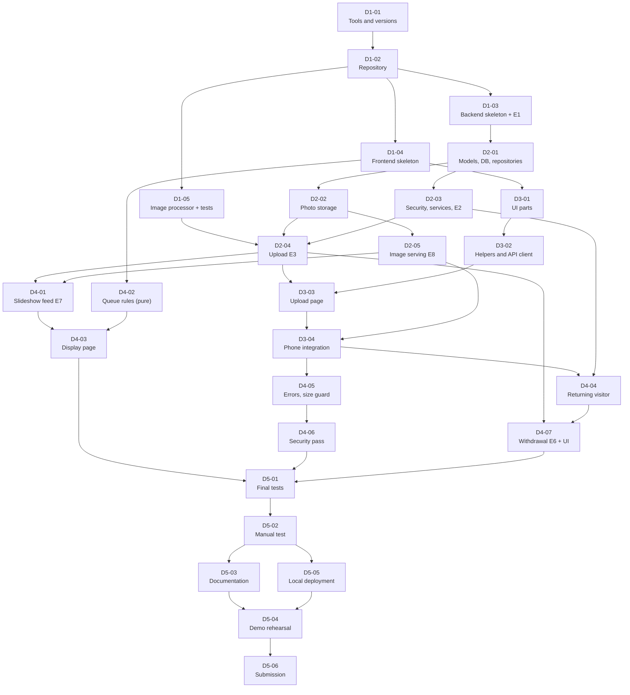

# IMPLEMENTATION_PLAN.md

# Visitor Photo Slideshow (MomentVault): Implementation Plan

| Item | Detail |
|---|---|
| Product | MomentVault, implementing Assignment 1: Visitor Photo Slideshow |
| Document version | 1.0 (draft for approval) |
| Date | 16 November 2026 |
| Based on | PROJECT_BRIEF, PRD, ASSUMPTIONS, TECH_STACK (Part 6 time budget and risk register), ARCHITECTURE v1.1, DATABASE_DESIGN, API_SPECIFICATION, BACKEND_DESIGN (Section 23 build order, Section 24.3 checks), FRONTEND_DESIGN (Sections 15 and 18) |
| Developer | MCA Semester 1 beginner, using Claude and Gemini as coding assistants |
| Budget | About 20 focused hours over 5 days |
| Not included | Source code. This is a plan, not an implementation. |

**What this plan is, and is not.**

- All durations are **estimates**, not measurements. Nothing here has been built or run yet, so every "completion criterion" is a **target to be proven** by the verification step, not a claim that it works.
- The plan targets a **working, explainable MVP**. It does not promise production-grade quality (no scaling, no backups, no formal security audit, no formal accessibility audit).
- Labels: **Must / Should / Could** are the PRD priorities. **Tier A** is committed scope. **Tier B** is funded only from unused reserve time.

---

## Read This First: Five Findings That Shaped the Plan

| # | Finding | What the plan does |
|---|---|---|
| 1 | **Consent notice item 4 promises something the Must Have scope does not build.** PRD FR-CON-01 (Must Have) requires the notice to say the visitor "can delete photos or withdraw consent at any time". But deletion (FR-DEL) and withdrawal (FR-WDR) are only **Should Have**. Shipping the notice without the feature would be a false promise to the public about their photos. | **Withdrawal (E6) is promoted into committed scope (task D4-07).** It removes all of a visitor's photos, so it keeps the promise at the lowest cost. **Single-photo deletion (E5) and "My photos" stay in Tier B.** Decision needed from you: see Section 9, decision P-2. If withdrawal is later cut, the notice wording must be changed (needs your approval), never left as it is. |
| 2 | **The approved estimates already fill the 20 hours.** BACKEND_DESIGN 23 (7.5 h backend plus about 2 h tests) and FRONTEND_DESIGN 15 (6 h Must Have), plus documentation (2 h in TECH_STACK 6.1), come to about 17.5 h **before any debugging buffer, any Should Have item or any rehearsal**. | The plan keeps meaningful reserve (Section 2) by applying the **simplifications in Section 7**. Even so, the plan is **about 1.5 to 2 hours tighter than the approved estimates**. This is the largest schedule risk. See Section 8. |
| 3 | **The image processor is the riskiest backend piece and depends on nothing else.** | It is built on **Day 1**, not Day 2. It is a pure function with no database or web code, so it fits "foundations" and finds Pillow problems early. This moves one task earlier than your day split suggests. |
| 4 | **The slideshow backend (E7) is built on Day 4**, together with the display page, not on Day 2. | Backend and page are built and checked as **one vertical slice**, so a feed problem and a timer problem are not debugged separately. Day 2 therefore ends with upload and image serving, not the feed. |
| 5 | **Several approved items are deliberately not scheduled** (admin page, thumbnails, crossfade, rate limiting, name caption, hosting). | Listed in Section 6 with the document that says why each is safe to postpone. Thumbnails need a decision (P-1) because it touches four approved documents. |

A smaller correction: PRD FR-CON-01 item 6 and API_SPECIFICATION call the name caption **FR-DSP-07**. It is **FR-DSP-10** (FR-DSP-07 is "show only active photos"). The caption is not scheduled, so this does not affect the plan.

---

# 1. How to Use This Plan

## 1.1 Plan Structure

| Part | Content |
|---|---|
| Section 2 | Time budget: where the 20 hours go |
| Section 3 | Dependency-aware sequence (diagram, critical path, what must come first) |
| Section 4 | The working loop for every task (with Claude and Gemini) |
| Section 5 | The five days: tasks, checklists, decision gates |
| Section 6 | What is postponed (Tier B and later) |
| Section 7 | What is simplified |
| Section 8 | High-risk tasks and likely time overruns |
| Section 9 | Decisions needed from you |
| Section 10 | Final submission checklist |
| Section 11 | Verification items carried from earlier documents |

## 1.2 Task Fields

Every task has the nine requested fields: **ID, description, priority, duration, dependencies, files, expected outcome, completion criteria, verification method.** Task IDs read `D<day>-<number>`. `-B` is a reserved buffer and `-C` is the end-of-day checkpoint.

## 1.3 Fixed Rules Used by Every Task

| # | Rule |
|---|---|
| 1 | **One task, one commit** (at least). A commit message says what changed and why. |
| 2 | **Read before you commit.** You must be able to explain each new function in your own words (the live demo rule). If you cannot, ask the assistant to explain or simplify it **before** moving on. |
| 3 | **Tests with the code, not after.** Each task that writes logic also writes its test, so a task is not done until its test passes. |
| 4 | **Pin versions.** Record exact versions in `requirements.txt` and `package.json` on Day 1 (TECH_STACK R6: assistants often produce outdated code). |
| 5 | **Never claim "works" without running it.** Completion means the verification step was performed and passed. |
| 6 | **Record AI mistakes as they happen** in `AI_LOG.md` (the brief requires at least 2 cases where the AI was wrong, how you noticed and how you fixed it, within 5 to 10 entries). |
| 7 | **Do not silently change an approved decision.** If a document is wrong or impractical, write it in the checkpoint notes and tell the assistant (and me) before changing it. |

---

# 2. Time Budget

## 2.1 Allocation by Day

| Day | Theme | Planned tasks (h) | Reserved buffer (h) | Checkpoint (h) | **Day total (h)** |
|---|---|---|---|---|---|
| 1 | Environment, project setup, foundations | 3.40 | 0.45 | 0.15 | **4.00** |
| 2 | Database and backend APIs | 3.40 | 0.45 | 0.15 | **4.00** |
| 3 | React frontend and API integration | 3.10 | 0.30 | 0.10 | **3.50** |
| 4 | Slideshow, returning visitors, essential security | 4.30 | 0.25 | 0.15 | **4.70** |
| 5 | Testing, documentation, deployment (local) | 3.50 | 0.30 | n/a | **3.80** |
| | **Total** | **17.70** | **1.75** | **0.55** | **20.00** |

Days are uneven on purpose. Day 3 is shorter because its integration work is the first full phone-to-server test and tends to expand into the buffer. Day 4 is longer because it carries the display page and withdrawal.

## 2.2 Allocation by Kind of Work

| Kind | Hours | Share |
|---|---|---|
| Building features and foundations (includes the tests written with each feature) | 12.95 | 65% |
| Setup (tools, repository) | 0.65 | 3% |
| **Integration and debugging tasks** (D3-04 plus manual testing D5-02) | 1.20 | 6% |
| **Reserved buffers** (unassigned, for overruns and debugging) | 1.75 | 9% |
| Final automated tests, documentation, demo rehearsal, submission, local deployment | 2.90 | 14% |
| Checkpoints (review actuals, re-plan, update `AI_LOG.md`) | 0.55 | 3% |
| **Total** | **20.00** | **100%** |

**Reserve for debugging, integration and verification: 1.75 + 1.20 = 2.95 hours (about 15%)**, not counting the debugging that happens inside each task. Roughly **35%** of the 20 hours is **not** feature building.

## 2.3 What This Budget Does Not Include

| Not counted | Reason |
|---|---|
| Time already spent on the planning documents | Done before the 20 hours (TECH_STACK noted this) |
| Any Tier B work | Funded only from unused buffer (Section 6) |
| Learning time beyond what each task states | The estimates already assume assistant help, but they **do** include reading and explaining the code |

## 2.4 Honest Comparison with the Approved Estimates

| Area | Approved estimate | This plan | Gap | How the gap is closed |
|---|---|---|---|---|
| Backend Must Have | 7.5 h (BACKEND_DESIGN 23.2) | about 6.9 h | about 0.6 h | Simplifications S1, S2, S5 |
| Frontend Must Have | 6.0 h (FRONTEND_DESIGN 15.2) | about 5.4 h | about 0.6 h | S3, S4 |
| Automated tests | about 2.0 h | 0.9 h of final tests plus the tests inside each task | about 0.5 h less in the final block | S2 |
| Withdrawal (promoted from Should Have) | 1.5 h (0.75 backend plus about 0.75 frontend) | 1.25 h | n/a | S6 |

If the simplifications are **not** taken, add about 1.5 to 2 hours. That would consume the buffers.

---

# 3. Dependency-Aware Sequence

## 3.1 Dependency Diagram (Tier A)

## 3.2 Tasks That Must Be Completed First

| Order | Task | Why it blocks everything |
|---|---|---|
| 1 | **D1-01** tools and versions | Nothing can be installed or pinned without it. BV-1 to BV-3 results shape later code. |
| 2 | **D1-02** repository and folders | Every file location comes from here. Commits start here. |
| 3 | **D1-03** backend skeleton with E1 | Proves the backend runs. The frontend needs E1 (limits, notice) for every page. |
| 4 | **D2-01** models and database set-up | Every API except E1 needs the three tables. |
| 5 | **D2-04** upload E3 | The central feature. The upload page, the feed, withdrawal and most tests need it. |

## 3.3 Critical Path

`D1-01, D1-02, D1-03, D2-01, D2-02, D2-03, D2-04, D3-03, D3-04, D4-01, D4-03, D5-01, D5-02, D5-04, D5-06`

Any slip on this path moves the submission date. Tasks off the path (D1-04 can start anytime after D1-02, D4-02 is independent, D4-05 and D4-06 sit beside the display work) can be reordered to use gaps.

## 3.4 Tasks That Can Run in Parallel (If You Are Waiting or Stuck)

| Pair | Note |
|---|---|
| D1-04 and D1-05 | Independent. If the image processor blocks you, work on the frontend skeleton and come back. |
| D4-02 and D4-01 | The queue rules are plain functions, with no server. |
| D2-02 and D2-03 | Both need only D2-01. |

You have **one developer**, so "parallel" means "pick the other one when stuck", not two at once.

## 3.5 Decision Gates

| Gate | When | Question | If the answer is "no" |
|---|---|---|---|
| **G1** | End of Day 1 | Is the image processor passing its tests and is total Day 1 time within 4.5 h? | Take the full Day 1 buffer. Skip nothing, but pre-approve cut C1 (Section 8.3). |
| **G2** | End of Day 2 | Can a photo be uploaded through the API documentation page and fetched back? | Day 3 starts with fixing E3, not with UI. Cut C2. |
| **G3** | End of Day 3 | Can a real phone upload a photo through the UI? | Stop all new work. Fix integration on Day 4 morning. Cut C3. |
| **G4** | End of Day 4 | Does a phone upload appear on the TV page and does withdrawal work? | Withdrawal falls back to decision P-2 (reword the notice). Do not start Tier B. |

---

# 4. The Working Loop with Claude and Gemini

Your master instruction defines how each implementation task is done. As recorded in your project notes it is: understand the requirement, explain the approach, list the files, generate only what is required, explain the code, flag problems, and give testing instructions. **Use that loop for every task.** The per-task rules below make it practical.

| Step | What you do | Time cost inside the task |
|---|---|---|
| 1. Brief | Paste the **relevant section** of the approved documents, not the whole document. Name the task ID and its files. | included |
| 2. Ask for an approach first | "Explain your plan in plain language and list the files. Do not write code yet." Check it against the documents. | included |
| 3. Generate small | One function or file at a time. Reject code that adds extra features or packages. | included |
| 4. Explain back | Say in your own words what each function does. If you cannot, ask for a simpler version. | included |
| 5. Test | Run the task's test or check. Fix failures **with** the assistant, and log mistakes. | included |
| 6. Commit | One clear commit. Update `AI_LOG.md` if the AI was wrong. | included |

| Tip | Reason |
|---|---|
| Use **one assistant per task** and switch only if stuck | Avoids merging two styles of code |
| Use the second assistant as a **reviewer** ("find bugs and anything I cannot explain in this code") | Cheap second opinion, and a source of AI_LOG entries |
| Always say the library versions you pinned | Prevents outdated examples (TECH_STACK R6) |
| Never paste `.env`, tokens or real photos into an assistant | Privacy and security |
| If generated code is larger than about 150 lines for one file, ask to split it | Explainability |

---

# 5. The Five Days

Each task table uses the same rows. "Files" lists paths relative to the repository root `momentvault/`, following BACKEND_DESIGN Section 5 and FRONTEND_DESIGN Section 9.

---

## Day 1: Environment, Project Setup and Foundations (4.0 h)

**Goal of the day:** both servers start, the page can read settings from the backend, and the hardest backend component (the image processor) is proven by tests.

### D1-01: Install tools and confirm versions

| Field | Detail |
|---|---|
| Description | Install or confirm Python, Node.js (Vite's guide says 20.19+ or 22.12+), npm and Git. Create a Python virtual environment. Install and **pin** FastAPI, Uvicorn, python-multipart, SQLAlchemy 2.x, Pydantic, Pillow, pytest and httpx. Look up the current install list in the official FastAPI documentation (TECH_STACK 3.2). Run the **BV-1 and BV-2** checks. |
| Priority | **Must** (foundation) |
| Duration | 0.40 h |
| Dependencies | None |
| Files | `backend/requirements.txt`, notes in `AI_LOG.md` or a scratch note |
| Expected outcome | A working Python environment and Node environment with pinned versions |
| Completion criteria | `python` and `node` report acceptable versions. All packages import. Versions are written into `requirements.txt`. BV-1 and BV-2 outcomes noted. |
| Verification | Run a one-line import of each package. Run `git --version`, `node --version`, `npm --version`. |

### D1-02: Repository, folders and hygiene

| Field | Detail |
|---|---|
| Description | Create the GitHub repository (public, as the assignment requires), initialise Git, create the folder layout, `.gitignore` (data folder, `.env`, virtual environment, caches, `node_modules`), `.env.example` (placeholders only), and put the approved documents in `docs/`. `ASSUMPTIONS.md` and `ARCHITECTURE.md` also go in the repository root (assignment requirement). Make the first commit. |
| Priority | **Must** |
| Duration | 0.25 h |
| Dependencies | D1-01 |
| Files | `.gitignore`, `.env.example`, `README.md` (stub), `ASSUMPTIONS.md`, `ARCHITECTURE.md`, `AI_LOG.md` (stub), `docs/*.md`, folder skeleton from BACKEND_DESIGN 5 |
| Expected outcome | A clean repository with a first commit and a place for every file |
| Completion criteria | `git status` is clean. `data/`, `.env` and `node_modules` are ignored. `.env.example` has no real secrets. |
| Verification | Create a dummy `.env` and `data/x`, run `git status`, confirm neither appears. Delete them. |

### D1-03: Backend skeleton with E1 (settings and consent notice)

| Field | Detail |
|---|---|
| Description | Create the application factory, settings (limits and durations from PRD 1.5), logging set-up, the consent notice definition (text plus version, BD-05) and route E1 `GET /api/config`. Add **one** test for E1. Confirm **BV-5** (dependency override in tests) and **BV-8** (lifespan hook) while here. |
| Priority | **Must** |
| Duration | 0.75 h |
| Dependencies | D1-02 |
| Files | `backend/app/main.py`, `core/settings.py`, `core/consent_notice.py`, `core/logging_config.py`, `api/config_routes.py`, `schemas/config.py`, `tests/conftest.py`, `tests/test_api_config_visitor.py` (first test) |
| Expected outcome | The backend starts and `GET /api/config` returns limits, durations, notice text and version |
| Completion criteria | Response matches API_SPECIFICATION E1. The consent notice lists the points FR-CON-01 requires that apply (see Finding 1). The automated documentation page opens. One test passes. |
| Verification | Start Uvicorn and open `/api/config` and `/docs`. Run pytest. |

### D1-04: Frontend skeleton

| Field | Detail |
|---|---|
| Description | Create the Vite and React project with **no extra libraries**. Set the development forward of `/api` to the backend. Write `tokens.css` and `base.css` from FRONTEND_DESIGN Section 2. Make `App` choose a page from the address (`/` and `/display`). Write `apiClient` (config call only) and `useConfig`. Each page shows a placeholder plus the loaded title. |
| Priority | **Must** |
| Duration | 0.75 h |
| Dependencies | D1-02 (D1-03 for the live check) |
| Files | `frontend/package.json`, `vite.config.js`, `index.html`, `src/main.jsx`, `App.jsx`, `pages/UploadPage.jsx`, `pages/DisplayPage.jsx`, `lib/apiClient.js`, `hooks/useConfig.js`, `styles/tokens.css`, `styles/base.css` |
| Expected outcome | Opening `/` and `/display` in the browser shows placeholders that prove the page reached the backend |
| Completion criteria | No console errors. The settings value (for example the title) comes from the backend through the forwarded `/api`. Only `react`, `react-dom`, Vite and its React plugin are installed. |
| Verification | Run both servers. Open both addresses. Stop the backend and confirm the page shows a calm failure, not a blank crash. |

### D1-05: Image processor and its tests (highest backend risk)

| Field | Detail |
|---|---|
| Description | Build the image processor as BACKEND_DESIGN Section 15 specifies: decode, enforce the pixel limit and the processing gate (AD-23 and AD-24), correct orientation, remove metadata, resize to the display size, save JPEG or PNG. Write a **test-image generator in code** (valid, empty, fake, corrupt, huge-pixel, GPS, rotated). Run **BV-9**. Thumbnail work follows decision P-1 (default: not in the MVP). |
| Priority | **Must** |
| Duration | 1.25 h |
| Dependencies | D1-02 |
| Files | `backend/app/services/image_processor.py`, `tests/helpers/` (image builders), `tests/test_image_processor.py` |
| Expected outcome | A function that turns uploaded bytes into a safe, clean image or a clear rejection reason, with no database and no web code |
| Completion criteria | Tests cover at least: valid JPEG, valid PNG, fake image, empty, corrupt, over-pixel-limit, GPS removed, sideways photo corrected. All pass. You can explain why the processor decodes the **whole** image and does not rely on a header check (BACKEND_DESIGN 15.3). |
| Verification | Run `pytest tests/test_image_processor.py`. Open one processed output image and one rotated input to compare by eye. |

### D1-B: Day 1 buffer (0.45 h, unassigned)

Use for version problems, tool installation trouble or overruns in D1-05. **If unused, carry the time to Day 2 (D2-04 is the likeliest consumer).**

### D1-C: Day 1 checkpoint (0.15 h)

Record actual hours per task, update `AI_LOG.md` (at least one real entry), commit, and check **Gate G1**. Re-plan Days 2 to 5 using your real speed (TECH_STACK 6.1).

### Day 1 Checklist

- [ ] Python, Node, npm and Git versions confirmed and pinned
- [ ] Repository public, `.gitignore` and `.env.example` correct, first commit made
- [ ] Backend starts, `/api/config` and `/docs` work
- [ ] Frontend starts and reads settings through the forwarded `/api`
- [ ] Image processor tests pass
- [ ] At least 4 commits with meaningful messages
- [ ] `AI_LOG.md` has at least one entry
- [ ] Decision P-1 (thumbnails) answered
- [ ] Actual hours recorded and Gate G1 checked

---

## Day 2: Database and Backend APIs (4.0 h)

**Goal of the day:** a visitor can register and upload photos through the API, and the stored photo can be fetched back. All tested at least by the documentation page and automated tests.

### D2-01: Models, database set-up, repositories

| Field | Detail |
|---|---|
| Description | Create the three tables (Visitors, ConsentRecords, Photos) from DATABASE_DESIGN, with their constraints (including `name IS NOT NULL` in the check). Set up the engine and session with the **required connection settings** (foreign keys on, WAL, busy timeout; BACKEND_DESIGN 8.2). Create the thin repository modules for visitors, consent and photos. Run **BV-3**. Tests run against a temporary database. |
| Priority | **Must** |
| Duration | 1.00 h |
| Dependencies | D1-03 |
| Files | `backend/app/db/database.py`, `db/init_db.py`, `models/base.py`, `models/visitor.py`, `models/consent_record.py`, `models/photo.py`, `repositories/visitor_repository.py`, `repositories/consent_repository.py`, `repositories/photo_repository.py`, `tests/test_repositories.py` (kept small, see S2) |
| Expected outcome | Tables are created at start-up. The repositories can add and read records. Bad data is rejected by the database. |
| Completion criteria | Foreign-key and check constraints reject invalid rows in a test. Each new connection has the required settings. A visitor with a duplicate name can be created (names are not unique, FR-REG-04). |
| Verification | Run the repository tests. Open the database file with a viewer, or the standard `sqlite3` tool, and list the tables. |

### D2-02: Photo storage

| Field | Detail |
|---|---|
| Description | Create the storage object that writes, reads and deletes image files safely: generated names only (never the visitor's file name), no path from user input, files kept in the data folder (BACKEND_DESIGN 16 and 17). |
| Priority | **Must** |
| Duration | 0.40 h |
| Dependencies | D2-01 |
| Files | `backend/app/storage/photo_storage.py`, `tests/test_photo_storage.py` |
| Expected outcome | A small class that stores bytes under a safe generated name and can remove them |
| Completion criteria | A file name containing `../` cannot escape the folder (test). Two saves never collide. Deleting a missing file does not crash. |
| Verification | Run the storage tests. |

### D2-03: Security helpers, visitor and consent services, E2

| Field | Detail |
|---|---|
| Description | Token creation and hashing (only the hash is stored), key comparison helper, the visitor and consent services (identify, register, profile) and the shared dependencies that read `X-Visitor-Token`. Route E2 `GET /api/visitor`. Run **BV-4**. |
| Priority | **Must** |
| Duration | 0.70 h |
| Dependencies | D2-01 |
| Files | `backend/app/core/security.py`, `core/dependencies.py`, `services/visitor_service.py`, `services/consent_service.py`, `schemas/visitor.py`, `api/visitor_routes.py`, `tests/test_security.py`, `tests/test_visitor_service.py` |
| Expected outcome | A visitor can be created with a consent record. A returning token is recognised. An unknown token is refused with 401. |
| Completion criteria | The database holds only the **hash**, never the token (checked in a test). Consent must be exactly true and the notice version must match. E2 returns 401 for an unknown token. |
| Verification | Run the tests. Call E2 from the documentation page with a valid and an invalid token. |

### D2-04: Upload workflow E3 (central feature)

| Field | Detail |
|---|---|
| Description | Build E3 as BACKEND_DESIGN 14 specifies: validate registration (new visitors only), check limits, process each file with the image processor, store each file and commit each photo separately, return **200 with a per-file result list**. Includes the per-visitor limit and the "token returned once" rule. Handle the empty file picker edge case. Run **BV-8** (optional form fields with several files). |
| Priority | **Must** |
| Duration | 1.10 h |
| Dependencies | D1-05, D2-02, D2-03 |
| Files | `backend/app/services/photo_service.py`, `schemas/photo.py`, `api/photo_routes.py` (upload part), `tests/test_photo_service.py`, `tests/test_api_upload.py` (start) |
| Expected outcome | Multiple photos upload in one request. Each file gets its own accepted or rejected result. A new visitor receives a token once. |
| Completion criteria | A mixed upload (2 valid, 1 fake `.jpg`) returns 3 results in order and stores 2 photos. No consent, a bad name or too many files stores nothing. A failed file leaves **no orphan file**. |
| Verification | Run the tests. Then do one real upload through `/docs` with a phone-sized JPEG and look at the stored file. |

### D2-05: Image serving E8

| Field | Detail |
|---|---|
| Description | Route E8 `GET /api/photos/{id}/image` with the required headers (`Cache-Control`, `nosniff`). Returns 404 for a missing or removed photo. Run **BV-10**. |
| Priority | **Must** |
| Duration | 0.20 h |
| Dependencies | D2-02 |
| Files | `backend/app/api/photo_routes.py` (image part), `tests/test_api_slideshow_images.py` (image part) |
| Expected outcome | An uploaded photo can be opened in a browser at its address |
| Completion criteria | Correct content type and headers. 404 for an unknown id. |
| Verification | Open `/api/photos/1/image` in the browser. Check response headers in the browser developer tools. |

### D2-B: Day 2 buffer (0.45 h, unassigned)

Use for SQLAlchemy and multipart surprises. This is the day where the buffer is most likely to be used.

### D2-C: Day 2 checkpoint (0.15 h)

Record actuals, commit, update `AI_LOG.md`, check **Gate G2**.

### Day 2 Checklist

- [ ] Tables created, constraints proven by tests
- [ ] Only the token **hash** is stored (test passes)
- [ ] Storage test shows paths cannot escape the data folder
- [ ] E2 returns the right answers for valid and invalid tokens
- [ ] E3 handles mixed uploads with per-file results
- [ ] No orphan files after a failed upload
- [ ] E8 shows an uploaded photo in the browser
- [ ] All tests pass (`pytest`)
- [ ] One commit per task, `AI_LOG.md` updated
- [ ] Gate G2 checked

---

## Day 3: React Frontend and API Integration (3.5 h)

**Goal of the day:** a visitor on a real phone can complete the full upload journey.

### D3-01: Shared UI parts and component styles

| Field | Detail |
|---|---|
| Description | Build the reusable parts from FRONTEND_DESIGN 4.2 that Day 3 needs: `Button` (variants), `TextField`, `Checkbox`, `Banner`, `ProgressBar`, `PageHeader` and the few inline icons. `ConfirmDialog` is built later in D4-07. Write `ui.css` using only the tokens. |
| Priority | **Must** |
| Duration | 0.60 h |
| Dependencies | D1-04 |
| Files | `frontend/src/components/ui/Button.jsx`, `TextField.jsx`, `Checkbox.jsx`, `Banner.jsx`, `ProgressBar.jsx`, `PageHeader.jsx`, `icons.jsx`, `styles/ui.css` |
| Expected outcome | A temporary page (or the upload page) shows each part and its states |
| Completion criteria | Uses only design tokens (no raw colours or sizes). Visible focus ring on each control. Touch targets at least 44 px. No new dependencies. |
| Verification | Look at it at 360 px and 1280 px wide in the browser. Tab through the parts with the keyboard only. |

### D3-02: Helpers and the API client for upload

| Field | Detail |
|---|---|
| Description | Add `tokenStorage` (wrapped so a storage failure never crashes the page), `photoChecks` (early file checks from FRONTEND_DESIGN 5.2 using E1 limits), `format` helpers, and the **upload** and **visitor** calls in `apiClient`: relative `/api`, token header, `ApiError` with code and message, `NETWORK_ERROR`, never set the multipart header by hand. |
| Priority | **Must** |
| Duration | 0.50 h |
| Dependencies | D3-01 |
| Files | `frontend/src/lib/tokenStorage.js`, `lib/photoChecks.js`, `lib/format.js`, `lib/apiClient.js` (extended) |
| Expected outcome | Plain, testable helper modules with no React inside |
| Completion criteria | `photoChecks` rejects wrong type, wrong size and over-count with the PRD's wording. `tokenStorage` returns "none" instead of throwing when storage is blocked. |
| Verification | Check the helpers by calling them in the browser console or a tiny script with fixed inputs. Block storage in the browser settings and reload to confirm no crash. |

### D3-03: Upload page for a new visitor

| Field | Detail |
|---|---|
| Description | Build the page from FRONTEND_DESIGN Section 5: `useUpload` (small state machine), name field, `PhotoPicker` (dropzone and button), `PhotoPreviews`, `ConsentNotice` (full notice always visible, unticked box), upload button that stays active and explains, indeterminate progress, `UploadResults` (per-file list, summary banner), error banners. Store the returned token **immediately**. |
| Priority | **Must** |
| Duration | 1.40 h |
| Dependencies | D2-04, D3-02 |
| Files | `frontend/src/pages/UploadPage.jsx`, `hooks/useUpload.js`, `components/upload/PhotoPicker.jsx`, `PhotoPreviews.jsx`, `ConsentNotice.jsx`, `UploadResults.jsx`, `styles/upload.css` |
| Expected outcome | A new visitor can enter a name, tick consent, choose photos, upload and read per-file results |
| Completion criteria | Missing name, missing consent and no photos each show their PRD message and send nothing. The submit button cannot send twice while uploading. Names and file names appear as plain text. No layout breaks at 360 px. |
| Verification | Walk through the manual test list items 1 to 3 (FRONTEND_DESIGN 16) in the desktop browser. Try a name such as `` and confirm it shows as text. |

### D3-04: Integration on a real phone

| Field | Detail |
|---|---|
| Description | Build the frontend, serve it through FastAPI (one address), find the computer's network address, and upload from a **real phone** on the same network. Fix whatever breaks. Confirm the file chooser offers camera and library and several photos (FV-12), and check HEIC behaviour (assumption A-12, unverified). |
| Priority | **Must** |
| Duration | 0.60 h |
| Dependencies | D3-03, D2-05 |
| Files | `backend/app/main.py` (serve the built frontend for `/` and `/display`), `README.md` (run notes, start now) |
| Expected outcome | The full journey works on a real phone, through one address |
| Completion criteria | A phone upload succeeds and the stored image is correct and the right way up. A second upload from the same phone is recognised as the same visitor only after D4-04, so for now confirm the token is stored. |
| Verification | Phone test with 3 real photos (one portrait). Look at the stored images. Note any HEIC problem in `ASSUMPTIONS.md`. |

### D3-B: Day 3 buffer (0.30 h, unassigned)

First phone integration is the likeliest place for surprise (network address, firewall, upload size). Use it before borrowing from Day 4.

### D3-C: Day 3 checkpoint (0.10 h)

Record actuals, commit, update `AI_LOG.md`, check **Gate G3**.

### Day 3 Checklist

- [ ] UI parts use only tokens, show visible focus, and meet the touch size
- [ ] Early checks show the PRD's messages
- [ ] Upload page works at 360 px with no sideways scroll
- [ ] Consent box is unticked on every load and the notice is visible with no click
- [ ] Mixed upload shows per-file results
- [ ] Real phone upload works through one address
- [ ] Token is stored after the first upload, even if all files were rejected
- [ ] HEIC result noted
- [ ] Commits and `AI_LOG.md` updated
- [ ] Gate G3 checked

---

## Day 4: Slideshow, Returning Visitors and Essential Security (4.7 h)

**Goal of the day:** a phone upload appears on the TV page, returning visitors are recognised, withdrawal works, and the basic security rules are checked.

### D4-01: Slideshow feed E7

| Field | Detail |
|---|---|
| Description | Build E7 `GET /api/slideshow` as API_SPECIFICATION defines: the list of active photo ids, the groups of new photos since a cursor (new first, then the owner's earlier photos most recent first), and the returned cursor. The first request returns no groups. |
| Priority | **Must** |
| Duration | 0.55 h |
| Dependencies | D2-04, D2-05 |
| Files | `backend/app/services/slideshow_service.py`, `schemas/slideshow.py`, `api/slideshow_routes.py`, `tests/test_slideshow_service.py`, `tests/test_api_slideshow_images.py` (feed part) |
| Expected outcome | The feed lists active photos and groups new uploads |
| Completion criteria | Only active photos appear. Group ordering matches the specification. First request has no groups. A cursor higher than the latest returns the server's real cursor. |
| Verification | Run the tests. Upload from the phone, then call E7 with and without `since_id`. |

### D4-02: Queue rules as plain functions

| Field | Detail |
|---|---|
| Description | Write `slideshowQueue` with no React and no network: start from a feed, add groups to the waiting line (skip duplicates), drop photos that left the feed, choose the next photo (waiting line first, then the loop), report "empty". Check with fixed data. |
| Priority | **Must** |
| Duration | 0.50 h |
| Dependencies | D1-04 |
| Files | `frontend/src/lib/slideshowQueue.js` and a small hand-run check (or a tiny test file if a runner already exists) |
| Expected outcome | The trickiest frontend logic, proven on its own |
| Completion criteria | With fixed input you can predict and confirm the next five photos. Duplicates and removed photos are handled. You can explain the rule in two sentences. |
| Verification | Run the check with 4 scenarios: first feed, new group arrives, a photo removed, empty feed. |

### D4-03: Display page

| Field | Detail |
|---|---|
| Description | Build `useSlideshow` (single chained timer for polling, independent slide timer, preload next image, skip a failed image within 2 seconds, keep playing if the server drops) and the page from FRONTEND_DESIGN Section 6: black background, whole photo (`contain`), no controls, cursor hidden, F key and click for fullscreen, the empty state with the join address, connecting and waiting states. **No crossfade yet** (instant swap). |
| Priority | **Must** |
| Duration | 1.00 h |
| Dependencies | D4-01, D4-02 |
| Files | `frontend/src/pages/DisplayPage.jsx`, `hooks/useSlideshow.js`, `components/display/SlideshowStage.jsx`, `Slide.jsx`, `DisplayMessage.jsx`, `styles/display.css` |
| Expected outcome | The TV page plays the photos, picks up new uploads and survives a server restart |
| Completion criteria | Portrait and landscape photos show whole and uncropped. A new phone upload plays after the current photo, never interrupting it. A deleted-file image is skipped silently. With the server stopped for 30 seconds the page keeps playing and then recovers without a reload (FR-DSP-08). |
| Verification | Manual test items 5 to 9 from FRONTEND_DESIGN 16. Use a second browser window as the "TV". |

### D4-04: Returning visitor

| Field | Detail |
|---|---|
| Description | Add `useVisitor` and `WelcomeBack`: on load, if a token exists ask E2. Show "Welcome back, name", hide the name and consent form, and add **"Not you?"** (forget the token on this device only). On 401 clear the token and show the new form quietly. Handle `NAME_REQUIRED` in returning mode as FRONTEND_DESIGN 5 H says. |
| Priority | **Must** (recognition) and **Should** ("Not you?", very cheap here) |
| Duration | 0.40 h |
| Dependencies | D3-04, D2-03 |
| Files | `frontend/src/hooks/useVisitor.js`, `components/upload/WelcomeBack.jsx`, `pages/UploadPage.jsx` (modified) |
| Expected outcome | A second visit from the same phone skips the name and consent |
| Completion criteria | Same phone is recognised. "Not you?" returns to the new form without deleting anything on the server. A cleared token shows the new form with no error page. Two visitors with the same name stay separate (test with two browsers). |
| Verification | Manual test item 4. Clear the token by hand in the browser and reload. |

### D4-05: Standard errors and the request size guard

| Field | Detail |
|---|---|
| Description | Add the domain error type and the handlers that turn every error into the standard JSON shape, the request id, and the guard that refuses an oversized body with 413 before storing it. Cap the number of files and fields the parser accepts. Run **BV-6**. **Minimal version only** (see S5): standard shape and 413, no extras. |
| Priority | **Must** (NFR-REL, NFR-SEC) |
| Duration | 0.40 h |
| Dependencies | D3-04 |
| Files | `backend/app/core/errors.py`, `core/error_handlers.py`, `core/middleware.py`, `tests/test_errors_and_headers.py` |
| Expected outcome | Every failure has the same JSON shape and no server details leak. An oversized upload is refused early. |
| Completion criteria | An unknown address, a wrong method, a bad form and a crash all return the standard shape. A body over the limit returns 413 and stores nothing. Error text never includes a file path or a stack trace. |
| Verification | Run the tests. Send an oversized body with `curl` and read the answer. |

### D4-06: Essential security pass

| Field | Detail |
|---|---|
| Description | Walk the security checklist below once and fix anything found. This is a **review of what exists**, not a new feature. |
| Priority | **Must** |
| Duration | 0.20 h |
| Dependencies | D4-05 |
| Files | Any file that fails the checklist; findings in `AI_LOG.md` |
| Expected outcome | The Must Have security requirements (NFR-SEC-01 to 04) are each checked once |
| Completion criteria | Every line of Section 5.1 below is ticked or has a recorded exception. |
| Verification | Perform each check by hand and tick it. |

#### 5.1 Essential Security Checklist (Day 4)

- [ ] The database stores only the token **hash**, and the token is returned once
- [ ] The token is never in a URL or a log line (search the log files after a test upload)
- [ ] A file renamed `.jpg` that is not an image is rejected
- [ ] A photo with a pixel size over the limit is rejected, small file or not
- [ ] A visitor's file name is never used to build a path
- [ ] Names and file names render as text (the `<script>` name test)
- [ ] Consent is enforced by the **server** (send an upload with `curl` and no consent: rejected, nothing stored)
- [ ] `.env` and `data/` are not in Git (`git log --all` shows neither)
- [ ] No secret in the frontend code or build
- [ ] Error messages show no path, no stack trace, no SQL
- [ ] GPS data is gone from a stored phone photo
- [ ] Nothing in the pages loads from another website (no CDN fonts or scripts)

### D4-07: Consent withdrawal (E6) and its screen (promoted, see Finding 1)

| Field | Detail |
|---|---|
| Description | Backend: E6 `POST /api/visitor/withdraw` with `{"confirm": true}` removes **all** of the visitor's photos and files, clears the token hash, closes the consent record, and keeps the visitor row without a name as the design specifies (DATABASE_DESIGN, BACKEND_DESIGN 11). Frontend: the `ConfirmDialog` (native dialog, safe choice focused first, Esc closes), the `WithdrawConsent` button for returning visitors and the success banner. |
| Priority | **Should**, promoted into committed scope because of notice item 4 |
| Duration | 1.25 h |
| Dependencies | D2-04, D4-04 |
| Files | `backend/app/services/visitor_service.py` (modified), `api/visitor_routes.py` (modified), `tests/test_api_delete_withdraw.py`; `frontend/src/components/ui/ConfirmDialog.jsx`, `components/upload/WithdrawConsent.jsx`, `hooks/useVisitor.js` (modified) |
| Expected outcome | A visitor can remove everything and be forgotten, and the photos leave the TV |
| Completion criteria | After withdrawal the old token is refused (401), the photo files are gone, the feed no longer lists the photos, and the page shows the new-visitor form with a success banner. Without `confirm: true` the server refuses. |
| Verification | Tests, then manually: upload, watch it appear on the TV page, withdraw, and watch it disappear within a few poll cycles. Confirm files are gone from `data/photos`. |

### D4-B: Day 4 buffer (0.25 h, unassigned)

Thin on purpose. Day 4 is the most likely overrun day, so **the Day 1 and Day 2 carry-over buffers go here first**.

### D4-C: Day 4 checkpoint (0.15 h)

Record actuals, commit, update `AI_LOG.md`, check **Gate G4**. This is the last point at which scope may still be reduced without hurting documentation and testing.

### Day 4 Checklist

- [ ] Queue rules checked with 4 fixed scenarios
- [ ] E7 tests pass and the first feed has no groups
- [ ] A phone upload appears on the TV page after the current photo
- [ ] Portrait and landscape photos are shown whole
- [ ] Server stopped and restarted: the TV page recovers without a reload
- [ ] Returning visitor recognised, "Not you?" works, two same-name visitors stay separate
- [ ] Every error has the standard JSON shape, 413 works
- [ ] The Section 5.1 security checklist is ticked
- [ ] Withdrawal removes photos, files and access, and the TV page updates
- [ ] Commits and `AI_LOG.md` updated
- [ ] Gate G4 checked

---

## Day 5: Testing, Documentation and Deployment (3.8 h)

**Goal of the day:** everything is proven, documented, rehearsed and submitted. **No new features today** (Tier B stays out unless Day 5 starts with unused buffer, see Section 6).

### D5-01: Contract and concurrency tests

| Field | Detail |
|---|---|
| Description | Complete the automated tests for upload, config and visitor, slideshow and images, delete and withdraw, errors, and the **10 simultaneous uploads** test (FR-CNC). Run **BV-7** (does the test client give genuine concurrency?). Add the appendix B test files that are not yet covered. |
| Priority | **Must** (NFR-TST-01) |
| Duration | 0.90 h |
| Dependencies | D4-03, D4-06, D4-07 |
| Files | `backend/tests/test_api_upload.py`, `test_api_config_visitor.py`, `test_api_slideshow_images.py`, `test_api_delete_withdraw.py`, `test_errors_and_headers.py`, `test_concurrency.py` |
| Expected outcome | A full automated test run that you can show |
| Completion criteria | The whole suite passes from a clean checkout. 10 simultaneous uploads from 10 visitors (two named `Sam`) all succeed with no "database is busy" failure. |
| Verification | Run `pytest` from a **fresh clone** in a new folder. |

### D5-02: Manual test run with real devices

| Field | Detail |
|---|---|
| Description | Execute the manual test list (FRONTEND_DESIGN 16) and the appendix B file list on a real phone and the real or nearest demo screen. Record **pass or fail with a date** for every item, not "looks fine". Work through the FV-1 to FV-12 checks that matter. |
| Priority | **Must** (NFR-TST-01) |
| Duration | 0.60 h |
| Dependencies | D5-01 |
| Files | `docs/MANUAL_TEST_RESULTS.md` (or a section in `README.md`) |
| Expected outcome | A written record of what was tested, on what, and the result |
| Completion criteria | Every item has a result. Every failure is either fixed (and retested) or listed as a **known limitation** in the README. |
| Verification | Another person (or you after a break) can repeat any item from the written steps. |

### D5-03: Documentation

| Field | Detail |
|---|---|
| Description | Finish `README.md` (what it is, how to install and run, how to run tests, how to demo on a phone and TV, the settings, known limitations, honest "not production-ready" statement), bring `ASSUMPTIONS.md` and `ARCHITECTURE.md` in line with what was **actually built** (including decisions P-1 to P-3), finalise `AI_LOG.md` (5 to 10 entries, at least 2 AI mistakes with how each was found and fixed). |
| Priority | **Must** (NFR-DOC-01, NFR-DOC-02) |
| Duration | 0.90 h |
| Dependencies | D5-02 |
| Files | `README.md`, `ASSUMPTIONS.md`, `ARCHITECTURE.md`, `AI_LOG.md`, `.env.example` |
| Expected outcome | A stranger can install, run, test and understand the project from the README |
| Completion criteria | Every command in the README was run once from a clean folder. The README lists what is **not** built. No document claims something that does not work. |
| Verification | Follow the README exactly on a fresh clone. |

### D5-05: Local demo set-up and restart test

| Field | Detail |
|---|---|
| Description | Prepare the **local-network demo** (decision A-30 provisional default): build the frontend once, serve both from one address, write the run steps and the phone-reachable address into the README. **Restart test:** upload a photo, stop and start the server, confirm the photo and visitor remain (TECH_STACK 5.3). **Hosted deployment is not attempted** (Section 6). |
| Priority | **Must** (demo), **Could** (public hosting) |
| Duration | 0.40 h |
| Dependencies | D5-02 |
| Files | `README.md` (demo section), `backend/app/main.py` (if the serving step needs a fix) |
| Expected outcome | The demo can be started in minutes on a laptop, and phones reach it |
| Completion criteria | A phone loads the upload page by the laptop's network address. The restart test passes. The steps work from a fresh clone. |
| Verification | Perform it on the demo network if possible (TECH_STACK R8 says rehearse there). |

### D5-04: Demo rehearsal and explain-every-component

| Field | Detail |
|---|---|
| Description | Rehearse the 5-minute demo: new visitor, upload, TV page, returning visitor, withdrawal. Then for **each** component in ARCHITECTURE's tree, say aloud what it does and why. Mark anything you cannot explain and simplify or re-read it. Prepare answers for "what happens if two visitors share a name", "why is the token hashed", "why is the photo not cropped", "what if the server restarts". |
| Priority | **Must** (project objective: explain every part in a live demo) |
| Duration | 0.40 h |
| Dependencies | D5-03, D5-05 |
| Files | `docs/DEMO_SCRIPT.md` (optional, short) |
| Expected outcome | A confident, repeatable demo and a list of no unexplained code |
| Completion criteria | Demo run end to end twice without help. Every file in `backend/app` and `frontend/src` has an explanation you can give in one or two sentences. |
| Verification | Record yourself or explain to another person. |

### D5-06: Submission

| Field | Detail |
|---|---|
| Description | Final repository check using Section 10, confirm the public link opens without logging in, and submit it. |
| Priority | **Must** |
| Duration | 0.30 h |
| Dependencies | D5-04 |
| Files | none (repository state) |
| Expected outcome | One public GitHub link submitted |
| Completion criteria | Every item in Section 10 is ticked. |
| Verification | Open the link in a private browser window. Clone it fresh, run the tests and start the app. |

### D5-B: Day 5 buffer (0.30 h, unassigned)

For late test failures. **If anything fails late, fix it or list it as a known limitation. Do not start a feature.**

### Day 5 Checklist

- [ ] Full test suite passes from a fresh clone
- [ ] 10 simultaneous uploads pass
- [ ] Manual test results recorded with dates
- [ ] Known limitations written in the README
- [ ] README commands verified from a clean folder
- [ ] `ASSUMPTIONS.md`, `ARCHITECTURE.md` match what was built
- [ ] `AI_LOG.md` has 5 to 10 entries including at least 2 AI mistakes
- [ ] Local demo works on a phone and screen, restart test passes
- [ ] Demo rehearsed twice, every component explainable
- [ ] Submission checklist complete (Section 10)

---

# 6. What Is Postponed

## 6.1 Tier B: Only if Buffer Is Left Over (Do Them in This Order)

| Order | Item | Estimate | PRD | Note |
|---|---|---|---|---|
| B1 | **Single-photo deletion (E5) and "My photos" (E4)** plus confirm dialog reuse | about 1.5 h | FR-DEL, FR-PRV-05 | Closes the rest of notice item 4. If skipped, decision P-2 applies. |
| B2 | Consent reminder for returning visitors | about 0.2 h | FR-CON-04 | Tiny |
| B3 | Fade transition (600 ms, reduced-motion aware) | about 0.5 h | FR-DSP-09 | Instant swap already meets every Must Have |
| B4 | Real upload percentage (older request method) | about 1 h | FR-UPL-05 | The indeterminate bar already satisfies it |
| B5 | Start-up orphan-file sweep | about 0.25 h | n/a | Leftover files remain after a crash |
| B6 | Thumbnails and E9 (if P-1 is "keep") | about 0.5 h | A-15 | See P-1 |

**Rule:** no Tier B work starts until D4-C (Gate G4) passes **and** the remaining buffer is at least the size of the item.

## 6.2 Postponed Beyond This Project (Not Scheduled)

| Item | Why it is safe to postpone |
|---|---|
| Operator page and E10 (Could Have) | FRONTEND_DESIGN 7: only one action exists, and the PRD excludes dashboards |
| Admin visitor listing and "remove all photos of a visitor" | Not in the approved API (FRONTEND_DESIGN 7.11, FUTURE) |
| Name caption on the TV (FR-DSP-10) | Needs an API change and a sixth notice point |
| Basic rate limiting (FR-VAL-08) | Could Have |
| QR code, public hosting | Hosting needs a persistent disk (TECH_STACK 5.3). Local demo is the approved default. |
| React component tests | Optional (TECH_STACK 4.16) |

## 6.3 Never Cut

The consent step and its server check, upload validation and size limits, the token hash, the tests, the documentation, `AI_LOG.md` and the honest notice (TECH_STACK cut list). **Never reduce the explain-every-component preparation.**

---

# 7. What Is Simplified

| ID | Simplification | Time saved | Effect on the approved design |
|---|---|---|---|
| S1 | **No thumbnails and no E9.** The full image is used everywhere (only withdrawal needs no thumbnails in this plan). | about 0.5 h | Needs decision P-1 and small amendments to four documents |
| S2 | Repository tests are kept small and the **service and API tests** carry the coverage. | about 0.5 h | None. Layers stay as designed. |
| S3 | **Indeterminate progress bar** instead of a percentage | about 1 h (avoided) | Already FE-03 |
| S4 | **No fade**, no auto-refresh, no admin page | about 0.5 h | Already Could Have |
| S5 | Error handling is **minimal**: the standard shape, the request id and the 413 guard, no extra logging detail | about 0.35 h | Fewer log fields than BACKEND_DESIGN 19 describes |
| S6 | Withdrawal tests focus on the visible outcome (token refused, files gone, feed updated) | about 0.25 h | None |
| S7 | `AI_LOG.md` is written a little at a time at each checkpoint, not at the end | prevents a 1 h panic on Day 5 | None |
| S8 | Display join address uses the page's own address, or the `?join=` value | none | Already FE-05 |
| S9 | Manual testing replaces frontend automated tests | about 2 h (avoided) | Allowed by TECH_STACK |

**If behind schedule, these further simplifications are available** (all listed in BACKEND_DESIGN 23.4 or FRONTEND_DESIGN 15.4): merge `consent_service` into `visitor_service`, merge repositories into services, drop the instant `ConfirmDialog` for the browser's own confirm pop-up as a last resort.

---

# 8. High-Risk Tasks and Likely Overruns

## 8.1 High-Risk Tasks

| Task | Risk | Why | Early warning | Response |
|---|---|---|---|---|
| **D1-05** Image processor | High | Pillow edge cases (truncated, rotated, huge-pixel images), first real use of decoding limits | Still failing a test after 1.25 h | Use Day 1 buffer. Keep only the Must Have cases; push the "rotated" case to a note if it is the only failing one, and say so in the README |
| **D2-01** Database set-up | High | SQLAlchemy 2.x style, the connection settings for SQLite (BV-3), outdated tutorial code | Assistant's code uses old-style queries or the settings do not apply to every connection | Use official docs and the pinned version. Ask the assistant for current-style examples only |
| **D2-04** Upload E3 | High | Multipart handling, per-file results, no orphan files, several moving parts together | Test with mixed files fails or leaves files behind | Build in small steps (one file, then many). Use Day 2 buffer. Cut C2 |
| **D3-04** Phone integration | High | Network address, firewall, single-address serving, upload size | Phone cannot load the page | Start with the laptop's browser at the network address, then the phone. Use the Day 3 buffer |
| **D4-03** Display page | High | Timers and state in React (TECH_STACK R1, highest learning load) | Photos repeat, skip, stack up requests or freeze | The queue rules are already proven (D4-02). Use a **single** chained timer. Add polling only after the plain loop plays |
| **D4-07** Withdrawal | Medium | Touches database, files, token and the feed together | A file or visitor row remains after withdrawal | Test with the database and the folder side by side. Fallback: decision P-2 |
| **D5-01** Concurrency test | Medium | Test client may not give real concurrency (BV-7), "database is busy" | Test passes too easily, or fails randomly | Use a real thread pool against a test server. If still unreliable, report honestly in the README |

## 8.2 Most Likely Time Overruns (Ranked)

| # | Overrun | Likely size | Where the time comes from |
|---|---|---|---|
| 1 | Display timers and state (D4-03) | +0.5 to 1.5 h | Day 4 buffer (0.25), then Day 5 buffer (0.30), then the cut list |
| 2 | Upload workflow (D2-04) | +0.5 to 1 h | Day 2 buffer (0.45) and the carry-over from Day 1 |
| 3 | Learning React forms and file handling (D3-03) | +0.5 h | Day 3 buffer (0.30) |
| 4 | Image processor surprises (D1-05) | +0.4 h | Day 1 buffer (0.45) |
| 5 | Understanding generated code well enough to explain it | +0.5 to 1 h spread across days | Not budgeted separately. This is the hidden cost of AI help. |
| 6 | Fixing failures found only by the manual test (D5-02) | +0.5 h | Day 5 buffer |

If **all** of these happened, the overrun would be about 3 to 5 hours, more than the 1.75 hours of buffers. Section 8.3 says what to do then.

## 8.3 Pre-Approved Cuts (Apply in This Order, Only When a Gate Fails)

| Cut | Action | Hours freed |
|---|---|---|
| C1 | Remove the fade, auto-refresh and any Tier B idea from the plan (already postponed) | 0 (already out) |
| C2 | Merge `consent_service` into `visitor_service` and repositories into services (BACKEND_DESIGN 23.4) | about 0.4 |
| C3 | "Not you?" is the only returning-visitor extra. Skip the early photo checks and rely on server messages for per-file errors | about 0.4 |
| C4 | Replace the custom `ConfirmDialog` with the browser's confirm pop-up | about 0.3 |
| C5 | Cut D4-07 (withdrawal) **and reword consent notice item 4** to remove the promise (decision P-2). This needs your approval. | 1.25 |
| C6 | Reduce D5-04 (rehearsal) to one run. **Not recommended**, because it is the project objective. | 0.2 |

Do **not** cut tests, documentation, `AI_LOG.md`, or the server-side consent check.

---

# 9. Decisions Needed From You

| ID | Decision | Default in this plan | Effect if changed |
|---|---|---|---|
| **P-1** | Thumbnails (A-15): include or leave out? | **Leave out.** Full image used everywhere. | If you want them, add about 0.5 h and an E9 task. If you leave them out, small amendments are needed in DATABASE_DESIGN (thumbnail name column), API_SPECIFICATION (E9), BACKEND_DESIGN and FRONTEND_DESIGN. I will apply these only after you approve. |
| **P-2** | Notice item 4 promises deletion or withdrawal. Build withdrawal only, or build both, or reword? | **Build withdrawal (D4-07)**. Single-photo deletion is Tier B. The notice should then say the visitor can **withdraw consent, which removes all their photos**, unless B1 is built. | If B1 is built, the notice can stay as the PRD words it. If you cut withdrawal (C5), the notice must be reworded and you must approve that change to a Must Have requirement. |
| **P-3** | `/admin` and E10: leave out? | **Leave out.** | Adding it later needs the small serving change (FRONTEND_DESIGN Finding 4). |
| **P-4** | Demo environment (A-26, A-30): a laptop plus a phone and a screen, run locally? | **Yes, local network demo.** | Hosted deployment needs a persistent disk and about 1 to 2 extra hours plus a restart test. |
| **P-5** | Confirm the palette, system font stack, indeterminate progress and the BD-05 notice definition (all awaiting approval from earlier documents). | **Accept as written.** | Changes cost small amounts of time in Days 1 and 3. |

---

# 10. Final Submission Checklist

## 10.1 Repository and Delivery

- [ ] The repository is **public** and the link opens in a private browser window
- [ ] The link is the single submission (the assignment asks for one public GitHub link)
- [ ] `README.md`, `ASSUMPTIONS.md`, `AI_LOG.md`, `ARCHITECTURE.md` are in the repository root
- [ ] `.env.example` is present with placeholders only
- [ ] `tests/` are present and pass
- [ ] Commit history is **regular and meaningful** (at least one per task, no single giant commit)
- [ ] No secrets, tokens, `.env`, database file, photos or `node_modules` in the repository (check with `git log --all`)

## 10.2 Working Software (Each Proven by a Test or a Recorded Manual Check)

- [ ] New visitor can register with a name and consent and upload photos
- [ ] Consent is enforced by the server
- [ ] A returning visitor is recognised and does not re-enter name or consent
- [ ] Two visitors with the same name stay separate
- [ ] Invalid files (fake, empty, corrupt, too large, wrong type, too many pixels) are rejected with clear messages
- [ ] Multiple photos upload at once with per-file results
- [ ] The TV page shows photos full screen, **whole and uncropped**, in a loop
- [ ] A new upload appears on the TV page without a reload and does not interrupt the current photo
- [ ] The TV page shows a friendly empty state and survives the server stopping and restarting
- [ ] Withdrawal removes the photos and the access
- [ ] Ten simultaneous uploads succeed
- [ ] Photos and visitors survive a server restart (local data kept)

## 10.3 Documentation Quality

- [ ] README: purpose, install, run, test, demo on phone and screen, settings, **known limitations**, and a plain statement that this is an MVP and not production-ready
- [ ] `ASSUMPTIONS.md` matches what was built, including any decision from Section 9
- [ ] `ARCHITECTURE.md` matches what was built
- [ ] `AI_LOG.md`: 5 to 10 entries, including at least 2 AI mistakes with how they were noticed and fixed
- [ ] Manual test results recorded with dates
- [ ] The consent notice wording matches the features that exist (Finding 1)

## 10.4 Demo Readiness

- [ ] Every file can be explained in one or two sentences
- [ ] The demo was run end to end twice
- [ ] Phone, laptop and screen tested on the demo network if possible
- [ ] A backup plan exists (a recorded run or screenshots) in case the network fails

---

# 11. Verification Items Carried From Earlier Documents

None of these were verified in the planning sandbox (FastAPI, SQLAlchemy and httpx were not installed). Each is placed in the task where it first matters.

| Item | Task | What to confirm |
|---|---|---|
| BV-1, BV-2 | D1-01 | SQLAlchemy 2.x typed-model style, the session option that stops objects expiring after commit |
| BV-3 | D2-01 | SQLite thread-sharing setting and per-connection settings (foreign keys, WAL, busy timeout) |
| BV-4 | D2-03 | A header parameter maps to `X-Visitor-Token` |
| BV-5 | D1-03 | Dependency overrides work in tests |
| BV-6 | D4-05 | The size guard stops very large and length-less bodies; cap on files and fields |
| BV-7 | D5-01 | The test client gives genuine concurrency for the 10-upload test |
| BV-8 | D1-03, D2-04 | The lifespan hook, optional form fields with several files, the replacement handlers |
| BV-9 | D1-05 | Pillow decompression-bomb limit at the project's own limit, and GPS removal on a real phone photo |
| BV-10 | D2-05 | A file response can carry `Cache-Control` and `nosniff` |
| FV-3, FV-12 | D4-07, D3-04 | Native dialog behaviour and the phone file chooser |
| A-12 | D3-04 | Does a phone convert HEIC to JPEG when choosing through a web page? |

---

# Glossary

| Term | Meaning |
|---|---|
| **Task ID** | `D<day>-<number>`. `-B` is a buffer, `-C` a checkpoint. |
| **Tier A, Tier B** | Committed scope, and scope funded only from unused buffer |
| **Gate** | A decision point at the end of a day with a defined fallback |
| **Critical path** | The chain of tasks that sets the earliest finish date |
| **Buffer** | Time deliberately left unassigned for overruns and debugging |
| **Vertical slice** | One feature built through every layer (backend and page) and tested together |
| **MVP** | The smallest version that meets the assignment and can be explained |

---

# Document Control

| Version | Date | Change |
|---|---|---|
| 1.0 | 16 Nov 2026 | Initial draft. Based on the approved documents. Nothing in this plan has been built or run. |

**Approvals needed before Day 1:** P-1 (thumbnails), P-2 (withdrawal versus notice wording), P-3 (no admin page), P-4 (local demo) and P-5 (carried-over design choices).
