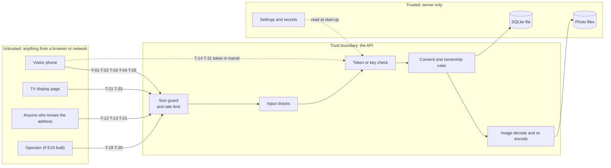

# SECURITY_PRIVACY.md

# Visitor Photo Slideshow (MomentVault): Security and Privacy Design Review

| Item | Detail |
|---|---|
| Product | MomentVault, implementing Assignment 1: Visitor Photo Slideshow |
| Document version | 1.0 (draft for approval) |
| Date | 17 November 2026 |
| Reviewed documents | PRD, ASSUMPTIONS, TECH_STACK, ARCHITECTURE v1.1 (Sections 9, 13, 14), DATABASE_DESIGN, API_SPECIFICATION (Sections 3, 4, 5, 8), BACKEND_DESIGN (Sections 15 to 20), FRONTEND_DESIGN, IMPLEMENTATION_PLAN |
| Review type | **Design review of documents.** No code exists yet, so nothing in this file is a test result for the application. |
| Not included | Application code. Plain-language rules, tables and diagrams only. |

**Please read these limits first.**

- **This application is not "fully secure", and this document does not claim it is.** It describes sensible controls for a small, supervised MVP and says plainly what they do not cover.
- **No compliance or certification claim is made.** The project holds no security certification and has had no legal review. Nothing here is legal advice. If the app is ever used for real members of the public, data-protection law may apply, and the retention and consent questions (A-11, A-08) need proper advice. This document does not say which law applies or whether the app meets it.
- **No penetration test or security audit was performed.**
- **What was actually checked.** Some Pillow and SQLite behaviours were run in the planning sandbox earlier in this project (listed in Section 27.1). Everything else here comes from reading the approved documents and reasoning about them. Behaviour of FastAPI, Starlette and SQLAlchemy was **not** run, because those packages were not installed. Those points are marked **to verify**.
- Labels: **MVP** means build it in the 20 hours. **PROPOSED** means this review recommends adding it and it needs your approval, because it changes or adds to an approved document. **FUTURE** means a production-style improvement outside the MVP.

---

## Read This First: Findings of the Design Review

The approved design is sound in its main structure (random file names, content checks by decoding, hashed tokens, server-side consent, ownership checks, no static photo folders). The review still found gaps. They are ranked by my own judgement of how much each could hurt, not by any formal scoring.

| # | Finding | Rank | Why it matters | Recommended action |
|---|---|---|---|---|
| **F-1** | **The per-visitor photo limit does not limit the total.** The limit is 20 photos per visitor, but anyone can register as a new visitor again and again (no login, by design), so one script can fill the disk and slow the server. Rate limiting is only a **Could Have** (FR-VAL-08) and there is no limit on the total number of photos. | **High** | The names "upload flooding" and "unauthorised uploads" in your brief both land here. The display is public, so a flood also puts junk on the screen. | **PROPOSED:** promote a minimal rate limit to MVP (Section 20), and add one **global cap on active photos** (Section 6). About 0.75 hours. Needs approval because PRD FR-VAL-08 is Could Have and the cap is a new setting. |
| **F-2** | **Withdrawn photos can stay in browser caches.** API_SPECIFICATION says photo responses are `public, max-age=31536000, immutable` (one year). After withdrawal the server answers 404, but any browser or shared cache that already holds the image may keep showing it. | **High** (privacy) | "Consent revocation not respected" is on your list. This is the one place where the approved design weakens it. | **PROPOSED:** use `private` and a short lifetime for photo responses, and accept the trade-off in Section 17.4. Needs a small change to API_SPECIFICATION (E8, E9) and its tests. |
| **F-3** | **There is no way to remove an offensive photo quickly unless the optional operator endpoint (E10) is built.** Without it, only the developer editing the database and files by hand can do it (A-29). IMPLEMENTATION_PLAN decision P-3 leaves out the admin **page**, which is fine, but E10 is a separate small endpoint. | **Medium to High** if strangers can reach the display | A public screen with no emergency removal is the biggest practical risk at a real event. | **PROPOSED:** build **E10 only** (about 0.5 hours, no admin page, used with a simple command-line request) or write a tested manual removal procedure in the README. Section 14. |
| **F-4** | **The token lives in browser storage, and the protection against stolen tokens (a content security policy) is only Should Have.** The design deliberately chose storage over cookies (ARCHITECTURE 9.3a). The mitigations are React's text escaping and a recommended policy header. | **Medium** | If any script ever runs on the page, it can read the token and act as the visitor. | **PROPOSED:** make the response headers (content security policy and "do not guess content types") part of the MVP. Verify them against the built frontend (Section 21.3). |
| **F-5** | **The operator key has no strength rule and no brute-force limit.** A short key like `1234` would pass. | **Medium** | Whoever guesses it can remove any photo. | **PROPOSED:** refuse to start the operator feature if the key is shorter than 32 characters, and apply the rate limit to E10 (Section 14). |
| **F-6** | **Plain HTTP on a shared Wi-Fi exposes tokens and photos.** The local demo uses HTTP (ARCHITECTURE 14.3). On a venue network, other devices may be able to read the traffic. | **Medium** | The token travels in a header on every request. | MVP: demonstrate on a private network or phone hotspot and say so in the README. FUTURE: HTTPS (Section 25). |
| **F-7** | **A withdrawal at the same moment as an upload is not covered by the approved tests.** The design commits each photo separately (BACKEND_DESIGN 14.3). A photo could be saved just after the withdrawal transaction, leaving an active photo for a withdrawn visitor. | **Medium** | "Consent revocation not respected." | Add the test in Section 16.3. If it fails, the photo insert must check that the owner is still active **in the same transaction**. |
| **F-8** | **Photo numbers are guessable counters, so anyone can download every active photo.** This is **accepted by design** (ARCHITECTURE 13.3, L8). | **Low to Medium** | It gives no more than watching the screen, but it is easier to scrape. | MVP: accept and document. FUTURE: random public photo identifiers (Section 17). |
| **F-9** | **Server logs contain client network addresses**, which can be personal data. | **Low** | The log is the terminal in the demo. | Keep logs in the terminal, never commit them, do not paste them into an AI assistant (Section 24). |
| **F-10** | **Consent is self-declared.** There is no age check and no proof that people in a photo agreed. | **Accepted** | Already stated in A-07, A-08, PRD OOS-13 and OOS-15. | MVP: keep the honest notice. FUTURE: moderation and a policy review (Section 26). |

Two smaller points: the PRD and API_SPECIFICATION name the optional **name caption** FR-DSP-07, but the caption is **FR-DSP-10**. This review uses FR-DSP-10. Also, if thumbnails are dropped (IMPLEMENTATION_PLAN P-1), the `thumbs` folder and E9 disappear, and every rule in this file about "two files per photo" becomes "one file per photo".

---

## Coverage of the Requested Topics

| # | Topic | Section |
|---|---|---|
| 1 | Threat model | 1 |
| 2 | Assets and sensitive data | 2 |
| 3 | Attackers and misuse scenarios | 3 |
| 4 | File upload security | 4 |
| 5 | Image content validation | 5 |
| 6 | File size and quantity restrictions | 6 |
| 7 | Filename generation | 7 |
| 8 | Path traversal prevention | 8 |
| 9 | MIME type and file signature checks | 9 |
| 10 | Decompression and resource exhaustion | 10 |
| 11 | Visitor token generation and validation | 11 |
| 12 | Token hashing and secure storage | 12 |
| 13 | Authentication and authorization | 13 |
| 14 | Admin endpoint protection | 14 |
| 15 | Consent collection | 15 |
| 16 | Consent withdrawal | 16 |
| 17 | Public image exposure | 17 |
| 18 | Photo deletion and retention | 18 |
| 19 | API input validation | 19 |
| 20 | Rate limiting | 20 |
| 21 | CORS configuration (and response headers) | 21 |
| 22 | Environment variable and secret management | 22 |
| 23 | Database security | 23 |
| 24 | Logging and sensitive data protection | 24 |
| 25 | HTTPS and deployment security | 25 |
| Threat table | All threats with attack, impact, prevention, test | 26 |
| MVP versus future | Control status | 27 |
| Test plan, checklist, residual risk | 28 to 30 |

---

# 1. Threat Model

## 1.1 What a Threat Model Is (Beginner Explanation)

> **In plain words:** a threat model asks four questions. What are we protecting? Who might attack it, or simply misuse it? How could they do it? What stops them? You write the answers **before** coding, so that safety is designed in and not added at the end.

## 1.2 Method Used

A simple approach suited to a beginner, drawing on common application-security practice (the OWASP style of thinking about web application risks):

1. Draw how data moves and mark the **trust boundary**: the line between "anything a browser sends" (untrusted) and "the server's own code and files" (trusted).
2. List the **assets** (Section 2).
3. List **who** might attack (Section 3).
4. For each point where untrusted data crosses the boundary, ask what could go wrong (Section 26).
5. Decide what the MVP does, what is proposed, and what is left for the future.

No formal scoring method is used. The ranks in this document are judgement.

## 1.3 Data Flow and Trust Boundary

The labels refer to the threats in Section 26. The dotted line marks a path where an attacker does not need the API at all: reading the network, or running a script inside the visitor's page.

## 1.4 Security Goals

| Goal | In this project |
|---|---|
| **Confidentiality** | Names, tokens, consent records and file paths are never shown to anyone else. Photos are public **only** while active and consented. |
| **Integrity** | Only the owner (or the operator) can remove a photo. Nothing a visitor sends is stored as it arrived. |
| **Availability** | One visitor or script cannot stop the display or fill the disk. |
| **Privacy** | Collect only what is needed. Honour deletion and withdrawal. Say honestly what cannot be undone. |

## 1.5 Scope

| In scope | Out of scope |
|---|---|
| The FastAPI backend, the React pages, the SQLite file, the photo folder, the settings | The visitor's phone, the venue network, the TV computer, the host operating system, social engineering of the operator |
| The demo setting (local network, one server) | Internet-scale deployment, multi-server set-up |

---

# 2. Assets and Sensitive Data

## 2.1 Asset Inventory

| Asset | Where | Sensitivity | What protects it |
|---|---|---|---|
| **Visitor photos** (may show people, places, children) | `data/photos/` (and `thumbs/` if built) | **High** while personal. Public by design while consented. | Consent, ownership checks, removal rules, no static folder |
| **Visitor name** | `visitors.name` | **Personal data** | Never in the feed, logs or errors. Erased on withdrawal. |
| **Visitor token (raw)** | The visitor's browser only | **High.** Whoever holds it acts as the visitor. | Random, never logged, returned once |
| **Token hash** | `visitors.token_hash` | Medium | One-way hash. Erased on withdrawal. |
| **Consent records** | `consent_records` | Medium. Proof of what was agreed. | Contains **no** name, token or photo reference |
| **Operator key** | Server settings only | **High** | Environment variable, never in Git |
| **Photo and visitor numbers** | Database, addresses | Low | Counters. Guessable by design. |
| **Image metadata (GPS, camera, time)** | Inside uploaded files | **High** (can reveal a home address) | Removed by re-encoding (FR-STO-03) |
| **Server logs** | Terminal output | Medium (contain network addresses and photo numbers) | Never log secrets, names or file names |
| **The database and data folder** | Disk | High as a whole | Outside the source and web folders, ignored by Git |
| **Server availability** | The running process | Medium | Limits, gate, busy timeout |
| **The consent notice text and version** | `core/consent_notice` | Medium (integrity matters, because records point to it) | One definition in code (BD-05) |

## 2.2 What Is Deliberately Not Collected

PRD NFR-PRV-02 limits collection to a name, photos and consent records. There is **no** face analysis, no tracking, no advertising, no analytics, no third-party scripts or fonts, no email, no phone number, no precise location (GPS is removed), no stored original file name, and (in the MVP) no stored client address in the database.

## 2.3 Personal Data in One Table

| Data | Personal? | Kept until | Erased by |
|---|---|---|---|
| Name | Yes | Withdrawal | Withdrawal clears it (FR-WDR-03) |
| Photos | Often (people may be recognisable) | Deleted, withdrawn, or removed by the operator | File deletion after the database commit (AD-13) |
| Token hash | Linked to a person | Withdrawal | Withdrawal clears it |
| Consent record | Not by itself (no name, token or photo link) | Kept as proof | Not erased in the MVP (BR-14) |
| Server log lines | Possibly (network address) | As long as the terminal output is kept | Closing the terminal. Never commit logs. |
| Browser token | Yes (acts as identity) | Until "Not you?", withdrawal or clearing site data | The visitor |

---

# 3. Attackers and Misuse Scenarios

## 3.1 Who Might Cause Harm

Not every risk is a "hacker". Several are ordinary people.

| Actor | Motive | Skill | Access | Most relevant threats |
|---|---|---|---|---|
| **Curious or mischievous visitor** | Fun, testing limits | Low | A phone and the address | T-01, T-04, T-10, T-25 |
| **Troll or abuser** | Show offensive images on a public screen | Low to medium | The address | T-01, T-02, T-25 |
| **Script-running attacker** | Break the app, fill the disk | Medium | The address and a script | T-02, T-03, T-05, T-12, T-13 |
| **Other visitor** | Remove or harass someone else | Low | Their own valid token | T-16, T-17, T-18 |
| **Network eavesdropper** (same Wi-Fi) | Steal tokens or photos | Medium | Same network, plain HTTP | T-14, T-31 |
| **Malicious web page or script** | Steal a token through the browser | Medium | A way to run a script in the page | T-10, T-14 |
| **Person whose photo was shown without permission** | Wants it removed | n/a | None | T-23, T-24, T-25 |
| **Operator (mistake or loss of key)** | Accidental removal, leaked key | Low | The operator key | T-19, T-20 |
| **Developer (mistake)** | Secrets or data committed, bad config | n/a | The repository | T-29, T-30, T-32 |

## 3.2 Misuse Scenarios in Plain Language

| Scenario | What happens without controls | Threat |
|---|---|---|
| A stranger finds the address and uploads rude pictures | They appear on the public screen | T-01, T-25 |
| Someone runs a script that registers 1,000 "visitors" with 20 photos each | The disk fills and the server slows | T-02 |
| A file called `holiday.jpg` is really a web page with a script | If stored as sent and opened by a browser, the script could run | T-04, T-11 |
| A tiny file that expands to a gigantic image | The server runs out of memory | T-05 |
| A visitor sends a file name like `../../app/main.py` | An attacker tries to write outside the photo folder | T-07 |
| Someone changes the photo number in a delete request | They try to delete another person's photo | T-16 |
| A person withdraws consent but the photo is still shown or still downloadable | Their rights are not respected | T-23 |
| Someone on the same Wi-Fi watches traffic | They copy a token and act as the visitor | T-14, T-31 |
| The operator key is committed to GitHub by mistake | Anyone can remove photos | T-20, T-29 |

---

# 4. File Upload Security

> **In plain words:** an upload is the most dangerous thing a public web page accepts, because the visitor controls the bytes, the name, the size and the claimed type. **The rule is never to trust any of it.**

## 4.1 Defence in Depth: Eight Layers

The approved design stacks several independent checks, so one mistake does not become a break-in (BACKEND_DESIGN 14, 15, 17).

| Layer | Check | Section |
|---|---|---|
| 1 | Rate limit (PROPOSED) and request size guard | 6, 20 |
| 2 | File count and per-file size | 6 |
| 3 | Allow-list of types, from the **content**, not the name | 9 |
| 4 | Full decode of the image | 5 |
| 5 | Pixel limit and the processing gate | 10 |
| 6 | **Re-encode** to a new clean file (nothing the visitor sent is stored as it arrived) | 5 |
| 7 | Random stored name, built from the database, checked twice | 7, 8 |
| 8 | Served with a fixed type and `nosniff`, no folder listing | 17 |

## 4.2 Rules for the Whole Upload

| Rule | Detail |
|---|---|
| Registration and consent are checked **before** any file work | Nothing is stored for a refused request (FR-CON-02, FR-REG-01) |
| Each file is checked and stored **separately** | A bad file does not stop good files (FR-UPL-04). A failed file leaves **no** leftover file (AD-14). |
| The server never runs or interprets an upload | Only decoded by Pillow and re-encoded |
| The server never trusts the browser's checks | The early checks in the page are convenience (FR-VAL-07). The server repeats them all. |
| One processing path | There is no second route that writes photos |
| Failures return the standard error shape with no detail | NFR-SEC-04 |

---

# 5. Image Content Validation

## 5.1 The Approved Method

The image processor opens the whole image with Pillow, **really decodes every pixel**, and then saves a **new** JPEG or PNG. The result is what gets stored (BACKEND_DESIGN 15).

## 5.2 Why Decode Fully (Verified Facts)

These behaviours were run in the planning sandbox with Pillow:

| Observation | Meaning for security |
|---|---|
| A **truncated** JPEG passes a header-only look but **fails** on a full decode | A header-only check would accept a broken file. Full decoding catches it. |
| Pillow's own `verify()` function **leaves the image unusable** afterwards | So the design does not use it (BACKEND_DESIGN 15.3). The whole decode is the check. |
| Saving again **drops EXIF** (including GPS) unless it is copied on purpose | Re-encoding removes hidden location data. |
| A CMYK JPEG stays CMYK unless converted | Needs a conversion step so browsers show it correctly. Not a security risk, a correctness one. |
| A JPEG padded to exactly 5 MiB still decodes | Size and content are separate checks |

## 5.3 What Re-encoding Achieves

| Threat | Why re-encoding helps |
|---|---|
| Hidden data appended after the image (a "polyglot" file) | The new file contains only the decoded pixels |
| Scripts or text in comments and metadata | Metadata is not copied |
| GPS and camera details | Removed (FR-STO-03, NFR-PRV-01) |
| Strange but valid encodings | Replaced by one known encoding |

> **Honest limit.** Re-encoding protects the **stored file and the visitors who see it**. It does not protect the **server** from bugs inside the image library while it decodes a hostile file. That risk is reduced by keeping the library updated (Section 22.5), by the pixel limit, and by the gate. It is not removed.

## 5.4 Rules

| Rule | Status |
|---|---|
| Allow only JPEG and PNG (P-04). GIF, WebP, SVG, HEIC, PDF and others are refused | MVP |
| The format is whatever Pillow **detects**, never the extension or declared type | MVP |
| Animated or multi-frame images are flattened to one still by the re-encode | MVP. **To verify with an animated PNG** (Section 28). |
| EXIF orientation is applied **before** metadata is dropped, so phone photos are not sideways | MVP (TECH_STACK R5) |
| Colour mode is normalised before saving | MVP |
| Image content is **not** scanned for malware or inappropriate content | **FUTURE** |

---

# 6. File Size and Quantity Restrictions

## 6.1 Limits (Settings, Reported by E1)

| Limit | Default | Reason | Enforced |
|---|---|---|---|
| Per file | 5 MiB (5,242,880 bytes, API-09) | Phones produce large photos. Limits memory and disk. | Server, and early check in the page |
| Files per request | 5 | Limits one request's work | Server and page |
| Whole request body | 27,262,976 bytes (5 files times 5 MiB plus 1 MiB overhead, calculated) | Stops oversized or endless bodies early | Size guard, `413` |
| Pixels per image | 25 million | Stops decompression bombs (Section 10) | Header check, then decode |
| Photos per visitor | 20 (active) | Stops one person filling the slideshow | Server |
| Name length | 50 | Display and storage | Server and page |
| **Total active photos (PROPOSED)** | for example 500, a setting | **Closes F-1.** No script can exceed it. | Server |

## 6.2 How the Size Guard Should Work

| Case | Required behaviour |
|---|---|
| Declared length over the limit | Refuse at once with `413`, before reading the body |
| No declared length (chunked) | Count bytes as they arrive and stop at the limit |
| Declared length smaller than the real data | The real count wins |
| Many tiny parts or many fields | The parser must cap the number of files and fields (**to verify**, BV-6) |
| Whole request refused | Nothing is stored, and the response uses the standard error shape |

> **Not verified here.** How the web framework's form parser handles very large or length-less bodies and part counts was not run. It is verification item BV-6 in the build plan and is **required** before this control is relied on.

## 6.3 The Global Cap (PROPOSED)

The existing limits stop one visitor. They do not stop a thousand visitors created by a script. A single **global limit on active photos** (and a message such as "The slideshow is full right now. Please try again later.") bounds the worst case.

Rough, unmeasured arithmetic to show why it matters: a photo saved at up to 1,920 pixels can range from a few hundred kilobytes to several megabytes. With no cap, a script making 20 photos per fake visitor needs only a few hundred fake visitors to reach many gigabytes. With a cap of 500 photos and a worst case of 5 MiB each, the folder is bounded at about 2.5 GiB. The exact sizes were not measured.

---

# 7. Filename Generation

> **In plain words:** the visitor's file name is untrusted text. The safest way to handle it is to throw it away and invent a new name.

## 7.1 The Approved Rules (BACKEND_DESIGN 16)

| Rule | Detail |
|---|---|
| The stored name is **random**, 32 lowercase hex characters from a random UUID, plus `.jpg` or `.png` | About 122 random bits. Cannot be guessed. |
| It is **not** derived from the visitor name, time, visitor id or photo id | Nothing personal and nothing predictable |
| The extension comes from the format **Pillow detected**, not from the upload | A `.php` or `.html` name never reaches the folder |
| The original file name is **never stored and never logged** | It may be personal and it is untrusted |
| Created in "exclusive" mode, which **fails if the name exists** | Nothing can be overwritten (FR-CNC-02) |
| The database also requires uniqueness | Last line of defence |
| A name must match the fixed shape before any file operation | A malformed value is refused as an internal error |

## 7.2 What the Visitor's File Name Is Used For

Only to **label that file's result line in the upload response**, shown in the page as plain text. It is never used in a path, a log line or the database.

---

# 8. Path Traversal Prevention

> **In plain words:** path traversal is when an attacker sneaks `../` into a name so the server reads or writes a file somewhere it should not, such as the database or the source code.

## 8.1 Three Independent Protections

| # | Protection | Where |
|---|---|---|
| 1 | The visitor's file name never reaches a file path | Upload workflow |
| 2 | The address of an image contains **only a number**. The file name is read **from the database**, never from the request | Image routes (E8, E9) |
| 3 | The name from the database must match the fixed 32-hex shape, **and** the final resolved path must be inside the data folder | Photo storage object |

No single mistake defeats all three.

## 8.2 Other Rules

| Rule | Status |
|---|---|
| Only the photo storage object touches photo files | MVP |
| The storage folders are **not** mounted as static folders. There is no directory listing | MVP |
| The data folder is outside the source and frontend folders | MVP |
| The number in an image address must be a whole number of 1 or more. Anything else is `404` or `422` | MVP |
| Symbolic links are not created or followed in the data folder | MVP (nothing creates them). **To verify** in the storage test. |

## 8.3 Tests (See Section 28)

A storage test that tries `../x`, an absolute path, an empty name, a name with a null character and a very long name. An upload with the file name `../../x.jpg` that must store a random name and leave no file outside the folder.

---

# 9. MIME Type and File Signature Checks

## 9.1 Three Different Things People Confuse

| Thing | Who controls it | Trust it? |
|---|---|---|
| **File extension** (`.jpg`) | The visitor | **No** |
| **Declared content type** (`image/jpeg` in the upload) | The visitor's browser, or a script | **No** |
| **File signature** (the first bytes, such as the JPEG or PNG marker) | In the file, but still supplied by the visitor | **A hint only** |
| **Actual decoded content** | The result of Pillow really decoding it | **Yes** |

## 9.2 Approved Approach

| Step | Check |
|---|---|
| 1 | Ignore the extension and the declared type for **decisions** |
| 2 | Let Pillow detect the format from the content |
| 3 | Accept only if the detected format is JPEG or PNG (allow-list) |
| 4 | Decode all pixels |
| 5 | Save a new file in that format |
| 6 | Store the content type that **the server derived**, in the database |

A mismatch between the declared type and the content is **not** an error by itself. The content decides. A `.png` that is a real JPEG is stored as JPEG. A `.jpg` that is text is refused with `FILE_NOT_AN_IMAGE`.

## 9.3 Why a Signature Check Alone Is Not Enough

A file can start with valid JPEG bytes and then contain anything. That is why signature checks are only a quick pre-filter and the full decode and re-encode are the real defence.

## 9.4 The Response Side

| Rule | Detail |
|---|---|
| The image response uses the content type from the database (set by the server) | Never a type chosen by the visitor |
| `X-Content-Type-Options: nosniff` on image responses | The browser must not guess a different type |
| The photo route never returns anything but an image | Errors use the standard JSON |

---

# 10. Image Decompression and Resource Exhaustion

> **In plain words:** a "decompression bomb" is a small file that expands into a huge picture in memory. File size says nothing about how big the decoded image will be.

## 10.1 Verified Facts (Run in the Planning Sandbox)

| Observation | Consequence |
|---|---|
| A **30-megapixel** solid-colour PNG was only about **37 KB** | A file-size limit alone does **not** stop a huge image |
| Pillow raised its decompression-bomb error at **twice** its configured limit, and only warned between one and two times the limit | The project must check the pixel count itself and not depend on that error alone (AD-24) |
| A JPEG padded to exactly 5 MiB still decodes | Size and pixels are separate |

## 10.2 Approved Controls

| Control | Detail | Source |
|---|---|---|
| **Header-based pixel check** | Read the declared width and height first, and refuse more than 25 million pixels **before** decoding | AD-24 |
| **Processing gate** | At most 4 images decoded at once (`MAX_CONCURRENT_IMAGE_JOBS`) | AD-23 |
| Per-file and request size limits | Section 6 | |
| Busy timeout for the database | Bounded waits | FR-CNC-03 |
| Never decode in the same request that holds a database write | Image work happens before the short write | BACKEND_DESIGN 14.6 |

## 10.3 The Memory Arithmetic

Rough and **not measured**: 25 million pixels at 4 bytes per pixel is about 100 MB for one decoded image. Operations such as rotating and resizing may hold extra copies, so the real peak is higher. With the gate at 4 jobs, the worst case is in the region of 400 MB or more of image memory, plus the application itself. That is why the gate exists, and why the limit must be checked **on the machine used for the demo** (a small laptop or a small host could be tight).

## 10.4 Other Resource Risks

| Risk | Control | Status |
|---|---|---|
| Disk fills with photos | Per-file, per-visitor and (PROPOSED) global cap, plus cleanup of failed uploads | MVP and PROPOSED |
| Slow upload that holds a connection | A time limit on the server side (**to verify**) | To verify |
| Many requests to the feed | The feed is a small query. Polling is every 5 seconds per display. Keep the feed free of heavy work. | MVP |
| CPU spent on image processing | The gate, plus the rate limit (Section 20) | PROPOSED |
| Database lock under many uploads | WAL mode and the busy timeout, tested with 10 simultaneous uploads | MVP |
| Memory growth in the TV page over hours | Frontend release rules, one-hour manual test | MVP |

---

# 11. Visitor Token Generation and Validation

> **In plain words:** a token is a long random secret ticket. Whoever shows it is treated as that visitor. So it must be impossible to guess and must never leak.

## 11.1 Generation

| Item | Rule |
|---|---|
| Source | The standard library's **secure** random source (never an ordinary random function) |
| Size | 32 random bytes, which is **256 bits**, shown as 43 URL-safe characters. The minimum required is 128 bits (FR-ID-01). |
| When | Once, when a new visitor registers |
| Returned | In the registration response **only once** |
| Stored | By the browser, in local storage; by the server, **only a hash** |

## 11.2 Why Guessing Is Not Realistic

Each of 2^256 values is equally likely. Trying values at random against the server has no realistic chance of success, whatever speed the attacker has. The rate limit is still useful (it protects the server's capacity), but token safety does **not** depend on it.

## 11.3 Validation on Each Request

| Step | Rule |
|---|---|
| 1 | Read `X-Visitor-Token`. A value longer than 128 characters or with odd characters is treated as "not recognised" **without** a database lookup. |
| 2 | Hash the value and look for an **active** visitor with that hash |
| 3 | Token-required endpoints (E2, E4, E5, E6): not found gives `401 VISITOR_NOT_RECOGNISED` and **nothing changes** |
| 4 | Upload (E3): not found means "new visitor", so name and consent are required |
| 5 | A withdrawn visitor has no hash, so the old token matches nothing |

## 11.4 Names Are Never Identity

The name is only a label (BR-01, FR-ID-03a). Two people called "Sam" are two visitors. **Guessable identifiers** therefore do not exist for visitors: the visitor number is internal and is never accepted as proof of anything and never exposed.

## 11.5 Token Theft Scenarios

| Route | Control | Residual risk |
|---|---|---|
| Script running in the page (cross-site scripting) | React escapes text. No raw HTML insertion anywhere. Names and file names are plain text. A content security policy (F-4). | Medium. Local storage is readable by any script on the page. |
| Reading network traffic | None in the MVP on plain HTTP (F-6). HTTPS in production. | **Real** on shared Wi-Fi |
| Shared or borrowed phone | "Not you?" forgets the token on that device (FR-ID-04). | Whoever uses the same browser profile acts as the visitor (A-01) |
| Token in a log, address or error | Never logged, never in a URL, never returned again (FR-ID-05). Tests read the captured log. | Low |
| Token in a screenshot or bug report | Not shown on screen anywhere | Low |
| Token from the database | Only a hash is stored (Section 12) | Low |
| Token lost | The visitor cannot manage earlier photos (A-03, A-29). Not a security hole, a limitation. | Accepted |

---

# 12. Token Hashing and Secure Storage

## 12.1 What Is Stored

| Place | What |
|---|---|
| Server database | `visitors.token_hash`: the **SHA-256 hash**, as 64 hexadecimal characters, unique. **Never the raw token.** |
| Browser | The raw token in local storage, through a small wrapper |

## 12.2 Why SHA-256 Is Correct Here, Although It Is "Fast"

> **In plain words:** slow hashes (bcrypt and similar) exist to protect **short passwords that people choose**, because an attacker can try billions of guesses. A token is **long and random**, so there is nothing to guess. If the database leaks, the attacker has hashes of 256-bit random values and cannot work backwards. A fast hash is correct, and a slow one would only slow every request.

## 12.3 Rules

| Rule | Detail |
|---|---|
| Hash on arrival, then compare hashes | The raw token is never compared to stored data |
| Look-up by hash (unique index) | Fast, one query |
| Withdrawal sets `token_hash` to NULL, together with `name`, under a check that allows NULL only for a withdrawn visitor | Section 23 |
| No response, log or error ever contains a hash | BACKEND_DESIGN 4.1 and 19.4 |
| Models are not sent to the browser. Only response schemas are, and they drop everything not declared | Verified for Pydantic 2.13.5 |
| A collision is practically impossible. The unique constraint makes registration retry with a new token if it ever happens | MVP |

## 12.4 Browser Storage Trade-offs (From ARCHITECTURE 9.3a)

Local storage is simple and works on a plain-HTTP demo. It is weaker than a protected cookie against injected scripts. **For a public HTTPS deployment, revisit** a cookie that scripts cannot read, together with protection against cross-site requests (Section 26, T-27).

---

# 13. Authentication and Authorization

## 13.1 Model in One Table

There are **no accounts and no passwords**. There are three levels of access.

| Level | Proof | Can do |
|---|---|---|
| **Public** | None | Read config, the slideshow feed and active photo images. Upload as a **new** visitor with name and consent. |
| **Recognised visitor** | `X-Visitor-Token` | Read own profile and photos, upload more, delete **own** photos, withdraw **own** consent |
| **Operator** | `X-Operator-Key` | Remove **any** photo (E10) |

## 13.2 Authorization Rules (Ownership)

| Rule | Detail |
|---|---|
| Ownership is checked on **every** photo delete | Query QA1 finds the photo and its owner. A different owner gives `403 NOT_PHOTO_OWNER` and nothing changes. |
| Unknown or already removed photo | `404 PHOTO_NOT_FOUND`, which reveals nothing about another visitor |
| A visitor can only name **their own** token | There is no endpoint that takes a visitor number |
| The feed never returns owners or names | Schemas drop them |
| `photo_ids` do not prove ownership | A photo number alone permits nothing |

> **Why "403 for someone else's active photo" is acceptable.** It reveals that photo number exists and is active. Active photos are public anyway, so nothing private is disclosed. For removed photos the answer is a neutral 404.

## 13.3 What Is Not Protected by This Model

| Limit | Note |
|---|---|
| Anyone who gets the token is the visitor | By design (A-01) |
| No account recovery | A lost token cannot be recovered (A-03) |
| No multi-device recognition | Not in the MVP |
| No roles beyond visitor and operator | Not needed |

## 13.4 Cross-Site Request Forgery

Tokens are sent in a **custom header added by the page's own code**, not in a cookie that the browser attaches automatically. So another website cannot trigger a deleting request using the victim's credentials. This is one reason the header design was chosen. If the design ever moves to cookies, protection against forged requests becomes **required**.

---

# 14. Admin Endpoint Protection

## 14.1 Scope in the MVP

The only operator action is **E10 `DELETE /api/operator/photos/{photo_id}`** (Could Have). There is no admin list, dashboard or visitor endpoint (API_SPECIFICATION endpoint list). A browser admin page (FRONTEND_DESIGN 7) is a separate, optional layer that only calls E10 and the public feed.

## 14.2 Approved Controls

| Control | Detail |
|---|---|
| Disabled by default | If `OPERATOR_KEY` is empty, the address returns an ordinary `404`, as if it did not exist. The endpoint is invisible. |
| Key in the environment | Never in Git or code (BR-15) |
| Constant-time comparison | Response time reveals nothing |
| Wrong or missing key | `401 OPERATOR_KEY_INVALID`, nothing changes |
| Key only in a header | Never in an address, never logged |
| Wrong attempts are logged as a **count** only | No key text |
| `no-store` on the response | API_SPECIFICATION caching table |
| Idempotent | A repeat removal of the same photo is a safe no-op |

## 14.3 Added Controls (PROPOSED, Closing F-3 and F-5)

| Control | Reason | Effort |
|---|---|---|
| **Build E10 even if the admin page is skipped.** An operator can then use a single request from a command line, or a tiny page later. | Gives an emergency removal path (F-3) | About 0.5 h |
| **Minimum key length of 32 characters**, refused at start-up, with `.env.example` showing how to generate one | A short key can be guessed (F-5) | 0.1 h |
| **Rate limit on E10** by client address | Blocks brute force | Included in Section 20 |
| Keep the operator page (if built) **unlinked** and treat that as obscurity only, not protection | The key is the protection | None |
| In the admin page, the key lives in tab session storage only, never local storage | FRONTEND_DESIGN 7.4 | Already designed |
| A remove action never reveals who owned the photo | Names stay private | Already designed |

## 14.4 Honest Limits

| Limit | Note |
|---|---|
| The key travels in a header over **plain HTTP** on the demo | Readable by a network eavesdropper (F-6). **Do not use E10 over a shared network without HTTPS in a real setting.** |
| One shared key, no per-person audit trail | Acceptable for one operator. Log the **photo number** of each removal. |
| No lock-out or alert | A rate limit slows guessing, it does not detect it |
| The key cannot be checked without removing a photo | Section 7.6 of FRONTEND_DESIGN. A wrong key shows on first use. |

## 14.5 FUTURE (Production)

Real operator accounts, hashed passwords or single sign-on, multi-factor authentication, an audit log of who removed what, and an alert on repeated failures.

---

# 15. Consent Collection

> **In plain words:** photos of people are shown **publicly**. Consent here means the visitor was shown a clear notice before the first upload, ticked a box themselves, and the server kept proof of which notice they agreed to.

## 15.1 Approved Design

| Rule | Detail | Source |
|---|---|---|
| The notice is visible **without extra clicks** before the first upload | Not hidden behind a link | FR-CON-01 |
| The checkbox is **unticked** by default | No pre-ticked box | FR-CON-02 |
| **The server refuses** an upload from a new visitor without consent | Sending a request directly, with no page, still fails and stores nothing | FR-CON-02 AC3 |
| The notice has a **version**. The upload must send the **current** version | A stale page gets `CONSENT_NOTICE_CHANGED`. The page reloads the notice and unticks the box. | BR-14 |
| Consent is recorded: notice version, time given, time withdrawn | The record has no name, token or photo link | FR-CON-03 |
| Text and version are one definition in code | They cannot drift apart | BD-05 |
| The notice states plainly what it covers | See 15.2 | FR-CON-01 |
| Returning visitors are not asked again, but get a reminder | Reminder is Should Have | FR-CON-04 |

## 15.2 What the Notice Must Say (PRD FR-CON-01)

Photos will be shown publicly on a screen. The visitor confirms the photos are theirs or they have permission, and anyone clearly visible has agreed. Photos stay until the visitor deletes them or withdraws consent. The visitor can delete photos or withdraw consent at any time. The visitor is an adult or has a guardian's permission. If the optional name caption is built, names are shown too.

> **Consistency check (carried from IMPLEMENTATION_PLAN Finding 1).** The notice promises deletion or withdrawal at any time. The notice must therefore **never** be shipped promising something that was not built. If withdrawal is cut, the wording must be changed with your approval.

## 15.3 What Consent Here Is Not

| Not | Note |
|---|---|
| Proof that everyone in the photo agreed | It is a **self-declaration** (A-07). Nobody checks. |
| Age verification | There is none (PRD OOS-13). A child could tick the box. |
| Legal advice or a legally reviewed wording | The wording is plain English written by the team, **not reviewed by a lawyer** (A-08, PRD OOS-15) |
| A guarantee that a photo cannot be copied | Anyone who sees the screen can photograph it. The notice says so. |

## 15.4 Misuse and Controls

| Misuse | Control |
|---|---|
| Upload without ticking | Server refusal (test with a direct request) |
| Upload against an outdated notice | Version check |
| Forged consent value (anything but exactly `true`) | Server accepts only exactly `true` |
| Consent given by someone else's token | Not possible without the token |
| Consent for a minor | Not detectable. Stated in the notice. |

---

# 16. Consent Withdrawal

## 16.1 Approved Design (E6, FR-WDR)

| Step | What happens |
|---|---|
| 1 | The visitor confirms in a dialog. The request must carry `confirm: true` (API-06). Without it the server refuses. |
| 2 | **One database transaction:** all the visitor's active photos are marked `removed`, the open consent record gets `withdrawn_at`, and the visitor becomes `withdrawn` with `name` **and** `token_hash` cleared |
| 3 | **After the commit**, the files are deleted (AD-13). A file that cannot be deleted is logged and retried later (query Q11). The photo is already invisible. |
| 4 | The old token now matches nothing (FR-WDR-04) |
| 5 | The display drops the photos at its next poll (a few seconds) |
| 6 | The browser forgets the token and shows the new-visitor form |

The database rule (`ck_visitors_state`) makes half-withdrawn visitors **impossible**: an active visitor must have name and hash, a withdrawn one must have neither.

## 16.2 What Withdrawal Cannot Undo (Be Honest With Visitors)

| Limit | Note |
|---|---|
| People who already saw the screen, or photographed it | Cannot be recalled (A-08, A-09) |
| Copies in **browser caches** on devices that already loaded the photo | **F-2.** With the approved one-year `public` cache setting, these may remain for a long time. Section 17.4 proposes a smaller lifetime. |
| Copies in **backups** of the data folder | Manual backups are not cleaned automatically. Do not keep backups of a public event longer than needed. |
| Entries in the **log** | They hold photo numbers and no names (Section 24) |
| The consent record | Kept on purpose as proof. It holds **no** personal data (BR-14). |
| A visitor who lost the token | They cannot withdraw (A-03, A-29). Only the developer or operator can remove their photos. |

## 16.3 The Race to Test (F-7)

> **Scenario:** a visitor starts an upload of 5 photos, and at the same moment withdraws consent in another tab. Each photo is committed on its own. A photo could be inserted **after** the withdrawal transaction, belonging to a visitor who is now withdrawn.

| Check | Required result |
|---|---|
| Withdraw while an upload is in progress | After both finish, **no** active photo belongs to a withdrawn visitor, and no photo file exists without an active row |
| If it fails | The photo insert must confirm the owner is still `active` inside the same transaction, or the withdrawal must remove late arrivals. Decide with the assistant, and record the decision. |

## 16.4 Verification

The visible outcome is tested end to end: the old token is refused, the feed no longer lists the photos, the files are gone from the folder, the name and hash are NULL in the database, the consent record has a withdrawal time, and the page shows the new-visitor form (API_SPECIFICATION test 30, BACKEND_DESIGN 22).

---

# 17. Public Image Exposure

> **In plain words:** the display must read the photos, and photos are shown publicly anyway. So image addresses carry **no login** (A-28). The question is not "can strangers see them" but "**which** photos can strangers see, and for how long".

## 17.1 What Is Public by Design

| Public | Why |
|---|---|
| The slideshow feed (photo numbers only) | The display needs it |
| Active photo files | The display needs them |
| The configuration | Limits and the consent text only |

**Never public:** names, tokens, hashes, visitor numbers, consent records, file paths, photos that are removed or whose visitor withdrew.

## 17.2 The Core Rule

> **A photo is reachable only while its status is `active` and its owner is `active`.** Query QA2 enforces both on every image request. A removed, withdrawn or unknown photo returns `404`.

## 17.3 Approved Controls

| Control | Detail |
|---|---|
| No static folders, no directory listing | Photos reach a browser only through E8 and E9 |
| Random stored file names | Nobody can guess a file name. The address uses a number, and the server looks the name up. |
| Fixed content type and `nosniff` | Section 9.4 |
| A missing file is a `404` and is logged | ERR-22 |
| Uploads only become public **after** they pass every check | A refused file never becomes reachable |
| Removal: database first, then files | The photo is invisible the instant the database commits |

## 17.4 Caching and Withdrawn Photos (F-2)

The approved response header for E8 and E9 is `public, max-age=31536000, immutable`. Reasons given: the photo never changes, and a display that loses the server keeps showing what it already loaded (A-27).

| Concern | Effect |
|---|---|
| `public` allows **shared** caches (a proxy, a CDN) to keep a copy | After withdrawal the server says 404, but a shared cache may still serve the image |
| One year is long | A browser may keep serving its own copy even after removal |
| `immutable` tells the browser not to ask again | The server has no chance to say "gone" |

| Option | Effect | Recommendation |
|---|---|---|
| Keep the approved header | Best for display resilience, weakest for withdrawal | Not recommended for a public event |
| **`private` with a short lifetime, for example about an hour** | No shared caches. Copies expire. The display can still survive a short outage because its page also holds loaded images in memory. | **Recommended (PROPOSED)** |
| `no-store` | Strongest for withdrawal, but the display re-downloads each photo on every loop | Only if bandwidth is not a problem |

> **Honest limit.** Even with a short lifetime, a device can keep a copy that the visitor cannot recall, and screenshots cannot be recalled. This is the same limit already stated in the consent notice.

## 17.5 Guessable Photo Numbers (F-8)

Photo numbers are counters (ARCHITECTURE L8). Anyone can count from 1 upwards and fetch every **active** photo. That reveals no more than watching the screen. It does make bulk copying easier and does reveal how many photos exist.

| Stage | Approach |
|---|---|
| MVP | Accept and document |
| FUTURE | **Random public photo identifiers** in addresses (the internal counter stays for the cursor), or signed short-lived image addresses |

## 17.6 Tests (Section 28)

Fetch a removed photo, a withdrawn visitor's photo, an unknown number and a non-number, all must be `404` or `422`. Confirm no folder listing exists at the data paths. Confirm the response headers on an image.

---

# 18. Photo Deletion and Retention

## 18.1 Who May Remove a Photo

| Route | Who | Status |
|---|---|---|
| E5 delete own photo | The owner, with the token | **Should Have** (Tier B in IMPLEMENTATION_PLAN) |
| E6 withdraw consent | The visitor | Should Have, promoted to committed scope |
| E10 operator removal | The operator, with the key | Could Have (**PROPOSED** to build, F-3) |

## 18.2 How Removal Works (AD-13, AD-14)

| Rule | Detail |
|---|---|
| Soft removal first | The database row becomes `removed`. The photo vanishes from every feed and image request at once. |
| Files deleted **after** the commit | A file failure cannot undo the removal |
| Leftover files | The stored name remains in a `removed` row, so a later cleanup (Q11 and the Should Have start-up sweep) can retry |
| Failed upload | Files written for a photo that did not commit are deleted at once (AD-14) |
| Idempotent | Removing something already removed is a safe no-op |
| Confirmation | The page asks before deleting. Withdrawal also needs `confirm: true` on the server. |

## 18.3 Retention

| Item | MVP position |
|---|---|
| Photos | Kept **until deleted, withdrawn or operator-removed**. **No automatic expiry** (BR-13). |
| Names | Kept until withdrawal |
| Withdrawn visitor row | Kept without name or hash, so photos and consent records still point at something |
| Consent records | Kept |
| Removed photo rows | Kept (status `removed`, file name kept until the file is deleted) |
| Logs | Terminal output only |
| **The real retention period** | **OPEN (A-11).** It must be decided before any real public use. This document does not set one. |

## 18.4 Recommended Safeguards

| Safeguard | Stage |
|---|---|
| State plainly in the README that there is no automatic expiry | MVP |
| After a demo, **delete the data folder and the database** (or use a documented "clear everything" step) so no stranger's photo stays on a laptop | MVP (procedure only) |
| An event-end "clear all data" command (E-05) | FUTURE |
| Scheduled expiry (for example after N days) and a notice change | FUTURE |
| A policy for requests to delete data from people who lost their token | FUTURE. Today it is a manual developer action (A-29). |

---

# 19. API Input Validation

> **In plain words:** every value that comes from outside is checked on the **server**, even if the page already checked it, because anyone can send a request without using the page.

## 19.1 Validation Layers

| Layer | What | Where |
|---|---|---|
| Size guard and rate limit | Body size, number of requests | Middleware |
| Schemas | Types and shapes of values | Request schemas (JSON endpoints) |
| Form fields | `name`, `consent`, `notice_version`, `files` for the upload | Route declarations |
| Services | Business rules (name rules, limits, consent, ownership) | Service layer |
| Image processor | The file itself | Section 5 |
| Database | Last line: types, `NOT NULL`, unique, check and foreign-key rules | DATABASE_DESIGN |

## 19.2 Rules per Input

| Input | Rule |
|---|---|
| `name` | Trimmed. Not empty. At most 50 characters. No control characters (FR-REG-02). Checked **in this order**: trim, empty, length, control characters. Ordinary punctuation, accents, emoji and `` or a script-like file name | A script runs in other visitors' browsers and steals tokens | Text rendered as text, no raw HTML, names not sent in the feed, CSP (MVP and PROPOSED) | Register that name, view upload page and any place it appears, confirm it shows as text and nothing runs |
| **T-11** | Active content served from the image route | Browser guesses a file type and runs it | Script execution | Fixed content type from the database, `nosniff`, only images served (MVP) | Check response headers on E8 |

## 26.2 Identity, Tokens and Authorization

| ID | Threat | Attack scenario | Potential impact | Prevention | Verification or test |
|---|---|---|---|---|---|
| **T-12 ★** | **Guessable visitor identifiers** | An attacker tries visitor numbers, names or photo numbers to act as someone | Impersonation, access to others' data | Identity is **only** a random 256-bit token. Names and numbers are never proof. No endpoint accepts a visitor number. Feed has no owner data (MVP) | Two visitors named "Sam" stay separate. A request with a made-up token gets `401`. The feed contains no names or visitor numbers. |
| **T-13** | Token guessing | A script tries random tokens | Account takeover | 256 random bits (about 1.2 times 10 to the power 77 values). Length and character check before lookup. Rate limit (PROPOSED). | Unit test for token length and randomness source. Wrong tokens give `401`. |
| **T-14 ★** | **Token theft** | (a) An injected script reads local storage. (b) Someone on the same Wi-Fi reads a header. (c) A shared phone is used. (d) A token appears in a log or error. | Attacker deletes photos, withdraws consent, uploads as the visitor | React text escaping, no raw HTML, CSP (MVP and PROPOSED). HTTPS or a private network (FUTURE and MVP procedure). "Not you?". Never log or show the token (MVP). | XSS name test. Search captured logs for the token. Check the token is never in a URL. Demo only on a private network. |
| **T-15** | Token disclosure from the database | The database file is copied | Visitors impersonated | Only the SHA-256 hash is stored (MVP). Withdrawal clears it. | Test that the database never contains the raw token. A copy of the database cannot be used as a token. |
| **T-16 ★** | **Unauthorised deletion** | A visitor changes the photo number to delete another person's photo. Someone deletes without a token. | Loss of other people's photos | Token required, ownership checked on every delete (`403 NOT_PHOTO_OWNER`), operator key for E10 (MVP) | API test 20: another visitor's photo returns `403` and remains. No token gives `401`. |
| **T-17** | Unauthorised withdrawal | Someone calls withdraw with a guessed or stolen token | Another person's photos removed | Token required, `confirm: true`, token secrecy (MVP) | Withdraw without the token and without `confirm`: refused, nothing changes |
| **T-18** | Impersonation through a name | Someone picks the same name as another visitor | Confusion | Names are labels. Two visitors may share a name. Nothing is based on a name (MVP). | Same-name test |

## 26.3 Operator

| ID | Threat | Attack scenario | Potential impact | Prevention | Verification or test |
|---|---|---|---|---|---|
| **T-19 ★** | **Abuse of admin APIs** | An attacker guesses the operator key, or calls E10 repeatedly, or finds E10 when it should be off | Photos removed without permission | Disabled when no key (404). Constant-time comparison. Rate limit and minimum key length (PROPOSED). No other admin endpoints exist (MVP). | Wrong key gives `401`. Empty key setting gives `404`. A burst of wrong keys gets `429`. A short key is refused at start-up. |
| **T-20** | Operator key leak | Key committed to Git, logged, or sent over an open network | Same as T-19 | Environment variable only, `.env` ignored, never logged. Search Git history before submission (MVP). Replace the key if it leaks. | Search the repository and history. Search logs after an E10 call. |

## 26.4 Privacy and Consent

| ID | Threat | Attack scenario | Potential impact | Prevention | Verification or test |
|---|---|---|---|---|---|
| **T-21 ★** | **Publicly accessible private photographs** | (a) Someone counts photo numbers and downloads all active photos. (b) A removed or withdrawn photo stays reachable. (c) A file is guessed or listed. (d) A photo is public before it passed checks. | Photos viewed or copied beyond the screen | Public only while photo and owner are `active`. Random file names, no static folder, no listing. Uploads become reachable only after passing every check (MVP). Short private caching (PROPOSED). Random public ids (FUTURE). **Active photos being public is by design (A-28).** | Fetch removed, withdrawn, unknown and non-numeric ids (404 or 422). Try to list data paths. Check cache headers. |
| **T-22** | Photos shown without valid consent | A direct request skips the checkbox. A stale page submits an old notice. | Unconsented public display | Server refuses a new visitor without `true` consent and the current version. Consent record stored (MVP). | Direct request with no consent and with an old version |
| **T-23 ★** | **Consent revocation not respected** | (a) Files remain after withdrawal. (b) A photo uploaded during withdrawal stays active. (c) The display keeps showing the photo. (d) Browser caches keep the photo. (e) Backups and logs keep it. | A person's wishes ignored | One transaction marks photos removed and clears name and hash. Files deleted after commit with retry. Display drops removed photos at the next poll. (MVP) **Short private cache (PROPOSED, F-2). Race test (F-7). Honest notice (MVP).** Backup cleanup (FUTURE). | The withdrawal end-to-end test (token refused, feed, files, database, display). The withdraw-during-upload test. Header check on E8. |
| **T-24** | Retention beyond need | Photos and names kept forever | Privacy harm over time | Deletion, withdrawal and operator removal exist. No automatic expiry yet. Clear data after the demo (MVP procedure). Expiry policy (FUTURE, A-11 OPEN). | Checklist item: data deleted after the demo |
| **T-25** | Inappropriate content or photos of people who did not agree | A visitor uploads someone else's photo or offensive content | Harm to a third party | Consent notice (self-declared). Operator removal E10 (PROPOSED). Limits (MVP). Moderation, reporting and a content policy (FUTURE). **There is no automatic detection.** | Removal procedure tried once before the demo |

## 26.5 Platform and Operations

| ID | Threat | Attack scenario | Potential impact | Prevention | Verification or test |
|---|---|---|---|---|---|
| **T-26** | SQL injection | Quote characters in a name | Data read or changed | Bound parameters only (MVP) | A name with SQL characters stores and displays as plain text |
| **T-27** | Cross-site request forgery or cross-origin misuse | Another website sends requests with the visitor's credentials | Photos deleted or withdrawn | Tokens in a custom header, not cookies. Same origin, no CORS. If CORS is ever enabled, one exact origin (MVP) | A request from a different origin gets no permissive headers. Confirm no CORS middleware. |
| **T-28** | Information leak in errors and logs | A forced error shows a path, trace or SQL | Attackers learn internals | Standard error shape, generic messages, detail only in the log (MVP) | Force 404, 405, 413, 422 and 500, read the messages (NFR-SEC-04) |
| **T-29** | Secrets or data committed to Git | `.env`, database or photos pushed to a public repository | Key leaked, personal photos public | `.gitignore` first. Placeholders only. Search history (MVP) | Search the repository and history before submission |
| **T-30** | Vulnerable dependency | A known flaw in the image or web library | Server compromised | Pinned versions, check advisories, run audit tools once (MVP). Automatic alerts (FUTURE). | Record the audit command output in the README or AI_LOG. **Not run in planning.** |
| **T-31** | Interception on plain HTTP | Someone on the same network reads the token header or photos | Token stolen, photos read | Private network or hotspot for the demo (MVP procedure). HTTPS for any real deployment (FUTURE). | Demo only on the controlled network |
| **T-32** | Database or data folder exposure | The folder is served or readable | All data exposed | Outside the web and source folders, no static mount, ignored by Git, sensible machine permissions (MVP) | Try to fetch the data paths over HTTP. Check file permissions on the demo machine. |
| **T-33** | Display disruption | Floods of feed requests, or a poisoned image makes the TV page freeze | The public screen fails | Light feed query, silent failure handling, skip failed images in 2 seconds, rate limit (PROPOSED) | Stop the server for 30 seconds and confirm recovery. Run the page for an hour. |
| **T-34** | Duplicate or racing registrations | A double click or two tabs create two visitors | Messy data, not a breach | Button busy state, known limitation (ERR-24) (MVP) | Double-click test |

---

# 27. MVP Controls Versus Future Production Enhancements

## 27.1 What Was Verified, and What Was Not

| Verified in the planning sandbox | Not verified (to check during the build) |
|---|---|
| Pillow: truncated JPEG fails a full decode, `verify()` leaves the image unusable, EXIF is dropped on re-save, CMYK stays CMYK, the bomb error appears at twice the limit, a 30-megapixel PNG can be about 37 KB, a JPEG padded to 5 MiB decodes | The web framework's size guard and multipart limits (BV-6), replacement of default error handlers (BV-8), header-to-parameter mapping (BV-4) |
| SQLite: a `NULL` passes a `CHECK`, so rules need `IS NOT NULL` | Rate limiter behaviour, CSP against the built frontend, response headers on image files (BV-10) |
| Token and file-name shapes (43 characters, 32 hex characters) | Real-phone photos (GPS removal, orientation, HEIC), animated PNG handling |
| Pydantic response schemas drop undeclared fields | Concurrency (BV-7), withdrawal race, memory under 4 big images |
| WCAG colour contrast (not security-related) | Dependency advisories and audit tools |

## 27.2 Controls by Stage

| Area | **MVP (build now)** | **PROPOSED (needs approval, small)** | **FUTURE (production)** |
|---|---|---|---|
| Upload | Content decode and re-encode, allow-list, size, count, pixel limits, gate, random names, no static folder | Global photo cap, minimal rate limit | Malware and content scanning, moderation queue, per-IP and per-token distributed limits |
| Identity | 256-bit token, hash only, header, ownership checks | Short private cache for photos | Cookie option for HTTPS, optional account or recovery |
| Operator | Key in environment, constant-time, off by default | Build E10, 32-character minimum key, rate limit | Accounts, audit log, alerts |
| Consent | Visible notice, unticked box, server check, version, record, withdrawal (committed) | Race test and fix | Reviewed policy and wording, age and guardian handling |
| Photos | Public only while active, removal order, retry cleanup | `private` short cache | Random public ids, signed addresses, expiry, backup deletion |
| Headers | Standard errors, no-store on private endpoints, `nosniff` on images | CSP and `nosniff` everywhere | HSTS, full header review |
| Database | Bound queries, constraints, WAL, outside web folder | None | Server database, encryption at rest, tested backups |
| Logging | No secrets, names or file names, request id | Search logs in a test | Central protected logs, retention, alerting |
| Transport | Private network or hotspot for the demo | None | HTTPS, forwarded-address trust rules |
| Dependencies | Pinned versions | One-time audit run | Automatic update alerts |
| Process | Delete data after the demo, honest README | None | Incident response and a data-protection review |

---

# 28. Security Test Plan

All of these are **to be run during Days 2 to 5** of IMPLEMENTATION_PLAN. None has been run.

## 28.1 Automated Tests (Mapped to the Planned Test Files)

| # | Test | Expected | File |
|---|---|---|---|
| S-1 | Fake image, empty file, corrupt file, GIF, PDF, SVG, HEIC | Each rejected with the right code, no file stored | `test_image_processor.py`, `test_api_upload.py` |
| S-2 | Huge-pixel PNG | `IMAGE_TOO_LARGE_PIXELS` | `test_image_processor.py` |
| S-3 | GPS photo | No GPS in the stored file | `test_image_processor.py` |
| S-4 | JPEG with appended text | Stored file has none | `test_image_processor.py` |
| S-5 | Animated PNG | One still frame stored, or a clear rejection | `test_image_processor.py` |
| S-6 | Traversal names, absolute paths, null characters in storage | Refused, nothing outside the folder | `test_photo_storage.py` |
| S-7 | Upload file name `../../x.jpg` | Stored under a random name, nothing outside the folder | `test_api_upload.py` |
| S-8 | Token length and hash storage | 43 characters, database holds only the hash | `test_security.py` |
| S-9 | No consent, wrong version, forged value | Refused, nothing stored | `test_api_upload.py` |
| S-10 | Another visitor's photo delete | `403`, photo remains | `test_api_delete_withdraw.py` |
| S-11 | No token, bad token, over-long token | `401`, nothing changes | `test_api_config_visitor.py` |
| S-12 | Withdrawal outcome | Token refused, feed empty, files gone, name and hash NULL | `test_api_delete_withdraw.py` |
| S-13 | Withdraw during an upload | No active photo for a withdrawn visitor | `test_concurrency.py` |
| S-14 | Removed, withdrawn, unknown, non-numeric photo ids | `404` or `422` | `test_api_slideshow_images.py` |
| S-15 | Image response headers | Fixed type, `nosniff`, cache header as decided | `test_api_slideshow_images.py` |
| S-16 | Oversized and length-less body | `413`, nothing stored | `test_errors_and_headers.py` |
| S-17 | Errors 404, 405, 413, 422, 500 | Standard shape, no path, trace or SQL | `test_errors_and_headers.py` |
| S-18 | Captured log after an upload with token, hostile name and distinctive file name | None of them appear | `test_errors_and_headers.py` |
| S-19 | Rate limit and global cap (if built) | `429` or the full message, nothing stored | `test_api_upload.py` |
| S-20 | E10 with no key setting, wrong key, right key, short key | `404`, `401`, removal, refusal at start-up | `test_api_delete_withdraw.py` |
| S-21 | 10 simultaneous uploads | No failure, no orphan files | `test_concurrency.py` |
| S-22 | SQL characters in the name | Stored and shown as text | `test_api_upload.py` |

## 28.2 Manual Checks

| # | Check | How |
|---|---|---|
| M-1 | The script-tag name shows as text everywhere | Phone and TV page |
| M-2 | No token in any web address or screen | Look through the pages and the browser address bar |
| M-3 | The token is not in the server's access log | Upload with a token, search the terminal output |
| M-4 | Data and database are not reachable over HTTP | Try the data paths in the browser |
| M-5 | CORS not enabled | A request from a different origin gets no permissive headers |
| M-6 | Security headers present on pages and images | Browser developer tools |
| M-7 | The content security policy does not break the built page (if added) | Load all pages, read the console |
| M-8 | Operator removal works and the wrong key is refused | One removal by command line |
| M-9 | Repository and Git history contain no secrets, data or photos | Search before submission |
| M-10 | Data folder deleted after the demo | Procedure |

---

# 29. Security Checklists

## 29.1 Before the First Commit

- [ ] `.gitignore` lists `.env`, `data/`, the database files, `node_modules`, caches
- [ ] `.env.example` holds placeholders only

## 29.2 Before Submission (Condensed From IMPLEMENTATION_PLAN Day 4 and Day 5)

- [ ] Only the token **hash** is stored (test passes)
- [ ] The token is never in a URL or a log line
- [ ] A text file named `.jpg` is rejected
- [ ] A huge-pixel PNG is rejected
- [ ] A traversal file name stores a random name only
- [ ] A hostile name shows as text
- [ ] Consent is enforced by the server
- [ ] Another visitor's photo cannot be deleted
- [ ] Withdrawal removes photos, files, name and hash, and the display follows
- [ ] Removed and withdrawn photos return `404`
- [ ] Standard errors reveal nothing
- [ ] Oversized body gives `413`
- [ ] Decision made and tested for the rate limit, global cap and E10
- [ ] The photo cache header decision (F-2) is made and tested
- [ ] Dependencies pinned. Audit tools run or the gap written in the README
- [ ] No secret, photo or database file in the repository or its history
- [ ] README states: plain HTTP demo on a private network, no automatic expiry, no legal review, no age check, consent is self-declared
- [ ] Demo data deleted after the demo

---

# 30. Residual Risks and Plain Statement of Limits

Even after every MVP control is built and tested, these remain. They are stated so nobody reads "secure" into this document.

| Remaining risk | Why it remains |
|---|---|
| A flood from many addresses, or a determined attacker | Needs network-level defences |
| Inappropriate or non-consented photos | No automatic detection. Consent is self-declared. |
| A bug in the image library or web framework | Reduced by limits, updates and re-encoding, never removed |
| A token read from the network on plain HTTP | Needs HTTPS for real use |
| A token stolen by an injected script | Local storage is readable by scripts. Reduced by escaping and a content security policy. |
| Photos copied, photographed or cached by others | Cannot be recalled |
| Data on backups, laptops and logs | No automatic cleanup |
| Lost tokens | Visitors cannot manage earlier photos |
| Design mistakes not yet found | This is a document review, with no code, no test results and no independent review |
| Legal obligations | Not assessed. The notice has not been reviewed by a lawyer. |

---

# 31. Decisions Needed From You

| ID | Decision | Default in this document | Effect |
|---|---|---|---|
| **SP-1** | Promote a minimal rate limit and a global photo cap into the MVP (F-1)? | **Yes, if time allows (about 0.75 h)**. Otherwise record as a known limitation and run only on a private network. | Changes PRD FR-VAL-08 priority and adds a setting. Needs IMPLEMENTATION_PLAN re-plan. |
| **SP-2** | Change the photo cache header to `private` with a short lifetime (F-2)? | **Yes** | Small change to API_SPECIFICATION E8 and E9 and one test |
| **SP-3** | Build E10 (with or without the admin page) (F-3)? | **Yes, E10 only** (about 0.5 h), because there is otherwise no emergency removal | Reverses part of IMPLEMENTATION_PLAN P-3 |
| **SP-4** | Move the content security policy and `nosniff` for all responses into the MVP (F-4)? | **Yes**, after verifying against the built frontend | Small middleware addition |
| **SP-5** | Minimum 32-character operator key (F-5)? | **Yes** | One start-up check |
| **SP-6** | Demonstrate only on a private network or hotspot (F-6)? | **Yes** | README wording |
| **SP-7** | Confirm the consent wording promises only what was built (IMPLEMENTATION_PLAN P-2) | **Yes** | May change the notice text |
| **SP-8** | Retention policy and who is responsible for the data (A-11) | **OPEN** | Required before any public deployment |

None of these changes an approved document until you approve it.

---

# Glossary

| Term | Meaning |
|---|---|
| **Threat model** | A structured list of what to protect, who might attack and how |
| **Trust boundary** | The line between untrusted input from a browser and trusted server code and files |
| **Token** | A long random secret ticket that identifies a returning visitor |
| **Hash** | A one-way scramble. You can check a value against it but cannot get the value back. |
| **SHA-256** | A standard fast hash, suitable for long random secrets |
| **Path traversal** | Using `../` in a name to reach files outside the intended folder |
| **Polyglot file** | A file that is valid as more than one kind, for example an image with a script appended |
| **Re-encode** | Decoding an image and saving a brand-new file, so nothing hidden is copied |
| **Decompression bomb** | A small file that expands into a very large image in memory |
| **Cross-site scripting (XSS)** | Getting a script to run inside another user's page |
| **CORS** | Browser rules and server headers about which other websites may call an API |
| **CSRF** | Tricking a browser into sending a request with credentials it attaches itself |
| **CSP** | A response header telling the browser where a page may load scripts and other content from |
| **Rate limit** | A cap on requests from one source in a time window |
| **Constant-time comparison** | Comparing secrets so the response time reveals nothing |
| **Soft removal** | Marking a row removed instead of deleting it at once |
| **Retention** | How long data is kept |
| **Least privilege** | Giving a component only the access it needs |
| **Defence in depth** | Several independent checks, so one mistake is not enough |

---

# Document Control

| Version | Date | Change |
|---|---|---|
| 1.0 | 17 Nov 2026 | Initial design review. Based on the approved documents. No code, no penetration test, no legal review, no compliance claim. |

**Approvals needed before coding:** SP-1 to SP-8 (Section 31).
