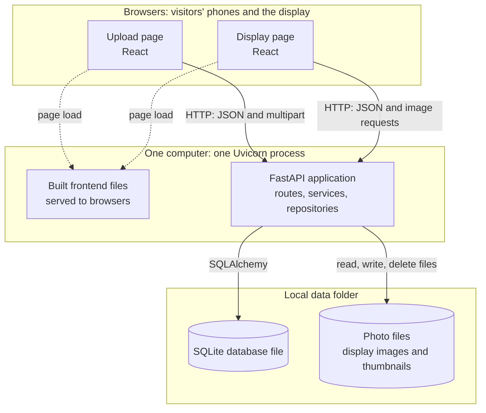

# MomentVault: Your Digital Time Capsule

**Visitor Photo Slideshow.** A web application where visitors enter their name, agree to a consent notice and upload photos, and the photos play in a slideshow on a TV or computer screen. Returning visitors have their earlier photos replayed too.

Built with **Python, FastAPI, React, Vite, SQLite and SQLAlchemy** as an MCA Semester 1 assignment (*Assignment 1: Visitor Photo Slideshow*), to portfolio standard, in about 20 focused hours.

> ### ⚠ Project status: read this first
>
> **This README was written from the approved design documents. At the time of writing, the application code was not yet in the repository.** So that nothing here is claimed that has not happened, every statement about behaviour carries a status tag:
>
> | Tag | Meaning |
> |---|---|
> | **[Planned]** | Designed and documented. **Not yet built or verified.** |
> | **[Unverified]** | A command or step taken from the design. **Not yet run from a fresh clone.** |
> | **[Verified]** | Checked, with evidence recorded (a test result, a run log, a screenshot). None yet. |
> | **[Placeholder]** | A value or image to be filled in. Written as `<LIKE_THIS>`. |
>
> **Before submission:** run every command from a fresh clone, change tags to **[Verified]** only where you have evidence, replace every placeholder, and delete this box. The checklist is in [Maintainer Checklist](#maintainer-checklist-delete-before-submission).

---

## Table of Contents

| # | Topic | Section |
|---|---|---|
| 1 | Project title and description | [Top of this page](#momentvault-your-digital-time-capsule) |
| 2 | Problem statement | [Problem Statement](#problem-statement) |
| 3 | Project objectives | [Objectives](#objectives) |
| 4 | Features | [Features](#features) |
| 5 | Screenshots | [Screenshots](#screenshots) |
| 6 | Live demo URL | [Live Demo](#live-demo) |
| 7 | Technology stack | [Technology Stack](#technology-stack) |
| 8, 9 | Architecture overview and diagram | [Architecture](#architecture) |
| 10 | Folder structure | [Project Structure](#project-structure) |
| 11 | Prerequisites | [Prerequisites](#prerequisites) |
| 12 | Installation | [Installation](#installation) |
| 13 | Backend setup | [Backend Setup](#backend-setup) |
| 14 | Frontend setup | [Frontend Setup](#frontend-setup) |
| 15 | Environment configuration | [Environment Configuration](#environment-configuration) |
| 16 | Database setup | [Database Setup](#database-setup) |
| 17 | Running the application | [Running the Application](#running-the-application) |
| 18 | Usage | [Usage](#usage) |
| 19 | API documentation | [API Documentation](#api-documentation) |
| 20 | Testing | [Testing](#testing) |
| 21 | Security and privacy | [Security and Privacy Notes](#security-and-privacy-notes) |
| 22 | Assumptions | [Assumptions](#assumptions) |
| 23 | Known limitations | [Known Limitations](#known-limitations) |
| 24 | Future improvements | [Future Improvements](#future-improvements) |
| 25 | AI-assisted development | [AI-Assisted Development](#ai-assisted-development) |
| 26 | License | [License](#license) |

---

## Problem Statement

At events, offices, labs and exhibitions, visitors take photos, but there is no simple way to show them together on a shared screen:

- Sharing usually needs accounts, apps or cables.
- Someone has to load photos onto the screen by hand.
- Returning visitors are not recognised, so their earlier photos are lost.
- Photos of people are shown in public, which raises **privacy and consent** questions.
- Many people uploading at once can fail or corrupt data if uploads are not handled carefully.

The assignment asks for an application that solves these problems and shows sound engineering judgement on three design questions: **how a returning visitor is identified**, **privacy and consent**, and **file validation, size limits and simultaneous uploads**.

## Objectives

**Product**

1. Deliver the assignment's behaviour: name and photo upload, a slideshow that plays a photo as soon as its upload completes, and replay of a returning visitor's previous photos.
2. Make the three design areas above explicit and defensible, with every assumption recorded in [ASSUMPTIONS.md](ASSUMPTIONS.md).

**Academic and learning**

3. Be able to explain every part of the submission in a live demo.
4. Show how AI tools were directed, checked and corrected ([AI_LOG.md](AI_LOG.md)).
5. Keep the design simple, tested and honest about its limits.

## Features

All features below are **[Planned]**. Priorities (Must, Should, Could Have) come from [PRD.md](PRD.md).

| Feature | Priority | Status |
|---|---|---|
| Visitor registers with a name (1 to 50 characters). **Duplicate names are allowed**. Names never identify anyone. | Must | [Planned] |
| **Consent** tick box (unticked by default) with a plain-language notice. The server refuses uploads without consent and records who agreed to which notice version, and when. | Must | [Planned] |
| **Photo upload** (one or several files), with the server checking each file by its **real content**, not its name | Must | [Planned] |
| **Returning-visitor recognition** by a secret random token kept in the browser (only a hash is stored on the server) | Must | [Planned] |
| **Slideshow display** page for a TV or computer. A new photo is added to the playback queue shortly after upload. | Must | [Planned] |
| **Previous photos** of a returning visitor are replayed with the new ones | Must | [Planned] |
| **Simultaneous uploads** handled safely (one commit per photo, random file names, a limit on images processed at once) | Must | [Planned] |
| Clear per-file results (accepted or rejected, with the reason) | Must | [Planned] |
| **My photos** list and **delete my photo** | Should | [Planned] |
| **Withdraw consent**: removes the visitor's photos and name | Should | [Planned] |
| "Not you?" for shared devices, upload progress, early file checks in the browser | Should | [Planned] |
| Display recovers by itself after a network or server interruption | Should | [Planned] |
| Fade transition, name caption on the display, basic rate limiting | Could | [Planned] |
| Operator removal of a photo using a secret key | Could | [Planned] |

### Default Limits (Configurable)

| Limit | Default | Setting |
|---|---|---|
| Accepted image types | **JPEG and PNG**, judged by real content | n/a |
| Largest file | 5 MiB (5,242,880 bytes) | `MAX_FILE_MB` |
| Files per upload | 5 | `MAX_FILES_PER_SUBMISSION` |
| Largest image | 25 megapixels | `MAX_MEGAPIXELS` |
| Active photos per visitor | 20 | `MAX_PHOTOS_PER_VISITOR` |
| Display size after processing | 1920 pixels on the longest side | `MAX_IMAGE_SIDE_PX` |
| Seconds per photo | 10 | `SLIDE_SECONDS` |
| Display refresh interval | 5 seconds | `POLL_SECONDS` |

These are the design defaults. The slide duration (assumption A-20) is still open for confirmation.

## Screenshots

**No screenshots have been captured yet.** The table lists the planned images. Capture each one from the running application, save it at the path shown, then uncomment its line.

| Screen | Planned file | Status |
|---|---|---|
| Visitor upload page (phone) | `docs/screenshots/upload-page.png` | [Placeholder] |
| Consent notice | `docs/screenshots/consent-notice.png` | [Placeholder] |
| Upload results (accepted and rejected files) | `docs/screenshots/upload-results.png` | [Placeholder] |
| Slideshow display (TV or full screen) | `docs/screenshots/display.png` | [Placeholder] |
| Empty slideshow message | `docs/screenshots/display-empty.png` | [Placeholder] |

<!--


-->

> Use test photos only (not real visitors) in any screenshot.

## Live Demo

**No deployed version exists, and none has been verified.**

| Item | Value |
|---|---|
| Live URL | `<DEPLOYED_URL>` **[Placeholder]**. Add it **only** after the host's restart test has passed (see [DEPLOYMENT_GUIDE.md](DEPLOYMENT_GUIDE.md), Section 14.4). |
| Demo video | `<VIDEO_URL>` **[Placeholder]** (optional) |

The planned way to demonstrate the project is **locally**, with phones and a screen on the same private Wi-Fi network (see [Running the Application](#running-the-application)). Free hosting services often use a **temporary filesystem** that erases the database and photos on restart, so a free host must not be assumed to keep data.

## Technology Stack

| Layer | Technology | Role |
|---|---|---|
| Backend language | **Python** (`<PYTHON_VERSION>`) | Application code |
| Backend framework | **FastAPI**, run with **Uvicorn** | HTTP API, request checking |
| Data validation | **Pydantic** (installed with FastAPI), `pydantic-settings` | Request and response shapes, settings |
| Database | **SQLite** (WAL mode) | Visitors, consent records, photo details |
| ORM | **SQLAlchemy 2.x** | Database access with bound queries |
| Image processing | **Pillow** | Checks real content, rotates, scales, strips metadata, thumbnails |
| Uploads | `python-multipart` | Reads uploaded files |
| Frontend | **React** with **JavaScript** | Upload page and display page |
| Build tool | **Vite** | Dev server and production build |
| Styling | Plain **CSS** with design tokens | No UI library, no CSS framework |
| Backend tests | **pytest**, FastAPI `TestClient` (needs `httpx`) | Automated tests |
| Version control | **Git**, **GitHub** | History and public repository |

Exact versions are pinned in `backend/requirements.txt` and `frontend/package.json` **[Placeholder: list them here after Day 1]**. Reasons for each choice, and what was left out on purpose, are in [TECH_STACK.md](TECH_STACK.md) and [ADR.md](ADR.md).

## Architecture

### Overview

**[Planned]** MomentVault is one **FastAPI** application that serves a **React** frontend and a JSON API from **one address**. Two pages share the API: a **visitor upload page** (`/`) and a **TV display page** (`/display`). Data lives in one local `data/` folder: a **SQLite** file and the **photo files**.

The backend is **layered**. Requests go **down only**:

| Layer | Job |
|---|---|
| **Routes** | Receive the request and return the response. No business rules. |
| **Schemas** | Define and check the shape of requests and responses |
| **Services** | Business rules: consent, ownership, limits, the upload sequence |
| **Repositories** | Database queries only |
| **Models** | SQLAlchemy table definitions |
| **Storage** and **image processor** | Safe file handling and Pillow work |

The display page **polls** the server every 5 seconds for changes (no WebSockets). Visitors are recognised by a **secret token**, not by name. See [ARCHITECTURE.md](ARCHITECTURE.md) and [ADR.md](ADR.md) for the reasons and the alternatives that were rejected.

### Architecture Diagram



More diagrams (context, backend components, React component tree, upload and slideshow flows) are in [ARCHITECTURE.md](ARCHITECTURE.md).

## Project Structure

**[Planned]** layout, from the approved designs (BACKEND_DESIGN 5 and FRONTEND_DESIGN 9). **Replace this block with the real output of your folder listing after Day 5**, so the README matches the repository.

```text
momentvault/
  README.md  ASSUMPTIONS.md  ARCHITECTURE.md  AI_LOG.md  ...documents
  .env.example               placeholders only
  .gitignore                 data/, .env, venv, caches
  backend/
    requirements.txt         pinned Python packages
    pytest.ini
    app/
      main.py                creates the app and wires everything
      api/                   ROUTES      (config, visitor, photo, slideshow, operator)
      schemas/               SCHEMAS     (request and response shapes)
      models/                MODELS      (Visitor, ConsentRecord, Photo)
      services/              SERVICES    (visitor, consent, photo, slideshow, image processor)
      repositories/          DATA ACCESS (queries only)
      storage/               photo_storage (safe file read, write, delete)
      db/                    engine, session, start-up
      core/                  settings, security helpers, errors, middleware, logging
    tests/                   mirrors the layers
  frontend/
    package.json
    vite.config.js           dev server, forwards /api to the backend
    index.html
    src/
      main.jsx  App.jsx
      pages/                 UploadPage, DisplayPage (AdminPage optional)
      components/            ui/, upload/, display/ (admin/ optional)
      hooks/                 useConfig, useVisitor, useUpload, useMyPhotos, useSlideshow
      lib/                   apiClient, tokenStorage, slideshowQueue, photoChecks, format
      styles/                tokens.css, base.css, ui.css, upload.css, display.css
  data/                      created at start-up. NOT in Git.
    momentvault.db           SQLite database
    photos/                  display-size images
    thumbs/                  thumbnails
  docs/                      design and planning documents, screenshots
```

## Prerequisites

| Need | Version | Check |
|---|---|---|
| **Git** | Any current version | `git --version` |
| **Python** | `<PYTHON_VERSION>` **[Placeholder]**. Use the exact version recorded here once chosen. The designs use Python 3.10+ syntax. | `python --version` |
| **Node.js** | **20.19 or newer, or 22.12 or newer** (Vite's requirement) | `node --version` |
| **npm** | Comes with Node.js | `npm --version` |
| A modern browser | Chrome or Edge | n/a |
| For a phone and TV demo | One shared **private Wi-Fi or phone hotspot** | n/a |

On Windows, if `python` is not found, try `py` instead.

## Installation

**[Unverified]** These steps match the approved project layout and the checks in [DEPLOYMENT_GUIDE.md](DEPLOYMENT_GUIDE.md). They have **not yet been run from a fresh clone**.

```bash
# 1. Get the code (replace <REPO_URL> with this repository's address)
git clone <REPO_URL>
cd <REPO_FOLDER>
```

Then follow [Backend Setup](#backend-setup), [Frontend Setup](#frontend-setup) and [Environment Configuration](#environment-configuration) in that order.

## Backend Setup

**[Unverified]** Run from the `backend/` folder.

**macOS or Linux**

```bash
cd backend
python3 -m venv venv
source venv/bin/activate
python -m pip install --upgrade pip
python -m pip install -r requirements.txt
```

**Windows (PowerShell)**

```powershell
cd backend
python -m venv venv
venv\Scripts\Activate.ps1
python -m pip install --upgrade pip
python -m pip install -r requirements.txt
```

If PowerShell blocks the activation script, run `Set-ExecutionPolicy -Scope Process -ExecutionPolicy RemoteSigned` in the same window and try again. Activate the virtual environment again in every new terminal.

## Frontend Setup

**[Unverified]** In a **second terminal**:

```bash
cd frontend
npm ci
```

`npm ci` installs exactly what `package-lock.json` lists. If the lock file is missing, use `npm install` and commit the lock file afterwards.

## Environment Configuration

Settings are read **once at start-up** from environment variables or a `.env` file that is **not in Git**. Only the settings below exist (BACKEND_DESIGN 20.2). `.env.example` is the authority once the code is in place.

```bash
# macOS / Linux, from the repository root
cp .env.example backend/.env
```

```powershell
# Windows PowerShell, from the repository root
Copy-Item .env.example backend\.env
```

Then set at least this one value in `backend/.env` (the server runs from `backend/`, and the data folder sits at the repository root):

```text
DATA_DIR=../data
```

| Setting | Default | Meaning |
|---|---|---|
| `DATA_DIR` | `./data` | Folder for the database and photos (**set to `../data`** as above) |
| `SLIDE_SECONDS` | `10` | Seconds per photo |
| `POLL_SECONDS` | `5` | How often the display asks for changes |
| `MAX_FILE_MB` | `5` | Largest file, in MiB |
| `MAX_FILES_PER_SUBMISSION` | `5` | Files per upload |
| `MAX_MEGAPIXELS` | `25` | Largest image |
| `NAME_MAX_LENGTH` | `50` | Longest visitor name |
| `MAX_PHOTOS_PER_VISITOR` | `20` | Active photos per visitor |
| `REPLAY_PREVIOUS_MAX` | `20` | Most earlier photos replayed |
| `MAX_IMAGE_SIDE_PX` | `1920` | Longest side after resizing |
| `THUMBNAIL_SIDE_PX` | `320` | Longest side of a thumbnail |
| `MAX_CONCURRENT_IMAGE_JOBS` | `4` | Images processed at once |
| `DB_BUSY_TIMEOUT_MS` | `5000` | How long a write waits if the database is busy |
| `FRONTEND_DIST_DIR` | `../frontend/dist` | Where the built frontend is |
| `LOG_LEVEL` | `INFO` | Logging level |
| `OPERATOR_KEY` | empty (**feature off**) | **Secret.** Enables optional operator removal. Use 32 or more random characters if set. |

Restart the server after any change. **Never commit `.env`, and never put a real key in `.env.example`.** The frontend needs no environment variables.

## Database Setup

**[Planned]** There is **no separate database command.** On first start the server creates `data/`, `data/photos/`, `data/thumbs/` and `data/momentvault.db`, creates the tables `visitors`, `consent_records` and `photos`, switches on WAL mode and foreign keys, and **stops with a clear message** if something is wrong. There is no migration tool in the MVP. A fresh clone starts with an **empty** database.

To **reset** between demos: stop the server, empty the `data/` folder, start again. **This erases all visitors and photos.**

## Running the Application

**[Unverified]**

### Development (two terminals)

```bash
# Terminal 1: backend, from backend/ with the virtual environment active
uvicorn app.main:app --reload --port 8000

# Terminal 2: frontend, from frontend/
npm run dev
```

Open <http://localhost:5173/> (upload page) and <http://localhost:5173/display> (display page). Vite forwards `/api` requests to the backend.

### Demo (one address, for phones and a screen)

```bash
# 1. Build the frontend once (from frontend/)
npm run build

# 2. Start the backend in demo mode (from backend/, virtual environment active)
uvicorn app.main:app --host 0.0.0.0 --port 8000
```

| Open | Address |
|---|---|
| On the same computer | <http://localhost:8000/> and <http://localhost:8000/display> |
| On a phone or TV on the same Wi-Fi | `http://<COMPUTER_IP>:8000/` and `http://<COMPUTER_IP>:8000/display` |

Find `<COMPUTER_IP>` with `ipconfig` (Windows) or `hostname -I` (Linux). A phone cannot use `localhost`. **Run one worker only** (do not add `--workers`), and **do not use `--reload` in the demo.** Use a **private network or hotspot you control**, because the demo uses plain HTTP.

`app.main:app`, port `8000` and the `npm run` script names follow common conventions and the design. **Confirm them against the real files.** Problems and fixes are in the troubleshooting table of [DEPLOYMENT_GUIDE.md](DEPLOYMENT_GUIDE.md) (Section 20).

## Usage

**[Planned]** behaviour.

**As a visitor (phone or computer)**

1. Open the upload page.
2. Enter your name. Names do not have to be unique.
3. Read the consent notice and tick the box.
4. Choose one or more JPEG or PNG photos and upload.
5. Read the per-file results. Rejected files show a reason (for example wrong type, too large, not a real image).
6. **Returning on the same browser:** you are recognised, see your earlier photos, and can upload again without re-entering consent.
7. Use **My photos** to delete a photo, **Not you?** on a shared device, or **Withdraw consent** to remove all your photos and your name.

**On the display (TV or computer)**

1. Open `/display` and put the browser in full screen (one manual step, browsers do not allow it automatically).
2. New photos join the playing queue shortly after upload. A returning visitor's earlier photos play too.
3. If there are no photos, a clear message is shown. If the server stops, the display keeps playing what it has and recovers on its own.

**As an operator (optional, Could Have):** remove an unwanted photo with the operator key. Switched off unless `OPERATOR_KEY` is set.

## API Documentation

| Where | What |
|---|---|
| [API_SPECIFICATION.md](API_SPECIFICATION.md) | The full contract: requests, responses, error codes, examples |
| `http://localhost:8000/docs` | Interactive documentation generated by FastAPI. **[Planned]** For local use. Switch it off for any public deployment. |

| ID | Endpoint | Access | Priority |
|---|---|---|---|
| E1 | `GET /api/config` | Public | Must |
| E2 | `GET /api/visitor` | Visitor token | Must |
| E3 | `POST /api/photos` (register and upload) | Token optional | Must |
| E4 | `GET /api/photos/mine` | Visitor token | Should |
| E5 | `DELETE /api/photos/{photo_id}` | Owner | Should |
| E6 | `POST /api/visitor/withdraw` | Visitor token | Should |
| E7 | `GET /api/slideshow` | Public | Must |
| E8 | `GET /api/photos/{photo_id}/image` | Public | Must |
| E9 | `GET /api/photos/{photo_id}/thumbnail` | Public | Should |
| E10 | `DELETE /api/operator/photos/{photo_id}` | Operator key | Could |

Success responses return the resource itself. Errors always use one shape: `{"error": {"code", "message", "details", "request_id"}}`. Uploading always answers `200` with a **per-file** result list.

## Testing

**No test has been run, and no result is reported here.** Test cases are written in [TESTING_PLAN.md](TESTING_PLAN.md): 215 planned cases (142 automated, 73 manual), covering registration, duplicate names, returning visitors, file validation, simultaneous uploads, consent, deletion, withdrawal, slideshow retrieval, security and backend interruption.

**Run the automated backend tests [Unverified]:**

```bash
cd backend
# virtual environment active
python -m pytest
```

Manual tests (display, real phones, the TV) are listed in TESTING_PLAN.md and are done by hand.

| Result | Value |
|---|---|
| Automated tests run | `<NOT RUN>` **[Placeholder]** |
| Automated tests passed / failed | `<NOT RUN>` |
| Manual tests run | `<NOT RUN>` |
| Date and commit tested | `<DATE>`, `<COMMIT>` |

Fill this table with the **real** results and link to the completed results section in TESTING_PLAN.md. Failures that remain are listed under [Known Limitations](#known-limitations).

## Security and Privacy Notes

**[Planned] design measures** (see [SECURITY_PRIVACY.md](SECURITY_PRIVACY.md)). They are intentions until tested.

| Area | Design |
|---|---|
| Visitor identity | A 256-bit random token from a secure source. **Only its SHA-256 hash is stored.** The token travels in the `X-Visitor-Token` header, never in a URL or a log. |
| Uploads | Size checked before decoding. Type decided by **real content**. Pixel limit. Every image is **re-encoded** with Pillow (metadata such as GPS is dropped). Files get **random server-made names**. |
| Consent | Unticked box, plain notice, enforced **on the server**, recorded with notice version and time |
| Withdrawal and deletion | Removes the file and the record. Name and token hash are cleared on withdrawal. |
| Photos | Delivered only through the API by photo id, only for active photos of consenting visitors |
| Output | Visitor text is always shown as text, never as HTML |
| Secrets | `.env` is not in Git. `.env.example` holds placeholders only. The only secret is the optional `OPERATOR_KEY`. |
| Errors and logs | No tokens, names, file names, paths or stack traces in responses or logs |

**This README does not claim the application is secure, and makes no legal or compliance claim.** Honest limits:

- The demo runs on **plain HTTP**. On shared Wi-Fi others may read the token and the photos. **Demo on a private network or hotspot you control.** Use HTTPS for any real deployment.
- **Consent is self-declared** by the uploader. It is not consent from other people in a photo.
- The consent notice has had **no legal review**, and there is **no age check**.
- There is **no automatic expiry** of photos (retention, assumption A-11, is still open).
- A per-visitor limit does **not** stop a flood of uploads from many visitors.
- The visitor token is kept in browser local storage, which is weaker than a protected cookie against injected scripts.

## Assumptions

The assignment lets you fill gaps, so long as each is documented. All **32 assumptions** are in [ASSUMPTIONS.md](ASSUMPTIONS.md). The ones that matter most:

| ID | Assumption | Status |
|---|---|---|
| A-01 | Visitors are identified by a secret token, **never by name** | Assumed |
| A-02 | Duplicate names are allowed and never merged | Assumed |
| A-03 | A returning visitor is recognised **only on the same browser** that holds the token | Assumed, **confirmation required** |
| A-07, A-08 | Consent is a tick box once per registration, with a team-written notice | Assumed, confirm recommended |
| A-09 | A visitor can withdraw consent, which removes their photos | Assumed |
| A-12 | Only JPEG and PNG are accepted | Assumed |
| A-18 | Photos are stored in a local folder | Assumed |
| A-25 | The display polls every 5 seconds | Assumed |
| A-11 | Data retention | **Open**, required before any public deployment |
| A-20 | Photo display duration | **Open** (default 10 seconds) |
| A-26 | Behaviour of the real TV browser | **Open**, needs a test on the real TV |
| A-30 | Deployment and network set-up | **Open** (local demo is the default) |

## Known Limitations

These are **design limits**. Update this list with real findings from testing.

| Limitation | Detail |
|---|---|
| Same browser only | A different browser, device, private window or cleared data means a new visitor. There is no recovery. |
| "Within 10 seconds" | A new photo **enters the playback queue** within about the poll interval. It appears **on screen** only after the current slide ends. |
| Removed photos | A removed or withdrawn photo can stay on screen until its current showing ends. |
| One database writer | SQLite allows one writer at a time. The server runs **one worker** and one instance. |
| Local storage | Photos and the database live on one disk. There are **no backups**. A host with a temporary filesystem erases them on restart. |
| iPhone photos | Some iPhone photos are HEIC and are **not accepted**. Browser conversion has not been verified on real phones. |
| Plain HTTP | See [Security and Privacy Notes](#security-and-privacy-notes) |
| Not production-grade | This is a working, explainable MVP. It is **not** hardened for a public deployment. |
| No test results yet | See [Testing](#testing) |

## Future Improvements

Not part of the MVP. Documented so the limits have a visible path forward.

| Improvement | Why |
|---|---|
| Recovery code for returning on another device | Same-browser limit |
| HTTPS and a protected cookie for the token | Real deployment |
| Rate limiting and a global photo cap | Flooding |
| Automatic expiry (retention) | Privacy |
| Moderation or approval before display | Content control |
| Server-Sent Events or WebSockets | Instant updates, many displays |
| PostgreSQL | Many simultaneous writers, several server instances |
| Object storage for photos | Hosts without a persistent disk |
| Database migrations (Alembic) | Changing the schema safely |
| HEIC support | More iPhone photos |
| Docker and continuous integration | Repeatable builds and tests |
| Automated browser tests | Display and phone testing |

## AI-Assisted Development

This project was built with AI assistants, **Claude and Gemini** `<confirm which tools you used>`, as the assignment allows.

- The planning documents (project brief, PRD, architecture, API and database designs, security review, testing plan and others) were **drafted with AI assistance (Claude)** and then reviewed by the developer.
- **Key AI interactions, the mistakes the AI made, how they were noticed and how they were fixed are recorded in [AI_LOG.md](AI_LOG.md).**
- AI-generated code is treated as **untested until the developer runs it** and records the result. No AI claim that something "works" is accepted without evidence.
- The developer is responsible for every line and must be able to explain each part. `<Add your own statement here in your own words.>` **[Placeholder]**

The rules given to the assistants are in [CODING_STANDARDS.md](CODING_STANDARDS.md).

## License

**No license has been selected.** `<LICENSE_NAME>` **[Placeholder]**. Until a `LICENSE` file is added, the code is under default copyright and others have no permission to reuse it. If you choose a license, add a `LICENSE` file at the repository root and replace this section with its name.

---

## Documentation Index

| Document | Contents |
|---|---|
| [PROJECT_BRIEF.md](PROJECT_BRIEF.md) | The agreed project brief |
| [PRD.md](PRD.md) | Requirements, priorities, acceptance criteria |
| [ASSUMPTIONS.md](ASSUMPTIONS.md) | Every gap filled, and why |
| [TECH_STACK.md](TECH_STACK.md) | Technology evaluation |
| [ARCHITECTURE.md](ARCHITECTURE.md) | Architecture and diagrams |
| [ADR.md](ADR.md) | Ten major decisions, accepted and proposed |
| [DATABASE_DESIGN.md](DATABASE_DESIGN.md) | Tables, constraints, relationships |
| [API_SPECIFICATION.md](API_SPECIFICATION.md) | The API contract |
| [BACKEND_DESIGN.md](BACKEND_DESIGN.md) / [FRONTEND_DESIGN.md](FRONTEND_DESIGN.md) | Detailed designs |
| [SECURITY_PRIVACY.md](SECURITY_PRIVACY.md) | Threats, controls, privacy |
| [IMPLEMENTATION_PLAN.md](IMPLEMENTATION_PLAN.md) | Five-day plan |
| [TESTING_PLAN.md](TESTING_PLAN.md) | Test cases and results sections |
| [CODING_STANDARDS.md](CODING_STANDARDS.md) | Shared coding rules |
| [DEPLOYMENT_GUIDE.md](DEPLOYMENT_GUIDE.md) | Running and hosting, troubleshooting |
| [AI_LOG.md](AI_LOG.md) | AI interactions and oversight |

*Move these files into `docs/` if you prefer, and update the links.*

## Author

`<YOUR NAME>`, MCA Semester 1. `<CONTACT OR PROFILE LINK>` **[Placeholder]**

---

## Maintainer Checklist (Delete Before Submission)

| # | Task | Done |
|---|---|---|
| 1 | Run every command in this README from a **fresh clone** and fix any that fail | ☐ |
| 2 | Confirm `app.main:app`, port 8000, `npm run dev`, `npm run build`, and `backend/.env` against the real files | ☐ |
| 3 | Fill `<PYTHON_VERSION>` and the pinned package versions | ☐ |
| 4 | Replace the folder-structure block with the real listing | ☐ |
| 5 | Capture screenshots (test photos only) and uncomment the image lines | ☐ |
| 6 | Fill the Testing results table with **real** numbers, or leave `<NOT RUN>` | ☐ |
| 7 | Change **[Planned]** to **[Verified]** only where evidence exists. Move anything that failed to Known Limitations. | ☐ |
| 8 | Add the live URL **only** if the restart test passed. Otherwise leave it as a placeholder or remove it. | ☐ |
| 9 | Add `LICENSE` and update the License section, or keep "No license selected" | ☐ |
| 10 | Complete the AI-assisted development statement in your own words, and check [AI_LOG.md](AI_LOG.md) is filled | ☐ |
| 11 | Remove the status box at the top, the tags, and this checklist | ☐ |
| 12 | Check that no secret, `.env`, database or real photo is in the repository (`git status`) | ☐ |
